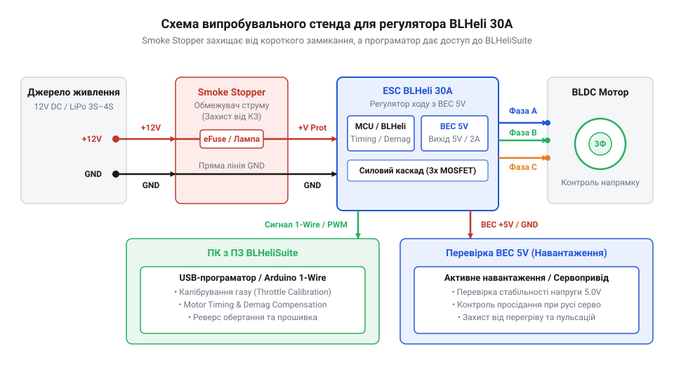

# Практична збірка, налаштування та діагностика регулятора BLHeli 30A на стенді

## Небезпека першого включення регулятора ходу

Пряме підключення свіжозібраного або відремонтованого силового регулятора ходу @@en|ESC@@ (від англ. *electronic speed controller* — електронний контролер швидкості) напряму до силового акумулятора — це найкоротший шлях до миттєвого знищення плати. Силові акумулятори типу @@en|LiPo@@ мають вкрай малий внутрішній опір і здатні віддавати в короткому замиканні струми у сотні ампер. Якщо на силових шинах живлення або між вихідними фазами регулятора є непомітна крапля припою, струмопровідне сміття чи міжвиткове замикання у статорі безколекторного мотора, подача прямої напруги викликає катастрофічний тепловий пробій.

У трифазному силовому мості регулятора ключову роль виконують потужні польові транзистори @@en|MOSFET@@ (від англ. *metal-oxide-semiconductor field-effect transistor* — польовий транзистор зі структурою метал-оксид-напівпровідник), які згруповано у три вертикальні стійки з верхніх та нижніх ключів. Під час початкового подавання напруги виникає критична фаза: доки схема живлення не стабілізується і спеціалізована система @@en|UVLO@@ (від англ. *under-voltage lockout* — блокування за недостатньої напруги) у драйверах затворів не увімкне активний захист, затвори транзисторів перебувають у плаваючому, невизначеному стані. Швидкий наріст напруги живлення через паразитну ємність між затвором і стоком може самовільно підняти потенціал на затворах обох ключів однієї стійки. Якщо в цей момент драйвери затворів не утримують ключі закритими або не витримують паузовий інтервал (від англ. @@en|dead-time@@ — мертвий час) між перемиканнями, верхній і нижній транзистори відкриваються одночасно. Це створює пряме коротке замикання між силовою шиною живлення та землею — виникає наскрізний струм (від англ. @@en|shoot-through@@ — пробивання наскрізь). При такому замиканні або зовнішньому КЗ через кристали перехідних транзисторів проходить струм, що в десятки разів перевищує граничний допустимий максимум. Напівпровідниковий кристал розігрівається за мікросекунди, що призводить до сплавлення силіцієвої структури, вибуху корпусу ключів та вигоряння мідних доріжок друкованої плати. Більше того, комутаційний імпульс перенапруги знищує драйвери затворів та вбудовану схему живлення @@en|BEC@@ (від англ. *battery eliminator circuit* — схема вилучення окремого акумулятора), яка живить мікроконтролер.

Щоб запобігти вигорянню коштовної електронної начинки при первинному подаванні живлення, перше включення та налагодження плати виконують виключно через спеціалізований випробувальний стенд з обмежувачем струму.

## Збірка випробувального стенда з обмежувачем

Головним елементом безпечного випробувального стенда є пристрій обмеження струму @@en|Smoke Stopper@@ (від англ. *smoke stopper* — зупинювач диму). Це електронний запобіжник (@@en|e-fuse@@) або самовідновлювана силова схема на основі PTC-резисторів чи вимірювального шунта. Основна функція обмежувача — пропускати робочий струм холостого ходу регулятора та мікроконтролера (до 1–2 А), але миттєво відсікати живлення або обмежувати струм при перевищенні цього порогу.

*Схема з'єднання елементів безпечного випробувального стенда для первинного тестування регулятора BLHeli 30A.*

Стенд збирається у чіткій послідовності комутації:
1. Лабораторне джерело живлення або акумулятор із напругою 12 В підключається до вхідних клем пристрою @@en|Smoke Stopper@@, після чого виставляють поріг обмеження струму (від 0.5 А до 2 А) за допомогою перемикачів або джамперів на платі обмежувача. Для регулятора @@en|BLHeli@@ 30A обирають поріг у діапазоні 1–2 А. Нижчий поріг 0.5 А використовують лише для малопотужних ESC або первинної перевірки логіки без мотора, оскільки під час підключення 30A регулятора виникає стартовий кидок струму заряджання вхідних конденсаторів та ініціалізації мотора, що спричиняє хибне спрацьовування захисту. Встановлення порогу понад 2 А небезпечне: у разі короткого замикання в силових ключах @@en|MOSFET@@ такий струм встигає локально перегріти та зруйнувати тонкі мідні доріжки плати регулятора до моменту спрацьовування електронного запобіжника.
2. Вихід обмежувача струму з'єднується з силовими проводами (V+ та GND) регулятора @@en|BLHeli@@ 30A.
3. Три вихідні силові фази регулятора (U, V, W) підключаються до безколекторного мотора.
4. Сигнальний провід @@en|PWM@@ та загальний провід GND регулятора підключаються до програматора на базі @@en|Arduino@@ або спеціалізованого USB-перехідника.
5. Програматор підключається до комп'ютера для зв'язку зі службовим ПЗ.

При першому подаванні живлення світлодіодний індикатор на @@en|Smoke Stopper@@ має сигналізувати про норму, а регулятор @@en|BLHeli@@ — відтворити звуковий сигнал ініціалізації. Якщо індикатор показує перевантаження, струм блокується, зберігаючи силові ключі @@en|MOSFET@@ від згоряння.

## Програмне підключення та калібрування газу

Після безпечної подачі живлення регулятор підключається до ПК через програму @@en|BLHeliSuite@@. Зв'язок відбувається за протоколом @@en|1-Wire@@ через завантажувач (@@en|bootloader@@), який прошитий у мікроконтролер регулятора. У середовищі @@en|BLHeliSuite@@ зчитуються поточні параметри прошивки, проводиться налаштування конфігурації та програмне реверсування напрямку обертання ротора (`Motor Direction`).

Критично важливим кроком є калібрування діапазону сигналів керування (@@en|Throttle Calibration@@). Стандартний керувальний ШІМ-імпульс змінюється від 1000 мкс (0% газу, стоп) до 2000 мкс (100% газу). Якщо межі регулятора не узгоджені з джерелом сигналу, мотор не зможе розігнатися до максимальних обертів або взагалі не увійде у стан армування.

:::tabs
@tab C
:::code proj-blheli-esc-bench-setup-and-tuning/c/esc_control.h 7-12
:::code proj-blheli-esc-bench-setup-and-tuning/c/esc_control.c 61-82
@tab C++
:::code proj-blheli-esc-bench-setup-and-tuning/cpp/blheli_esc.hpp 15-18
:::code proj-blheli-esc-bench-setup-and-tuning/cpp/blheli_esc.cpp 22-38
:::

У коді програмне калібрування реалізує подачу максимального сигналу 2000 мкс під час подачі живлення, чекає звукових сигналів підтвердження регулятора, після чого знижує сигнал до мінімального порогу 1000 мкс. Для радикальної зміни алгоритмів прошивки знадобиться [модифікація вихідного коду](root:cat-hw-drivers/blheli-firmware-source-code-modification) з наступною перекомпіляцією.

## Налаштування таймінгу та компенсації демагнетизації

У бездатчикових безколекторних системах регулятор визначає положення ротора шляхом вимірювання зворотної ЕРС (@@en|Back-EMF@@, від англ. *back electromotive force*) на неактивній фазі в момент переходу напруги через нуль (@@en|Zero-Crossing@@). Під час різкого набору обертів або при великому навантаженні струм у обмотках статора не встигає миттєво зникнути через індуктивність фаз. Це явище викликає сплески напруги розмагнічування, які викривляють сигнал зворотної ЕРС, спричиняючи пропуск кроків або повний зрив синхронізації (десинхронізацію).

Для усунення зривів синхронізації у прошивці @@en|BLHeli@@ налаштовують два ключові параметри:
- **Motor Timing**: кутове випередження комутації фаз відносно положення ротора. Низький таймінг (Low, 0°) дає максимальний ККД на низькооборотних моторах. Високий таймінг (High, 30°) збільшує максимальну потужність та стійкість до десинхронізацій на високооборотних моторах з великою кількістю полюсів.
- **Demag Compensation**: параметр компенсації демагнетизації (від англ. *demagnetization*). Він задає часове засліплення алгоритму виявлення zero-crossing після перемикання фаз. Режим `High` блокує помилкові спрацьовування від індуктивних сплесків, запобігаючи зупинці мотора при різкому скиданні та наборі газу.

## Навантажувальне тестування BEC та діагностика

Вбудований імпульсний або лінійний регулятор живлення @@en|BEC@@ формує стабільні 5 В для живлення приймача та сервоприводів. При активній роботі потужних сервоприводів вихідна напруга @@en|BEC@@ може просідати. Якщо напруга падає нижче 4.50 В, виникає загроза перезавантаження польотного контролера. Регулятор тестують шляхом вимірювання напруги мультиметром або АЦП під максимальним сервонавантаженням.

:::tabs
@tab C
:::code proj-blheli-esc-bench-setup-and-tuning/c/esc_control.h 23-35
:::code proj-blheli-esc-bench-setup-and-tuning/c/esc_control.c 94-124
:::code proj-blheli-esc-bench-setup-and-tuning/c/main.c 33-63
@tab C++
:::code proj-blheli-esc-bench-setup-and-tuning/c/cpp/esc_control.hpp 38-42
:::code proj-blheli-esc-bench-setup-and-tuning/c/cpp/esc_control.cpp 70-88
:::code proj-blheli-esc-bench-setup-and-tuning/c/cpp/main.cpp 30-55
:::code proj-blheli-esc-bench-setup-and-tuning/cpp/blheli_esc.cpp 60-80
:::code proj-blheli-esc-bench-setup-and-tuning/cpp/main.cpp 37-52
:::

При виявленні просідання напруги нижче критичних 4.50 В керувальний драйвер скидає газ у безпечні 1000 мкс та блокує роботу двигуна для збереження керованості. Якщо ж регулятор не реагує на сигнальний провід або не подає ознак життя, проводять перевірку силових транзисторів @@en|MOSFET@@ мультиметром у режимі прозвонки діодів між силовими шинами V+/GND та фазними виходами U, V, W. Якщо ключі пробиті, виконується [компонентний ремонт плати](root:cat-hw-drivers/esc-pcb-component-repair-mosfet-replacement) з заміною транзисторів. При розробці власних силових схем дивіться розрахунок ключів у матеріалі про [проєктування трифазних інверторів](root:cat-hw-drivers/bldc-three-phase-power-inverter-design).
