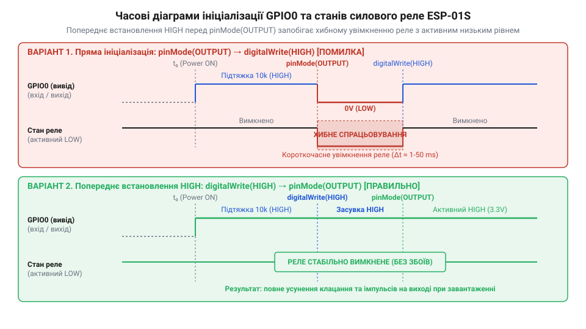

# Програмний інтерфейс керування реле через GPIO0 ESP8266

<preknowlist>
- [5V реле-модуль (Songle SRD-05VDC)](root:cat-hw-drivers/relay-5v) — схемотехніку оптичного/транзисторного розв'язування та принципи керування активним низьким рівнем
</preknowlist>

## Небажане клацання реле під час увімкнення

Подача живлення на керувальний модуль часто супроводжується короткочасним спонтанним клацанням силових контактів. Коли [5V реле-модуль](root:cat-hw-drivers/relay-5v) підключають до лінії @@en|GPIO0@@ мікроконтролера @@en|ESP8266@@, це клацання не лише створює хибне імпульсне ввімкнення навантаження, а й може повністю заблокувати запуск пристрою. Замість виконання основної програми мікроконтролер зависає в технічному режимі.

Причина цього явища полягає у фізичній поведінці виводу під час апаратного скидання. У перші мілісекунди після подачі напруги лінія @@en|GPIO0@@ перебуває у стані високого опору. Якщо зовнішня схема реле починає протікати струмом на землю через вхідний транзистор чи @@en|оптопару@@ (від @@en|opto-@@ — оптичний та @@en|coupler@@ — з'єднувач), на лінії утворюється низький рівень. Силове реле миттєво замкне контакти, а внутрішній завантажувач @@en|ESP8266@@ сприйме цей рівень як команду для переходу в режим оновлення прошивки. Щоб запобігти цьому, програмна ініціалізація виводу має бути чітко узгоджена з апаратними вимогами пуску чипа.

## Логіка страпування GPIO0 та інверсне керування

Для вибору джерела запуску прошивки @@en|ESP8266@@ використовує @@en|страпувальні виводи@@ (від @@en|strap@@ — затискач для фіксації стану). Спеціальний внутрішній модуль @@en|BootROM@@ зчитує рівні на цих лініях у момент відпускання сигналу скидання й порівнює напругу з пороговими значеннями логічних рівнів. Щоб контролер розпочав виконання програми з внутрішньої пам'яті (режим @@en|Flash boot@@), на виводах @@en|GPIO0@@ та @@en|GPIO2@@ обов'язково повинен утримуватися високий логічний рівень із напругою не нижче `0.75 × VDD` (близько `2.47 В` при живленні `3.3 В`), а на виводі @@en|GPIO15@@ — низький рівень з напругою не вище `0.25 × VDD` (близько `0.83 В`). Якщо напруга на @@en|GPIO0@@ через зовнішнє коло просідає нижче цього порогу, мікроконтролер зависає або збивається в режим прошивання. Саме ці вимоги визначають [режими завантаження ESP8266](root:cat-hw-boards/esp8266-boot-modes) під час подачі напруги.

Для забезпечення безпеки схемотехніка релейних плат застосовує інверсну логіку керування (@@en|active-low@@). Високий рівень на лінії @@en|GPIO0@@ тримає керувальний транзистор закритим, завдяки чому котушка реле лишається знеструмленою під час старт-апу. Комутація навантаження відбувається лише тоді, коли мікроконтролер свідомо переводить вивід у низький стан.

_*Порівняння часових діаграм GPIO0 та реле під час старту показує усунення хибного спрацьовування при попередньому записі HIGH.*_

## Програмна ініціалізація та безпечне керування станом

Пряме перемикання лінії у режим виходу через функцію `pinMode(0, OUTPUT)` створює короткочасний низький сплеск, оскільки за замовчуванням регістр даних може містити нуль. Щоб зберегти вимкнений стан силового ключа під час ініціалізації, необхідно спочатку записати високий рівень у регістр виходу, а вже потім активувати режим @@en|OUTPUT@@. Аналогічний підхід застосовують і під час виходу з режиму @@en|Deep Sleep@@ (англ. deep — глибокий, sleep — сон), коли мікроконтролер повністю перезапускає периферію та скидає стан регістрів. Для збереження необхідного стану реле після пробудження значення відновлюють із пам'яті @@en|RTC@@ (англ. real-time clock — годинник реального часу) та записують у регістр виходу ще до ввімкнення режиму виводу. У багатозадачних операційних системах на кшталт @@en|FreeRTOS@@ таку первинну конфігурацію виконують на самому початку стартового потоку до запуску основних задач, що запобігає гонитві умов та захищає силовий ключ від випадкового спрацьовування.

Комутація виконавчого пристрою здійснюється подачею логічного нуля, тоді як для розмикання контактів повертають логічну одиницю. На відміну від схем, де застосовують [спеціалізовані реле безпеки](root:cat-hw-drivers/safety-relay) з додатковим апаратним блокуванням, для @@en|ESP8266@@ правильний порядок викликів є єдиним захистом від хибних спрацьовувань.

:::tabs
:::code api-esp01s-relay-gpio0-control/c/esp-idf/relay-init.c
:::code api-esp01s-relay-gpio0-control/cpp/arduino/setup.cpp
:::

## Діагностика збоїв та усунення апаратних конфліктів

Якщо після подачі живлення мікроконтролер зависає та не виконує програму, причиною є апаратний конфлікт на лінії @@en|GPIO0@@. Якщо вхідний опір релейного модуля занадто малий, він шунтує вивід на землю. Під час старту напруга на лінії падає нижче порогу логічної одиниці, переводячи чип у режим прошивки через @@en|UART@@.

Для діагностики підключають підтягувальний @@la|резистор@@ (від @@la|resisto@@ — чинити опір) номіналом 4.7–10 кОм між @@en|GPIO0@@ та лінією 3.3 В або використовують каскад на @@en|MOSFET-транзисторі@@. У консолі @@en|UART@@ на швидкості 74880 @@fr|бод@@ (від прізвища @@fr|Baudot@@) нормальний старт підтверджується повідомленням `boot mode:(3,x)`, тоді як статус `boot mode:(1,x)` вказує на хибне завантаження через низький рівень на @@en|GPIO0@@.
