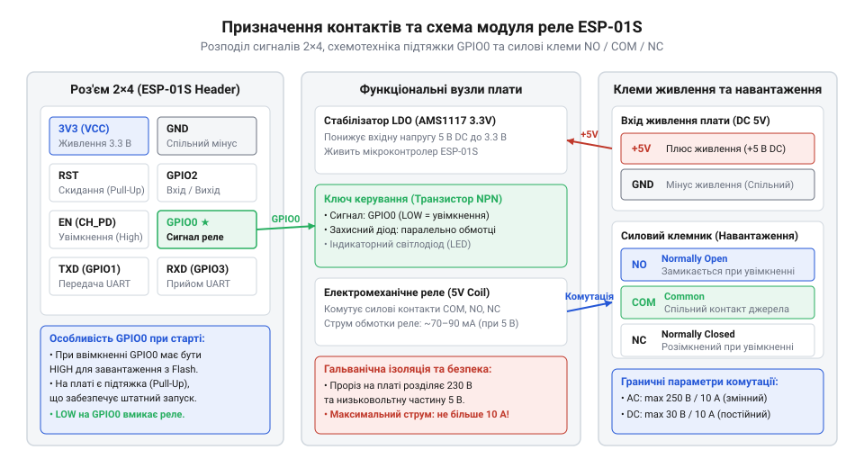
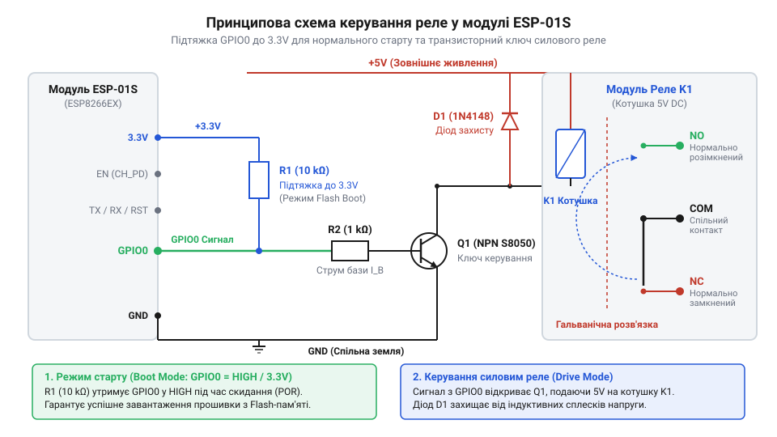

# Залізний інтерфейс та розводка плати реле ESP-01S

<preknowlist>
- [5V реле-модуль (Songle SRD-05VDC)](root:cat-hw-drivers/relay-5v) — принцип роботи котушки 5В, конструкція контактної групи NO/COM/NC та дугогасіння при комутації навантаження
</preknowlist>

## Конфлікт завантаження та силового керування

Безпосереднє підключення реле до виводів мікроконтролера часто спричиняє збої ще до початку виконання програмного коду. Під час подачі живлення на мікрочип @@en|ESP8266@@ (англ. *ESP8266* — назва чипа) у складі модуля @@en|ESP-01S@@ (англ. *ESP-01S* — позначення мікроконтролерного модуля) внутрішній завантажувач зчитує фізичні логічні рівні на виводах конфігурації. Ключовим для вибору режиму старту є вивід @@en|GPIO0@@ (англ. *General Purpose Input/Output* — вхід/вихід загального призначення). Якщо в момент увімкнення вивід @@en|GPIO0@@ виявляється підтягнутим до землі через низький опір котушки реле або базу транзистора, мікроконтролер переходить у режим @@en|UART Download Boot@@ (англ. *Universal Asynchronous Receiver-Transmitter* — режим завантаження прошивки через послідовний порт). У цьому стані виконання робочої програми зупиняється, а пристрій неочікувано чекає на передачу нової прошивки.

Для нормального запуску розробленої програми мікроконтролер мусить увійти в режим @@en|Flash Boot@@ (англ. *Flash Boot* — завантаження з зовнішньої флеш-пам'яті), який вимагає наявності високого логічного рівня (напруги 3.3 В) на виводі @@en|GPIO0@@ під час подачі живлення. Одночасно у високий стан має бути виведений @@en|GPIO2@@ (англ. *General Purpose Input/Output 2* — другий вхід/вихід загального призначення). Лінії керування @@en|CH_PD@@ (англ. *Chip Power Down* — вхід увімкнення чипа) та @@en|RST@@ (англ. *Reset* — вхід скидання мікроконтролера) також вимагають високого потенціалу 3.3 В для активності кристала. Спеціалізована плата розширення підтягує виводи @@en|CH_PD@@, @@en|RST@@ та @@en|GPIO2@@ до лінії 3.3 В за допомогою резисторів, гарантуючи стійке утримання потрібних рівнів під час увімкнення. Спроба ж підключити реле напряму створює подвійну проблему: навіть якщо вивід @@en|GPIO0@@ підтягнуто до лінії 3.3 В, поява логічної одиниці під час старту спричиняє самовільне коротке спрацьовування контактної групи ще до ініціалізації периферії. Розуміння того, як [конфігурація GPIO визначає завантаження](root:hw-arch/strapping-piny-i-rezhymy-zavantazhennia), робить очевидною потребу в спеціалізованій платі узгодження. Проміжна плата розширення відокремлює кола завантажувача від силового ключа, забезпечуючи коректний старт та надійну комутацію.

Окрім вибору режиму старту, пряме підключення впирається у фізичну несумісність електричних параметрів. Виводи @@en|GPIO@@ модуля @@en|ESP-01S@@ розраховані на роботу з напругою 3.3 В та видають граничний струм близько 12 мА, тоді як обмотка індуктивного елемента, як-от стандартний [5V реле-модуль](root:cat-hw-drivers/relay-5v), вимагає для спрацьовування напруги 5 В і споживає від 70 до 90 мА. Спроба живити котушку безпосередньо з виводу мікроконтролера призводить до просідання напруги, перегріву вихідних каскадів чи миттєвого перезавантаження чипа. Крім того, під час вимкнення індуктивного навантаження виникають сплески зворотної електрорушійної сили, здатні пробити чутливі напівпровідникові структури. Спеціалізована плата розширення виконує роль електричного буфера: вона узгоджує керуючі рівні, захищає цифрові кола від імпульсних завад і забезпечує необхідний струм для надійної комутації.

## Призначення клем і роз'єму 2x4

Плата розширення поєднує посадкове місце для мікроконтролера, схему узгодження рівнів та силові комутаційні термінали. Для встановлення модуля @@en|ESP-01S@@ на платі розміщено дворядне посадкове гніздо роз'єму 2x4 (8 контактів). Електрично задіяно лише п'ять виводів роз'єму: лінія живлення 3.3 В (VCC), заземлення @@en|GND@@ (англ. *Ground* — спільний провідник землі), сигнал скидання (RST), лінія дозволу роботи чипа (CH_PD) та керувальний вивід @@en|GPIO0@@. Вхідне живлення згладжується та знижується лінійним стабілізатором напруги @@en|LDO@@ (англ. *Low Dropout* — стабілізатор з малим падінням напруги), який живить мікроконтролер потрібними 3.3 В. Решта три контакти роз'єму — лінія передавання даних @@en|TX@@ (англ. *Transmit* — передавання), лінія приймання даних @@en|RX@@ (англ. *Receive* — приймання) та додатковий вивід @@en|GPIO2@@ — на друкованій платі не задіяні й залишені непідключеними (без розведених доріжок), оскільки схема розрахована виключно на автономне керування ключем через @@en|GPIO0@@ і не передбачає послідовного програмування чи підключення додаткової периферії безпосередньо у посадковому гнізді.

Підключення зовнішнього джерела живлення здійснюється через двоконтактну гвинтову клему з позначеннями `5V` та `GND`. Джерело 5 В подає напругу одночасно на котушку електромеханічного реле та на вхід стабілізатора @@en|LDO@@. Для підключення керованого навантаження передбачено триконтактний силовий термінал із маркуванням @@en|NO@@ (англ. *Normally Open* — нормально розімкнений контакт), @@en|COM@@ (англ. *Common* — спільний контакт) та @@en|NC@@ (англ. *Normally Closed* — нормально замкнений контакт). У знеструмленому стані реле спільний контакт @@en|COM@@ замкнений із @@en|NC@@, а клемник @@en|NO@@ залишається від'єднаним. При подачі керованого сигналу котушка притягує якір, перемикаючи лінію @@en|COM@@ на контакт @@en|NO@@. Така силова група комутує навантаження за принципами, що описують [базового 5V реле-модуля](root:cat-hw-drivers/relay-5v).


*Призначення контактів посадкового гнізда 2x4, клем живлення та силових терміналів плати реле ESP-01S.*

## Схемотехніка ключа та вплив GPIO0

Безпечний запуск мікроконтролера та керування котушкою реалізовано за допомогою схеми підтяжки та транзисторного ключа. Вивід @@en|GPIO0@@ з'єднаний із лінією 3.3 В через підтягувальний резистор `R1` номіналом 10 кОм. Під час подачі живлення резистор `R1` фіксує високий логічний рівень на @@en|GPIO0@@, що гарантує стабільний вхід модуля @@en|ESP-01S@@ у режим @@en|Flash Boot@@ без перешкод для завантажувача.

Керування струмом котушки виконує біполярний транзистор @@en|NPN@@ (англ. *NPN* — тип біполярної структури) або @@en|PNP@@ залежно від ревізії модуля. У популярних платах з активним низьким рівнем база транзистора підключена до лінії @@en|GPIO0@@. Коли мікроконтролер встановлює на @@en|GPIO0@@ логічний нуль (0 В), транзистор відкривається та підключає котушку реле до лінії 5 В. Для захисту ключа від індуктивного сплеску напруги проти-ЕРС, який виникає при розмиканні котушки, паралельно їй увімкнено зворотний шунтувальний діод @@en|flyback@@ (англ. *flyback* — зворотний захисний діод).

Різні ревізії плат відрізняються способом обробки сигналу: варіанти v1.0 можуть містити допоміжний мікроконтролер @@en|STC15F104W@@ (англ. *STC15F104W* — маркування мікроконтролера керування), який приймає текстові команди через @@en|UART@@ (англ. *Universal Asynchronous Receiver-Transmitter* — послідовний інтерфейс), тоді як ревізії v4.0 керують транзистором безпосередньо через рівень на виводі @@en|GPIO0@@.


*Принципова електрична схема підтяжки виводу GPIO0, транзисторного ключа та шунтувального діода котушки реле.*

## Гальванічна ізоляція та робочі параметри

Електлектромеханічне реле забезпечує фізичну повітряну ізоляцію між низьковольтною платою керування (3.3 В / 5 В) та силовим колом. Граничні параметри комутації контактної групи зазвичай становлять до 250 В змінного струму @@en|AC@@ (англ. *Alternating Current* — змінний струм) або до 30 В постійного струму @@en|DC@@ (англ. *Direct Current* — постійний струм) при максимальному струмі до 10 А. Однак при роботі з індуктивним або ємнісним навантаженням (двигунами, трансформаторами чи блоками живлення) пускові струми перевищують номінальні у кілька разів, викликаючи дуговий розряд та обгорання контактів.

Для запобігання поверхневому електричному пробою під корпусом реле на друкованій платі зроблено ізоляційний проріз — наскрізну щілину у текстоліті. Цей проріз збільшує довжину шляху витоку струму між високовольтною групою клем @@en|NO@@/@@en|COM@@/@@en|NC@@ та низьковольтною зоною заземлення @@en|GND@@. За наявності підвищених вимог до відмовостійкості замість побутових модулів рекомендується встановлювати [спеціалізовані реле безпеки](root:cat-hw-drivers/safety-relay) з примусовим розмиканням контактів.

## Усунення нештатних режимів і збоїв

Під час експлуатації модуля можуть виникати нештатні режими, такі як зависання мікроконтролера або хаотичне клацання реле. Якщо модуль @@en|ESP-01S@@ не запускає програму, першим кроком є вимірювання напруги мультиметром між виводами @@en|GPIO0@@ та @@en|GND@@ на роз'ємі 2x4 під час увімкнення. Якщо напруга становить менше 2.5 В, підтягувальний резистор `R1` пошкоджений або має завищений опір, що блокує перехід у режим @@en|Flash Boot@@.

Повторюване хаотичне клацання реле свідчить про циклічне перезавантаження мікроконтролера через просідання живлення. У момент увімкнення котушка споживає струм близько 70 мА. Якщо джерело живлення 5 В не забезпечує необхідного струму, напруга на вході стабілізатора @@en|LDO@@ падає, що викликає перезапуск модуля @@en|ESP-01S@@, вимикання реле, відновлення живлення і повторення циклу. Проблема вирішується встановленням електролітичного конденсатора ємністю 100...470 мкФ паралельно клемам `5V` та `GND`. У програмному коді стан виводу @@en|GPIO0@@ слід задавати у перших рядках ініціалізації:

```cpp|arduino
void setup() {
    digitalWrite(0, HIGH); 
    pinMode(0, OUTPUT);
}
```

Така послідовність дій запобігає короткочасному увімкненню силового ключа під час подачі живлення.
