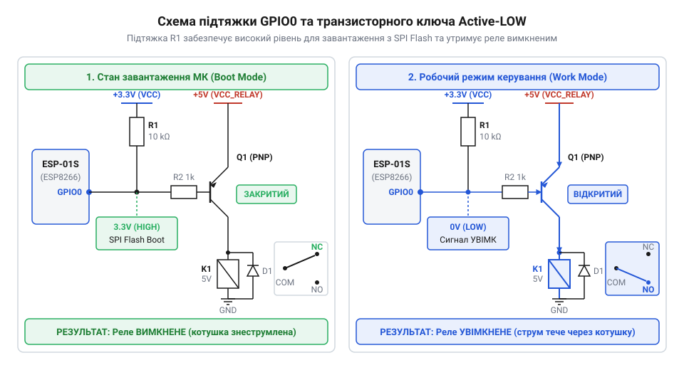
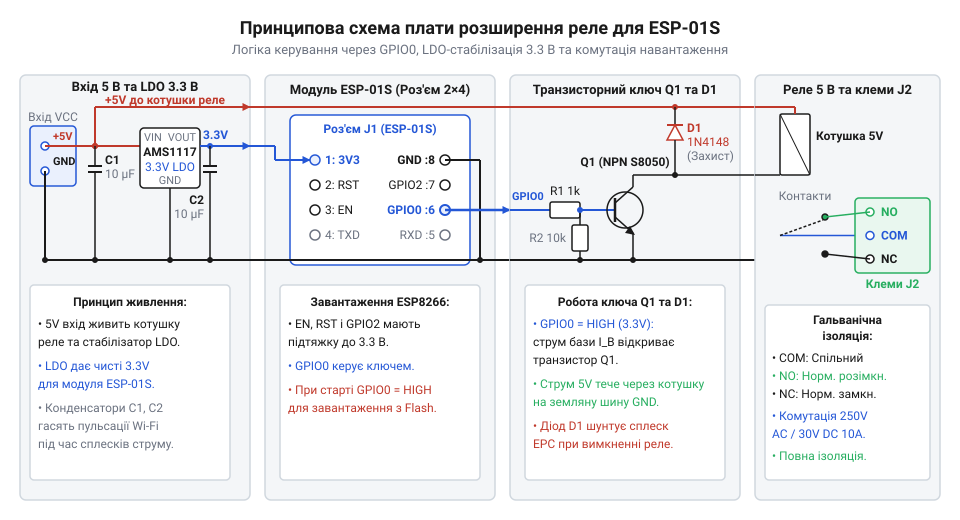
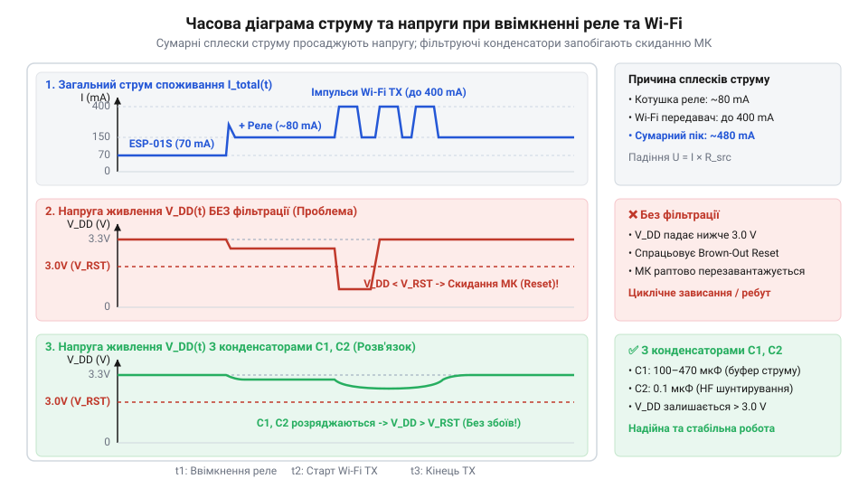
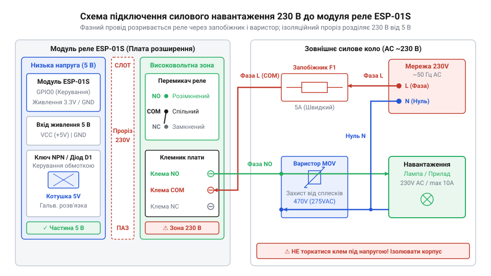
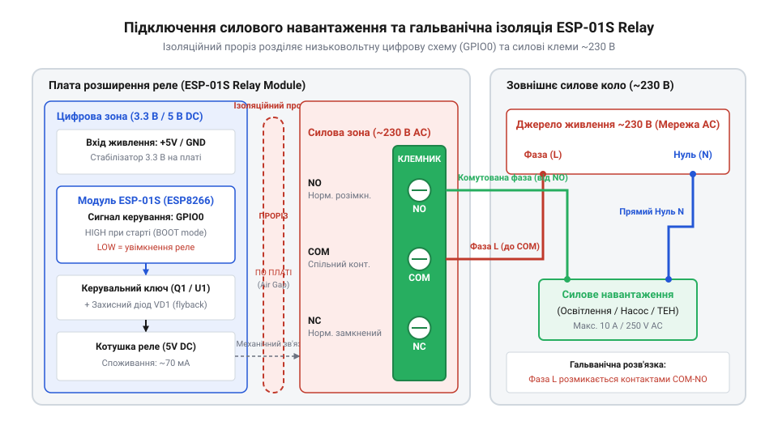

# Модуль реле для ESP-01S

<preknowlist>
- [5V реле-модуль (Songle SRD-05VDC)](root:cat-hw-drivers/relay-5v) — Будова та принцип роботи електромеханічного реле SRD-05VDC, призначення контактної групи SPDT (NO, NC, COM), параметри споживання котушки 5 В та індуктивний характер її навантаження
</preknowlist>

## Проблема безпосереднього керування реле від ESP8266

Коли виникає потреба комутувати побутовий електроприлад за допомогою бездротового мікроконтролера @@en|ESP8266@@, найпростішою думкою здається з'єднати вихід @@en|GPIO@@ (з англ. @@en|General Purpose Input/Output@@, від @@en|general@@ — загальний, @@en|purpose@@ — призначення, @@en|input@@ — вхід, @@en|output@@ — вихід) напряму з котушкою силового перемикача. Проте спроба підключити [стандартний 5V реле-модуль](root:cat-hw-drivers/relay-5v) безпосередньо до виводу цифрового порту одразу призводить до апаратного збою чи фізичного руйнування мікросхеми. Причина полягає у критичній невідповідності електричних параметрів двох пристроїв: обмотка електромеханічного @@en|реле@@ (з фр. @@fr|relais@@ — перепряжка, заміна) вимагає для спрацьовування струм близько `70 мА` при напрузі `5 В`, тоді як вихідний каскад цифрового порту мікроконтролера розрахований на максимальний довготривалий струм лише `12 мА` при напрузі `3.3 В`.

Низьковольтний цифровий вихід не спроможний пропустити струм спрацьовування котушки без падіння напруги. Якщо вихідний струм порту позначити як `I_gpio`, а струм споживання обмотки як `I_relay`, то величина перевантаження виводу `ΔI` обчислюється наступним чином:

```
ΔI = I_relay - I_gpio
   = 70 - 12         [підстановка струму котушки та граничного струму порту в міліамперах]
   = 58 мА           [струмове перевантаження цифрового виводу]
```

Значне перевищення допустимого навантаження спричиняє миттєве просідання напруги на внутрішніх шинах мікроконтролера, ініціює циклічні перезавантаження за низькою напругою або призводить до теплового пробою вихідного транзистора в порту.

Другою фізичною перепоною є індуктивний характер навантаження котушки. Під час проходження струму обмотка накопичує енергію в своєму магнітному полі. У момент розмикання кола струм крізь обмотку різко припиняється, що через явище @@en|самоіндукції@@ (з англ. @@en|self-induction@@, від @@en|self@@ — сам, @@en|induction@@ — наведення) викликає виникнення @@en|зворотної ЕРС@@ (з англ. @@en|back EMF@@, від @@en|back@@ — зворотний, @@en|electromotive force@@ — електрорушійна сила). Оскільки накопичена енергія магнітного поля не може розсіятися миттєво, індуктивність прагне втримати струм і ґенерує електрорушійну силу `e`, яка пропорційна індуктивності обмотки `L` та швидкості падіння струму `di / dt` за принципом `e = -L · (di / dt)`. Стрімке припинення струму за частки мікросекунди створює колосальну величину похідної `di / dt`, тому сплеск напруги зворотної полярності може сягати сотень вольтів, що миттєво випалює напівпровідникову структуру цифрового порту. Крім того, на компактному модулі серії [огляд сімейства модулів](root:cat-hw-boards/esp-01-module-family-overview) взагалі відсутній вихід напруги `5 В`, а спроба заживлювати п'ятивольтову котушку від лінії `3.3 В` не створює достатнього магнітного потоку для втягування якоря.

Третім критичним фактором є специфіка початкового конфігурування завантаження @@en|bootstrapping@@ (з англ. @@en|bootstrap@@ — зашморга чобота). Під час подачі живлення внутрішній логічний автомат мікроконтролера зчитує стан декількох виводів, щоб обрати режим роботи. Якщо вивід `GPIO0` під час старту виявляється підтягнутим до землі, кристал переходить у режим оновлення прошивки замість виконання робочої програми. Пряме підключення обмотки реле чи низькоомного ключа на `GPIO0` створює постійну підтяжку до землі, блокуючи нормальний старт пристрою.


*Схема підтяжки виводу GPIO0 та транзисторного ключа Active-LOW з позначенням логічних рівнів під час старту МК та робочого стану.*

Щоб узгодити низьковольтний мікроконтролер із потужною котушкою, уникнути збоїв при завантаженні та захистити виходи від індуктивних викидів, необхідно використовувати спеціалізовану плату розширення. Вона об'єднує керувальний транзисторний ключ, захисний діод, силовий клемник та лінійний стабілізатор живлення. Як саме влаштована ця плата, розглядається у наступному розділі.

Таке поєднання елементів перетворює плату розширення на повноцінний узгоджувальний вузол, який відокремлює обчислювальне ядро @@en|ESP8266@@ від силового кола. Завдяки застосуванню апаратного ключа мікроконтролер працює у штатному режимі споживання, а рівень на виводі @@en|GPIO0@@ не спотворює режимів [початкового завантаження мікроконтролера](root:hw-arch/strapping-piny-i-rezhymy-zavantazhennia). Це забезпечує надійне утримання зв'язку без просідань напруги та захищає цифровий порт від руйнівного впливу обмотки @@en|реле@@.

## Архітектура та схемотехніка плати розширення ESP-01S

Плата розширення для @@en|ESP-01S@@ побудована за модульним принципом і вирішує одразу три завдання: узгодження струмів і напруг, забезпечення стабільного живлення мікроконтролера та безпечну комутацію силових кіл. Основними вузлами плати є дворядний роз'єм 2x4 для встановлення Wi-Fi модуля, лінійний @@en|LDO@@-стабілізатор (з англ. @@en|Low Dropout@@, від @@en|low@@ — низький, @@en|drop out@@ — падіння) напруги `3.3 В`, електромеханічне реле @@en|Songle SRD-05VDC@@, керувальний @@en|транзисторний ключ@@ з захисним діодом та гвинтовий силовий клемник. Детальні електричні зв'язки між цими блоками показано на принциповій схемі.


*Принципова електрична схема плати розширення реле для ESP-01S: роз'єм 2x4, LDO-стабілізатор 3.3 В, керувальний ключ та захисний діод.*

Роз'єм 2x4 приймає модуль @@en|ESP-01S@@ і перенаправляє керувальний сигнал із виводу `GPIO0` на базу біполярного або затвор польового транзистора. У дорожчих модифікаціях плати замість прямого транзистора застосовується [оптронна гальванічна розв'язка](root:hw-components/optocoupler), яка фізично відокремлює логічну частину від силового кола реле. Схема керування побудована за логікою @@en|Active-LOW@@: котушка реле вмикається тоді, коли на `GPIO0` виставляється низький логічний рівень (`0 В`). У разі використання @@en|PNP-транзистора@@ (з англ. @@en|Positive-Negative-Positive@@, від @@en|positive@@ — позитивний, @@en|negative@@ — негативний) подача `0 В` створює необхідний струм бази й вмикає ключ. Проте через різницю напруг між живленням котушки `5 В` та логічним рівнем `3.3 В` перехід база-емітер не закривається повністю, створюючи залишковий витік напруги `1.7 В`. Пряме ж застосування @@en|NPN-транзистора@@ (з англ. @@en|Negative-Positive-Negative@@, від @@en|negative@@ — негативний, @@en|positive@@ — позитивний) для логіки @@en|Active-LOW@@ вимагає додаткового інвертувального каскаду, що ускладнює принципову схему плати. Схема з @@en|оптроном@@ (з грец. @@el|optikos@@ — оптичний) позбавлена цих вад: анод вбудованого @@en|світлодіода@@ (з англ. @@en|Light-Emitting Diode@@, від @@en|light@@ — світло, @@en|emitting@@ — випромінювальний) підключено до шини `3.3 В`, а катод — до виводу `GPIO0`. Низький рівень `0 В` відкриває @@en|світлодіод@@ й вмикає силовий @@en|фототранзистор@@ (з грец. @@el|phos@@ — світло), а високий рівень `3.3 В` дає нульову різницю потенціалів і повністю блокує струм. Усі фізичні виводи та розводку контактів на платі описує [довідник апаратного роз'єму](root:cat-hw-drivers/esp-01s-relay/api-esp01s-relay-hardware-interface.md).

Вибір інверсної логіки @@en|Active-LOW@@ є фундаментальним схемотехнічним рішенням. Під час увімкнення живлення вивід `GPIO0` утримується у високому стані внутрішнім або зовнішнім резистором підтяжки, що гарантує нормальне завантаження мікроконтролера з Flash-пам'яті без хибного переходу в режим прошивки, про який згадує [початковий стан виводів](root:hw-arch/strapping-piny-i-rezhymy-zavantazhennia) системи. Одночасно високий рівень на `GPIO0` тримає керувальний ключ закритим, запобігаючи короткочасному клацанню реле при подачі живлення. Паралельно котушці реле обов'язково впаяно зворотний напівпровідниковий діод у зустрічно-паралельному ввімкненні, який гасить імпульси зворотної ЕРС при розмиканні ключа. Розрахунок номіналів елементів ключа містить [баланс струму та параметрів](root:cat-hw-drivers/esp-01s-relay/math-esp01s-relay-power-and-key-calculation.md) схеми.

Історія розвитку цих плат розширення демонструє важливий еволюційний крок у спрощенні схемотехніки. Перші версії модулів розроблялися під класичну плату @@en|ESP-01@@, яка не мала внутрішніх підтягувальних резисторів на службових лініях, через що пряме керування ключем через `GPIO0` призводило до постійних збоїв завантаження. Щоб обійти цю проблему, виробники встановлювали на плату розширення додатковий мікроконтролер @@en|STC15@@, який приймав командні текстові послідовності від @@en|ESP-01@@ через послідовний інтерфейс @@en|UART@@ (з англ. @@en|Universal Asynchronous Receiver-Transmitter@@, від @@en|universal@@ — універсальний, @@en|asynchronous@@ — асинхронний, @@en|receiver@@ — приймач, @@en|transmitter@@ — передавач) на швидкості 9600 бод і вже сам керував транзистором. З появою оновленої модифікації @@en|ESP-01S@@, у якій резистори підтяжки `12 кОм` впаяні безпосередньо на плату мікроконтролера, потреба в допоміжному чіпі зникла. Це дозволило перейти до сучасних плат із прямим транзисторним або оптронним керуванням через `GPIO0`, що спростило схему, знизило вартість та прибрало затримку передачі команд по шині @@en|UART@@.

Для впевненого програмного маніпулювання станом реле розробнику необхідно правильно конфігурувати режим роботи виводу `GPIO0` у прошивці, враховуючи інверсію сигналу. Практичні аспекти та фрагменти коду для керування реле містить [специфікація керування лінією](root:cat-hw-drivers/esp-01s-relay/api-esp01s-relay-gpio0-control.md). Завдяки такій схемотехніці плата розширення забезпечує надійну роботу реле та повну сумісність із режимами завантаження мікроконтролера.

## Подвійна роль GPIO0 та стабільне завантаження

Коли мікроконтролер @@en|ESP8266@@ подає сигнал на силове реле, вибір лінії керування виявляється далеко не довільним. У мініатюрному модулі @@en|ESP-01S@@ доступно лише два виводи загального призначення — @@en|GPIO0@@ та @@en|GPIO2@@. Однак саме @@en|GPIO0@@ обрано для комутації котушки. Тут розробник плати розширення стикається з апаратною пасткою: при увімкненні живлення внутрішній завантажувач мікроконтролера перевіряє фізичний стан кількох виводів, щоб визначити, яку саме програму запускати. Ця процедура опитування називається @@en|strapping@@ (англ. *strap* — ремінь, прив'язка).

Якщо в момент подачі живлення або апаратного скидання лінія @@en|GPIO0@@ опиняється підтягнутою до землі (низький логічний рівень `0 V`), @@en|ESP8266@@ вважає, що користувач прагне оновити прошивку, і переходить у режим завантаження через @@en|UART@@ (англ. *Universal Asynchronous Receiver-Transmitter* — універсальний асинхронний трансивер). У цьому стані мікроконтролер зупиняє виконання основної програми з внутрішньої пам'яті @@en|SPI Flash@@ (англ. *Serial Peripheral Interface*, *flash memory*) й нескінченно чекає на команду з комп'ютера. Для того щоб пристрій успішно стартував у звичайному робочому режимі, при ввімкненні на лінії @@en|GPIO0@@ обов'язково має утримуватися високий логічний рівень `3.3 V`. Детальніше про конфігурацію виводів мікроконтролера розповсюджують інформацію [службові виводи ESP8266](root:hw-arch/strapping-piny-i-rezhymy-zavantazhennia).

Пряме підключення ключа класичної схеми (де високий рівень умикає реле) спричинило б катастрофу: для стабільного старту мікроконтролера потрібно подати `3.3 V`, але саме ця напруга миттєво замкнула б реле при кожному ввімкненні приладу. Щоб розв'язати цю суперечність, схемотехніка плати розширення будується за принципом @@en|Active-LOW@@ (англ. *active low* — активний низький рівень).

На платі встановлюють підтягувальний резистор (@@en|pull-up resistor@@, від англ. *pull up* — підтягувати вгору) номіналом `10 кОм` між лінією @@en|GPIO0@@ та шиною `3.3 V`. Під час подачі живлення цей резистор фіксує високий рівень на виводі, гарантуючи, що завантажувач @@en|ESP8266@@ успішно прочитає програму з @@en|SPI Flash@@. Одночасно керувальний транзистор (або оптопара) підключений так, що він відкривається лише тоді, коли лінія @@en|GPIO0@@ примусово притягується до землі (`0 V`). Таким чином, у момент старту реле залишається повністю знеструмленим, а керування здійснюється інвертованою логікою: логічний `0` вмикає навантаження, а логічна `1` — вимикає. Розподіл сигналів на роз'ємі 2x4 описує [довідка з апаратного інтерфейсу](root:cat-hw-drivers/esp-01s-relay/api-esp01s-relay-hardware-interface.md).

У схемах із підвищеними вимогами до завадостійкості керувальний сигнал передається через [гальванічну розв'язку ключа](root:hw-components/optocoupler) на оптроні, що додатково захищає чутливий вивід мікроконтролера від імпульсних перешкод котушки.

Однак навіть при інверсній схемі існує ризик короткочасного клацання реле при підключенні живлення. Справа в тому, що під час початкового скидання та ініціалізації мікроконтролера вивід @@en|GPIO0@@ перебуває в апаратному стані високого імпедансу @@en|Hi-Z@@ (англ. *high impedance*, від лат. *impedire* — перешкоджати). У цьому фізичному стані обидва внутрішні вихідні транзистори каскаду повністю закриті та відключені від шин живлення й землі, тому вивід поводиться як розімкнене коло з високим опором, а його потенціал утримується виключно зовнішнім підтягувальним резистором. Проте під час переходу завантажувача між станами на виводі можуть виникати короткі імпульсні завади. Якщо у програмному коді спочатку змінити режим виводу на вихід (`OUTPUT`), апаратний драйвер активується і за замовчуванням виставляє стан власного внутрішнього регістра на логічний `0`. Це на декілька мікросекунд примусово притягує лінію до землі й відкриває керувальний ключ, що спричиняє хибне клацання реле до виконання команди з записом високого рівня.

Щоб уникнути цього брязкання, прошивка повинна спочатку встановити у регістр виходу високий логічний рівень, і лише після цього переводити напрямок виводу на вихід. Повні програмні інструкції містить [програмна взаємодія з GPIO0](root:cat-hw-drivers/esp-01s-relay/api-esp01s-relay-gpio0-control.md).

:::tabs
@tab Arduino C++
:::code esp-01s-relay-d/cpp/arduino/setup.cpp
@tab ESP-IDF C
:::code esp-01s-relay-d/c/esp-idf/app-main.c
:::

Такий підхід повністю усуває початковий хибний імпульс та гарантує стабільне завантаження системи. Розрахункові співвідношення для підбору бази транзистора дає [розрахунок керування котушкою](root:cat-hw-drivers/esp-01s-relay/math-esp01s-relay-power-and-key-calculation.md).

Водночас така жорстка прив'язка до схеми @@en|Active-LOW@@ накладає важливе схемотехнічне обмеження: вивід @@en|GPIO0@@ більше не можна використовувати для підключення зовнішніх фізичних кнопок чи локальних датчиків. Якщо користувач спробує паралельно приєднати до цієї лінії механічний вимикач для ручного розриву кола, випадкове натискання кнопки під час подачі живлення або короткочасного просідання напруги миттєво притягне вивід до землі. У результаті мікроконтролер @@en|ESP8266@@ замість виконання прошивки застрягне у режимі @@en|UART@@, а реле виявиться примусово ввімкненим. Через це будь-які зовнішні органи керування доводиться підключати через єдину вільну лінію @@en|GPIO2@@ або реалізовувати перемикання виключно через мережу, про що свідчить [огляд сімейства модулів](root:cat-hw-boards/esp-01-module-family-overview). Такий підхід залишає лінію @@en|GPIO0@@ виключно у розпорядженні ключа, забезпечуючи передбачувану роботу, яку демонструє [силовий реле-модуль](root:cat-hw-drivers/relay-5v) у складі автономних вузлів автоматизації.

## Бюджет струму живлення та усунення перезавантажень

Після налагодження керувальної логіки розробники часто стикаються з несподіваним явищем: пристрій успішно підключається до мережі Wi-Fi, але в момент подачі команди на ввімкнення реле мікроконтролер раптово перезавантажується. Причина полягає у фізичних характеристиках споживання електричного струму та падінні напруги на стабілізаторі плати.

Модуль розширення отримує зовнішнє живлення постійної напруги `5 V`. На самій платі встановлено лінійний стабілізатор з малим падінням напруги (@@en|LDO@@, від англ. *Low Drop-Out* — мала різниця напруг), зазвичай серії @@en|AMS1117-3.3@@, який знижує вхідну напругу `5 V` до робочого рівня `3.3 V` мікроконтролера @@en|ESP8266@@. Загальний струм, що споживається від зовнішнього джерела, складається з двох основних компонентів: струму утримання котушки реле та струму живлення мікросхеми Wi-Fi.

Котушка класичного [електромеханічного реле SRD-05VDC](root:cat-hw-drivers/relay-5v) при напрузі `5 V` споживає постійний струм від `70 мА` до `90 мА`. Водночас сам модуль @@en|ESP8266@@ у спокійному стані споживає близько `70 мА`, але під час активного випромінювання пакетів даних Wi-Fi передавач створює надзвичайно короткі, але потужні імпульси струму амплітудою від `300 мА` до `500 мА`.

Поточне пікове споживання струму усієї плати `I_total_peak` визначається як сума струму котушки `I_relay_coil`, пікового струму мікроконтролера `I_esp_peak` та необхідного технологічного резерву `I_margin`:

I_total_peak = I_relay_coil + I_esp_peak + I_margin
= 80 + 400 + 120              [додавання струму котушки, піку Wi-Fi та резерву 20%]
= 600 мА                      [мінімальний гарантований струм джерела 5 V]

Для стабільного функціонування джерело живлення повинно безпроблемно забезпечувати постійний струм не менше `600 мА`, а з урахуванням пускових перехідних процесів — рекомендується джерело на `5 V / 1 A`.

Якщо пристрій підключено до слабкого джерела (наприклад, USB-порту комп'ютера без зовнішнього живлення або дешевого адаптера), під час одночасного ввімкнення котушки та випромінювання Wi-Fi відбудеться різке просідання напруги на шині `5 V`. Для стабілізатора @@en|AMS1117-3.3@@ мінімальна допустима різниця між вхідною та вихідною напругою (@@en|dropout voltage@@, від англ. *drop out* — падіння напруги) становить близько `1.1 V`. Якщо вхідна напруга падає нижче `4.4 V`, напруга на виході стабілізатора неминуче знижується нижче критичної позначки `2.9 V`. Окрім виходу з режиму стабілізації через падіння вхідної напруги, лінійний стабілізатор перетворює усю надлишкову різницю напруг у тепло. Розсіювана теплова потужність стабілізатора `P_diss` визначається як добуток падіння напруги `ΔV = V_in - V_out` на струм навантаження `I_out`. При штатній вхідній напрузі `5 V` падіння становить `ΔV = 5 V - 3.3 V = 1.7 V`. Під час пікових сплесків споживання Wi-Fi передавача струмом `I_esp_peak = 500 мА` (`0.5 A`) миттєва теплова потужність розсіювання на мікросхемі становить:

P_diss_peak = ΔV × I_esp_peak
= (5 - 3.3) × 0.5               [падіння напруги 1.7 V на піковий струм 0.5 A]
= 0.85 Вт                       [пікова теплова потужність розсіювання LDO]

При середньому струмі споживання модуля близько `170 мА` стаціонарне тепловиділення становить `P_diss_avg = 1.7 V × 0.17 A = 0.289 Вт`. Оскільки корпус @@en|AMS1117-3.3@@ типу `SOT-223` на платі без великого мідного полігона має тепловий опір «кристал–довкілля» (@@en|junction-to-ambient@@, від англ. *junction* — перехід, *ambient* — довкілля) `R_th_JA ≈ 90 °C/W`, таке розсіювання викликає помірне нагрівання кристала на `ΔT = 0.289 × 90 ≈ 26 °C` відносно навколишнього середовища. Проте якщо помилково подати на вхід підвищену напругу `12 V`, падіння складе `ΔV = 8.7 V`, а пікова потужність зросте до `P_diss_peak = 8.7 V × 0.5 A = 4.35 Вт`, що спричинить миттєве розігрівання кристала (@@en|die@@, від англ. *die* — кристал мікросхеми) понад `150 °C` та спрацьовування теплового захисту (@@en|thermal shutdown@@, від англ. *thermal* — тепловий, *shutdown* — вимкнення).


*Часова діаграма струму споживання та напруги шин 5 V і 3.3 V під час одночасного спрацьовування котушки реле та випромінювання Wi-Fi передавача.*

У цей момент всередині @@en|ESP8266@@ спрацьовує детектор просідання живлення (@@en|Brown-Out Reset@@, скорочено @@en|BOR@@, від англ. *brownout* — зниження напруги, *reset* — скидання). Мікроконтролер скидається, лінія @@en|GPIO0@@ повертається у високий стан, ключ закривається, реле вимикається, і споживання струму падає. Напруга відновлюється, мікроконтролер знову завантажується, підключається до Wi-Fi, подає команду на реле — і цикл перезавантажень повторюється безкінечно.

Для усунення цієї проблеми застосовують комбінацію рішений:
1. Застосування якісного блока живлення `5 V` із робочим струмом `1 A`.
2. Встановлення згладжувального електролітичного конденсатора ємністю `470 мкФ` – `1000 мкФ` (на напругу `10 V`) паралельно шині живлення `5 V` безпосередньо біля роз'єму плати. Конденсатор виступає локальним буфером енергії, віддаючи накопичений заряд під час мікросекундних піків Wi-Fi.
3. Додавання керамічного конденсатора `0.1 мкФ` безпосередньо біля виводів живлення модуля [модулів ESP-01S](root:cat-hw-boards/esp-01-module-family-overview) для фільтрації високочастотних завад.

Крім того, при керуванні високовольтним мережевим навантаженням `230 V` критично важливо правильно підключати дроти до ґвинтових клем. Клемник містить три контакти: @@en|COM@@ (англ. *common* — спільний), @@en|NO@@ (англ. *normally open* — нормально розімкнутий) та @@en|NC@@ (англ. *normally closed* — нормально замкнутий).


*Електрична схема та розводка клем NO, COM, NC для безпечного підключення мережевої навантаги 230 V з елементами захисту та прорізом ізоляції.*

Для безпечного перемикання фазний дріт мережі розривають і підключають до клем @@en|COM@@ та @@en|NO@@. При комутації індуктивного навантаження (двигуни, трансформатори) розмикання контактів спричиняє потужну зворотну ЕРС, яка створює дуговий розряд на контактах реле. Для захисту контактів та запобігання електромагнітним завадам паралельно контактам клемника встановлюють демпферний ланцюг (@@en|snubber@@, від англ. *snub* — гасити, поглинати) з послідовно з'єднаних резистора й конденсатора чи варистор. Монтажні схеми та правила безпеки наведено в посібнику з підключення [електроприладу напруги 230 В](root:cat-hw-drivers/esp-01s-relay/proj-esp01s-safe-ac-switching-wiring.md).

Приклад повноцінного пристрою автоматизації на основі цього модуля розглядається в описі [бездротового вимикача на ESP-01S](root:cat-hw-drivers/esp-01s-relay/proj-esp01s-wifi-relay-controller.md).

## Безпечне підключення силового навантаження до клемника

Коли низьковольтна частина плати надійно заживлена, виникає потреба підключити зовнішній електроприлад, робоча напруга якого становить 230 В змінної напруги або 12–30 В постійної. Безпосереднє з'єднання цифрових кіл мікроконтролера з мережею живлення призведе до миттєвого пробою напівпровідників та ураження струмом. Посередником між цими двома світами виступає електромеханічне реле, силові контакти якого виведені на трипозиційний ґвинтовий клемник з маркуваннями @@en|NO@@, @@en|COM@@ та @@en|NC@@.

Для побудови безпечного кола комутації необхідно розрізняти призначення кожного з трьох терміналів. Контакт @@en|COM@@ (англ. @@en|Common@@ — спільний) є вхідною точкою, до якої підключають один з фазних чи силових дротів джерела живлення. Контакт @@en|NO@@ (англ. @@en|Normally Open@@ — нормально розімкнутий) у знеструмленому стані реле від'єднаний від @@en|COM@@. @@en|Normally Open@@ — нормально розімкнений) у знеструмленому стані реле від'єднаний від @@en|COM@@. При подачі керувального сигналу котушка притягує якір, замикаючи коло між @@en|COM@@ та @@en|NO@@, що вмикає підключене навантаження. Натомість контакт @@en|NC@@ (англ. @@en|Normally Closed@@ — нормально замкнутий) замкнений із @@en|COM@@ за замовчуванням і розмикається при активації котушки. @@en|Normally Closed@@ — нормально замкнений) замкнений із @@en|COM@@ за замовчуванням і розмикається при активації котушки. Задля поглиблення розуміння конструкції механічної групи варто опрацювати [опис електромеханічного реле](root:cat-hw-drivers/relay-5v), де детально показано рух контактного якоря.

Захист цифрової схеми ESP-01S від високої силової напруги базується на принципі гальванічна ізоляція (італ. Galvani, лат. insulatio — ізолювання). @@it|Galvani@@, лат. @@la|insulatio@@ — ізолювання) @@la|гальванічна ізоляція@@. Вона унеможливлює прямий протік електричного струму між високовольтним клемником і низьковольтною шиною 3.3 В. Проте на самостійній друкованій платі висока напруга може пробити фізичний проміжок по поверхні текстоліту через поверхневі струми витоку або дуговий розряд при підвищеній вологості. Щоб упередити цей ефект, під корпусом реле розробники виконують @@en|isolation slot@@ — спеціальний фрезерований ізоляційний проріз у текстоліті, який фізично розриває поверхню плати між високовольтними доріжками клемника та низьковольтним графітовим полігоном заземлення. Фізичні параметри розведення силових ліній описує [довідник апаратного інтерфейсу](root:cat-hw-drivers/esp-01s-relay/api-esp01s-relay-hardware-interface.md) даного модуля.


*Підключення мережевої фази через нормально розімкнений контакт NO та розташування фрезерованого ізоляційного прорізу під реле.*

Особливої уваги вимагає комутація індуктивних навантажень — електродвигунів, вентиляторів, трансформаторів чи електромагнітних клапанів. У момент розмикання контактів реле в індуктивності виникає високовольтний сплеск зворотної ЕРС, який формує електричну дугу між контактами @@en|COM@@ та @@en|NO@@. Ця дуга руйнує напилення контактів і створює потужні високочастотні електромагнітні завади, які наводяться на антену ESP-01S і спричиняють зависання мікроконтролера. Для гасіння розряду паралельно силовим контактам клемника або безпосередньо на клеми навантаження встановлюють снабер (англ. @@en|snubber@@ — гасник, від @@en|snub@@ — глушити) @@en|RC-снабер@@ (послідовний ланцюг із резистора та конденсатора) або варистор (англ. @@en|variable resistor@@ — змінний резистор) @@en|варистор@@ з напругою спрацьвування 275 В. На відміну від орієнтовних типових значень (100 Ом та 10 нФ 400 В), точний розрахунок номіналів елементів @@en|RC-снабера@@ спирається на індуктивність `L` та робочий струм `I` конкретного навантаження. У момент розмикання вся накопичена в індуктивності магнітна енергія має перейти в електричну енергію конденсатора без перевищення граничної напруги пробою контактів `U_max`. Необхідну ємність конденсатора `C` розраховують з енергетичного балансу:

```
C = (L × I²) ÷ U_max²      [рівність накопиченої магнітної та електричної енергії]
```

Для запобігання високочастотним коливанням напруги опір резистора `R` добирають таким, щоб забезпечити критичне згасання замикаючого контуру за значенням його хвильового опору:

```
R = √(L ÷ C)               [умова критичного згасання коливального контуру]
```

Резистор `R` виконує подвійну роль: він гасить резонансні коливання при розмиканні та обмежує піковий струм розряду конденсатора `C` через контакти в момент їхнього наступного замикання. Помилка у виборі номіналів руйнує захист: занадто мала ємність `C` не поглине енергію сплеску і спричинить дугу, а надмірна ємність пропускає відчутний змінний струм витоку у вимкненому стані; занадто малий опір `R` призведе до зварювання контактів при розряді `C`, а надто великий — зведе нанівець гасіння дуги. Для захисту від короткого замикання в силову лінію послідовно врізають плавкий запобіжник. Практичні схеми монтажу та правила безпеки при роботі з мережею 230 В викладено у посібнику з безпечного монтажу силових дротів. Загальні принципи ізоляції силових кіл розглядає [дослідження оптронної ізоляції](root:hw-components/optocoupler) у ключових схемах.

## Програмне керування GPIO0 та діагностика збоїв

Після фізичного монтажу пристрою необхідно реалізувати алгоритм керування станом реле через вивід @@en|GPIO0@@ у прошивці ESP8266. Складність полягає в тому, що вивід @@en|GPIO0@@ бере участь у процесі службового визначення режиму завантаження кристала (@@en|strapping@@). Якщо під час скидання або подачі живлення на цьому виводі зафіксовано низький логічний рівень, мікроконтролер переходить у режим внутрішнього завантажувача (@@en|bootloader@@) для оновлення прошивки замість виконання робочої програми з флешпам'яті. Усі тонкощі апаратної конфігурації службових виводів містить [довідник режиму завантаження](root:hw-arch/strapping-piny-i-rezhymy-zavantazhennia) мікроконтролера ESP8266.

Схема керувального ключа плати розширення побудована за логікою @@en|Active-LOW@@: реле вмикається при подачі низького рівня (0 В) і вимикається при високому рівні (3.3 В). Якщо у програмному коді спочатку перевести вивід у режим виходу командою встановлення напрямку, коли у вихідному регістр (середньовічна лат. @@la|registrum@@ — списочний зошит) @@la|регістр@@ за замовчуванням записано нуль, вивід @@en|GPIO0@@ короткочасно просяде в низький рівень. Це спричинить короткий брязкіт (англ. @@en|chatter@@ — брязкіт) @@en|chatter@@ — коротке клацання контактами реле при кожному старті пристрою. Щоб усунути цей дефект, необхідно застосувати алгоритм попереднього запису: спочатку у вихідний регістр виводу явно записується високий логічний рівень, і лише після цього режим виводу перемикається на вихід. 

:::tabs
:::code esp-01s-relay-d/cpp/arduino/setup-2.cpp
:::code esp-01s-relay-d/c/esp-idf/app-main-2.c
:::

Визначити повний перелік функцій та низькорівневих регістрових викликів допоможе [специфікація програмного інтерфейсу](root:cat-hw-drivers/esp-01s-relay/api-esp01s-relay-gpio0-control.md) керування GPIO0. Алгоритми інтеграції цієї логіки у бездротову мережу описані в [проєкті бездротового контролера](root:cat-hw-drivers/esp-01s-relay/proj-esp01s-wifi-relay-controller.md) із підтримкою зв'язку. Додаткові електричні параметри керування містить [математична модель ключа](root:cat-hw-drivers/esp-01s-relay/math-esp01s-relay-power-and-key-calculation.md) та живлення плати.

При експлуатації модуля можуть виникати апаратні та програмні збої, найнебезпечнішими з яких є повні зависання обчислювального ядра @@en|ESP8266@@ через блокувальні операції, переповнення буферів або заклинювання фонового стека @@en|Wi-Fi@@. Для автоматичного відновлення працездатності без участі людини в мікроконтролері передбачено дворівневий захист на базі сторожового таймера (англ. @@en|Watchdog Timer@@, від @@en|watchdog@@ — сторожовий собака) @@en|Watchdog Timer@@ (@@en|WDT@@). Програмний сторожовий таймер @@en|Software WDT@@ (від англ. @@en|software@@ — програмне забезпечення) з часом очікування близько 1.5–3 секунд відстежує передачу управління операційній системі під час довготривалих обчислень: якщо розробник у зацикленому фрагменті коду не викликає функцію скидання лічильника `yield()`, `delay()` або `ESP.wdtFeed()`, цей таймер ініціює м'який перезапуск @@en|Reset@@. На нижчому рівні функціонує апаратний сторожовий таймер @@en|Hardware WDT@@ (від англ. @@en|hardware@@ — апаратне забезпечення) із фіксованим інтервалом близько 8.3 секунд, який примусово перезавантажує кристал навіть при повному блокуванні системних переривань. Проте спрацьвування @@en|WDT@@ має свою ціну: у момент перезавантаження мікроконтролера вивід @@en|GPIO0@@ короткочасно втрачає активне керування й підтягується до високого рівня через [специфіку початкового завантаження](root:hw-arch/strapping-piny-i-rezhymy-zavantazhennia), що спричиняє раптове вимкнення реле та брязкіт силових контактів. Спроба повністю вимкнути @@en|Software WDT@@ викликом `ESP.wdtDisable()` є критичною помилковою практикою, оскільки перша ж втрата мережевого з'єднання залишить модуль повністю завислим, а силове навантаження — у невизначеному стані. Тому надійна експлуатація вимагає балансу між регулярним скиданням таймера у довгих циклах та використанням систематизованого алгоритму діагностики й усунення несправностей:

1. **Короткочасне клацання реле при підключенні живлення.** Викликане неправильним порядком ініціалізації у коді (налаштування режиму виводу до встановлення вихідного рівня `HIGH`) або просіданням напруги 5 В на старті через заряджування вхідних ємностей. Виправляється застосуванням алгоритму попереднього запису та встановленням електролітичного конденсатора ємністю 470 мкФ на шину 5 В.
2. **Зависання мікроконтролера в режимі прошивки (@@en|bootloader@@).** Виникає, коли вхідний опір транзисторного ключа або пробитий світлодіод підтягують лінію @@en|GPIO0@@ до GND під час старт-апу. Необхідно перевірити наявність зовнішнього резистора підтяжки 10 кОм до шини 3.3 В та цілісність напівпровідникових елементів ключа.
3. **Самодовільне перезавантаження модуля під час спрацьвування реле.** Відбувається через імпульсне просідання напруги живлення 5 В при одночасному споживанні струму котушкою реле (близько 70 мА) та сплеску Wi-Fi передавача (до 300–500 мА), що викликає спрацьвування схеми @@en|Brown-Out Reset@@ (@@en|BOR@@). Також причиною є відсутність захисного снабера на силових контактах при комутації індуктивностей. Вирішується заміною джерела живлення на якісний адаптер із струмом від 1 А та монтажем @@en|RC-снабера@@.
4. **Відсутність реакції реле на програмні команди.** Пов'язана з нехтуванням інверсія (лат. @@la|inversio@@ — перевертання) @@la|інверсія@@ логічного сигналу (надсилання `HIGH` замість `LOW`), або з використанням реле-плат першого покоління на базі мікроконтролера STC15, які очікують текстові UART-команди замість прямого тонового сигналу @@en|GPIO0@@. Потрібно перевірити версію плати розширення та коректність логічних рівнів у коді.
