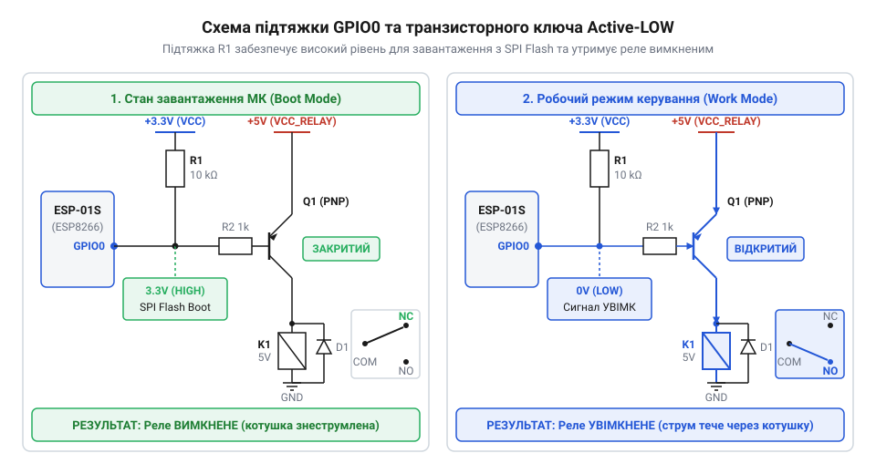
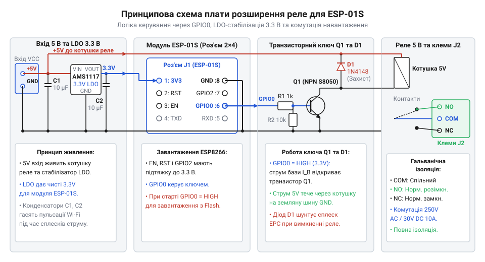
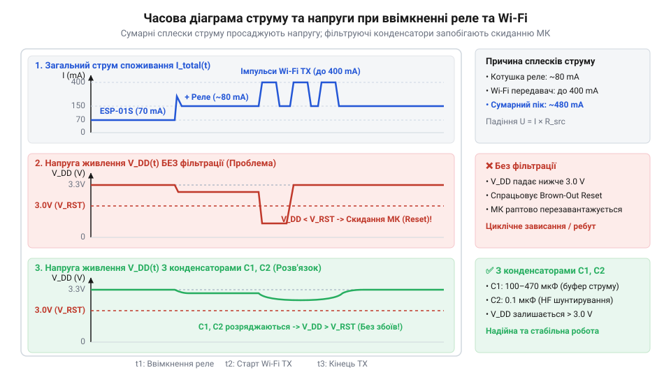
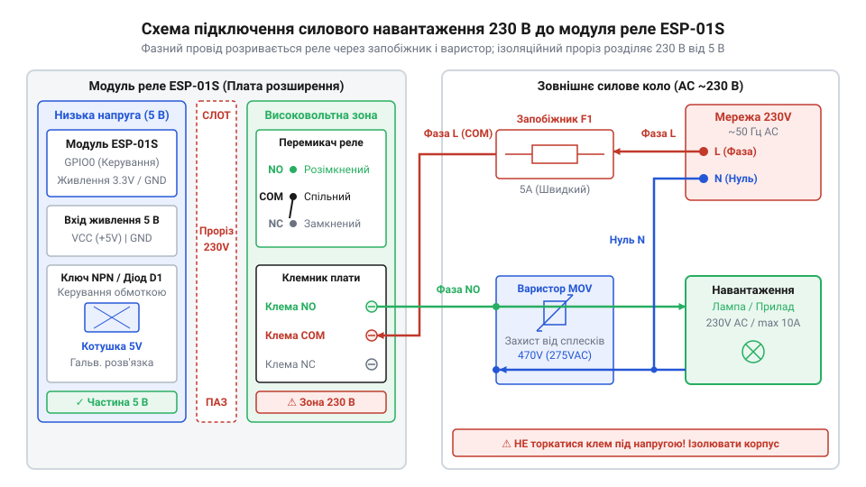

# Модуль реле для ESP-01S

<preknowlist>
- [5V реле-модуль (Songle SRD-05VDC)](root:cat-hw-drivers/relay-5v) — Будова та принцип роботи електромеханічного реле SRD-05VDC, призначення контактної групи SPDT (NO, NC, COM), параметри споживання котушки 5 В та індуктивний характер її навантаження
</preknowlist>

## Проблема прямого підключення реле до ESP8266

Цифровий вивід мікроконтролера @@en|ESP8266@@ не здатний напряму живити котушку електромагнітного реле. Вихідний порт @@en|GPIO0@@ (від англ. @@en|General-Purpose Input/Output@@ — вхід/вихід загального призначення) видає струм до `12 mA` при напрузі `3.3 V`. Для спрацьвування котушки `5 V` реле потрібно понад `70 mA`. Пряме підключення викликає просідання напруги, а під час вимкнення виникає індуктивний викид зворотної @@en|ЕРС самоіндукції@@ (від лат. *electrica* — бурштиновий) амплітудою в десятки вольт, що руйнує порт.

Додаткову перешкоду створює @@en|strapping-режим@@ (англ. *strap* — стягувати, прив'язувати) початкового запуску. Під час подачі живлення кристалу необхідний високий логічний рівень на лінії @@en|GPIO0@@ для завантаження програми з флешпам'яті. Низький опір котушки реле, підключеної до землі, тягне лінію до нуля, через що мікроконтролер переходить у режим прошивки.

*Вплив логічного рівня на виводі GPIO0 на вибір режиму завантаження мікроконтролера.*

## Архітектура плати розширення та керувальний ключ

Плата розширення узгоджує низьковольтний мікроконтролер із силовою котушкою за допомогою керувального ключа на @@en|NPN-транзисторі@@ або @@en|оптроні@@ (від грец. *optos* — видимий). Низьковольтну частину живить лінійний @@en|LDO-стабілізатор@@ (від англ. @@en|Low Dropout@@ — мале падіння напруги), який знижує вхідну напругу `5 V` до робочих `3.3 V`. Для гасіння зворотної @@en|ЕРС самоіндукції@@ паралельно обмотці встановлено захисний діод.

Модуль працює за принципом інверсної логіки @@en|Active-LOW@@ (англ. *active low* — активний низький). У цьому режимі підтягувальний резистор утримує на виводі @@en|GPIO0@@ високий рівень під час увімкнення, задовольняючи вимоги @@en|strapping-режиму@@. Котушка залишається знеструмленою, поки мікроконтролер свідомо не подасть низький рівень. На платі встановлено [електромеханічне силове реле](root:cat-hw-drivers/relay-5v), яке спрацьовує лише після завершення ініціалізації прошивки.

*Принципова схема плати розширення з елементами узгодження рівнів та захисту.*

## Бюджет живлення та запобігання перезавантаженням

Модуль @@en|ESP-01S@@ вимагає стабільного джерела живлення через високе пікове споживання. У момент активної передачі даних модуль @@en|Wi-Fi@@ (бренд, гра слів від hi-fi) споживає імпульсний струм до `300 mA`, а увімкнення котушки додає постійне навантаження `70 mA`. Якщо джерело живлення не здатне покрити ці сплески, вхідна напруга на @@en|LDO-стабілізаторі@@ просідає.

При падінні напруги на лінії `3.3 V` нижче допустимої межі виникає @@en|brownout-перезавантаження@@ (англ. *brownout* — просідання напруги). Спрацьовує апаратний скид мікроконтролера, що призводить до циклічного перезавантаження плати. Для запобігання збоям джерело живлення має розраховуватися на струм від `500 mA`, а шину `3.3 V` шунтують буферними конденсаторами для згладжування сплесків.

*Сплески споживання струму під час одночасної роботи радіомодуля та котушки реле.*

## Комутація силового навантаження та програмна ініціалізація

Для підключення зовнішнього електроприладу модуль має перекидні @@en|SPDT-контакти@@ (від англ. @@en|Single Pole Double Throw@@ — один полюс, два напрямки): спільний @@en|COM@@ (від англ. @@en|Common@@ — спільний), нормально розімкнений @@en|NO@@ (від англ. @@en|Normally Open@@ — нормально розімкнений) та нормально замкнений @@en|NC@@ (від англ. @@en|Normally Closed@@ — нормально замкнений). Фазовий провід силової мережі розривають через клеми @@en|COM@@ і @@en|NO@@. При комутації індуктивних навантажень паралельно контактам додають @@en|снабберний ланцюг@@ (англ. *snubber* — демпфер) для гасіння дуги. Для підвищених вимог до надійності застосовують [промислове реле безпеки](root:cat-hw-drivers/safety-relay).

У прошивці ініціалізація виводу @@en|GPIO0@@ потребує суворого порядку дій. Щоб уникнути короткочасного брязкоту контактів при старті, спочатку програмно записують високий рівень у регістр виходу, і лише після цього переводять вивід у режим цифрового виходу. Це гарантує відсутність хибних спрацьвувань під час завантаження.

*Схема безпечної комутації мережевого приладу через контактну групу реле.*
