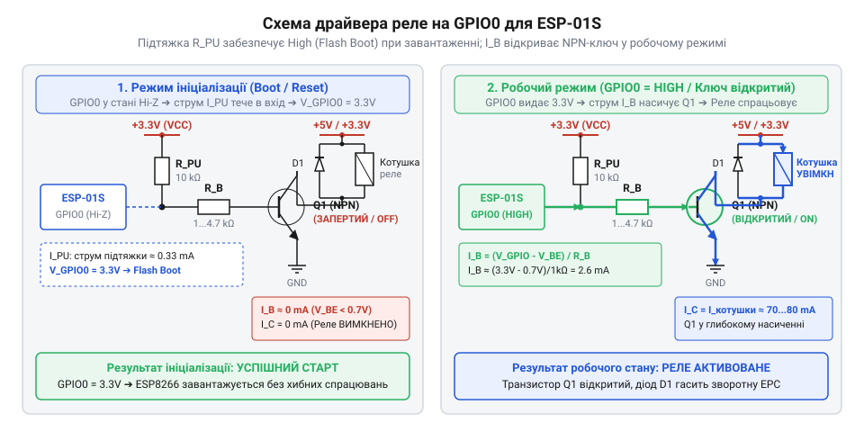

# Розрахунок струму живлення та ключів керування реле ESP-01S

<preknowlist>
- [5V реле-модуль (Songle SRD-05VDC)](root:cat-hw-drivers/relay-5v) — Робоча напруга, струм спрацьовування та опір котушки для розрахунку силового ключа.
</preknowlist>

## Причини збоїв та перезавантажень ESP-01S

У колах автоматизації компактний модуль @@en|ESP-01S@@ на базі мікроконтролера @@en|ESP8266@@ часто застосовують для керування навантаженням змінного чи постійного струму. Проте під час спроби підключити [електромеханічний модуль реле](root:cat-hw-drivers/relay-5v) розробники регулярно стикаються із двома критичними електричними проблемами: самовільними циклічними перезавантаженнями пристрою в момент увімкнення котушки або повним зависанням плати відразу після подачі живлення. Ці явища зумовлені імпульсним характером споживання струму та жорсткими вимогами до логічного стану виводу @@en|GPIO0@@ під час старту мікроконтролера.

Перша причина збоїв полягає в швидкій зміні споживаного струму. У спокійному стані мікроконтролер @@en|ESP8266@@ споживає близько 70–80 mA. Однак під час випромінювання пакета даних у мережу @@en|Wi-Fi@@ внутрішній підсилювач потужності створює коротке радіовипромінювання, яке викликає піковий сплеск струму тривалістю в кілька мілісекунд амплітудою від 300 mA до 430 mA. Якщо в цей же момент мікроконтролер подає сигнал на увімкнення реле (франц. *relais* — зміна), котушка електромагніту додає кидок струму ще на 70–90 mA. Загальне миттєве споживання перевищує 500 mA. На відміну від ситуацій, де використовують [спеціалізовані реле безпеки](root:cat-hw-drivers/safety-relay), у компактних модулях джерело живлення часто не розраховане на такі піки. Якщо воно має занадто великий внутрішній опір або тонкі провідники лінії живлення створюють помітне падіння напруги, потенціал на шині 3.3 V просідає нижче критичної межі 2.7 V. Спрацьовує внутрішня схема аварійного скидання за зниженням напруги (англ. *brownout reset*, @@en|Brownout Reset@@), і модуль іде в безкінечний цикл перезавантажень.

Друга причина зумовлена схемотехнікою конфігурації завантаження. Під час подачі живлення або апаратного скидання мікроконтролер @@en|ESP8266@@ опитує стан [конфігураційних виводів завантаження](root:cat-hw-boards/esp8266-boot-strapping-pins), серед яких головну роль відіграє вивід @@en|GPIO0@@. Для запуску керуючої програми з внутрішньої мікросхеми флеш-пам'яті (англ. *flash boot*) на виводі @@en|GPIO0@@ у момент зняття сигналу скидання мусить бути високий логічний рівень (напруга понад 2.475 V). Якщо ж на @@en|GPIO0@@ присутній низький рівень (напруга нижче 0.825 V), мікроконтролер переходить у режим завантажувача через послідовний порт (англ. *UART bootloader*, GPIO0) і зупиняє виконання прошивки. *UART bootloader*, @@en|UART bootloader@@) і зупиняє виконання прошивки. Якщо вхідний ланцюг ключа реле створює низький опір на землю, він виступає як примусове стягування, блокуючи нормальний старт пристрою.

## Розрахунок струму та згладжувальної ємності

Щоб запобігти імпульсним просіданням напруги живлення, необхідно кількісно оцінити максимальне навантаження на первинне джерело та розрахувати параметр накопичувального конденсатора. Сумарний піковий струм `I_total_peak` складається з трьох компонентів: пікового струму радіосплеску модуля `I_esp_peak`, струму споживання котушки реле `I_relay` та струму кола керування силовим ключем `I_key`.

Струм котушки реле визначається за законом Ома через напругу живлення `V_relay` та опір обмотки `R_coil`. Для типового [модуля реле на 5V](root:cat-hw-drivers/relay-5v) з напругою живлення `V_relay = 5.0 V` та опором котушки `R_coil = 70 Ω` струм становить `I_relay = 5.0 ÷ 70 ≈ 0.071 A`. У той же час піковий струм модуля @@en|ESP-01S@@ `I_esp_peak` дорівнює `0.430 A`, а струм керування ключем `I_key` приймають рівним `0.005 A`.

Опишемо вираз для знаходження сумарного пікового струму споживання вузла з окремих компонентів.

```
I_total_peak
= I_esp_peak + I_relay + I_key      [сумування пікових струмів споживачів]
= 0.430 + 0.071 + 0.005      [підстановка розрахованих номіналів]
= 0.506 A                   [арифметичне додавання]
```

Отримане значення `0.506 A` показує, що первинне джерело живлення повинно розраховуватись на струм не менше `0.65 A` з урахуванням необхідного запасу потужності.

Однак навіть потужне джерело живлення має скінченну швидкість наростання струму. Під час радіосплеску тривалістю `Δt = 0.002 s` (2 ms) дефіцит струму `ΔI`, який не встигає компенсувати регулятор напруги, має покриватися згладжувальним конденсатором. Припустимо, що джерело живлення здатне безперервно віддавати струм `I_supply = 0.150 A`.

Визначимо дефіцит струму `ΔI`, який виникає під час радіосплеску через обмеження віддачі джерела.

```
ΔI
= I_total_peak - I_supply      [різниця пікового та безперервного струму]
= 0.506 - 0.150                [підстановка значення навантаження та джерела]
= 0.356 A                      [обчислення дефіциту струму]
```

Значення `0.356 A` визначає амплітуду додаткового струму, який протягом імпульсу передачі має поставлятися згладжувальною ємністю.

Мінімальну необхідну ємність накопичувального конденсатора `C_min` обчислюють на основі закону збереження електричного заряду. Позначимо допустиме просідання напруги на шині 3.3 V як `ΔV = 0.3 V` (падіння з nominal `3.3 V` до мінімально допустимого `3.0 V`).

Розрахуємо мінімальну ємність накопичувального конденсатора `C_min` на основі виразу для електричного заряду.

```
C_min
= (ΔI × Δt) ÷ ΔV      [закон збереження електричного заряду]
= (0.356 × 0.002) ÷ 0.3      [підстановка параметрів імпульсу струму]
= 0.000712 ÷ 0.3              [множення у чисельнику]
= 0.002373 F                  [ділення на допустиме просідання напруги]
= 2373 μF                    [переведення у мікрофаради]
```

З отриманого розрахунку видно, що для повної компенсації просідання напруги під час тривалого радіовипромінювання потрібна накопичувальна ємність близько `2400 μF`. На практиці паралельно до шини живлення 3.3 V встановлюють електролітичний конденсатор ємністю `470–1000 μF` та керамічний конденсатор `0.1 μF` з низьким еквівалентним послідовним опором (англ. *equivalent series resistance*, @@en|ESR@@) для приглушення високочастотних завад.

## Забезпечення режиму завантаження виводу GPIO0

Після забезпечення стабільного живлення необхідно гарантувати коректну ініціалізацію мікроконтролера при підключенні керуючого ключа реле. Для запуску прошивки з флеш-пам'яті вивід @@en|GPIO0@@ під час скидання повинен перебувати у стані високого імпедансу з підтяжкою (англ. *high impedance with pull-up*). *pull-up*, від *pull* — тягнути та *up* — вгору) до напруги 3.3 V.


*Принципова схема узгодження виводу GPIO0 з керуючим входом ключа реле та підтягувальним резистором.*

Якщо застосувати пряме керування NPN-транзистором із низьким базовим опором на землю, у момент включення живлення цей опір утворює дільник напруги з внутрішньою підтяжкою мікроконтролера. Напруга на виводі @@en|GPIO0@@ опускається нижче порогового значення `2.475 V`, що примусово переводить @@en|ESP8266@@ у режим завантаження через послідовний порт.

Для усунення цього конфлікту застосовують активний низький рівень керування з використанням оптопари (англ. *optocoupler*, від грец. *optikos* — зоровий та англ. *coupler* — з'єднувач). Як показано на схемі, анод світлодіода оптопари підключають до лінії живлення 3.3 V через обмежувальний резистор `R_opt`, а катод — до виводу @@en|GPIO0@@. Додатково вивід @@en|GPIO0@@ підтягують до шини 3.3 V зовнішнім резистором `R_pullup = 10 kΩ`. Під час старт-апу вивід перебуває в режимі входу з високим опором, тому напруга з обох боків світлодіода дорівнює 3.3 V, струм не тече, реле залишається вимкненим, а вивід @@en|GPIO0@@ надійно утримується в стані високого логічного рівня.

## Розрахунок базового резистора силового ключа

Після вибору схемотехніки вузла керування необхідно розрахувати номінали обмежувальних резисторів. У силових ключах на базі біполярного транзистора (англ. *transistor*, від *transfer resistor* — перехідний опір) головною вимогою є введення напівпровідникового триода в режим насичення (латин. *saturatio* — повнота), коли падіння напруги між колектором та емітером мінімальне.

Струм колектора `I_c` дорівнює струму споживання котушки реле `I_relay = 0.071 A`. Щоб транзистор перебував у [режимі глибокого насичення](root:hw-components/bjt-switch), струм бази `I_b` повинен перевищувати мінімальний необхідний струм лінійного режиму `I_c ÷ h_FE` у коефіцієнт насичення `k_sat = 3` (де `h_FE` — коефіцієнт підсилення струму транзистора). Для поширеного транзистора NPN-типу з `h_FE = 100` обчислимо необхідний струм бази `I_b_min`.

Знайдемо мінімальний струм бази `I_b_min` для введення ключа в режим глибокого насичення.

```
I_b_min
= (I_c × k_sat) ÷ h_FE      [умова глибокого насичення транзистора]
= (0.071 × 3) ÷ 100         [підстановка струму колектора та коефіцієнтів]
= 0.213 ÷ 100               [множення у чисельнику]
= 0.00213 A                 [обчислення базового струму в амперах]
= 2.13 mA                   [переведення в міліампери]
```

Розраховане значення `2.13 mA` є безпечним для виводу @@en|GPIO0@@, оскільки воно значно менше за максимально допустимий вихідний струм ніжки мікроконтролера.

Знаючи спад напруги на відкритому базі-емітерному переході кремнієвого транзистора `V_BE_sat = 0.7 V` та напругу логічної одиниці `V_OH = 3.3 V`, розрахуємо опір базового резистора `R_b`.

Розрахуємо необхідний опір базового резистора `R_b` за законом Ома для базового кола.

```
R_b
= (V_OH - V_BE_sat) ÷ I_b_min      [закон Ома для базового кола]
= (3.3 - 0.7) ÷ 0.00213            [підстановка спадів напруги та базового струму]
= 2.6 ÷ 0.00213                    [різниця потенціалів на резисторі]
= 1220.6 Ω                         [розрахований опір]
≈ 1.2 kΩ                           [вибір стандартного номіналу E24]
```

Отриманий опір `1.2 kΩ` забезпечує стійке відкривання транзистора та надійне утримання котушки реле в замкненому стані.

Якщо ключ керується через оптопару, увімкнену між шиною 3.3 V та виводом @@en|GPIO0@@, обчислиють опір обмежувального резистора `R_opt`. Для прямого струму світлодіода оптопари `I_f = 0.005 A` (5 mA), прямого спаду напруги на світлодіоді `V_f = 1.2 V` та напруги низького логічного рівня виводу `V_OL = 0.1 V` розрахуємо опір `R_opt`.

Обчислимо необхідний опір обмежувального резистора `R_opt` для оптронного ключа.

```
R_opt
= (V_CC - V_OL - V_f) ÷ I_f      [закон Ома для кола світлодіода]
= (3.3 - 0.1 - 1.2) ÷ 0.005      [підстановка напруги живлення та спадів напруг]
= 2.0 ÷ 0.005                    [різниця потенціалів на резисторі]
= 400 Ω                          [розрахований опір]
≈ 390 Ω                          [вибір стандартного номіналу E24]
```

Номінал `390 Ω` гарантує проходження необхідного струму для спрацьовування оптопари без створення перевищення струмових лімітів виводу.
