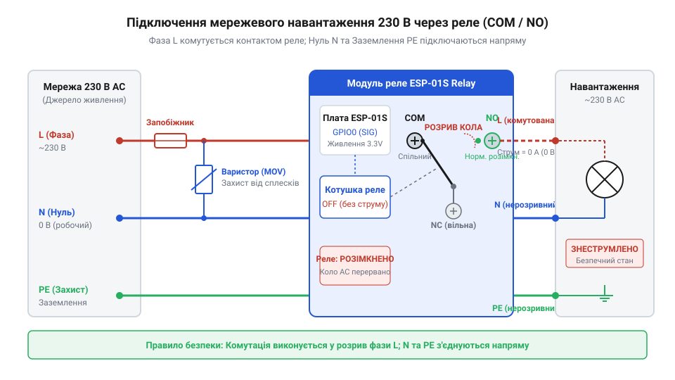

# Підключення мережевого силового навантаження до клемника реле

<preknowlist>
- [5V реле-модуль (Songle SRD-05VDC)](root:cat-hw-drivers/relay-5v) — Конструктивні особливості та граничні електричні параметри контактної групи електромеханічних реле Songle.
</preknowlist>

## Небезпека прямого розриву мережевого кола

Підключення мережевого електроприладу до мікроконтролера вимагає комутації силового кола змінного струму напругою `230 В`. У побутовій електромережі струм подається трьома провідниками: @@en|фазним провідником@@ `L` (від англ. @@en|line@@ — лінія під потенціалом), @@en|нульовим провідником@@ `N` (від англ. @@en|neutral@@ — нейтраль) та @@en|захисним провідником@@ `PE` (від англ. @@en|protective earth@@ — захисне заземлення). Головне завдання підключення — забезпечити вимикання приладу без створення прихованої загрози ураження електричним струмом.

Потенціал небезпечної напруги `230 В` відносно землі присутній виключно на фазному провіднику `L`. Нульовий провідник `N` з'єднаний із землею на трансформаторній підстанції і за нормальних умов має потенціал, близький до нульового. Захисний провідник `PE` під'єднано безпосередньо до контуру заземлення будівлі та металевого корпуса приладу для відведення струмів витоку.

Якщо помилково комутувати нульовий провідник `N`, розмикаючи його силовими контактами, які має [типовий 5V реле-модуль](root:cat-hw-drivers/relay-5v), прилад припинить працювати через розрив кола. Проте весь внутрішній монтаж приладу та його нагрівальні чи комутаційні елементи залишаться під з'єднанням із фазою `L`. При спробі обслуговування або випадковому дотику людини до внутрішніх вузлів вимкненого приладу струм потече через тіло на землю, викликавши тяжке ураження струмом.

З цієї причини комутація завжди виконується виключно в розрив фазного провідника `L`. Нульовий провідник `N` та захисне заземлення `PE` підключаються до навантаження напряму і залишаються нерозривними по всій довжині кабельної траси. Оскільки колірне маркування жил у реальному монтажі може бути відсутнім або помилковим, провідник `L` перед підключенням обов'язково визначають практично за допомогою @@en|індикаторної викрутки@@ (від лат. @@en|indicare@@ — вказувати). Під час такої перевірки під напругою щупом індикатора торкаються зачищеної жили, утримуючи палець на металевому контакті рукоятки. Мікроамперний струм витоку через вбудований резистор опором `1 МОм` і тіло людини на землю викликає світіння неонової лампи виключно на фазному провіднику `L`. На нульовому провіднику `N` та захисному заземленні `PE` потенціал близький до нуля, тому лампа не світиться. Після точного визначення фази мережеву лінію обов'язково знеструмлюють автоматичним вимикачем для безпечного затискання провідника `L` у силові клеми реле.

## Принцип роботи силових клем реле

Для безпечного розриву фазного провідника `L` на платі модуля розпаяно гвинтовий @@en|клемник@@, з'єднаний із контактною групою електромеханічного @@en|реле@@ (від фр. @@fr|relais@@ — зміна коней). Контактна група складається з трьох силових виводів: `COM`, `NO` та `NC`.

Клема `COM` (від англ. @@en|common@@ — спільний) є рухомим контактом, на який подається вхідний фазний провідник `L` від мережі живлення. Клема `NO` (від англ. @@en|normally open@@ — нормально розімкнений) у знеструмленому стані котушки відокремлена від `COM`. При подачі сигналу керування на котушку електромагніт притягує якір, з'єднуючи `COM` із `NO` та подаючи фазу на навантаження. Клема `NC` (від англ. @@en|normally closed@@ — нормально замкнений), навпаки, у знеструмленому стані замкнена з `COM` і розмикається при спрацьовуванні реле.

Вибір між клемами `NO` та `NC` визначає поведінку підключеного приладу під час подачі живлення або скидання мікроконтролера ESP-01S. Зазвичай силову фазу навантаження підключають до клеми `NO`. У цьому разі при відсутності живлення контролера або під час його завантаження прилад залишається знеструмленим. Підключення до `NC` використовують лише тоді, коли прилад повинен працювати за замовчуванням і вимикатися тільки за активним сигналом. Однак на платі модуля силовий ключ реле керований виводом `GPIO0`. Під час увімкнення живлення цей вивід виконує роль @@en|страпінг-виводу@@ (від англ. @@en|strap@@ — обв'язувати) для вибору режиму завантаження. У перші мілісекунди ініціалізації на виводі `GPIO0` виникають перехідні процеси та короткочасні зміни логічного рівня. Ці імпульси помилково відкривають керуючий транзистор ще до запуску прошивки. У результаті контакти `COM` і `NO` короткочасно замикаються, спричиняючи помилкове увімкнення навантаження та прискорене зношення контактної групи. При підключенні до клеми `NC` ті самі перехідні процеси короткочасно розмикають коло та переривають живлення приладу.

*Принципова схема комутації фазного провідника L через клеми COM і NO реле з нерозривними провідниками N та PE.*

## Захист контактів і кола живлення

Комутація мережевої напруги створює два види ризиків для обладнання: високовольтні імпульсні перенапруги та струмові перевантаження. Особливо небезпечним є індуктивне навантаження — електродвигуни, трансформатори чи соленоїди.

При розмиканні контактів під струмом в індуктивності виникає @@en|ЕРС самоіндукції@@. Енергія магнітного поля підтримує проходження струму, створюючи на розімкненому зазорі стрибок напруги `U = L_load · (dI / dt)`. Цей сплеск сягає кіловольт і пробиває повітряний проміжок між контактами, утворюючи @@en|електричну дугу@@. Дуговий розряд руйнує покриття контактів, призводить до їх зварювання та випромінює потужні електромагнітні перешкоди, що викликають збої в роботі ESP-01S.

Для гасіння сплесків напруги паралельно клемам `COM` і `NO` або паралельно самому навантаженню підключають @@en|варистор@@ (від англ. @@en|variable resistor@@ — змінний резистор, скорочено з @@en|varistor@@). [Варисторний захист від перенапруг](root:hw-components/varistor) діє як нелінійний напівпровідник: при робочій напрузі `230 В` його опір становить сотні мегаом, але при стрибку напруги понад порогову (наприклад, `275 В`) опір миттєво падає до часток ома, шунтуючи високовольтний імпульс через себе. Однак варистор зрізає лише амплітуду піків, тому для безпосереднього гасіння дуги та обмеження швидкості наростання напруги паралельно контактам або індуктивності додатково вмикають @@en|RC-снабер@@ (від англ. @@en|RC snubber@@, від @@en|snub@@ — глушити, стримувати) — послідовне коло з @@en|резистора@@ та @@en|конденсатора@@. Під час розмикання реле @@en|конденсатор@@ перехоплює струм самоіндукції, уповільнюючи зростання напруги між контактами й запобігаючи пробою повітряного зазору, а @@en|резистор@@ номіналом `47-120 Ом` (потужністю `1-2 Вт`) розсіює енергію коливань і обмежує імпульс розрядного струму при наступному замиканні контактів. Ємність @@en|конденсатора@@ обирають у діапазоні `0.01-0.1 мкФ`: занадто мала ємність не зупинить дуговий розряд, а надто велика — створить помітний витік змінного струму через розімкнений клемник, викликаючи блимання світлодіодних ламп чи неповне вимкнення приладів. Робоча напруга @@en|конденсатора@@ має становити не менше `275 В` змінного струму, причому застосовують виключно плівкові @@en|конденсатори класу X2@@, які при випадковому імпульсному пробої самовідновлюються, не утворюючи короткого замикання мережі.

Захист від короткого замикання забезпечує @@en|плавкий запобіжник@@ (від англ. @@en|fuse@@), який встановлюють послідовно у фазний провідник `L` перед клемою `COM`. Номінал запобіжника обирають відповідно до струму споживання приладу, але не вище граничного струму реле (зазвичай до `5-8 А` для тривалої роботи). При короткому замиканні нитка запобіжника перегорає за мілісекунди, розриваючи коло до виникнення пожежі чи розплавлення плати.

## Конструктивне оформлення та безпечний монтаж

Зібрана електрична схема має відкриті струмопровідні доріжки під напругою `230 В` на зворотному боці плати ESP-01S Relay та на контактах клемника. Будь-який випадковий дотик до цих елементів створює загрозу для життя, тому фізичний монтаж вимагає суворого дотримання правил корпусування.

Плата модуля разом із запобіжником і варистором має розміщуватися в закритому @@en|діелектричному корпусі@@ з негорючого @@en|ABS-пластику@@ або полікарбонату з ступенем захисту не нижче @@en|IP20@@. Усередині корпуса плата надійно закріплюється на ізоляційних стійках, забезпечуючи повітряний зазор не менше `5 мм` між високовольтними доріжками та стінками корпуса.

Усі вхідні та вихідні кабелі закріплюються через механічні @@en|кабельні фіксатори@@ (гермовводи, від англ. @@en|cable gland@@). Це запобігає висмикуванню провідників із ґвинтових клем при випадковому натягу шнура. Високовольтні мережеві дроти `230 В` та низьковольтні лінії живлення `5 В` для плати прокладають окремими трасами всередині корпуса, уникаючи їх перетину. Для систем підвищеної відповідальності замість побутових модулів використовують спеціалізоване [промислове реле безпеки](root:cat-hw-drivers/safety-relay), але в аматорських розробках належно заізольований корпус забезпечує достатній рівень захисту.
