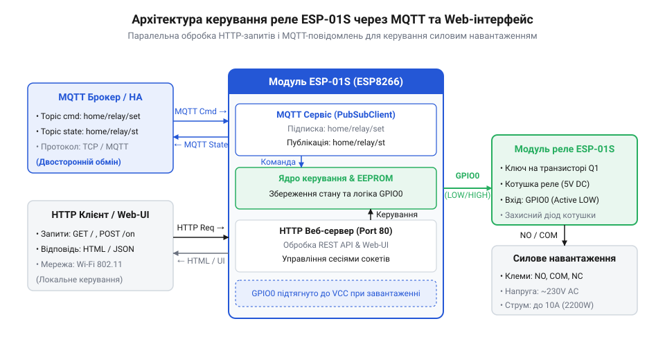
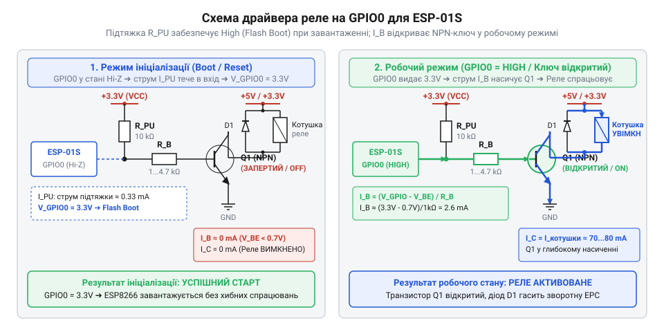

# Створення бездротового вимикача на ESP-01S з MQTT та веб-інтерфейсом

<preknowlist>
- [5V реле-модуль (Songle SRD-05VDC)](root:cat-hw-drivers/relay-5v) — Електричні характеристики котушки 5V реле, принципи транзисторного керування та допустимі навантаження силової групи контактів.
</preknowlist>

## Проблема самовільного спрацьовування силового реле

Спроба автоматизувати побутовий прилад за допомогою простого вимикача без дистанційного керування швидко впирається у відсутність віддаленого моніторингу та зворотного зв'язку. Коли розробник намагається вирішити цю задачу й підключає компактний бездротовий модуль @@en|ESP-01S@@ до схеми, де працює [силовий релейний модуль](root:cat-hw-drivers/relay-5v), виникає критична проблема: у момент подачі живлення або перезавантаження мікроконтролера котушка реле короткочасно клацає або самовільно переходить у замкнений стан.

Така поведінка створює реальну небезпеку для підключеного обладнання. Короткочасне імпульсне ввімкнення потужного навантаження (наприклад, нагрівального елемента чи насоса) зумовлює пускові кидки струму, передчасне зношування силових контактів або створення аварійних ситуацій. У відповідальних промислових вузлах для виключення таких ризиків використовують [спеціалізовані реле безпеки](root:cat-hw-drivers/safety-relay), проте в компактних бездротових контролерах захист залежить від чіткої узгодженості апаратної схеми й прошивки.

Головна причина короткочасних хибних спрацьовувань полягає у фізиці старту мікроконтролера ESP8266. Під час виконання первинного завантажувача з внутрішньої ROM-пам'яті виводи загального призначення (з англ. @@en|General Purpose Input/Output@@ — вхід/вихід загального призначення, або @@en|GPIO@@) короткочасно змінюють свій електричний стан ще до того, як почне виконуватися користувацька програма. У момент подачі живлення внутрішня апаратна логіка вивільняє лінію скидання, і первинний завантажувач починає зчитувати електричні рівні на виводах для визначення режиму старту. Упродовж цього опитування апаратний мультиплексор перемикає вивід із високоімпедансного стану (з англ. @@en|High Impedance@@ — високий імпеданс, або @@en|High-Z@@) у режим зчитування. Така перекомутація внутрішніх транзисторних ключів викликає перехідні імпульсні процеси — короткочасні сплески напруги (з англ. @@en|glitch@@ — короткочасний сплеск або завада) тривалістю від кількох мікросекунд до десятків мілісекунд. Якщо вхідний каскад релейного модуля реагує на просідання напруги чи низький рівень, цей перехідний імпульс відкриває керуючий транзистор і викликає помилкове спрацьовування котушки до ініціалізації програмних режимів.

*ESP-01S одночасно обробляє прямі HTTP-запити від локальних браузерів та обмінюється станами з MQTT-брокером.*

Щоб бездротовий вимикач був надійним, апаратно-програмний контролер мусить відповідати двом жорстким вимогам. По-перше, схемотехніка та алгоритм ініціалізації мають гарантувати фіксований і безпечний рівень керуючої лінії @@en|GPIO0@@ від першої мілісекунди подачі живлення. По-перше, пристрій повинен підтримувати два незалежних канали комунікації: локальний веб-інтерфейс за протоколом @@en|HTTP@@ (з англ. @@en|Hypertext Transfer Protocol@@ — протокол передачі гіпертексту) для прямого керування з браузера та мережевий протокол @@en|MQTT@@ (з англ. @@en|Message Queuing Telemetry Transport@@ — транспорт телеметрії з черговістю повідомлений) для асинхронного обміну даними із сервером розумного дому.

## Узгодження лінії GPIO0 з релейним модулем

Фізичні особливості завантажувача ESP8266 вимагають особливого ставлення до виводу @@en|GPIO0@@. Під час подачі живлення або апаратного скидання внутрішня програма мікроконтролера зчитує логічний рівень на спеціальних конфігураційних виводах (з англ. @@en|strapping pins@@, від *strap* — прив'язувати). Якщо на лінії @@en|GPIO0@@ присутній високий рівень (3.3 В), чип починає завантаження користувацької прошивки з зовнішньої пам'яті @@en|SPI Flash@@. Якщо ж на @@en|GPIO0@@ виявиться низький рівень (0 В), мікроконтролер перейде в режим прошивки через послідовний порт (з англ. @@en|UART Download Mode@@) і виконання робочої програми не розпочнеться.

Через це вивід @@en|GPIO0@@ обов'язково підтягують до лінії живлення 3.3 В за допомогою зовнішнього або внутрішнього резистора (з англ. @@en|Pull-Up@@ — підтяжка догори). Отже, під час увімкнення на лінії @@en|GPIO0@@ завжди формується потенціал логічної одиниці.

*Підтягуючий резистор тримає високий рівень на GPIO0 при старті, а транзисторний ключ вмикає котушку реле тільки при подачі низького рівня.*

Щоб притягнута до високого рівня лінія не вмикала котушку реле при старті, схему керування будують за логікою активного низького рівня (з англ. @@en|Active LOW@@). У такій схемі транзисторний ключ або оптопара розімкнені, коли на @@en|GPIO0@@ діє високий рівень (3.3 В), і замикаються лише тоді, коли мікроконтролер свідомо подає низький рівень (0 В). Якби силовий ключ працював за прямою логікою (з англ. @@en|Active HIGH@@), обов'язкова підтяжка @@en|GPIO0@@ до 3.3 В призводила б до спрацьовування реле під час кожного завантаження.

Навіть за наявності правильної схемотехніки апаратне узгодження має підкріплюватися коректною послідовністю дій у прошивці. Якщо просто викликати стандартну функцію переведення виводу в режим виходу, мікроконтролер на коротку мить виставить на ньому низький рівень за замовчуванням, що в схемі @@en|Active LOW@@ призведе до короткочасного проходження струму через котушку й хибного клацання реле. Щоб запобігти цьому імпульсу, прошивка виконує покрокову ініціалізацію: спочатку записує в регістр засувки виходу пасивний високий рівень (HIGH) та вмикає підтяжку, і лише після цього переводить @@en|GPIO0@@ у режим цифрового виходу — в середовищі @@en|Arduino@@ це реалізують викликом `digitalWrite()` перед `pinMode()`, а в @@en|ESP-IDF@@ — попереднім викликом `gpio_set_level()` перед `gpio_config()`. Вибір конкретної схемотехніки ключа керування безпосередньо визначає логіку роботи прошивки: дискретний @@en|NPN@@-транзисторний ключ прямої логіки (@@en|Active HIGH@@) вмикає навантаження високим рівнем, що робить його несумісним із виводом @@en|GPIO0@@ через завантажувальну підтяжку, тоді як схема на @@en|PNP@@-транзисторі або оптопарі з інверсною логікою (@@en|Active LOW@@) тримає силовий ключ закритим саме при високому потенціалі на лінії, забезпечуючи повну гальванічну розв'язку та безпеку під час увімкнення живлення.

:::tabs
@tab Arduino / C++
:::code proj-esp01s-wifi-relay-controller/cpp/src/RelayController.h 51-55

@tab ESP-IDF / C
:::code proj-esp01s-wifi-relay-controller/c/main/relay_driver.c 56-77
:::

## Розгортання автономного веб-сервера керування реле

Коли бездротовий контролер працює в локальній мережі, виникає потреба прямого взаємообміну командами з користувачем без посередництва хмарних серверів чи зовнішньої інфраструктури. Якщо зв'язок із центральним маршрутизатором або інтернетом переривається, пристрій повинен зберігати локальну керованість через стандартний веб-браузер з будь-якого смартфона чи ПК.

Для вирішення цього завдання мікроконтролер перетворюють на автономний @@en|HTTP@@-сервер, який слухає мережевий порт 80. Обслуговування клієнтів відбувається у неблокуючому режимі: у кожному циклі виконання сервер перевіряє мережевий @@en|сокет@@ (англ. *socket*, гніздо, від лат. *soccus* — легкий черевик) на наявність вхідних даних і миттєво повертає керування за їх відсутності. Коли браузер надсилає пакет, сервер приймає запит за протоколом @@en|HTTP@@ (англ. *Hypertext Transfer Protocol*, протокол передачі гіпертексту) та виконує його @@en|парсинг@@ (англ. *parsing*, синтаксичний аналіз, від лат. *pars* — частина). Обробник виділяє метод та запрошений шлях (маршрут), зіставляє його з внутрішньою таблицею та переводить логічний рівень на керуючому виводі у відповідний стан. При зверненні до головного маршруту `/` сервер виконує генерацію структури @@en|HTML@@-відповіді (англ. *Hypertext Markup Language*, мова розмітки гіпертексту, від лат. *textus* — тканина): він зчитує поточний стан виводу, вставляє текст статусу й відповідні CSS-стилі у шаблон та відправляє підготовлену сторінку. При виклику маршрутів `/on`, `/off` або `/toggle` обробник здійснює [комутацію силового навантаження](root:cat-hw-drivers/relay-5v), після чого повертає браузеру заголовок перенаправлення з кодом 303 (See Other) на головну сторінку `/`. Це запобігає повторному випадковому спрацьовуванню котушки при оновленні сторінки в браузері.

Окрім візуальної HTML-сторінки з кнопками ручного перемикання, сервер реалізує програмований інтерфейс @@en|REST API@@ (англ. *Representational State Transfer*, передача стану уявлення) за маршрутом `/api/status`. Запит типу @@en|GET@@ на цей маршрут повертає структуровану відповідь у форматі @@en|JSON@@ з поточним станом реле та часом безперервної роботи пристрою (uptime), що дозволяє легко підключати контролер до довільних скриптів автоматизації.

:::tabs
:::code proj-esp01s-wifi-relay-controller/cpp/src/NetworkManager.h 150-213
:::code proj-esp01s-wifi-relay-controller/c/main/main.c 23-148
:::

## Інтеграція контролера в MQTT мережу

Пряме керування через веб-сервер зручне для людини, але системи автоматизації розумного дому (такі як Home Assistant чи Node-RED) потребують подійно-орієнтованого зв'язку з низькими накладними витратами. Постійне опитування HTTP-сервера створює зайве навантаження на мережу та мікроконтролер.

Для побудови ефективної мережевої взаємодії використовують протокол @@en|MQTT@@ (англ. *Message Queuing Telemetry Transport*, черга повідомлень передачі телеметрії). Контролер встановлює постійне @@en|TCP@@-з'єднання з @@en|MQTT-брокером@@ (англ. *broker*, посередник) і підписується на топік команд `esp01s/relay/cmd`. У разі втрати зв'язку пристрій не блокує виконання основної програми у нескінченних циклах очікування, а використовує алгоритм асинхронного перепідключення: фоновий таймер періодично (наприклад, кожні 5 секунд) перевіряє стан мережі й ініціалізує повторне з'єднання без зупинки обслуговування вебсервера та зчитування датчиків. Для обміну повідомленнями узгоджують відповідний рівень @@en|QoS@@ (англ. *Quality of Service*, якість обслуговування, від лат. *qualitas* — якість, та *servitium* — служба): якщо рівень QoS 0 відправляє пакети без підтвердження з ризиком втрати даних при мережевих завадах, то рівень QoS 1 гарантує доставку повідомлення щонайменше один раз завдяки обов'язковому квитуванню пакетом підтвердження, що є критичним для надійного керування силовими контактами. Структура @@en|payload@@ (англ. *payload*, корисне навантаження — від давньоангл. *lād* — перевезення) команд і телеметрії залишається максимально простим текстовим рядком (`ON`, `OFF`, `TOGGLE` або числові еквіваленти `1`, `0`), що мінімізує накладні витрати на парсинг у мікроконтролері. Коли система автоматизації відправляє в цей топік повідомлення, брокер миттєво доставляє його контролеру, викликаючи зворотну функцію (callback). Контролер змінює стан силових контактів і негайно публікує новий стан у топік телеметрії `esp01s/relay/state`.

Щоб центри керування після перезавантаження одразу дізнавалися актуальне положення контактів без очікування нових подій, публікація стану виконується з прапорцем @@en|retained messages@@ (англ. *retain*, утримувати). Це змушує брокер зберігати останнє повідомлення в пам'яті й відправляти його будь-якому новому підписнику негайно при підключенні. У разі тимчасового обриву зв'язку з брокером фоновий таймер виконує неблокуючі спроби перепідключення, не заважаючи виконанню інших задач мікроконтролера.

:::tabs
:::code proj-esp01s-wifi-relay-controller/cpp/src/NetworkManager.h 215-278
:::code proj-esp01s-wifi-relay-controller/c/main/mqtt_app.c 10-130
:::

## Збереження стану в пам'яті та діагностика

Знеструмлення мережі живлення призводить до перезавантаження мікроконтролера. Якщо пристрій не запам'ятовує свій останній робочий стан, після відновлення живлення реле може перейти у випадкове або небезпечне положення, вимкнувши критичний споживач.

Для забезпечення енергонезалежності перед ініціалізацією фізичних виводів прошивка зчитує збережені дані з пам'яті: @@en|EEPROM@@ (англ. *Electrically Erasable Programmable Read-Only Memory*, електрично стираний програмований постійний запам'ятовувач) в Arduino або @@en|NVS@@ (англ. *Non-Volatile Storage*, енергонезалежне сховище) в ESP-IDF. Структура збереження містить магічний байт (наприклад, `0xA5`), який слугує маркером валідності даних. Якщо маркер збігається, пристрій відновлює останній стан контактора; якщо пам'ять чиста або пошкоджена, встановлюється безпечний вимкнений стан за замовчуванням. Проте апаратна флеш-пам'ять @@en|Flash@@ мікроконтролера має обмежений ресурс перезапису комірок (зазвичай від 10 000 до 100 000 циклів), тому часта фіксація станів може призвести до її передчасного зношування. У середовищі Arduino емуляція @@en|EEPROM@@ під час кожного виклику `EEPROM.commit()` перезаписує цілий фізичний сектор розміром 4 КБ, тоді як підсистема @@en|NVS@@ у ESP-IDF рівномірно розподіляє навантаження завдяки збереженню пар «ключ-значення» з механізмом @@en|wear leveling@@ (англ. *wear leveling*, вирівнювання зношування). Щоб зберегти ресурс напівпровідникових комірок, прошивка фіксує новий стан у пам'яті виключно в момент його фактичної зміни відносно поточного значення, утримуючись від виклику операцій запису під час повторних команд чи проміжних високочастотних перемикань.

У разі втрати Wi-Fi з'єднання мережевий менеджер переходить у режим автоматичного відновлення зв'язку за допомогою фонових спроб, а для запобігання хибним спрацюванням у звичайних колах під час аварій використовують відповідну схему, тоді як у критично важливих промислових системах застосовують [спеціалізовані реле безпеки](root:cat-hw-drivers/safety-relay). Діагностика роботи пристрою здійснюється через фонову задачу моніторингу, яка періодично виводить стан пам'яті @@en|Heap@@ та статус реле в послідовний порт @@en|UART@@ (англ. *Universal Asynchronous Receiver-Transmitter*, універсальний асинхронний приймач-передавач).

:::tabs
:::code proj-esp01s-wifi-relay-controller/cpp/src/RelayController.h 20-56
:::code proj-esp01s-wifi-relay-controller/cpp/src/RelayController.h 109-133
:::code proj-esp01s-wifi-relay-controller/c/main/main.c 153-196
:::
