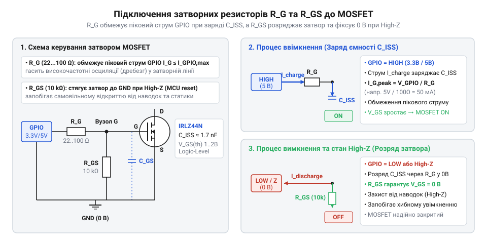
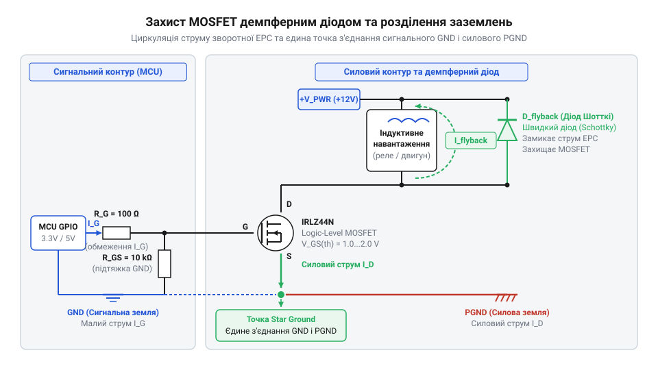

# Залізний інтерфейс підключення MOSFET логічного рівня

<preknowlist>
- [Схемотехніка низькостороннього ключа на MOSFET для керування навантаженням](root:cat-hw-drivers/low-side-mosfet-switch) — базовий принцип роботи MOSFET як ключа у колі низького боку та його основні статичні характеристики.
</preknowlist>

## Небезпеки прямого підключення силового MOSFET

Спроба підключити силовий ключовий транзистор безпосередньо до виходу мікроконтролера виглядає привабливо простим рішенням, але майже завжди призводить до пошкодження мікросхеми або некерованої поведінки навантаження. Для з'ясування причин слід розглянути внутрішній устрій керуючого електрода транзистора та особливості роботи цифрового порту.

Вхідний електрод @@en|N-канального MOSFET@@ (англ. *N-channel Metal-Oxide-Semiconductor Field-Effect Transistor*, від *N-channel* — канал з електронною провідністю) — @@en|затвор@@ (англ. *gate*, від *gate* — ворота, що керують струмом) — ізольований від струмоведучого каналу тонким шаром діелектрика. Через це затвор поводиться як паразитний конденсатор ємністю від 1 до 5 нФ. Під час зміни логічного стану виходу @@en|GPIO@@ (англ. *General-Purpose Input/Output*, від *general-purpose* — загальне призначення, *input/output* — вхід та вихід) цей конденсатор починає заряджатися або розряджатися. Оскільки струм заряду обмежується лише внутрішнім опором вихідних транзисторів порту (близько 20–40 Ом), у момент перемикання виникає короткий імпульс струму амплітудою до 100–150 мА. Це у 4–6 разів перевищує гранично припустимий струм виводу мікроконтролера, що при частому перемиканні руйнує його кристал.

Другою небезпекою є @@en|плаваючий потенціал@@ (англ. *floating state*, від *floating* — неокреслений стан) затвора під час подачі живлення або перезавантаження мікроконтролера. У цей момент виводи @@en|GPIO@@ перебувають у режимі високого опору. Оскільки затвор має опір витоку понад 10⁸ Ом, навіть незначна наводка або залишковий заряд на паразитній ємності відкриває транзистор у напівпровідний лінійний режим. Силовий струм починає текти через частково відкритий канал @@en|сток@@-@@en|витік@@, викликаючи миттєвий перегрів і згорання транзистора ще до того, як мікроконтролер виконає першу інструкцію прошивки.

Третій ризик виникає при комутації індуктивного навантаження (реле, двигуни, соленоїди). Під час вимкнення струму в котушці виникає @@en|зворотна ЕРС@@ (англ. *back EMF*, від *back electromotive force* — протиелектрорушійна сила), напруга якої сягає сотень вольт. Без спеціального кола захисту цей високовольтний імпульс пробиває тонкий діелектрик затвора чи силовий канал транзистора й виводить з ладу вихід @@en|GPIO@@.

У [схемотехніці низькостороннього ключа](root:cat-hw-drivers/low-side-mosfet-switch) пряме підключення є неприпустимим. Надійний залізний інтерфейс узгодження мусить вирішувати три задачі: обмежити піковий струм затвора, зафіксувати логічний рівень під час скидання МК та задемпфувати зворотний викид напруги індуктивності. Для варіантів комутації навантаження по позитивній шині живлення розглядається [схемотехніка високостороннього ключа на MOSFET](root:cat-hw-drivers/high-side-mosfet-switch).

## Корпуси та призначення виводів MOSFET

Для роботи безпосередньо від цифрових виходів з напругою 3.3 В або 5 В застосовують @@en|MOSFET логічного рівня@@ (англ. *logic-level MOSFET*, від *logic level* — рівень логічної напруги мікроконтролера). Ці транзистори мають знижену порогову напругу відкривання, що дозволяє їм повністю насичуватися без застосування додаткових каскадів підсилення. Якщо ж для керування потужним транзистором потрібна висока швидкість перемикання або більша напруга затвора, використовують [драйвери затворів силових MOSFET](root:hw-power/gate-driver).

На практиці найпоширенішими є два типи корпусів: @@en|корпус TO-220@@ для наскрізного монтажу та @@en|корпус DPAK@@ (також відомий як @@en|TO-252@@, англ. *Decawatt Package*) для поверхневого SMD-монтажу.

Прикладами популярних транзисторів у корпусі TO-220 є IRLZ44N, IRL540N та IRL2203N. Якщо дивитися на передній бік корпусу (маркуванням до себе, виводами донизу), призначення ніжок зліва направо є стандартним:
1. @@en|затвор@@ — керуючий електрод, що підключається до кола @@en|GPIO@@.
2. @@en|сток@@ (англ. *drain*, від *drain* — сток носіїв) — силовий вихід, до якого підключається мінусовий вивід навантаження.
3. @@en|витік@@ (англ. *source*, від *source* — джерело носіїв) — силовий вихід, що з'єднується з силовою землею.

Металеве вушко (фланець) корпусу TO-220 електрично з'єднане з середнім виводом (@@en|сток@@). Якщо кілька таких транзисторів монтуються на спільний алюмінієвий радіатор, їх необхідно ізолювати за допомогою теплопровідних слюдяних чи силіконових прокладок і диелектричних втулок, інакше виникне коротке замикання між стоками ключів.

У SMD-транзисторах, таких як FDD8447L у корпусі @@en|корпус DPAK@@, середня ніжка @@en|сток@@ зазвичай підрізана. Роль основного контакту стоку виконує великий металевий майданчик на звороті корпусу, який припаюється безпосередньо до мідної зони друкованої плати для відведення тепла. Вивід 1 (ліворуч) залишається затвором, а вивід 3 (праворуч) — витоком.

## Пасивна обв'язка затвора ключа

Щоб гарантувати безпеку виходу мікроконтролера та стабільну роботу ключа, між @@en|GPIO@@ та електродами транзистора встановлюють пасивну обв'язку з двох резисторів.

*Підключення пасивної обв'язки затвора N-канального MOSFET до виходу GPIO.*

Послідовний @@en|струмообмежувальний резистор@@ `R_G` виконує дві функції. Він обмежує піковий струм заряду й розряду ємності затвора при перемиканні стану @@en|GPIO@@, захищаючи буфер порту. Крім того, разом із паразитною індуктивністю провідників плати ємність затвора утворює коливальний LC-контур. Резистор `R_G` гасить ці високочастотні осциляції, запобігаючи дзвону на затворі й помилковим перемиканням.

Розрахунок мінімального опору `R_G` виконують за законом Ома виходячи з максимального струму порту `I_max`:

R_G = V_GPIO ÷ I_max
= 3.3 В ÷ 0.02 А      [обмеження струму порту 3.3 В до 20 мА]
= 165 Ом              [найменший безпечний опір]

На практиці обирають стандартний номінал від 47 Ом до 220 Ом. Занадто великий опір уповільнює заряд затвора, через що транзистор довше перебуває в лінійному режимі та додатково гріється.

Паралельний @@en|підтягувальний резистор@@ `R_GS` підключають безпосередньо між виводами @@en|затвор@@ та @@en|витік@@. Він розряджає затвор на землю під час перезавантаження або ініціалізації мікроконтролера, коли вивід @@en|GPIO@@ перебуває в режимі високого опору. Це усуває @@en|плаваючий потенціал@@ і тримає ключ надійно закритим.

Опір `R_GS` обирають у діапазоні від 10 кОм до 100 кОм. Він має бути значно більшим за `R_G`, щоб дільник напруги між `R_G` та `R_GS` не зменшував керуючий рівень на затворі.

## Захист від зворотного викиду ЕРС

При керуванні активним опором (наприклад, нагрівачем чи світлодіодами) вимкнення транзистора проходить без ускладнень. Проте при комутації індуктивного навантаження (двигунів, реле, електромагнітів) виникають небезпечні перехідні процеси.

Струм через індуктивність не може змінитися миттєво. У момент закриття транзистора магнітне поле котушки розпадається і створює @@en|зворотна ЕРС@@ протилежної полярності. На стоку транзистора виникає позитивний сплеск напруги, амплітуда якого може сягати сотень вольт. Якщо ця напруга перевищить граничний параметр `V_DS` (наприклад, 55 В для IRLZ44N), виникне зворотний пробій силового каналу.

Для безпечного розсіювання енергії паралельно індуктивності підключають @@en|демпферний діод@@ (англ. *flyback diode*, від *flyback* — зворотний хід) у зворотному напрямку: катод підключають до позитивної шини живлення, а анод — до виводу @@en|сток@@.

Коли транзистор відкритий, діод закритий напругою живлення. У момент вимкнення MOSFET струм котушки замикається через діод і безпечно циркулює в замкненому контурі, розсіюючись на активному опорі обмотки.

Найкращим вибором є @@en|діод Шотткі@@ (англ. *Schottky diode*, на честь фізика В. Шотткі). Він має малий час зворотного відновлення (менше 10 нс) та низьке пряме падіння напруги (0.3–0.5 В). Зворотна напруга діода `V_R` повинна перевищувати напругу живлення силового кола щонайменше на 20%, а допустимий імпульсний струм має бути не меншим за робочий струм навантаження.

## Розведення заземлень та тепловідведення

Для забезпечення завадостійкості сигналів керування та теплової надійності ключа необхідно правильно розвести заземлення на друкованій платі й розрахувати тепловідведення.

*Шунтування індуктивності демпферним діодом і одноточкова топологія заземлення.*

У колі комутації присутні два типи струмів: слабкострумовий сигнал керування затвором та потужний струм навантаження. Якщо вони протікають по спільній доріжці заземлення, паразитна індуктивність та опір провідника створюють падіння напруги. Ця сплескова перешкода зміщує потенціал землі мікроконтролера, спричиняючи збої прошивки. Щоб уникнути цього, @@en|сигнальне заземлення@@ (англ. *signal ground*, від *signal* — сигнал) МК та @@en|силове заземлення@@ (англ. *power ground*, від *power* — сила) ключа розводять окремими провідниками й з'єднують в одній точці — безпосередньо на виводі @@en|витік@@ MOSFET або на клемі джерела живлення.

Тепловиділення ключа у статичному режимі залежить від струму `I_D` та опору відкритого каналу `R_DS(on)`. Напруга на затворі `V_GS` визначає ступінь відкриття каналу. При напрузі `V_GS` = 3.3 В опір `R_DS(on)` вищий, ніж при 5 В. Розрахунок статичних втрат виконують за формулою:

P_d = I_D² × R_DS(on)
= (8)² × 0.025          [підстановка струму 8 А та опору 0.025 Ом]
= 1.6 Вт                [розрахована потужність теплових втрат]

Без тепловідводу @@en|корпус TO-220@@ здатний безпечно розсіювати до 1.5 Вт. Для оцінки температури кристала `T_j` використовують розрахунок:

T_j = T_amb + (P_d × R_th(j-a))
= 25 + (1.6 × 62)        [температура довкілля 25 °C, опір кристала до середовища 62 °C/Вт]
= 124.2 °C              [розрахована температура кристала]

Оскільки температура наближається до максимально допустимої (150 °C), транзистору потрібен @@en|радіатор@@ (англ. *heat sink*, від *heat sink* — сток тепла). Необхідний @@en|тепловий опір@@ (англ. *thermal resistance*, від *thermal* — тепловий) радіатора `R_th(heatsink)` обчислюють за виразом:

R_th(heatsink) = ((T_j_max - T_amb) ÷ P_d) - R_th(j-c) - R_th(c-s)
= ((125 - 25) ÷ 1.6) - 1.5 - 0.5   [де R_th(j-c)=1.5 °C/Вт, R_th(c-s)=0.5 °C/Вт прокладки]
= 58.5 °C/Вт           [максимально припустимий тепловий опір радіатора]

Якщо розрахований опір перевищує можливості пасивного радіатора, застосовують активне охолодження або знижують втрати шляхом паралельного включення кількох транзисторів.
