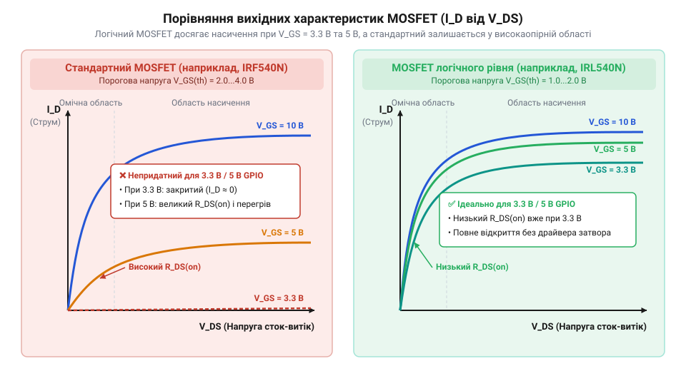
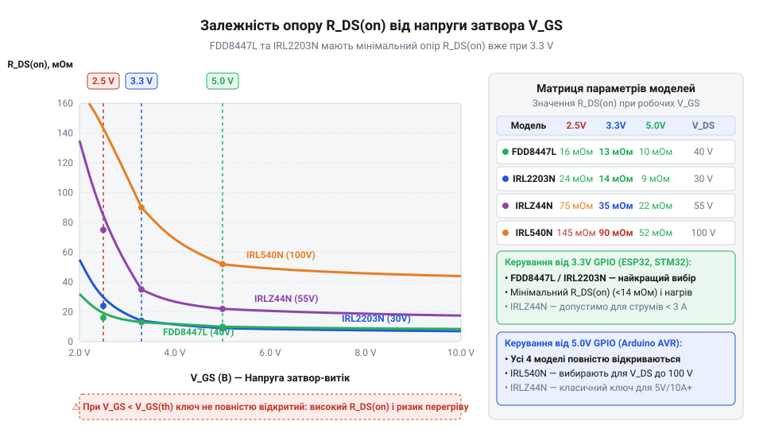
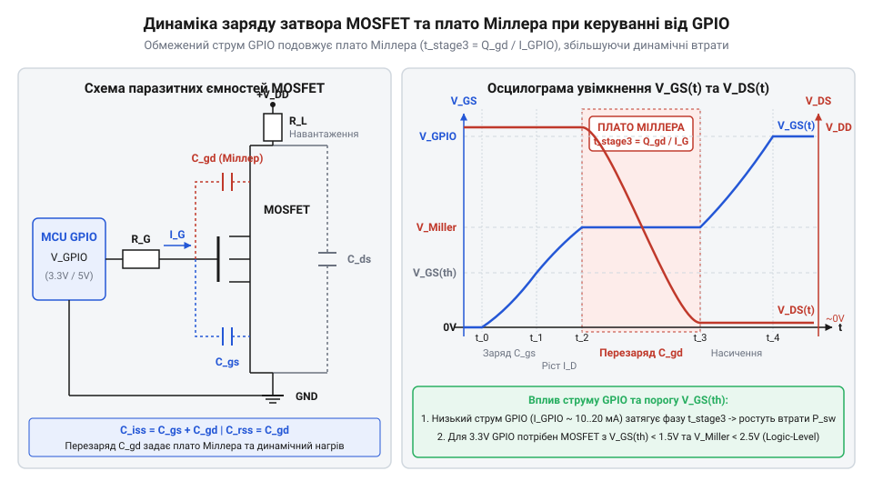
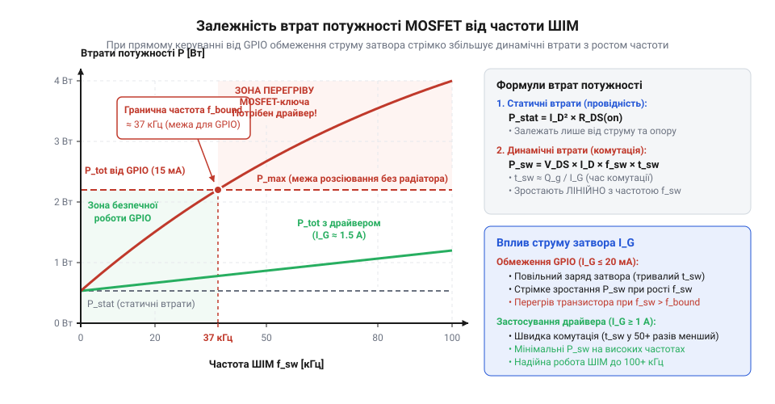
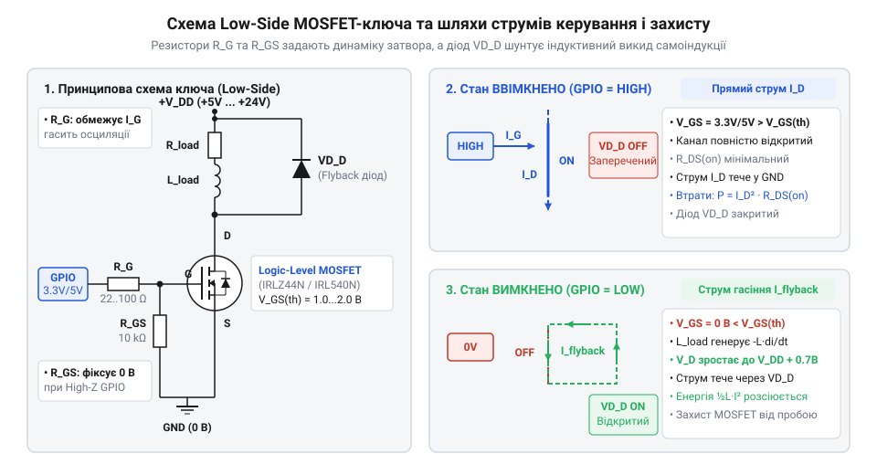

# MOSFET логічного рівня (IRLZ44N, IRL540N, IRL2203N, FDD8447L)

<preknowlist>
- [Схемотехніка низькостороннього ключа на MOSFET для керування навантаженням](root:cat-hw-drivers/low-side-mosfet-switch) — базовий принцип розмикання кола через N-канальний транзистор та функцію підтягувального резистора
</preknowlist>

## Перегрів стандартного MOSFET від GPIO

Типова ситуація у схемотехніці: потрібно увімкнути силовий пристрій з робочою напругою 12 В та струмом 5 А — наприклад, потужний колекторний двигун чи нагрівальну спіраль. Для цього часто беруть популярний силовий @@en|MOSFET@@ (англ. *Metal-Oxide-Semiconductor Field-Effect Transistor* — польовий транзистор зі структурою метал–оксид–напівпровідник) серії @@en|IRF540N@@ або @@en|IRFZ44N@@ у корпусі @@en|TO-220@@ і підключають його @@en|gate@@ (затвор) напряму до виходу @@en|GPIO@@ (англ. *General-Purpose Input/Output* — вихід загального призначення) мікроконтролера з рівнем 3,3 В або 5 В. Вибір здається обґрунтованим, адже у довідковій документації записано вражаючий граничний струм `I_D` на рівні 33 А чи навіть 110 А. Проте під час запуску навантаження ледь працює, а корпус транзистора за кілька секунд розігрівається до температури понад 100 °C і згорає від теплового пробою.

Ця проблема виникає через принципове непорозуміння фізики відкривання транзистора. Керування транзистором відбувається напругою `V_GS` між затвором та витоком (@@en|source@@). У специфікаціях на стандартні силові ключі вказано параметр порогової напруги `V_GS(th)` (порогова напруга, *threshold voltage*), який зазвичай становить 2,0–4.0 В. Початківець помилково вважає, що досягнення цієї напруги достатньо для повного відкриття ключа. Насправді `V_GS(th)` — це лише точка, у якій @@en|channel@@ (канал) між затвором і стоком (@@en|drain@@) тільки починає формуватися, а струм стоку досягає мікроскопічного тестового значення 250 мкА.

Для повноцінного насичення каналу носіями заряду та досягнення мінімального опору `R_DS(on)` (*drain-source on-state resistance*) стандартним силовим транзисторам потрібна напруга `V_GS` не менше 10 В. Якщо ж на затвор подати лише 3,3 В від STM32/ESP32 або 5 В від Arduino, ключ залишиться в лінійній (омічній) області вольт-амперної характеристики. У цьому проміжному стані опір каналу `R_DS(on)` перевищує номінальний паспортний показник у десятки разів.

Обчислення статичного нагріву показує масштаби катастрофи. Для ключа @@en|IRF540N@@ паспортний опір `R_DS(on)` при `V_GS = 10 В` становить 0.044 Ом. Проте при подачі керуючої напруги `V_GS = 4.5 В` опір відкритого каналу зростає приблизно до 0.8 Ом. Таке нелінійне зростання зумовлене фізикою формування інверсійного каналу під діелектриком затвора: провідність каналу прямо залежить від концентрації вільних носіїв заряду, залучених електричним полем напруги `V_GS - V_GS(th)`. Коли напруга `V_GS` лише незначно перевищує поріг `V_GS(th)`, електричне поле виявляється занадто слабким для утворення щільної зони провідності, тому опір каналу `R_DS(on)` зростає за стрімкою гіперболічною залежністю. У довідковій документації (@@en|datasheet@@) цю залежність визначають із двох графіків: вихідних характеристик `I_D` від `V_DS` та залежності `R_DS(on)` від `V_GS`. На кривих вихідних характеристик кут нахилу початкової омічної ділянки відповідає провідності відкритого ключа, і при низьких значеннях `V_GS` ця лінія стає майже пологою. На окремому графіку `R_DS(on)` від `V_GS` це відображається як різкий згин кривої вгору в області напруг нижче 5–6 В, де опір виходить із зони насичення й стрімко зростає. Знайдемо потужність статичних втрат `P_stat` при робочому струмі навантаження 5 А:

P_stat = I_D² × R_DS(on)
       = (5 A)² × 0.8 Ом    [підстановка робочого струму та опору каналу при V_GS = 4.5 В]
       = 20 Вт             [розрахована потужність статичного теплового розсіювання]

Порівняємо це з режимом повного відкриття ключа при напрузі 10 В:

P_stat = (5 A)² × 0.044 Ом
       = 1.1 Вт             [потужність втрат при напрузі затвора 10 В]

При потужності втрат 20 Вт без масивного зовнішнього радіатора кристал транзистора у корпусі @@en|TO-220@@ (з тепловим опором кристалик-середовище близько 62 °C/Вт) розігріється на тисячу градусів вище за температуру довкілля, що гарантовано знищує напівпровідник. Крім того, на самому транзисторі виникає значне падіння напруги `V_DS = I_D × R_DS(on) = 5 A × 0.8 Ом = 4 В`, через що навантаження замість 12 В отримує лише 8 В. Коли реалізується [схемотехніка низькостороннього ключа](root:cat-hw-drivers/low-side-mosfet-switch), цей ефект стає головною перешкодою для прямого підключення потужних елементів. Зрозуміти граничні режими допоможуть детальні [електричні режими MOSFET](root:cat-hw-drivers/logic-level-mosfets/api-logic-level-mosfet-hardware-interface.md), де описано безпечну область роботи напівпровідника.


*ВАХ струму стоку від напруги сток-витік: при керуванні від 3,3 В або 5 В стандартний транзистор не переходить у режим повного насичення й працює з високим опором.*

Таким чином, вибір силового ключа лише за граничним струмом стоку `I_D` призводить до теплової аварії при прямому керуванні від низьковольтної логіки. Щоб уникнути катастрофічного нагріву та забезпечити мінімальний опір відкритого каналу при підключенні до виходу @@en|GPIO@@ з рівнем 3,3 В або 5 В, необхідно використовувати @@en|logic-level MOSFET@@ (англ. *logic-level MOSFET* — транзистор із керуванням логічним рівнем). Такі пристрої мають знижену порогову напругу `V_GS(th)` і досягають повного насичення каналу безпосередньо від цифрових рівнів мікроконтролера. Якщо ж у схемі застосовують стандартний силовий транзистор, прямого керування від логічних виходів недостатньо і доводиться додавати [виділені драйвери затворів](root:hw-power/gate-driver) для підвищення напруги керування до 10 В.

## Принцип роботи MOSFET логічного рівня

Для усунення проблеми перегріву при прямому керуванні від мікроконтролерів створено спеціальний клас напівпровідникових пристроїв — @@en|logic-level MOSFET@@ (польові транзистори логічного рівня). Головна відмінність таких компонентів полягає в технології виготовлення структури затвора.

У звичайному транзисторі шар діелектрика з оксиду кремнію `SiO_2` під металевим або полікремнієвим затвором має відносно велику товщину для забезпечення високої електричної міцності. У транзисторах логічного рівня цей шар діелектрика роблять значно тоншим. За законами електростатики, зменшення товщини @@en|dielectric@@ (діелектрик) збільшує питому ємність затвора. Завдяки цьому навіть відносно слабке електричне поле при напрузі 2,5–4.5 В утворює в напівпровіднику інверсійний провідний @@en|channel@@ (канал) достатньої щільності. Порогова напруга `V_GS(th)` у таких приладах знижена до 1,0–2,0 В, а мінімальний опір `R_DS(on)` гарантується вже при логічних рівнях 3,3 В або 5 В. Проте таке зменшення товщини оксидного шару має зворотний бік: воно суттєво знижує його електричну міцність. Якщо стандартні силові ключі витримують напругу затвор-витік `V_GS` до ±20 В або навіть ±30 В, то для компонентів логічного рівня гранично допустима напруга `V_GS(max)` зазвичай обмежена діапазоном ±8–16 В. Будь-який імпульсний сплеск напруги на затворі вище цієї межі спричиняє незворотний фізичний пробій тонкої плівки `SiO_2` з утворенням короткого замикання між затвором і каналом. Крім того, стоншений діелектрик робить транзистор надзвичайно чутливим до @@en|ESD@@ (англ. *Electrostatic Discharge* — електростатичний розряд): навіть незначний статичний потенціал, переданий людиною чи паяльним обладнанням під час монтажу, може пробити затвор і безповоротно вивести прилад з ладу ще до ввімкнення схеми.

Еволюційні вимоги до силової електроніки змусили виробників переглянути класичну концепцію 10-вольтних затворів. Історично силові @@en|MOSFET@@ розроблялися під промислові стандарти живлення схем керування від 10–12 В, оскільки товстий шар діелектрика під затвором забезпечував високу пробійну міцність, але вимагав значного електричного поля для формування провідного каналу. З масовим поширенням цифрово-аналогових мікроконтролерів із живленням від @@en|TTL@@ (англ. *Transistor-Transistor Logic*) та КМОП-рівнів з'явилася гостра потреба комутувати силові кола напряму від виходів 5 В і 3,3 В без громіздких проміжних підсилювачів. Технологічний перехід на тонші оксидні шари дозволив суттєво знизити порогову напругу `V_GS(th)` і створити спеціалізовані серії пристроїв логічного рівня — зокрема серії @@en|IRL@@ (на відміну від стандартних @@en|IRF@@). Це дало змогу досягти мінімального опору відкритого каналу `R_DS(on)` при керуючих напругах 2,5–4,5 В і перетворило @@en|logic-level MOSFET@@ на базовий елемент сучасної мікроконтролерної схемотехніки.

Для ідентифікації ключа логічного рівня за @@en|datasheet@@ (інженерна специфікація) необхідно звертати увагу не лише на параметр `V_GS(th)`, а й на таблицю вимірювання опору відкритого каналу `R_DS(on)`:
1. Якщо специфікація наводить опір каналу виключно при `V_GS = 10 В`, транзистор є стандартним і вимагає проміжного підсилювача.
2. Якщо в документі чітко нормовано опір при `V_GS = 4.5 В`, `V_GS = 4.0 В` або `V_GS = 2.7 В`, пристрій є транзистором логічного рівня.

Серед широкої номенклатури напівпровідників виділяється кілька популярних моделей, орієнтованих на різні завдання:
- @@en|IRLZ44N@@: N-канальний транзистор (`V_DS = 55 В`, `I_D = 47 А`). Має гарантований опір `R_DS(on) = 0.022 Ом` при `V_GS = 5 В` та `0.025 Ом` при `V_GS = 4 В`. Оптимальний вибір для керування навантаженням 12–24 В від 5-вольтних мікроконтролерів.
- @@en|IRL540N@@: N-канальний ключ (`V_DS = 100 В`, `I_D = 30 А`) з опором `R_DS(on) = 0.044 Ом` при `V_GS = 5 В`. Завдяки високій допустимій напрузі сток-витік застосовується в кола з підвищеним ризиком індуктивних викидів.
- @@en|IRL2203N@@: виключно потужний ключ (`V_DS = 30 В`, `I_D = 116 А`) з наднизьким опором `R_DS(on) = 0.007 Ом` при `V_GS = 4.5 В`. Призначений для комутації великих струмів при низькій напрузі живлення.
- @@en|FDD8447L@@: сучасний @@en|SMD@@-транзистор у корпусі @@en|DPAK@@ (`V_DS = 40 В`, `I_D = 50 А`). Нормований для роботи при `V_GS = 3.3 В` з опором `0.011 Ом`, що робить його ідеальним рішенням для планарного монтажу та мікроконтролерів STM32 чи ESP32.

Здійснемо обчислення втрат для транзистора @@en|IRLZ44N@@ при струмі 5 А та напрузі затвора 4.5 В:

P_stat = I_D² × R_DS(on)
       = (5 A)² × 0.025 Ом   [підстановка струму навантаження та опору каналу IRLZ44N при 4.5 В]
       = 0.625 Вт           [потужність тепла у відкритому стані]

При втратах 0.625 Вт корпус транзистора без додаткових охолоджувачів розігріється лише на 35–40 °C вище навколишнього середовища, працюючи у цілковито безпечному тепловому режимі. Щоб правильно вибрати геометричні параметри відведення тепла, варто розрахувати [розрахований тепловий режим](root:hw-components/thermal-chain) напівпровідникового вузла.

Якщо ж комутація здійснюється на високих частотах, окрім статичних втрат з'являються динамічні втрати на перезаряд ємності затвора. Розрахувати ці процеси дозволяє [математична модель втрат](root:cat-hw-drivers/logic-level-mosfets/math-mosfet-losses-and-gate-dynamics.md), яка описує зв'язок між струмом GPIO та швидкістю перемикання. Для побудови завершеного пристрою можна використати готовий [практичний проект силового ключа](root:cat-hw-drivers/logic-level-mosfets/proj-logic-mosfet-low-side-driver.md), де розраховано обмежувальні резистори. Якщо ж струму GPIO не вистачає для швидкої комутації важких затворів, схемотехніку доповнюють, встановлюючи [виділені драйвери затвора](root:hw-power/gate-driver) силових MOSFET.


*Графік зміни опору відкритого каналу залежно від керуючої напруги на затворі для популярних транзисторів логічного рівня.*

## Динаміка затвора та ефект Міллера

Коли цифровий вихід (від англ. @@en|GPIO@@ — інтерфейс вводу-виводу загального призначення) мікроконтролера змінює свій стан із низького на високий, затвор (від англ. @@en|gate@@ — ворота) транзистора не відкривається миттєво. Напівпровідникова структура між затвором та іншими виводами утворює паразитні ємності, які вихідний буфер мікроконтролера змушений заряджати обмеженим струмом. Вихідний струм @@en|GPIO@@ зазвичай обмежений величиною 20–40 мА. Якщо підключити затвор @@en|MOSFET@@ напряму, цей струм заряджає вхідну ємність `C_iss` та ємність зворотного зв'язку `C_rss`. Через обмеженість струму напруга на затворі зростає не стрибкоподібно, а за лінійним або експоненційним законом, розтягуючи процес комутації в часі.


*Паразитні ємності MOSFET та часова діаграма напруги затвора, що демонструє затримку перемикання під час плато Міллера.*

Процес увімкнення транзистора ділиться на чотири послідовні фази. На першій фазі струм @@en|GPIO@@ заряджає ємність затвор-витік `C_gs` до порогової напруги `V_GS(th)`. У цей проміжок струм стоку (від англ. @@en|drain@@) `I_D` дорівнює нулю, а напруга між стоком і витоком (від англ. @@en|source@@) `V_DS` залишається максимальною. На другій фазі напруга затвора перевищує `V_GS(th)`, і струм `I_D` починає зростати від нуля до повного струму навантаження. На третій фазі настає критичний ефект — поява плато Міллера (від прізвища американського інженера Джона Міллера, англ. @@en|Miller plateau@@). У цей момент струм стоку досяг максимуму, але напруга `V_DS` починає стрімко падати від напруги живлення до мінімального значення. Оскільки ємність затвор-сток `C_gd` (або `C_rss`) підключена між виходом і входом транзистора, швидке падіння напруги `V_DS` створює розрядний струм через `C_gd`. Увесь струм, що надходить від @@en|GPIO@@, витрачається на перезарядку ємності `C_gd`, через що напруга на затворі `V_GS` «заморожується» на постійному рівні плато `V_plat` і не зростає, поки `V_DS` повністю не впаде. На четвертій фазі, після завершення спаду `V_DS`, напруга `V_GS` дозаряджається до повного рівня логічної одиниці 3,3 В або 5 В, забезпечуючи найменший опір відкритого каналу `R_DS(on)`.

Тривалість плато Міллера та фази спаду напруги `V_DS` прямо визначає динамічні втрати потужності `P_dyn`. Упродовж цього перехідного часу `t_sw` транзистор одночасно перебуває під високою напругою `V_DS` та проводить повний струм `I_D`. Щоб не оцінювати тривалість комутації наосліп, її виводять із паспортного заряду затвор-сток `Q_gd` (від англ. @@en|gate-to-drain charge@@ — заряд від затвора до стоку), який відображає ємність зворотного зв'язку. Під час плато Міллера напруга затвора зафіксована на рівні `V_plat`, тому струм затвора `I_gate`, який віддає вихід @@en|GPIO@@ через сумарний опір кола `R_G_total` (що складається з вихідного опору драйвера мікроконтролера та зовнішнього резистора `R_G`), залишається постійним. Для обчислення часу плато `t_plat` ділять необхідний заряд `Q_gd` на струм заряджання затвора `I_gate`:

```
t_plat = Q_gd ÷ I_gate
= Q_gd ÷ ((V_OH - V_plat) ÷ R_G_total)      [підстановка струму затвора через різницю потенціалів]
= (Q_gd × R_G_total) ÷ (V_OH - V_plat)       [тривалість плато через заряд і опір кола]
```

Де `V_OH` — напруга логічної одиниці на виході @@en|GPIO@@. Якщо вихідний струм мікроконтролера обмежений його максимальним допустимим значенням `I_GPIO`, струм `I_gate` не може перевищувати `I_GPIO`, що задає фізичну межу швидкості комутації `t_plat = Q_gd ÷ I_GPIO`. Потужність, що розсіюється на кристалі під час одного імпульсу комутації, дорівнює добутку напруги на струм. Якщо транзистор перемикається з частотою широтно-імпульсної модуляції (від англ. @@en|PWM@@ — Pulse Width Modulation) `f_PWM`, загальні втрати складаються зі статичних втрат у відкритому стані та динамічних втрат під час перемикання. Точний розрахунок обох складових описує [математична модель динаміки затвора](root:cat-hw-drivers/logic-level-mosfets/math-mosfet-losses-and-gate-dynamics.md), яка дозволяє обчислити температуру кристала за робочих частот.

Щоб обчислити середню динамічну потужність `P_dyn` при симетричному часі ввімкнення та вимкнення `t_sw`, використовують співвідношення між напругою живлення `V_DS`, струмом навантаження `I_D`, частотою `f_PWM` та тривалістю перехідного процесу `t_sw`:

```
P_dyn = 0.5 × V_DS × I_D × (t_r + t_f) × f_PWM [усереднення енергії двох перехідних процесів]
```

Тут `t_r` — час наростання струму стоку, `t_f` — час спаду напруги стоку, а сума `t_r + t_f` дорівнює повній тривалості перехідного стану `t_sw`. З формули чітко видно: що вища частота @@en|PWM@@ або що триваліший перехідний процес через низький струм керування від @@en|GPIO@@, то більша теплова потужність виділяється на транзисторі.


*Залежність втрат потужності від частоти ШІМ: при високій частоті динамічні втрати переважають статичні.*

Для обмеження імпульсного струму виводу мікроконтролера та запобігання високочастотному дзвінку в колі затвора послідовно встановлюють обмежувальний резистор `R_G` (зазвичай 47–220 Ом). Однак резистор `R_G` разом із внутрішнім опором @@en|GPIO@@ збільшує постійну часу зарядки ємності затвора `τ = R_total × C_iss`. Це подовжує час перебування в плато Міллера та підвищує `P_dyn`. На низьких частотах (наприклад, 100 Гц при комутації реле чи нагрівачів) динамічними втратами можна знехтувати, оскільки статичні втрати `P_stat = I_D² × R_DS(on)` є визначальними. Проте при частотах @@en|PWM@@ понад 20–50 кГц тривалість `t_sw` від @@en|GPIO@@ стає порівнянною з періодом ШІМ, і динамічне нагрівання може швидко вивести транзистор з ладу.

## Вибір популярних моделей під завдання

При виборі транзистора логічного рівня (від англ. @@en|Logic-Level MOSFET@@) розробник змушений балансувати між трьома основними параметрами: максимально допустимою напругою стоку `V_DS`, максимальним струмом `I_D` та опором відкритого каналу `R_DS(on)` при логічній напрузі затвора 3,3 В або 5 В. Фізична структура кремнієвого кристала створює жорсткий компроміс: що вища пробійна напруга `V_DS`, то товстіший шар дрейфу потрібен у структурі напівпровідника, що неминуче збільшує питомий опір каналу `R_DS(on)` при тій самій площі кристала. Повний перелік параметрів та призначення виводів описує [апаратний інтерфейс підключення](root:cat-hw-drivers/logic-level-mosfets/api-logic-level-mosfet-hardware-interface.md), який слугує довідником при підборі компонентів.

Серед вивідних транзисторів у корпусі @@en|TO-220@@ класичними рішеннями є моделі @@en|IRLZ44N@@ та @@en|IRL540N@@. Транзистор @@en|IRLZ44N@@ розрахований на напругу `V_DS` до 55 В і струм до 47 А, маючи при напрузі затвора 5 В опір `R_DS(on)` всього 22 мОм (і близько 25 мОм при 4 В). Це робить його ідеальним вибором для комутації навантажень із напругою 12 В або 24 В (наприклад, світлодіодних стрічок чи потужних колекторних двигунів). У той же час модель @@en|IRL540N@@ витримує напругу `V_DS` до 100 В, але через вищу пробійну напругу її опір `R_DS(on)` зростає до 44 мОм при `V_GS` = 5 В. Отже, @@en|IRL540N@@ обирають для кіл із напругою живлення 48 В або при ризику високих індуктивних викидів, але він виділяє удвічі більше тепла при тому самому струмі, ніж @@en|IRLZ44N@@.

Коли необхідно комутувати надвисокі струми від мікроконтролерів із живленням 3,3 В (наприклад, @@en|ESP32@@ або @@en|STM32@@), застосовують транзистор @@en|IRL2203N@@. Завдяки збільшеній площі кристала він забезпечує наднизький опір `R_DS(on)` близько 7 мОм при `V_GS` = 4,5 В і всього 10 мОм при `V_GS` = 2,8 В, витримуючи струм до 116 А при граничній напрузі `V_DS` = 30 В. Для сучасних компактних друкованих плат поверхневого монтажу (від англ. @@en|SMD@@ — Surface Mount Device) чудовим вибором є @@en|FDD8447L@@ у корпусі @@en|DPAK@@. Він розрахований на `V_DS` = 40 В, струм 50 А та має `R_DS(on)` близько 8,5 мОм при `V_GS` = 4,5 В і 11 мОм при 2,5 В. Завдяки малому заряду затвора `Q_g` всього 19 нКл, @@en|FDD8447L@@ легко керується безпосередньо від @@en|GPIO@@ без значних затримок.

Типова схема комутації нижнього плеча (від англ. @@en|low-side@@) вимагає не лише транзистора, а й обв'язки для стабільної та безпечної роботи.


*Схема підключення MOSFET логічного рівня до GPIO з обмежувальним резистором затвора, підтяжкою до землі та захисним діодом для індуктивного навантаження.*

Окрім послідовного резистора затвора `R_G`, паралельно між затвором та витіком обов'язково встановлюють підтягувальний резистор `R_GS` номіналом 10 кОм. Він гарантує закритий стан транзистора під час перезавантаження мікроконтролера, коли виводи @@en|GPIO@@ перебувають у високоімпедансному стані. При керуванні індуктивним навантаженням (котушки реле, соленоїди, двигуни) паралельно до навантаження підключають захисний діод самоіндукції (від англ. @@en|flyback diode@@). Діод гасить зворотний імпульс напруги `V = L × (dI/dt)`, виникаючий при розмиканні ключа, захищаючи сток транзистора від пробою. Схемотехнічні нюанси розглядає [схемотехніка низькостороннього ключа](root:cat-hw-drivers/low-side-mosfet-switch), а створення завершеного пристрою описує [практична схема силового ключа](root:cat-hw-drivers/logic-level-mosfets/proj-logic-mosfet-low-side-driver.md), де наведено практичний приклад розрахунку компонентів.

Пряме керування від @@en|GPIO@@ має чітку межу застосовності. Якщо робочий струм навантаження вимагає використання масивного транзистора з великим зарядом затвора `Q_g` понад 50–100 нКл, або якщо частота @@en|PWM@@ перевищує десятки кілогерц, струму @@en|GPIO@@ в 20 мА стає недостатньо для швидкої перезарядки ємностей. У таких випадках пряме керування спричиняє неприпустимий перегрів. Вирішенням проблеми є застосування [виділених драйверів затворів](root:hw-power/gate-driver), здатних видавати імпульсний струм у кілька ампер. Крім того, якщо навантаження вимагає постійного зв'язку зі спільною землею, застосовують [силові ключі верхнього плеча](root:hw-components/high-side-mosfet-switches-and-charge-pumps), які потребують додаткових схем зсуву рівня або вольтододачі. Якщо ж теплові втрати навіть при низькому `R_DS(on)` перевищують допустимі межі корпусу, розробнику знадобиться [обчислення режимів охолодження](root:hw-components/thermal-chain) для підбору оптимального радіатора.

## Схемотехніка ключа та елементи захисту

Пряме з'єднання затвора транзистора з виводом мікроконтролера створює ризик пошкодження обох компонентів. Вхідний каскад польового транзистора виявляє ємнісні властивості, тому в момент перемикання цифрового виходу з нуля в одиницю розряджена ємність затвора працює як коротке замикання. Вихідний драйвер @@en|GPIO@@ мікроконтролера змушений віддавати короткочасний струм, що перевищує допустимий поріг мікросхеми (зазвичай 12–20 мА для @@en|ESP32@@ та @@en|STM32@@). Щоб захистити вихідний каскад від струмового перевантаження, у послідовний ланцюг затвора вмикають обмежувальний затворний резистор `R_G` (англ. @@en|gate resistor@@).

Мінімальний опір обмежувального резистора затвора `R_G` розраховують через максимальний допустимий струм виходу мікроконтролера `I_GPIO(max)` та напругу логічної одиниці `V_GPIO`:

```text
R_G = V_GPIO ÷ I_GPIO(max)                      [закон Ома для кола затвора]
```

**Обчислення мінімального опору R_G для мікроконтролера ESP32 із вихідним струмом 12 мА при напрузі 3.3 В:**
```text
R_G(min) = 3.3 В ÷ 0.012 А                      [підстановка напруги 3.3 В та струму 12 мА]
         = 275 Ом                               [найближчий номінал E24 дорівнює 300 Ом]
```

Значення `R_G` зазвичай обирають у межах 270–330 Ом. Більший опір безпечніше обмежує струм, але уповільнює процес заряджання внутрішніх ємностей транзистора, затягуючи комутаційні фронти. Електричні параметри та розпіновку моделей на зразок @@en|IRLZ44N@@ чи @@en|FDD8447L@@ визначено в [залізній довідці з підключення](root:cat-hw-drivers/logic-level-mosfets/api-logic-level-mosfet-hardware-interface.md), що регламентує граничні струми затвора.

Другий необхідний елемент — підтягувальний резистор `R_GS` (англ. @@en|pull-down resistor@@), який підключають між затвором та витоком. У момент подачі живлення або скидання мікроконтролера його ніжки перебувають у стані високого імпедансу (англ. @@en|high-Z state@@). Затвор MOSFET має надзвичайно високий власний опір (більше 10⁸ Ом), тому ізольований затвор легко накопичує статичний заряд або завади, самовільно відкриваючи транзистор. Резистор `R_GS` номіналом 10–100 кОм створює постійний шлях для розряду ємності на землю, гарантуючи закритий стан ключа під час завантаження управляючої плати.

Підтягувальний резистор `R_GS` утворює дільник напруги із затворним резистором `R_G`. Ослаблення керуючого сигналу на затворі `V_GS` розраховують за виразом:

```text
V_GS = V_GPIO × R_GS ÷ (R_G + R_GS)            [дільник напруги між R_G та R_GS]
```

**Обчислення напруги затвора при R_G = 300 Ом та R_GS = 10 кОм:**
```text
V_GS = 3.3 В × 10000 Ом ÷ (300 Ом + 10000 Ом)   [підстановка опорів 300 Ом та 10 кОм]
     = 3.3 В × 10000 ÷ 10300                     [обчислення знаменника]
     = 3.204 В                                  [падіння напруги становить менше 3%]
```

Падіння керуючої напруги на 0.096 В є незначним, тому резистор `R_GS` підключають безпосередньо до виводів затвора та витоку транзистора. Усі ці елементи збирають у [практичному проекті силового ключа](root:cat-hw-drivers/logic-level-mosfets/proj-logic-mosfet-low-side-driver.md), де наведено реальне розведення друкованого вузла.


*Принципова схема низькостороннього ключа з резисторами R_G і R_GS та захисним діодом паралельно індуктивному навантаженню.*

Особливої уваги вимагає комутація індуктивного навантаження: електродвигунів, реле, соленоїдів чи трансформаторів. Індуктивність накопичує енергію в магнітному полі. Коли MOSFET стрімко розмикає коло, струм не може зникнути миттєво. Згідно з законом самоіндукції, на виводах обмотки виникає зворотна емо (ЕРС самоіндукції) з високою швидкістю зміни струму. Цей імпульс високої напруги прикладається до стоку транзистора, викликаючи [фізику лавинного пробою](root:hw-components/mosfet-avalanche) у напівпровідниковій структурі та руйнуючи кристал.

Для захисту силового ключа паралельно індуктивному навантаженню вмикають діод зворотного ходу (англ. @@en|flyback diode@@ від *@@en|fly@@* — летіти та *@@en|back@@* — назад). Його підключають катодом до позитивної шини живлення `V_CC`, а анодом — до стоку MOSFET. При відкритому транзисторі діод закритий зворотною напругою живлення і не впливає на роботу. У момент закриття транзистора ЕРС самоіндукції змінює полярність на обмотці, відкриваючи діод. Струм індуктивності продовжує замкнено протікати через діод та власний опір обмотки, безпечно розсіюючи накопичену енергію у вигляді тепла. Захисний елемент повинен бути швидким (наприклад, діод Шотткі, англ. @@en|Schottky diode@@), а його допустимий прямий струм має перевищувати робочий струм навантаження. Коли навантаження підключають через [вузол низькостороннього ключа](root:cat-hw-drivers/low-side-mosfet-switch), який забезпечує розрив мінусового провідника, захисний діод є обов'язковим. Для завдань із розривом плюсової шини використовують [структури верхнього плеча](root:hw-components/high-side-mosfet-switches-and-charge-pumps) з додатковим схемотехнічним обв'язуванням.

Вибір конкретного типу захисного діода критично залежить від частоти комутації ключа. Звичайні низькочастотні випрямні діоди (наприклад, серії @@en|1N4007@@) мають великий час зворотного відновлення (англ. @@en|reverse recovery time@@ від *@@en|reverse@@* — зворотний та *@@en|recovery@@* — відновлення; `t_rr` досягає 2 мкс). Якщо транзистор повторно відкривається раніше, ніж діод встигає повністю закритися, виникає короткочасне наскрізне замикання шини живлення `V_CC` на землю через відкритий канал ключа та діод. Це викликає різкий імпульсний струм, підвищує [розсіювання тепла силових напівпровідників](root:hw-components/thermal-chain) та генерує сильні електромагнітні завади. Застосування діодів Шотткі запобігає наскрізним струмам завдяки миттєвому перемиканню та меншому падінню прямої напруги. Для максимальної ефективності захисний елемент монтують безпосередньо біля виводів індуктивного навантаження або стоку @@en|MOSFET@@, мінімізуючи довжину провідників плати, паразитна індуктивність яких створює додаткові сплески напруги.

## Тепловий розрахунок і межі застосування

Під час роботи силовий транзистор виділяє тепло у двох режимах: під час проходження струму через відкритий канал та під час перехідних процесів перемикання. Сумарна потужність втрат складається зі статичної складової `P_stat` та динамічної складової `P_dyn`.

Статичну потужність втрат `P_stat` розраховують як добуток квадрата струму стоку `I_D` на опір відкритого каналу `R_DS(on)` із урахуванням коефіцієнта заповнення ШІМ `D`:

```text
P_stat = D × I_D² × R_DS(on)                   [статичні втрати в провідному стані]
```

Слід ураховувати, що опір `R_DS(on)` зростає під час нагрівання кристала (температурний коефіцієнт становить близько +0.4% на кожний градус Цельсія). При температурі 100 °C опір каналу транзистора @@en|IRLZ44N@@ зростає з номінальних 0.022 Ом до приблизно 0.035 Ом.

**Обчислення статичних втрат MOSFET IRLZ44N при струмі 5 А, D = 1.0 та температурі кристала 100 °C (R_DS(on) = 0.035 Ом):**
```text
P_stat = 1.0 × (5 А)² × 0.035 Ом                [підстановка струму 5 А та гарячого опору]
       = 1.0 × 25 А² × 0.035 Ом                 [піднесення струму до квадрата]
       = 0.875 Вт                               [теплова потужність у стаціонарному режимі]
```

Динамічні втрати потужності `P_dyn` виникають на фронтах включення та виключення, коли транзистор проходить через лінійну область із високою напругою сток-витік `V_DS` та значним струмом `I_D`. Вони пропорційні напрузі живлення, струму навантаження, частоті @@en|PWM@@ `f_PWM` та сумарному часу комутації `t_sw`:

```text
P_dyn = 0.5 × V_DS × I_D × f_PWM × t_sw         [динамічні втрати на інтервалах перемикання]
```

**Обчислення динамічних втрат при V_DS = 12 В, I_D = 5 А, f_PWM = 20000 Гц та часі комутації t_sw = 1.5 мкс:**
```text
P_dyn = 0.5 × 12 В × 5 А × 20000 Гц × 1.5×10⁻⁶ с [підстановка параметрів комутації]
      = 30 Вт·А × 20000 Гц × 0.0000015 с         [обчислення миттєвого добутку]
      = 0.9 Вт                                  [динамічне теплове розсіювання]
```

Повний математичний аналіз перехідних процесів затвора детально описано в [розрахунку втрат потужності](root:cat-hw-drivers/logic-level-mosfets/math-mosfet-losses-and-gate-dynamics.md), де наведено інтегральні вирази для плато Міллера.

Сумарну теплову потужність `P_tot` визначають додаванням статичної та динамічної компонент:

```text
P_tot = P_stat + P_dyn                          [сумарна потужність теплових втрат]
```


*Еквівалентна теплова схема MOSFET на радіаторі, що ілюструє послідовне складання теплових опорів від кристала до навколишнього середовища.*

Температуру напівпровідникового кристала `T_j` (англ. @@en|junction temperature@@ від *@@en|junction@@* — з'єднання) розраховують через тепловий опір (англ. @@en|thermal resistance@@) між кристалом та середовищем `R_θJA`:

```text
T_j = T_a + P_tot × R_θJA                       [тепловий баланс напівпровідникового приладу]
```

Повний тепловий опір без зовнішнього охолодження складається з опору кристал-корпус `R_θJC` та корпус-середовище `R_θCA`. Для корпусу @@en|TO-220@@ параметр `R_θJA` становить приблизно 62 °C/Вт.

**Обчислення температури кристала IRLZ44N без радіатора при P_tot = 1.775 Вт та T_a = 25 °C:**
```text
T_j = 25 °C + 1.775 Вт × 62 °C/Вт               [підстановка втрат та теплового опору]
    = 25 °C + 110.05 °C                         [обчислення перегріву відносно середовища]
    = 135.05 °C                                 [температура кристала без охолодження]
```

Отримана температура 135 °C перевищує рекомендовану робочу межу (120–125 °C), що вимагає встановлення радіатора чи розширення мідного полігону для планарних корпусів на зразок @@en|DPAK@@. Обсяг металевого охолоджувача визначає [методика розрахунку радіаторів](root:hw-components/thermal-chain) для активного відведення тепла.

Обчислення показують граничні можливості прямого керування від @@en|GPIO@@. При частотах ШІМ вище 10–20 кГц або при використанні потужних транзисторів типу @@en|IRL2203N@@ із великим зарядом затвора `Q_g` (близько 60 нК), вихідний струм мікроконтролера в 12–20 мА не здатний швидко перезаряджати ємності затвора. Час комутації `t_sw` зростає до 2–3 мкс, викликаючи стрімке зростання динамічних втрат `P_dyn` та катастрофічний перегрів ключа. У таких режимах пряме керування стає непридатним, а схема потребує [виділеного драйвера затвора](root:hw-power/gate-driver) з високим піковим струмом (1–2 А) на основі двотактного каскаду (англ. @@en|push-pull@@ від *@@en|push@@* — штовхати та *@@en|pull@@* — тягнути), який швидко заряджає затвор без перевантаження мікроконтролера.
