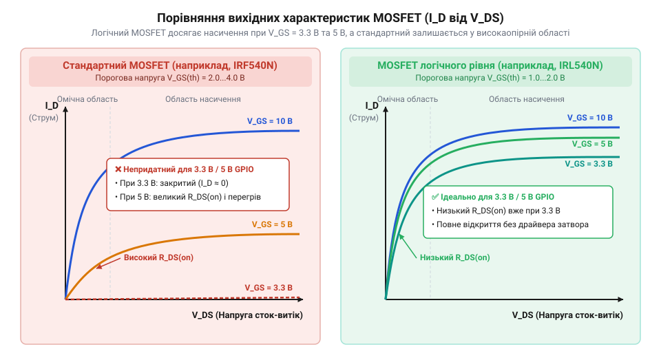
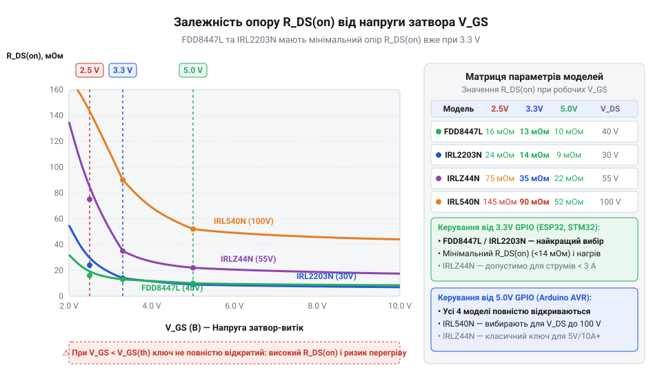

# MOSFET логічного рівня (IRLZ44N, IRL540N, IRL2203N, FDD8447L)

<preknowlist>
- [Схемотехніка низькостороннього ключа на MOSFET для керування навантаженням](root:cat-hw-drivers/low-side-mosfet-switch) — базовий принцип розмикання кола через N-канальний транзистор та функцію підтягувального резистора
</preknowlist>

## Перегрів стандартного MOSFET від GPIO

При підключенні потужного навантаження через [низькосторонній ключ на транзисторі](root:cat-hw-drivers/low-side-mosfet-switch) від цифрового виводу `@@en|GPIO@@` мікроконтролера транзистор може розжаритися за лічені секунди. Причина полягає у хибному сприйнятті параметра порогової напруги затвора `V_GS(th)`. Значення `V_GS(th)` у специфікації стандартного `@@en|MOSFET@@` (англ. *metal-oxide-semiconductor field-effect transistor*, корінь *transistor* від англійського *transfer* — передавати + *resistor* — опір) вказує лише на початок формування провідного каналу, коли струм стоку становить лише частки міліампера. Щоб повністю відкрити канал і зменшити опір `R_DS(on)` до мінімуму, звичайній силовій структурі потрібно від `8` до `10` В на затворі. Коли цифровий вивід подає лише `3.3` В або `5` В, ключ залишається у лінійному режимі: опір каналу вимірюється Омами замість міліомів, а струм навантаження створює на ньому високий спад напруги й катастрофічні статичні втрати потужності.


*При малій напрузі затвора V_GS стандартний транзистор залишається в лінійному режимі з великим спадом напруги, тоді як логічний досягає насичення.*

## Будова та характеристики логічних MOSFET

Для керування силою безпосередньо від мікроконтролера розробили `@@en|MOSFET@@` логічного рівня. Зменшення товщини діелектричного шару діоксиду кремнію `SiO_2` під затвором збільшує питому ємність структури, тому електричне поле відкриває провідний канал вже при напрузі `V_GS` від `3.3` В до `5` В. Проте тонкий діелектрик знижує граничну напругу `V_GS(max)` до `10`–`16` В проти `20` В у стандартних ключів і робить деталь вкрай чутливою до `@@en|ESD@@` (англ. *electrostatic discharge*, корінь *discharge* від латинського *dis-* — зняття + *charge* — навантаження). Для вибору пристрою порівнюють струм стоку та напругу: `@@en|IRLZ44N@@` підходить для струмів до `47` А при напрузі до `55` В, `@@en|IRL540N@@` витримує до `100` В, `@@en|IRL2203N@@` забезпечує наднизький опір при напругах до `30` В, а `@@en|FDD8447L@@` у поверхневому корпусі розрахований на компактні платформи.


*Характеристики моделей IRLZ44N, IRL540N, IRL2203N та FDD8447L показують компроміс між допустимою напругою стоку та опором відкритого каналу.*

## Схемотехніка обв'язки та захисного діода

Надійне підключення затвора вимагає захисної обв'язки. Оскільки ємність затвора у момент перемикання працює як коротке замикання, обмежувальний резистор `R_G` номіналом `47`–`220` Ом захищає вивід мікроконтролера від імпульсного струмового перевантаження. Підтягувальний резистор `R_GS` номіналом `10`–`100` кОм між затвором і землею фіксує нульовий потенціал під час перезавантаження виводів керування. При комутації індуктивного навантаження паралельно йому встановлюють швидкий діод зворотного ходу, який шунтує високовольтний сплеск електрорушійної сили самоіндукції під час розмикання ключа.


*Резистори R_G та R_GS формують безпечний режим керування затвором, а паралельний діод захищає транзистор від індуктивних викидів.*

## Оцінка втрат і межі застосування

Тепловий режим визначається двома компонентами втрат потужності. Статичні втрати потужності `P_stat` виникають під час проходження струму стоку `I_D` через відкритий канал з опором `R_DS(on)`:

```
P_stat = I_D² × R_DS(on)
```

Динамічні втрати `P_dyn` зростають при підвищенні частоти керування `@@en|PWM@@` (англ. *pulse-width modulation*, корінь *modulation* від латинського *modus* — міра, лад), коли затвор повільно перезаряджається через обмежений струм цифрового виводу, утримуючи транзистор у лінійному режимі під час фронтів. Сумарна втрата потужності `P_tot` визначає підсумкову температуру кристала `T_J` відносно температури довкілля `T_A` через тепловий опір `R_th(JA)`:

```
T_J = T_A + P_tot × R_th(JA)
```

Якщо обчислена температура кристала перевищує граничне значення `150` °C, для охолодження потрібен радіатор або виділений `@@en|драйвер@@` (англ. *driver*, корінь *drive* — гнати, вести) затвора для прискорення динамічної комутації.


*Тепловий опір від кристала до довкілля визначає перегрів транзистора при розрахованих статичних і динамічних втратах.*
