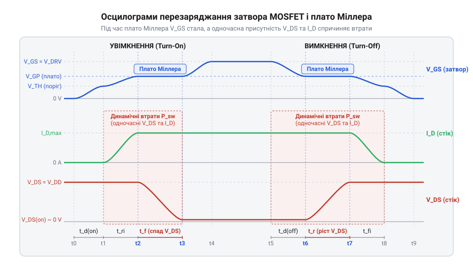

# Математична модель втрат потужності та динаміки затвора MOSFET

<preknowlist>
- [Схемотехніка низькостороннього ключа на MOSFET для керування навантаженням](root:cat-hw-drivers/low-side-mosfet-switch) — базову схемотехніку включення N-канального MOSFET із затворним резистором та принципи роботи ключа в режимі насичення
</preknowlist>

## Проблема перегріву силового MOSFET

Пряме підключення @@en|затвора@@ (англ. *gate*) транзистора @@en|MOSFET@@ (англ. *metal-oxide-semiconductor field-effect transistor*, метал-оксид-напівпровідник) до виходу @@en|GPIO@@ (англ. *general-purpose input/output*, вхід-вихід загального призначення) цифрового пристрою здається найпростішим розв'язком, коли збирається [низькосторонній ключ на MOSFET](root:cat-hw-drivers/low-side-mosfet-switch). Інженер очікує, що силовий ключ працюватиме із найменшим нагріванням, якщо опір відкритого каналу `R_DS(on)` з паспортних даних становить лише кілька міліом. Проте при реальній комутації потужного навантаження за допомогою @@en|ШІМ@@ (англ. *PWM*, pulse-width modulation, широтно-імпульсна модуляція) кристал транзистора швидко розігрівається до критичних температур або виходить із ладу.

Спрощений розрахунок тепловиділення, який враховує лише опір каналу у статичному стані, припускається трьох суттєвих помилок. По-перше, паспортне значення `R_DS(on)` вказують для температури 25 °C, але під час нагрівання напівпровідника опір каналу зростає. По-друге, керувальна напруга виходу @@en|GPIO@@ @@en|мікроконтролера@@ (англ. *microcontroller*) часто є занизькою для повного відкривання стандартного транзистора, через що канал залишається в проміжному стані з підвищеним опором. По-третє, у моменти перемикання транзистор неминуче проходить через лінійну область, де на ньому одночасно присутні висока напруга та великий струм @@en|стоку@@ (англ. *drain*).

Щоб запобігти аварійному руйнуванню силового ключа, необхідно розрахувати сумарне тепловиділення `P_total`. Повний баланс потужності розсіювання складається зі статичних втрат провідності `P_stat` у відкритому стані, динамічних втрат комутації `P_sw` під час фронтів перемикання та потужності перезаряджання ємностей @@en|затвора@@ `P_gate`. Задача інженера — обчислити кожну складову та порівняти сумарну потужність із тепловими можливостями корпусу.

## Розрахунок статичних втрат провідності

Після усвідомлення структури втрат першим кроком є визначення статичної потужності розсіювання `P_stat`, яка виділяється на ключі у відкритому стані. Коли @@en|MOSFET@@ повністю відкритий, опір між @@en|стоком@@ та @@en|витоком@@ (англ. *source*) дорівнює опору відкритого каналу `R_DS(on)`. Проте використання значення `R_DS(on)` за нормальної температури кристала 25 °C призводить до заниження обчисленого тепла, оскільки кремній має позитивний температурний коефіцієнт опору `α`.

Для обчислення дійсного опору розігрітого каналу `R_DS(on)_hot` застосовують лінійну температурну модель:

```
R_DS(on)_hot = R_DS(on)_25 × (1 + α × ΔT)      [урахування температурного приросту опору]
```

Тут `R_DS(on)_25` — паспортний опір при 25 °C, `α` — температурний коефіцієнт (типово від 0.005 до 0.008 1/°C для кремнієвих ключів), а `ΔT = T_j - 25` — перевищення температури кристала `T_j` над стандартною початковою температурою.

Знаючи робочий струм @@en|стоку@@ `I_D` та коефіцієнт заповнення імпульсів `D` для режиму @@en|ШІМ@@, статичні втрати потужності визначають за формулою:

```
P_stat = I_D² × R_DS(on)_hot × D              [обчислення статичної потужності]
```

Розглянемо приклад розрахунку ключа із струмом `I_D = 6 А`, початковим опором `R_DS(on)_25 = 0.02 Ом`, коефіцієнтом `α = 0.006 1/°C` та робочою температурою кристала `T_j = 105 °C` при безперервному включенні (`D = 1`):

```
R_DS(on)_hot = 0.02 × (1 + 0.006 × (105 - 25))
             = 0.02 × (1 + 0.006 × 80)          [зсув температури на 80 °C]
             = 0.02 × 1.48                      [температурний множник опору]
             = 0.0296 Ом                        [опір гарячого каналу]
```

```
P_stat = 6² × 0.0296
       = 36 × 0.0296                            [піднесення струму до квадрата]
       = 1.0656 Вт                              [статична потужність втрат]
```

Зростання температури кристала підвищує опір каналу майже в півтора рази, що збільшує нагрів. Зв'язок між втраченою потужністю та температурою кристала описується через тепловий опір корпус-середовище `R_θJA`: `T_j = T_amb + P_total × R_θJA`. Розрахунок `P_stat` дає лише нижню межу тепловиділення, бо в режимі комутації до неї додаються динамічні втрати.

## Динаміка затвора та плато Міллера

Для аналізу втрат під час перемикання спрощене уявлення про @@en|затвор@@ як про звичайний стаціонарний конденсатор є недостатнім. Внутрішня структура @@en|MOSFET@@ містить три паразитні ємності: ємність затвор-витік `C_gs`, ємність затвор-сток `C_gd` та ємність сток-витік `C_ds`. У паспортних даних їх групують у вхідну ємність `C_iss = C_gs + C_gd`, вихідну `C_oss = C_ds + C_gd` та зворотну перехідну ємність `C_rss = C_gd`. Динамічна зміна напруги на @@en|стоку@@ створює @@en|ефект Міллера@@ (англ. *Miller effect*, від прізвища дослідника Джона Міллера), який кардинально змінює характер заряду затвора.


*Осцилограми перехідних процесів увімкнення та вимкнення силового MOSFET при заряджанні паразитних ємностей.*

Процес увімкнення транзистора складається з чотирьох послідовних фаз. На першій фазі струм керування заряджає ємність `C_gs` до порогової напруги відкривання `V_GS(th)`. Струм @@en|стоку@@ при цьому дорівнює нулю. На другій фазі напруга @@en|затвора@@ зростає від `V_GS(th)` до напруги @@en|плато Міллера@@ (англ. *Miller plateau*) `V_Miller`, а струм стоку зростає до повного значення навантаження `I_D`. На третій фазі напруга затвора замирає на рівні `V_Miller`, хоча вихідний драйвер продовжує подавати струм. Усе надходження заряду витрачається на розряджання ємності `C_gd` під дією швидкого спаду напруги `V_DS`. Лінійна область перемикання закінчується лише тоді, коли `V_DS` падає до мінімального значення. На четвертій фазі @@en|затвор@@ дозаряджається до повної напруги джерела керування `V_DRV`.

Оскільки ємність `C_gd` нелінійно залежить від напруги `V_DS`, часові інтервали обчислюють через паспортний заряд затвора `Q_g`, заряд затвор-витік `Q_gs` та заряд Міллера `Q_gd`. Середній струм заряду @@en|затвора@@ на етапі плато становить:

```
I_gate_on = (V_DRV - V_Miller) / R_gate_total     [струм заряду на плато Міллера]
```

Тут `R_gate_total = R_driver + R_g_ext + R_g_int` — сумарний опір кола @@en|затвора@@, що включає внутрішній опір виходу драйвера або виводу @@en|GPIO@@, зовнішній резистор затвора та внутрішній опір електрода затвора.

Тривалість фронту наростання струму та спаду напруги стоку `t_r` під час вмикання, а також тривалість спаду `t_f` під час вимкнення визначаються через заряд Міллера:

```
t_r = Q_gd / I_gate_on                           [тривалість фронту вмикання]
```

```
t_f = Q_gd / I_gate_off                          [тривалість фронту вимкнення]
```

Де `I_gate_off = V_Miller / R_gate_total` — струм розряду @@en|затвора@@ під час вимкнення ключа. Самі ці інтервали `t_r` та `t_f` є основою для обчислення енергії, що розсіюється транзистором під час комутації.

## Розрахунок динамічних втрат комутації

Протягом інтервалів `t_r` та `t_f` транзистор перебуває в активному режимі: крізь нього протікає робочий струм `I_D`, а напруга `V_DS` змінюється від повної напруги живлення `V_DS_bus` до нуля і навпаки. Перекриття високих значень струму та напруги викликає сплеск миттєвої потужності.

Енергію, що розсіюється в кристалі за один такт увімкнення `E_on` та один такт вимкнення `E_off`, знаходять інтегруванням миттєвої потужності, що для лінійних фронтів дає трикутну форму імпульсу:

```
E_on = 0.5 × V_DS_bus × I_D × t_r                [енергія увімкнення]
```

```
E_off = 0.5 × V_DS_bus × I_D × t_f               [енергія вимкнення]
```

Помноживши сумарну енергію комутації на частоту перемикання `f_sw`, отримують потужність динамічних втрат комутації `P_sw`:

```
P_sw = 0.5 × V_DS_bus × I_D × (t_r + t_f) × f_sw [потужність динамічних втрат]
```

Крім втрат у силовому каналі, схема керування витрачає потужність на перезаряджання ємностей @@en|затвора@@ `P_gate` та розряджання вихідної ємності @@en|стоку@@ `P_oss`:

```
P_gate = Q_g × V_DRV × f_sw                       [потужність керування затвором]
```

```
P_oss = 0.5 × C_oss × V_DS_bus² × f_sw            [втрати вихідної ємності]
```

Обчислимо динамічні втрати для ключа з напругою шини `V_DS_bus = 24 В`, струмом `I_D = 6 А`, часом фронтів `t_r = 80 нс`, `t_f = 60 нс` та частотою @@en|ШІМ@@ `f_sw = 50 000 Гц` (50 кГц):

```
t_sum = 80 × 10⁻⁹ + 60 × 10⁻⁹
      = 140 × 10⁻⁹ с                             [сумарний час перехідних процесів]
```

```
P_sw = 0.5 × 24 × 6 × (140 × 10⁻⁹) × 50 000
     = 72 × (140 × 10⁻⁹) × 50 000                 [добуток напруги та струму]
     = 72 × 0.007                                [енергія комутацій за секунду]
     = 0.504 Вт                                  [потужність втрат комутації]
```

Сумарні втрати потужності ключа становлять:

```
P_total = P_stat + P_sw + P_gate + P_oss        [сумарний баланс потужності]
```

При низьких частотах (наприклад, 100 Гц) величина `P_sw` є мізерною порівняно з `P_stat`. Проте зі зростанням частоти до десятків і сотень кілогерців динамічні втрати починають домінувати і стають головною причиною перегріву @@en|MOSFET@@.

## Критерії вибору режиму керування

Маючи повну математичну модель втрат, можна визначити межі застосовності прямого керування @@en|MOSFET@@ від виводу @@en|GPIO@@ @@en|мікроконтролера@@ та обґрунтувати потребу у застосуванні спеціалізованого @@en|драйвера затвора@@ (англ. *gate driver*, від *gate* — затвор, *driver* — керувальник).

Перший критерій — піковий струм керування. Вивід @@en|GPIO@@ має обмежену нагрузочну здатність `I_GPIO_max` (типово від 10 до 20 мА). Піковий струм перезаряджання @@en|затвора@@ на початку увімкнення дорівнює:

```
I_gate_peak = (V_GPIO - V_Miller) / R_gate_total [піковий струм затвора]
```

Якщо `I_gate_peak` перевищує `I_GPIO_max`, вивід @@en|GPIO@@ переходить у режим обмеження струму. Це штучно збільшує опір джерела, розтягує тривалість `t_r` та `t_f` у десятки разів і призводить до катастрофічного зростання динамічних втрат `P_sw`.

Другий критерій — напруга керування. Для звичайного @@en|MOSFET@@ необхідна напруга `V_GS = 10 В` для досягнення мінімального `R_DS(on)`. Якщо керувати ним безпосередньо від @@en|GPIO@@ з напругою 3.3 В або 5 В, канал відкриється лише частково, і транзистор працюватиме в лінійному режимі із величезними статичними втратами. Пряме керування можливе лише для спеціальних транзисторів @@en|Logic-Level MOSFET@@ (англ. *logic-level*, рівень логіки — транзистор із низьким порогом відкривання `V_GS(th)`), розрахованих на повне відкривання при напругах 2.5–4.5 В.

Третій критерій — відносне співвідношення часу перемикання та періоду @@en|ШІМ@@ `T_sw = 1 / f_sw`. Сумарний час фронтів `t_r + t_f` не повинен перевищувати 2–5% від періоду `T_sw`.

Таким чином, пряме підключення @@en|Logic-Level MOSFET@@ до @@en|GPIO@@ є математично виправданим лише за дотримання трьох умов одночасно:
1. Напруга @@en|GPIO@@ достатня для забезпечення мінімального `R_DS(on)`.
2. Піковий струм @@en|затвора@@ не перевищує граничний струм виводу `I_GPIO_max`.
3. Частота комутації `f_sw` достатньо низька, щоб `P_sw` складала малу частку від `P_stat`.

Якщо хоча б одна з умов порушується, між @@en|мікроконтролером@@ та @@en|затвором@@ необхідно встановлювати [виділений драйвер затвора](root:hw-power/gate-driver), здатний забезпечувати пікові струми в кілька ампер та форсувати процес перезаряджання ємностей.
