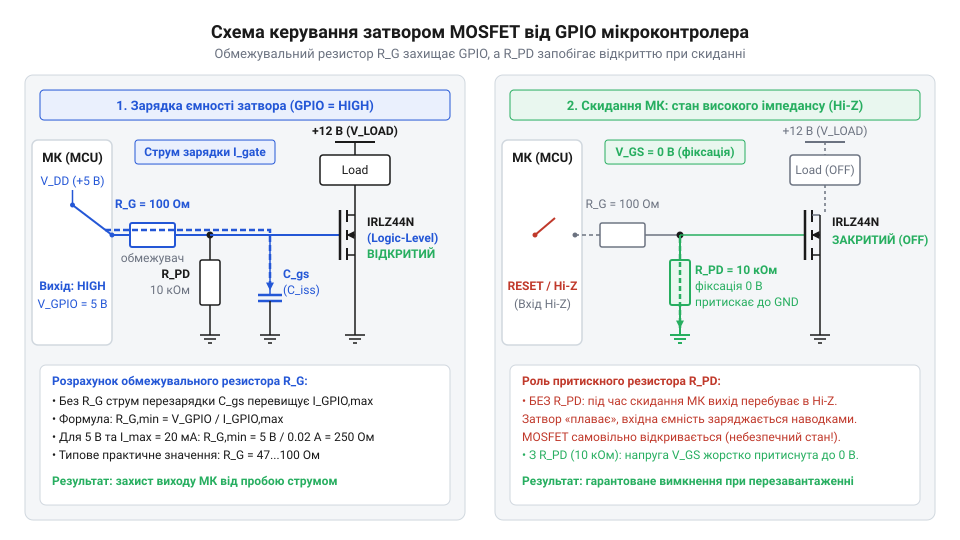
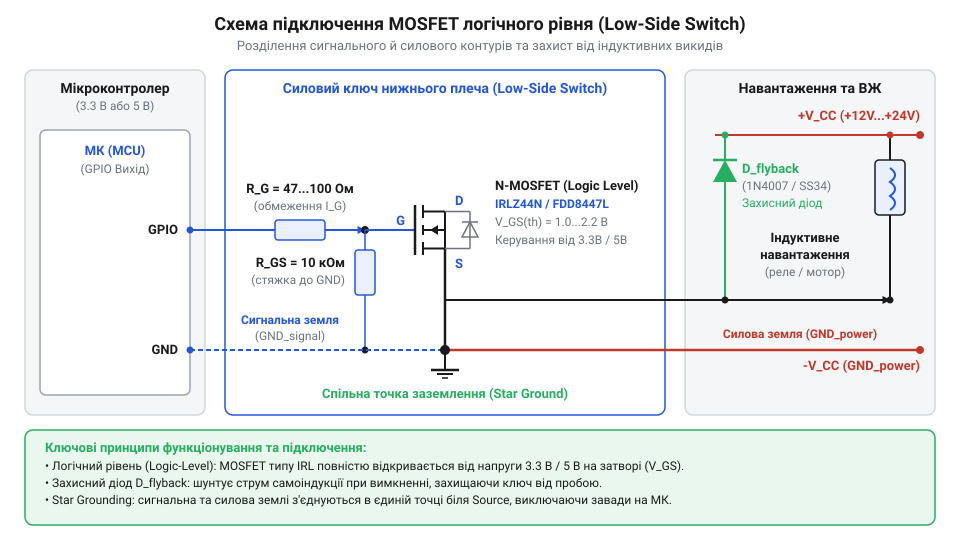
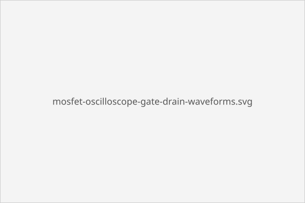

# Практична реалізація силового ключа нижнього плеча на MOSFET логічного рівня

<preknowlist>
- [Схемотехніка низькостороннього ключа на MOSFET для керування навантаженням](root:cat-hw-drivers/low-side-mosfet-switch) — принцип роботи n-канального MOSFET у режимі насичення, поняття порогової напруги VGS(th) та опору відкритого каналу RDS(on)
</preknowlist>

## Проблема прямого керування силовим навантаженням

Спроба підключити потужне зовнішнє навантаження (котушку реле, електродвигун постійного струму, соленоїд чи світлодіодну стрічку) безпосередньо до виводу порту мікроконтролера (@@en|GPIO@@) призводить до фізичного пошкодження мікросхеми або нестабільної роботи системи.

Цифрові виводи мікроконтролерів (AVR, STM32, ESP32) розраховані виключно на обробку слабострумових сигналів. Внутрішні @@en|CMOS@@-транзистори буфера GPIO здатні безпечно пропускати через себе струм лише до 20–40 мА (номінальний рекомендований струм зазвичай не перевищує 10–12 мА). Якщо до виводу підключити котушку електромеханічного реле зі споживанням 100 мА або невеликий мотор на 500 мА, внутрішній кремнієвий кристал миттєво перегрівається, що спричиняє тепловий пробій і незворотне вигорання виводу або всього вихідного порту.

Окрім струмових обмежень, логічні мікросхеми працюють при суворо фіксованих напругах живлення — 3.3 В або 5.0 В. Силове ж навантаження часто потребує вищої напруги (12 В, 24 В або 48 В). Пряме з'єднання піддає чутливий цифровий вивід дії високого потенціалу силового кола.

Окрему загрозу при комутації індуктивного навантаження (котушки реле, соленоїдів, обмоток мотора) становить електрорушійна сила самоіндукції (зворотна ЕРС, @@en|back-EMF@@). У момент стрімкого вимкнення струму індуктивність котушки генерує сплеск напруги протилежної полярності:

```
V_L = -L · (di / dt)
```

Цей високовольтний пік сягає сотень вольт і пробиває захисні діоди мікроконтролера, спричиняючи перезавантаження процесора, спотворення даних у RAM або повне виведення з ладу кристала.

Щоб розв'язати проблему перевантаження та ізолювати чутливу логіку МК від силових кіл, застосовують проміжний силовий ключ нижнього плеча (@@en|low-side driver@@ / @@en|low-side switch@@). У схемі нижнього плеча комутувальний елемент встановлюється між негативним виводом навантаження та спільною шиною землі (GND), тоді як позитивний вивід навантаження постійно підключений до шини живлення `V_LOAD`. Якщо за умовами схемотехніки необхідно комутувати плюсову лінію живлення, використовують [ключі верхнього плеча на MOSFET з бутстрепним живленням](root:hw-power/high-side-switch).

Ідеальним елементом для такого ключа є N-канальний польовий транзистор із ізольованим затвором (MOSFET, англ. @@en|Metal-Oxide-Semiconductor Field-Effect Transistor@@, польовий транзистор зі структурою метал-оксид-напівпровідник). Проте стандартні N-канальні MOSFET (наприклад, популярний IRF540N) вимагають для повного відкриття в режим насичення з мінімальним опором каналу `R_DS(on)` напруги затвор-витік `V_GS` не менше 10 В. При керуванні від виводу 3.3 В або 5.0 В стандартний транзистор залишається у лінійному режимі, виступаючи високоомним опором. Падіння напруги `V_DS` на ньому залишається високим, що викликає величезні статичні теплові втрати:

```
P_loss = I_D² · R_DS(on)
```

Кристал транзистора при цьому стрімко перегрівається й виходить із ладу.

Для прямого керування силою від низьковольтних виходів МК без додаткових мікросхем-драйверів використовують спеціальні MOSFET логічного рівня (@@en|logic-level@@ MOSFET, такі як IRLZ44N, IRL540N, FDD8447L). Вони мають знижену порогову напругу відкриття затвора `V_GS(th)` (зазвичай 1.0–2.0 В) та повністю відкриваються в насичення вже при `V_GS` = 3.3 В або 5.0 В.

Докладніше теоретичні основи роботи N-канальних транзисторів у режимі насичення розкрито у матеріалі про [схемотехніку низькостороннього ключа](root:cat-hw-drivers/low-side-mosfet-switch).

## Розрахунок затворного кола силового MOSFET

Правильне підключення N-канального MOSFET логічного рівня (IRLZ44N, IRL540N або SMD DPAK FDD8447L) вимагає обчислення двох пасивних компонентів у колі керування затвором: обмежувального послідовного резистора `R_G` (@@en|gate resistor@@) та притискного резистора `R_PD` (@@en|pull-down resistor@@).

Керуючий затвор MOSFET ізольований від провідного каналу тонким шаром діелектрика (оксиду кремнію), утворюючи вхідну ємність `C_iss` (суму ємностей затвор-витік `C_gs` та ємності Міллера `C_gd`). У момент перемикання GPIO з логічного 0 у 1 розряджена ємність затвора виступає короткочасним коротким замиканням на землю. Без послідовного резистора піковий струм зарядки ємності `I_peak` обмежується лише внутрішнім опором вихідного каскаду GPIO:

```
I_peak = V_MCU / R_out
```

Цей струмовий сплеск досягає 100–150 мА протягом кількох десятків наносекунд, що перевищує максимально припустимий струм виводу `I_GPIO_max` і спричиняє деградацію напівпровідникової структури МК.

Для обмеження пікового струму зарядки затвора на безпечному рівні `I_GPIO_max` (зазвичай приймають 15–20 мА) між виводом МК та затвором встановлюють обмежувальний резистор `R_G`:

```
R_G = V_MCU / I_GPIO_max
```

**Приклад розрахунку обмежувального резистора затвора R_G:**
Для мікроконтролера з жиленням 3.3 В (STM32, ESP32) та допустимим пиковим струмом GPIO 20 мА:

```
R_G = 3.3 / 0.020
    = 165 Ом            [закон Ома для кола затвора]
```
Вибираємо найближчий стандартний номінал із ряду E24: `R_G` = 180 Ом (або 100 Ом для струму 33 мА).

Для мікроконтролера з жиленням 5.0 В (AVR / Arduino):

```
R_G = 5.0 / 0.020
    = 250 Ом            [закон Ома для кола затвора]
```
Вибираємо стандартне значення `R_G` = 220 Ом або 270 Ом.

Другим обов'язковим елементом є притискний резистор `R_PD`. Під час увімкнення живлення, скидання МК або виконання завантажувача (bootloader) виводи GPIO перебувають у стані високого опору (@@en|Hi-Z@@ / режим входу). У цей час затвор MOSFET залишається плаваючим у повітрі. Накопичення статичного заряду або наводки на вхідній ємності `C_iss` можуть підняти напругу `V_GS` вище порогу `V_GS(th)` = 1.0–1.5 В, спричинивши довільне неконтрольоване відкриття силового ключа та подачу живлення на навантаження.

Для гарантування надійного запертого стану ключа резистор `R_PD` номіналом 10 кОм...100 кОм підключають безпосередньо між затвором і витоком (GND). Він постійно розряджає паразину ємність `C_iss` на землю, коли вивід МК деактивований. Для швидкої комутації потужних транзисторів та підвищення струму керування затвором використовують [push-pull драйвери затвора MOSFET](root:hw-power/discrete-totem-pole-gate-driver).


*Схема затворного кола N-канального логічного MOSFET з послідовним резистором R_G для захисту GPIO від струмового піку та підтяжкою R_PD до землі.*

Програмна реалізація конфігурації драйвера та функцій безпечного запуску мовами C та C++ подана у фрагментах нижче:

:::tabs
@tab C
:::code proj-logic-mosfet-low-side-driver/c/mosfet_driver.h 63-90
:::code proj-logic-mosfet-low-side-driver/c/mosfet_driver.c 9-43
@tab C++
:::code proj-logic-mosfet-low-side-driver/cpp/MosfetSwitch.hpp 90-120
:::code proj-logic-mosfet-low-side-driver/cpp/MosfetSwitch.cpp 61-82
:::

## Захист ключа від індуктивних викидів

При комутації чисто активного навантаження (нагрівальних елементів, ламп розжарювання) напруга на стоці MOSFET не перевищує напругу живлення `V_LOAD`. Проте при керуванні індуктивним навантаженням (котушками реле, клапанами, двигунами) вимкнення транзистора створює смертельну загрозу для напівпровідника.

Згідно із законом електромагнітної індукції, струм в індуктивності не може змінитися миттєво. Коли MOSFET стрімко закривається (`I_D` -> 0), накопичена в магнітному полі котушки `L` енергія генерує ЕРС самоіндукції:

```
e_L = -L · (di / dt)
```

Оскільки швидкість спаду струму `di/dt` при розмиканні дуже велика, на стоці транзистора виникає позитивний імпульс високої напруги. Цей пік `V_DS` легко перевищує гранично припустиму напругу пробою сток-витік `V_DS_max` (наприклад, 55 В для IRLZ44N або 40 В для FDD8447L), викликаючи лавинний пробій і руйнування каналу.

Для захисту ключа від високовольтних викидів паралельно індуктивному навантаженню підключають захисний зворотний діод (@@en|flyback diode@@ / @@en|freewheeling diode@@) у зустрічному включенні (катод до `V_LOAD`, анод до стоку MOSFET).

Увімкнений ключ тримає діод у запертому стані зворотною напругою `V_LOAD`. У момент вимкнення ключа ЕРС самоіндукції змінює полярність на котушці, відкриваючи зворотний діод. Струм індуктивності замкненим контуром циркулює через діод, поступово розсіюючись у вигляді тепла на активному опорі обмотки. Напруга на стоці MOSFET обмежується на безпечному рівні:

```
V_DS_clamp = V_LOAD + V_F
```

де `V_F` — пряме падіння напруги на відкритому діоді (~0.7–1.1 В).

**Критерії вибору захисного зворотного діода:**
1. **Максимальна зворотна напруга `V_R_max`:** Повинна перевищувати напругу живлення силового навантаження `V_LOAD` з коефіцієнтом запасу не менше 1.5–2.0 (`V_R_max` ≥ 2 · `V_LOAD`).
2. **Максимальний прямий струм `I_F`:** Повинен бути не меншим за робочий струм навантаження у сталі імпульсі (`I_F` ≥ `I_load`), оскільки в момент вимкнення струм самоіндукції дорівнює струму, що протікав через котушку.
3. **Швидкодія діода (`t_rr`):** Для статичної комутації (реле, соленоїди) підходить стандартний випрямний діод (наприклад, 1N4007). Проте при ШІМ-регулюванні (@@en|PWM@@) на частотах вище 1 кГц необхідно використовувати імпульсні діоди або діоди Шотткі (@@en|Schottky diode@@, наприклад, SS34, 1N5819, UF4007) із мінімальним часом зворотного відновлення `t_rr` < 50 нс для запобігання нагріву під час перемикань.


*Принципова та монтажна схема силового ключа нижнього плеча з індуктивним навантаженням та захисним зворотним діодом.*

Повні приклади виконання дискретного керування, ШІМ-регулювання та аварійного відключення мовами C та C++ наведені нижче:

:::tabs
@tab C
:::code proj-logic-mosfet-low-side-driver/c/main.c 53-129
@tab C++
:::code proj-logic-mosfet-low-side-driver/cpp/main.cpp 22-97
:::

## Монтаж та підключення схемного вузла

Фізична компоновка силового ключа нижнього плеча (@@en|low-side driver@@, від англ. *low side* — нижній бік) вимагає суворого дотримання правил розведення силових та сигнальних кіл. Основна небезпека під час комутації високих струмів полягає у виникненні імпульсного падіння напруги на спільному провіднику заземлення. Якщо струм навантаження протікає через тонку доріжку сигнальної землі (сигнальний @@en|GND@@, від англ. *ground* — земля) мікроконтролера, це спричиняє зміщення потенціалу землі МК, що призводить до перезавантажень або збоїв периферії. Щоб усунути цей ефект, застосовують [зіркове розділення земель](root:hw-pcb/star-ground-topology): силова земля від виводу витоку (@@en|Source@@) транзистора та сигнальна земля МК з'єднуються лише в одній точці — безпосередньо на мінусовій клемі джерела живлення.

Пасивні елементи затворного та захисного кіл монтують із мінімальною довжиною з'єднувальних провідників. Обмежувальний резистор затвора `R_G` розміщують якомога ближче до ніжки затвора (@@en|Gate@@) для придушення паразитних високочастотних коливань, викликаних індуктивністю доріжки та вхідною ємністю `C_iss`. Притискний резистор (@@en|pull-down@@, від англ. *pull down* — тягнути донизу) `R_PD` опором 10 кОм запаюють безпосередньо між виводами затвора та витоку транзистора. Це гарантує швидкий розряд `C_iss` на землю під час ініціалізації МК або перебування виводу @@en|GPIO@@ у стані високого опору. При комутації індуктивного навантаження захисний зворотний діод (@@en|flyback diode@@, від англ. *fly back* — відлітати назад) підключають паралельно клемам навантаження — катодом до позитивної шини живлення, а анодом до стоку (@@en|Drain@@) транзистора.


*Схемотехнічне розведення силового ключа нижнього плеча з використанням зіркової точки з'єднання земель.*

У програмному забезпеченні перед активацією комутації необхідно забезпечити початковий безпечний стан виводу МК, що виключає самовільне відкриття транзистора при подачі живлення.

:::tabs
@tab C
:::code proj-logic-mosfet-low-side-driver/c/mosfet_driver.c 9-43

@tab C++
:::code proj-logic-mosfet-low-side-driver/cpp/MosfetSwitch.cpp 61-82
:::

Некоректне розведення силового контуру або відсутність захисного діода у схемі [низькостороннього ключа на MOSFET](root:cat-hw-drivers/low-side-mosfet-switch) спричиняє високовольтні пробої та вихід з ладу керуючого мікроконтролера.

## Тестування та контроль теплового режиму

Перший запуск зібраного силового модуля здійснюють від лабораторного джерела живлення з обмеженням струму на рівні 100–200 мА без підключення потужного навантаження. За допомогою осцилографа контролюють форму сигналу на затворі транзистора при ШІМ-керуванні (@@en|PWM@@, від англ. *pulse-width modulation* — широтно-імпульсна модуляція). Щуп осцилографа підключають безпосередньо між виводами затвора та витоку `V_GS`. Сигнал повинен мати чіткі прямокутні фронти без затягнутих перехідних ділянок або високовольтного викиду, який свідчить про наявність паразитної індуктивності у затворному колі.


*Форма сигналів на затворі та стоці транзистора при ШІМ-керуванні з чіткими фронтами та відсутністю паразитного дзвеніння.*

Після перевірки комутаційних фронтів до модуля підключають робоче навантаження та вимірюють спад напруги на відкритому каналі сток-витік `V_DS(on)` мультиметром або осцилографом у статичному стані насичення. Знаючи струм навантаження `I_D`, обчислюють фактичний опір відкритого каналу транзистора логічного рівня (@@en|Logic-Level MOSFET@@):

```
R_DS(on) = V_DS(on) ÷ I_D
```

Отриманий опір `R_DS(on)` дозволяє оцінити статичні теплові втрати на провідність `P_conduct` у ватах залежно від коефіціента заповнення ШІМ:

```
P_conduct = I_D² × R_DS(on) × (DutyCycle ÷ 100)
```

При робочому струмі `I_D` = 10 А, опорі відкритого каналу `R_DS(on)` = 0.028 Ом (для транзистора IRLZ44N при `V_GS` = 5 В) та 100% коефіцієнті заповнення розрахунок стаціонарних втрат потужності має вигляд:

```
P_conduct
= (10)² × 0.028 × (100 ÷ 100)      [підстановка виміряних значень]
= 100 × 0.028 × 1                   [піднесення струму до квадрата]
= 2.8 Вт                            [статична розсіювана потужність]
```

Оцінка перегріву кристала без додаткового радіатора при тепловому опорі корпус-довкілля `R_th(j-a)` = 62 °C/Вт та температурі навколишнього середовища `T_amb` = 25 °C проводиться за формулою:

```
T_j
= T_amb + (P_conduct × R_th(j-a))   [формула теплового балансу]
= 25 + (2.8 × 62)                   [підстановка втрат потужності]
= 25 + 173.6                        [обчислення температурного приросту]
= 198.6 °C                          [перевищення максимальної температури 175 °C]
```

Розрахункове значення 198.6 °C перевищує максимально припустиму температуру кристала (175 °C), що вказує на необхідність встановлення пасивного алюмінієвого радіатора або вибору транзистора з нижчим опором каналу.

У програмному коді моніторинг розрахованих втрат потужності реалізується функціями розрахунку телеметрії на кожному кроці регулювання.

:::tabs
@tab C
:::code proj-logic-mosfet-low-side-driver/c/mosfet_driver.c 147-158

@tab C++
:::code proj-logic-mosfet-low-side-driver/cpp/MosfetSwitch.cpp 212-240
:::

Контроль спаду напруги `V_DS(on)` та динамічна оцінка нагріву гарантують надійну роботу силового ключа без ризику теплового пробою.
