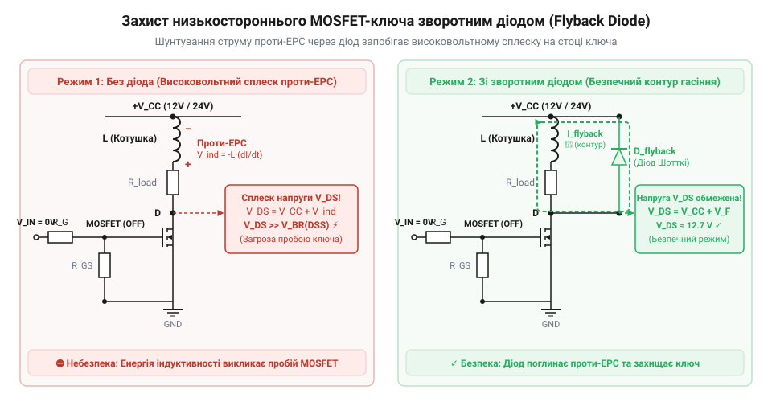
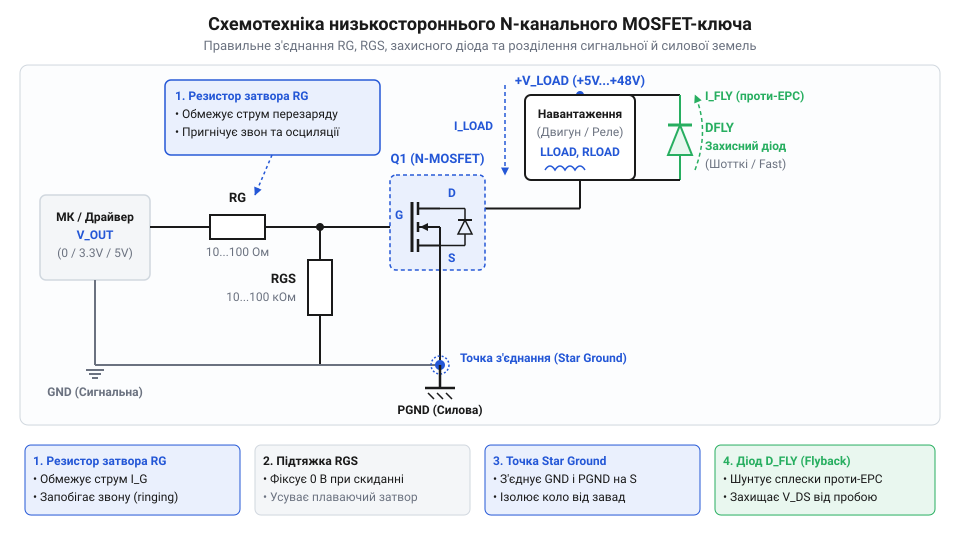

# Схема підключення та електричний інтерфейс низькостороннього MOSFET-ключа

<preknowlist>
- [MOSFET логічного рівня (IRLZ44N, IRL540N, IRL2203N, FDD8447L)](root:cat-hw-drivers/logic-level-mosfets) — порогова напруга затвора VGS(th) для узгодження з логічними рівнями 3.3 В та 5 В, а також залежність опору RDS(on) від напруги керування
</preknowlist>

## Ризики прямого керування потужним навантаженням

Пряме підключення силового навантаження (реле, колекторний електродвигун, соленоїд, нагрівальний елемент) до виводу @@en|GPIO@@ (англ. *General-Purpose Input/Output* — цифровий вивід загального призначення) мікроконтролера призводить до миттєвого виходу з ладу мікросхеми або нестабільної роботи всієї системи. Ця проблема зумовлена трьома фізичними чинниками:

1. **Струмове перевантаження виводу GPIO**: Цифрові виходи мікроконтролера розраховані на обробку логічних сигналів. Один вивід може безпечно віддавати чи споживати струм у діапазоні від 10 mA до 20 mA (гранично допустимий струм зазвичай не перевищує 40 mA). Силові приводи та реле потребують струмів від сотень міліампер до десятків ампер. Спроба комутувати таке навантаження напряму викликає струмове перевантаження та фізичне вигорання вихідного каскаду @@en|microcontroller@@ (англ. *microcontroller* — мікроконтролер).

2. **Невизначеність стану під час скидання**: У момент подачі живлення, перезавантаження або оновлення прошивки виводи GPIO мікроконтролера переходять у високоімпедансний стан (Hi-Z). Лінія керування стає плаваючою. Будь-які статичні наводки чи витоки струму заряджають ємність керувального провідника, викликаючи самочинне та неконтрольоване ввімкнення силового навантаження.

3. **Високовольтні сплески проти-ЕРС**: Індуктивне навантаження чинить опір швидкій зміні струму. При спробі виводу GPIO різко розімкнути коло індуктивності накопичене магнітне поле генерує потужний високовольтний імпульс @@en|back-EMF@@ (англ. *back electromotive force* — проти-ЕРС, зворотна електрорушійна сила). Цей сплеск напруги сягає сотень вольт, пробиває напівпровідникову структуру виводу мікроконтролера та повністю руйнує кристал.

Для безпечного узгодження чутливої цифрової логіки з потужним навантаженням використовують проміжний силовий ключ. Найпростішим та найефективнішим рішенням для комутації навантаження, підключеного до позитивної шини живлення, є @@en|low-side switch@@ (англ. *low-side switch* — низькосторонній ключ) на базі N-канального @@en|MOSFET@@ (англ. *Metal-Oxide-Semiconductor Field-Effect Transistor* — польовий транзистор зі структурою метал-оксид-напівпровідник).

## Формування кола керування затвором ключа

N-канальний MOSFET відкривається при подачі позитивної напруги між @@en|gate@@ (англ. *gate* — затвор) та @@en|source@@ (англ. *source* — витік) `V_GS`, яка перевищує порогове значення `V_GS(th)`. Затвор ізольований від каналу діелектриком і в стаціонарному стані не споживає постійного струму, проте володіє вхідною ємністю `C_iss`. Корректне керування затвором потребує розрахунку двох обводових резисторів: `R_G` та `R_GS`.

### Обмеження імпульсного струму резистором `R_G`

У момент перемикання виводу GPIO з низького рівня на високий розряджена ємність затвора `C_iss` поводиться як коротке замикання на землю. Пряме з'єднання викликає кидок струму `I_G = V_GPIO / R_out`, де `R_out` — внутрішній опір ключа GPIO. Цей струмовий імпульс здатний перевищити гранично допустимий струм виводу `I_GPIO_max`.

Для захисту виходу мікроконтролера послідовно в коло затвора встановлюють обмежувальний резистор `R_G` (@@en|gate resistor@@). Мінімальне значення опору `R_G` розраховують за законом Ома:

```
R_G_min = V_GPIO / I_GPIO_max
```

Де `V_GPIO` — напруга високого логічного рівня (наприклад, 3.3 V або 5 V), а `I_GPIO_max` — максимальний безпечний імпульсний струм виводу (наприклад, 20 mA).

**Обчислення мінімального опору затвора**
**Умова:** Вивід мікроконтролера з напругою `V_GPIO = 3.3 V` має граничний допустимий струм `I_GPIO_max = 20 mA`. Необхідно знайти мінімальний опір `R_G_min`.

```
R_G_min = 3.3 / 0.020      [застосовано закон Ома]
        = 165 Ω            [результат ділення]
```

Вибір `R_G` є інженерним компромісом: збільшення опору обмежує струм GPIO, але збільшує тривалість перезаряджання ємності `C_iss` (час перемикання `t_sw`). Упродовж `t_sw` транзистор перебуває в лінійному режимі, що збільшує динамічні теплові втрати. Для прямого керування від GPIO обирають номінали `R_G` у діапазоні від 100 Ω до 470 Ω.

### Фіксація стану затвора резистором `R_GS`

Для запобігання самочинному відкриванню транзистора під час скидання мікроконтролера між затвором та витоком впаюють розрядний резистор `R_GS` (@@en|pull-down resistor@@). Коли вивід GPIO перебуває у високоімпедансному стані, `R_GS` розряджає ємність `C_iss` на землю, гарантуючи рівень `V_GS = 0 V`.

Під час подачі високого рівня з GPIO резистори `R_G` та `R_GS` утворюють дільник напруги. Напруга на затворі `V_GS` визначається виразом:

```
V_GS = V_GPIO × R_GS / (R_G + R_GS)
```

Щоб падіння напруги на `R_G` не зменшувало рівень `V_GS` нижче необхідного для повного відкривання каналу, опір `R_GS` має значно перевищувати `R_G` (у 20–100 разів). Зазвичай номінал `R_GS` вибирають у межах від 10 kΩ до 100 kΩ. При керуванні від мікроконтролерів із низьковольтним живленням доцільно застосовувати [спеціалізовані MOSFET логічного рівня](root:cat-hw-drivers/logic-level-mosfets), які досягають мінімального опору відкритого каналу `R_DS(on)` при напругах затвора 3.3 В та 5 В.

## Захист від сплесків індуктивного навантаження

Комутація індуктивного навантаження (обмотки реле, соленоїди, електродвигуни) створює загрозу пробою силового каналу MOSFET-ключа.

При протіканні струму `I_D` через індуктивність `L` у магнітному полі накопичується енергія `E = (L × I_D²) / 2`. У момент вимкнення транзистора струм намагається миттєво зменшитися до нуля. Зміна магнітного потоку генерує ЕРС самоіндукції:

```
V_ind = -L × (di / dt)
```

Оскільки час закривання транзистора `dt` є дуже малим, на навантаженні виникає позитивний імпульс напруги в сотні вольт. Цей потенціал додається до напруги живлення `V_DD` і прикладається до @@en|drain@@ (англ. *drain* — сток) закритого MOSFET. Якщо сумарна напруга `V_DS` перевищить межу `V_DS_max`, транзистор зазнає лавинного пробою і руйнується від перегріву.

Для захисту ключа паралельно до індуктивного навантаження підключають зворотний захисний діод (@@en|flyback diode@@ або @@en|freewheeling diode@@). Діод анодом підключають до стоку MOSFET, а катодом — до позитивної шини живлення `V_DD`.


*Схема гасіння проти-ЕРС захисним діодом: після закривання ключа індуктивний струм замикається через діод, запобігаючи пробою залізобетонного каналу MOSFET.*

При відкритому транзисторі діод перебуває під зворотною напругою `V_DD` і струм через нього не протікає. У момент вимкнення ключа сплеск проти-ЕРС змінює полярність напруги на обмотці, діод відкривається у прямому напрямку і створює замкнений контур для струму самоіндукції. Магнітна енергія безпечно розсіюється у вигляді тепла на активному опорі обмотки та прямому переході діода.

### Критерії вибору захисного діода

Вибір діода здійснюється за трьома основними параметрами:

1. **Максимальний прямий струм `I_F`**: Робочий або піковий струм діода має бути не меншим за максимальний струм навантаження `I_load`, оскільки у першу мікросекунду після вимкнення струм через діод дорівнює струму відкритого транзистора.

2. **Максимальна зворотна напруга `V_R`**: Зворотна напруга діода повинна перевищувати напругу живлення `V_DD` із запасом 20–30% (`V_R ≥ 1.25 × V_DD`).

3. **Час зворотного відновлення `t_rr`**: Для схем із ШІМ або високочастотним перемиканням стандартні випрямні діоди (наприклад, 1N4007 з `t_rr ≈ 2 мкс`) є непридатними через виникнення наскрізних струмів. Слід застосовувати імпульсні діоди Шотткі (наприклад, 1N5819, SS34) або ультрашвидкі діоди з `t_rr < 50 нс`. Детальніше про принцип дії та розрахунок швидкісних діодів гасіння проти-ЕРС читайте у статті про [захисні діоди в індуктивних колах](root:hw-power/flyback-diodes-protection).

## Розділення сигнальної та силової землі

При проектуванні силових плат із MOSFET-ключами поширеною причиною збоїв мікроконтролера є некоректна організація спільних провідників заземлення.

Силовий контур (джерело живлення `V_DD`, навантаження, сток і витік MOSFET) проводить струми в кілька ампер із високою швидкістю наростання `di/dt`. Провідники друкованої плати мають власний опір `R_trace` та індуктивність `L_trace`. Під час комутації на силовій ділянці землі виникає падіння напруги:

```
ΔV_GND = I_load × R_trace + L_trace × (di / dt)
```

Якщо сигнальне заземлення цифрової частини мікроконтролера підключити до силового провідника заземлення після силового транзистора, імпульсне зміщення потенціалу `ΔV_GND` (явище @@en|ground bounce@@ — «стрибок землі») прикладеться до керувальних виводів GPIO та опорних ліній цифрових мікросхем. Це призводить до хибних спрацьовувань, збоїв тактування та перезавантажень мікроконтролера.

Для захисту цифрової логіки застосовують правило розділення земель:

1. **Сигнальна земля (@@en|signal ground@@)**: Окремий контур заземлення для мікроконтролера, датчиків та кола затвора (`R_GS`), де протікають лише малі сигнальні струми.

2. **Силова земля (@@en|power ground@@)**: Силовий провідник або шар плати для великих струмів витоку MOSFET та мінусового виводу силового джерела живлення.

3. **Єдина точка з'єднання (@@en|star ground@@)**: Сигнальна та силова землі об'єднуються суворо в одній точці — безпосередньо біля виводу витоку (Source) силового MOSFET-ключа.

За такої топології силовий імпульсний струм не створює різниці потенціалів у колі сигнального заземлення мікроконтролера. Докладніше про механізми виникнення ground bounce та правила створення зіркоподібного заземлення читайте у матеріалі про [топологію та розділення земель на силових друкованих платах](root:hw-pcb/star-ground-topology).

## Принципова схема низькостороннього MOSFET-ключа

Узагальнення розглянутих вузлів дає повну принципову схему та електричний інтерфейс низькостороннього N-канального MOSFET-ключа.


*Повна принципова схема низькостороннього ключа: електричний інтерфейс включає обмежувальний резистор R_G, розрядний R_GS, захисний діод для індуктивності та єдину точку з'єднання сигнальної й силової земель.*

Електричний інтерфейс ключа складається з трьох функціональних зон:

1. **Вхідний керувальний інтерфейс**:
   - Вхідний сигнал `CTRL` надходить із виводу GPIO мікроконтролера.
   - Послідовний резистор `R_G` (100–470 Ω) розміщують біля затвора для пригнічення завад та обмеження струму GPIO.
   - Підтягувальний резистор `R_GS` (10–100 kΩ) впаюють безпосередньо між затвором та витоком для утримання транзистора в закритому стані під час скидання MCU.

2. **Силовий комутаційний вузол**:
   - N-канальний MOSFET вмикається в розрив мінусового провідника навантаження.
   - Навантаження включене між силовою шиною `V_DD` та стоком (Drain) транзистора.
   - Витік (Source) транзистора підключається до силової землі.
   - Для індуктивного навантаження паралельно встановлюють діод Шотткі `D_FLY`, катод якого з'єднаний із `V_DD`, а анод — зі стоком.

3. **Інтерфейс заземлення**:
   - Сигнальна земля `GND_SIG` та силова земля `GND_PWR` з'єднуються в єдиній точці безпосередньо на виводі витоку `S` MOSFET.

### Електричний чекліст для проектування

При виборі компонентів дотримуйтесь таких граничних параметрів:

- **Сумісність за напругою затвора**: При керуванні напругою `V_GPIO = 3.3 V` або `5 V` опір відкритого каналу `R_DS(on)` повинен нормуватися саме для цієї напруги затвора (застосовуйте [MOSFET логічного рівня](root:cat-hw-drivers/logic-level-mosfets)).
- **Запас за напругою стоку**: Гранична напруга сток-витік транзистора повинна відповідати умові `V_DS_max ≥ 1.5 × V_DD`.
- **Запас за струмом стоку**: Неперервний струм стоку `I_D_max` транзистора має перевищувати струм навантаження принаймні у 2–3 рази для мінімізації стаціонарного нагріву `P_cond = I_D² × R_DS(on)`.
