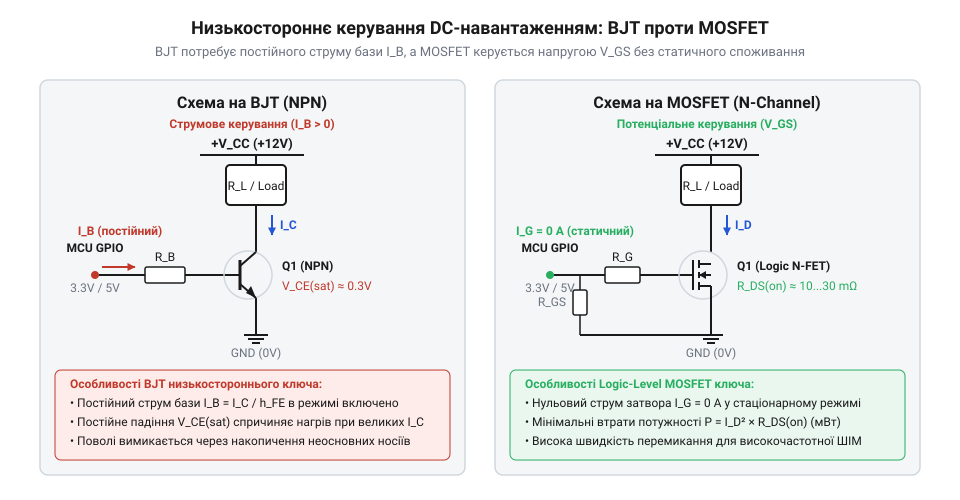
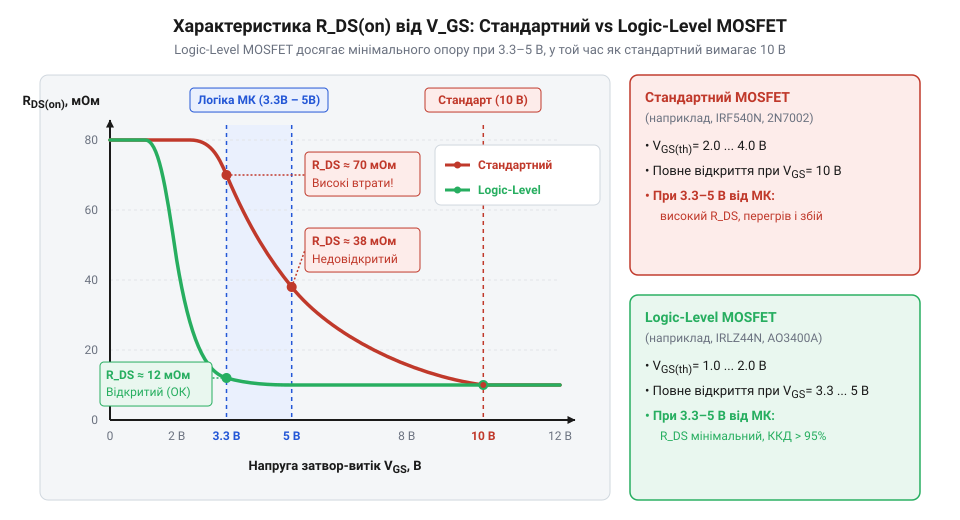

# Еволюція схемотехніки низькосторонніх ключів: від реле та біполярних транзисторів до Logic-Level MOSFET

<preknowlist>
- [MOSFET логічного рівня (IRLZ44N, IRL540N, IRL2203N, FDD8447L)](root:cat-hw-drivers/logic-level-mosfets) — практичні характеристики та маркування популярних силових ключів логічного рівня
</preknowlist>

## Обмеження реле в комутації струму

Потреба комутувати електричні кола безпосередньо в лінії живлення навантаження існувала з перших днів електротехніки. У схемотехніці низької сторони комутатор встановлюють між навантаженням і спільним провідником (землею). Тривалий час єдиним доступним рішенням для цього залишалися електромеханічні @@fr|реле@@ (франц. *relais* — зміна коней, естафета). Їхній принцип простий: струм у керувальній котушці створює магнітне поле, яке притягує рухомий якір і фізично замикає металеві контакти.

Попри повну гальванічну розв'язку та низький опір замкнених контактів, механічне замикання виявилося непридатним для динамічного керування потужністю. Головним обмеженням стала механічна інерційність: перемикання реле триває від 10 до 50 мілісекунд. Це унеможливлює швидку комутацію та широтно-імпульсну модуляцію (@@en|ШІМ@@), де потрібна частота у тисячі перемикань на секунду.

Другою фізичною перешкодою став електричний знос. Під час розмикання кола з постійним струмом під навантаженням між контактами виникає електрична дуга, яка випалює метал і призводить до зварювання контактів. Крім того, під час ударного замикання виникає @@en|дребезг контактів@@ — серія швидких неконтрольованих розмикань через пружний відскок. Для захисту від індуктивних сплесків комутованих котушок доводилося додавати [зворотний захисний діод](root:hw-components/flyback-inductive-spike). Потреба у високій частоті, безшумності та безмежному ресурсі перемикань спонукала інженерів шукати твердотільну безконтактну альтернативу.

## Перехід до біполярних транзисторів NPN

Винайдення транзистора наприкінці 1940-х років та створення кремнієвих планарних структур у 1950-х роках дали електронним схемам безконтактне перемикання. У схемах низького плеча застосування знайшли біполярні @@en|NPN-транзистори@@ (англ. *bipolar junction transistor*, скорочено @@en|BJT@@, де *bipolar* вказує на участь двох типів носіїв — електронів та дірок). Емітер транзистора підключають до спільного провідника, колектор — до навантаження, а на базу подають керувальний струм.

Твердотільний @@en|біполярний транзистор@@ миттєво подолав швидкодійні обмеження механіки, скоротивши час перемикання до часток мікросекунди. Це дозволило ефективно застосовувати ШІМ для регулювання потужності двигунів та джерел світла. Проте масове впровадження BJT у силову електронну комутацію виявило два критичні недоліки.

Перша проблема полягає в тому, що біполярний транзистор є приладом із струмовим керуванням. Щоб утримувати NPN-ключ у режимі насичення з найменшим опором, через базу має постійно протікати струм `I_B \ge I_C / β`, де `I_C` — струм колектора, а `β` — коефіцієнт підсилення. При комутації навантаження у 5 А з коефіцієнтом `β = 20` керувальне коло мусить безперервно віддавати в базу 250 мА. Мікроконтролери та логічні мікросхеми не здатні віддавати такий струм безпосередньо.

Другим обмеженням стали втрати на напрузі насичення колектор-емітер `V_CE(sat)`. Навіть у глибокому насиченні спад напруги на відкритому транзисторі становить від 0.2 В до 1.5 В. При струмі 10 А на транзисторі безперервно розсіюється від 2 Вт до 15 Вт у вигляді тепла, що знижує КПД системи та вимагає масивних радіаторів.

*Схемотехнічна відмінність між комутацією біполярним транзистором із струмовим керуванням та силовим MOSFET із потенціальним керуванням.*

## Прорив вертикальних силових MOSFET

Усунути втрати на керування вдалося завдяки польовим транзисторам структури метал-оксид-напівпровідник (англ. *metal-oxide-semiconductor field-effect transistor*, скорочено @@en|MOSFET@@). Перші планарні польові структури мали надто високий опір каналу і не підходили для силових кіл. Справжній прорив відбувся наприкінці 1970-х років із розробкою вертикальних структур з подвійною дифузією (англ. @@en|DMOS@@). У 1979 році інженери Алекс Лідоу (Alex Lidow) та Том Герман (Tom Herman) у компанії @@en|International Rectifier@@ створили технологію @@en|HEXFET@@ (від англ. *hexagonal* — шестикутний), об'єднавши тисячі паралельних шестикутних мікроосередків на одному кристалі.

У N-канальному силовому @@en|MOSFET@@ струм протікає вертикально від стоку на нижній стороні кристала до витоку на верхній через послідовність напівпровідникових шарів: N⁺-стік, N⁻-область дрейфу та P-подібну кишеню підкладки (тіла, англ. @@en|body@@). Для запобігання засувковому ефекту паразитного біполярного транзистора металізація витоку надійно закорочує P-кишеню з N⁺-витоком. Таке конструктивне об'єднання створює на межі між P-тілом та N-стоком внутрішній паразитний діод (англ. @@en|body diode@@, від *body* — тіло кристала), включений паралельно каналу анодом до витоку і катодом до стоку. Цей діод відіграє роль вбудованого зворотного ключа для скидання струму індуктивного навантаження, проте через технологічні обмеження класичного PN-переходу він має помітні втрати на зворотному відновленні (англ. @@en|reverse recovery@@) при швидкому перемиканні. Затвор відокремлений від напівпровідника тонким діелектриком з оксиду кремнію `SiO₂`, що забезпечує потенціальне керування: для відчинення ключа потрібне лише створення електричного поля напругою затвор-витік `V_GS`, а постійний струм затвора дорівнює нулю.

Паралельне з'єднання мікроосередків дозволило знизити опір відкритого каналу `R_DS(on)` до міліомних значень. Статичні втрати потужності стали розраховуватися за формулою `P = I_D² × R_DS(on)`. На низьких та середніх струмах це дало значно менше тепловиділення, ніж спад `V_CE(sat)` у BJT.

Перші силові MOSFET вимагали напруги затвора `V_GS = 10 В` для повного відчинення. Для спрощення схемотехніки виробники зменшили товщину подзатворно діелектрика, що знизило порогову напругу `V_GS(th)`. Це відкрило шлях до створення [силових ключів логічного рівня](root:cat-hw-drivers/logic-level-mosfets), які повноцінно відчиняються від напруги 3.3 В або 5 В безпосередньо з виходів мікроконтролерів.

*Характеристика опору відкритого каналу R_DS(on) залежно від напруги затвор-витік V_GS для стандартних і Logic-Level ключів.*

## Поява транзисторів із логічним рівнем

Перші силові MOSFET розроблялися для промислових систем із напругою керування 10–12 В. Проте стрімкий розвиток мікроконтролерів із цифровою логікою 5 В, а згодом і 3.3 В, створив нову проблему: спроба підключити стандартний польовий транзистор безпосередньо до виводу мікроконтролера залишала ключ у напіввідкритому стані. Опір каналу `R_DS(on)` залишався високим, напівпровідник працював у лінійному режимі й моментально перегрівався під навантаженням. Для комутації доводилося додавати проміжні каскади розгойдування напруги на біполярних транзисторах або спеціалізовані мікросхеми.

Щоб усунути додаткові компоненти й забезпечити пряме керування від цифрових мікросхем, у 1980–1990-х роках виробники вдосконалили технологію виготовлення підзатворного діелектрика. Ключовим рішенням стало стоншення шару @@en|оксиду затвора@@ (діоксиду кремнію `SiO₂`). Зменшення товщини діелектрика збільшило напруженість електричного поля в каналі при тій самій керувальній напрузі, що дозволило знизити порогову напругу затвор-витік `V_GS(th)` із типових 2–4 В до 1–2 В. Так з'явилися @@en|Logic-Level MOSFET@@ (англ. *logic-level* — логічний рівень, від латинського *logica* — наука про міркування та *libella* — рівень).

Зменшення товщини діелектрика мало зворотний фізичний бік. Питома ємність оксиду кремнію на одиницю площі визначається формулою `C_ox = ε_ox / d_ox`, де `ε_ox` — діелектрична проникність, а `d_ox` — товщина шару. Стоншення `d_ox` призвело до пропорційного зростання питомої [ємності затвора](root:cat-hw-drivers/logic-level-mosfets) `C_iss`. Щоб відчинити ключ, керувальне коло мусить передати на затвор більший імпульсний @@en|заряд затвора@@ `Q_g`. Вихідний каскад мікроконтролера з обмеженим струмом 10–20 мА витрачає більше часу на заряджання цієї ємності. Поряд зі зростанням ємності стоншення `d_ox` пропорційно зменшило граничну напругу, яку здатен витримати тонкий шар діоксиду кремнію `SiO₂`. Максимально припустима напруга затвор-витік `V_GS(max)` знизилася з класичних 20–30 В до 10–12 В, що суттєво звузило безпечний діапазон керування. Стоншений оксид став вразливим до руйнування: будь-який короткочасний сплеск напруги від індуктивності дротів або @@en|електростатичний розряд@@ (англ. *electrostatic discharge*, від грецького *ēlektron* — янтар та *statikos* — той, що стоїть) понад `V_GS(max)` спричиняє @@en|статичний пробій@@ діелектрика з закороченням затвора на витік. Цей компроміс між низьким порогом відчинення `V_GS(th)`, збільшеною ємністю та підвищеною вразливістю оксиду визначив сучасну схемотехніку застосування Logic-Level N-MOSFET.

## Спірні атрибуції та розвінчання міфів

Масове поширення транзисторів із логічним рівнем породило низку схемотехнічних міфів щодо їхніх реальних можливостей. Найпоширенішою помилкою є уявлення про те, що Logic-Level MOSFET можна безальтернативно комутувати на будь-якій частоті ШІМ безпосередньо від цифрового виходу мікроконтролера.

У статичному стані відкритий затвор справді практично не споживає струму. Однак під час перемикання на високій частоті ємність затвора та паразитна ємність стік-затвор, яка зумовлює @@en|ефект Міллера@@ (англ. *Miller effect*, на честь американського інженера Джона Міллера), вимагають значних перезаряджальних струмів `I = Q_g / t_sw`. Якщо струм виводу мікроконтролера обмежений 10–20 мА, транзистор затягує фронти перемикання. Значну частину періоду ШІМ ключ проводить у лінійній зоні, де одночасно присутні висока напруга та великий струм. Це призводить до високих динамічних втрат потужності й перегріву ключа, що вимагає застосування зовнішнього [драйвера затвора](root:hw-power/gate-driver).

Другий міф стверджує, що Logic-Level MOSFET є принципово іншим напівпровідниковим приладом, винайденим як окремий клас транзисторів. Насправді ключі логічного рівня не відрізняються квантово-фізичним принципом роботи від стандартних силових MOSFET. Це результат інженерної оптимізації геометричних параметрів кристала, товщини оксиду та профілю легування, яку впроваджували паралельно провідні виробники напівпровідників у ході розвитку фотолітографії.

Третя помилка стосується порогової напруги. Початківці часто припускають, що значення `V_GS(th)` із паспорта приладу вказує на напругу повного відчинення ключа. Насправді `V_GS(th)` — це лише напруга, за якої канал тільки починає проводити мікроамперні струми (зазвичай 250 мкА). Для досягнення мінімального опору `R_DS(on)` напруга затвор-витік має перевищувати порогову в кілька разів.

## Критерії вибору сучасного низькостороннього ключа

Вибір оптимального низькостороннього комутатора для DC-навантажень ґрунтується на зіставленні електричних параметрів ключа з режимами роботи схеми. Головним критерієм є оцінка опору `R_DS(on)` саме при наявній напрузі керування. Якщо мікроконтролер працює від 3.3 В, опір відкритого каналу слід перевіряти за паспортним графіком або таблицею для `V_GS = 3.0 В` або `3.3 В`, а не орієнтуватися на значення `R_DS(on)`, вказане для 10 В.

Другим критерієм є аналіз частоти комутації та загального заряду затвора `Q_g`. Для низькочастотної комутації (реле, клапани, статичне ввімкнення) доцільно обирати [транзистори логічного рівня](root:cat-hw-drivers/logic-level-mosfets) із прямим керуванням від виводу цифрової логіки. Якщо ж схема працює в режимі високочастотного ШІМ (понад 10–20 кГц) або комутує потужні навантаження з великим `Q_g`, між мікроконтролером і затвором необхідно встановлювати буферний драйвер.

Третім обов'язковим кроком є захист від індуктивного удару. При комутації обмоток реле, соленоїдів чи двигунів розмикання ключа викликає сплеск самоіндукції зворотної полярності. Низькосторонній ключ необхідно захищати паралельним зворотним діодом або обирати MOSFET із нормованим рівнем лавинного пробою. Правильний вибір компонента за цими критеріями забезпечує високий КПД та надійність силового вузла.
