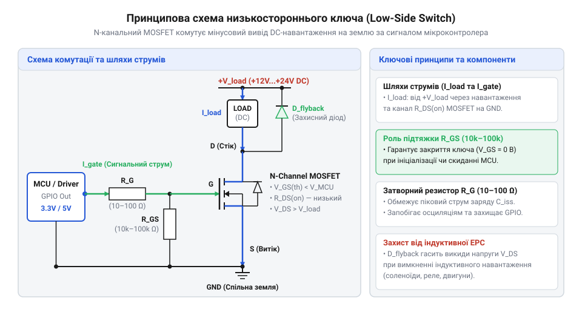
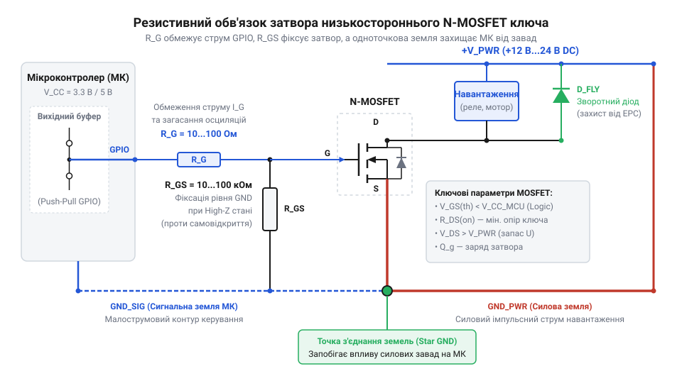
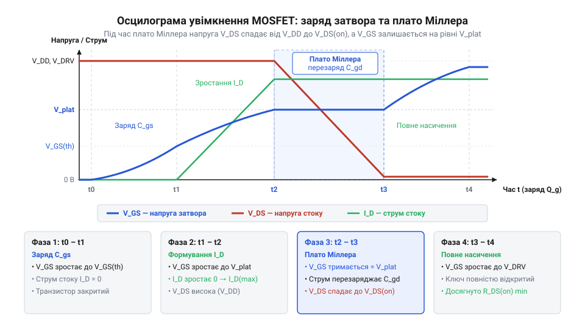
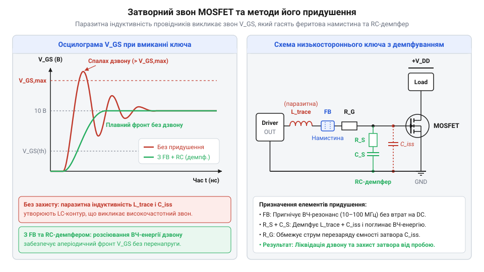
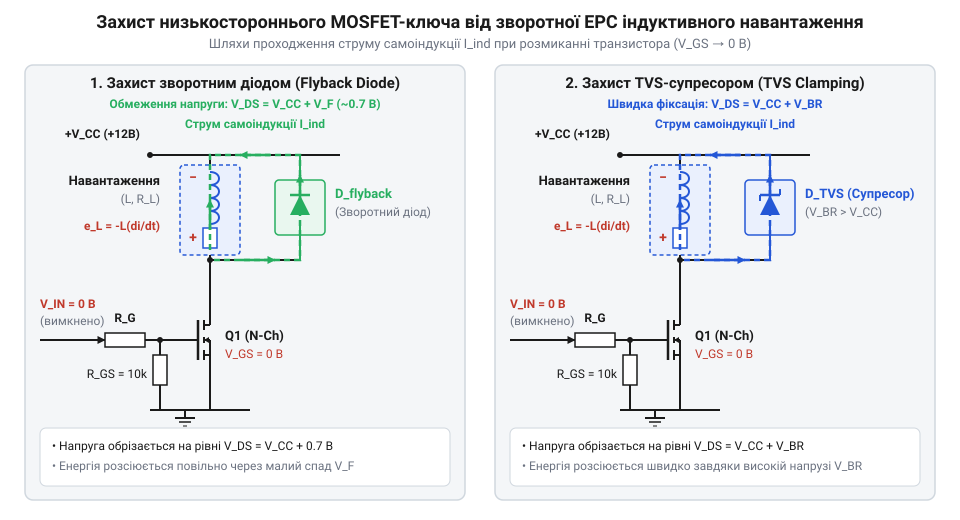

# Схемотехніка низькостороннього ключа на MOSFET для керування навантаженням

<preknowlist>
- [MOSFET логічного рівня (IRLZ44N, IRL540N, IRL2203N, FDD8447L)](root:cat-hw-drivers/logic-level-mosfets) — Поняття порогової напруги затвора V_{GS(th)}, відмінності транзисторів із логічним рівнем керування від стандартних силових MOSFET та залежність опору каналу $R_{DS(on)}$ від рівня напруги на затворі.
</preknowlist>

## Проблема прямого керування потужним DC-навантаженням

Підключення постійного струму DC-навантаження — наприклад, електродвигуна, електромагнітного клапана чи світлодіодної стрічки — безпосередньо до цифрового виходу мікроконтролера призводить до негайного виходу з ладу порту виводу. Порти @@en|GPIO@@ (англ. @@en|General-Purpose Input/Output@@, від @@en|general-purpose@@ — загального призначення, @@en|input/output@@ — вхід/вихід) розраховані на передачу внутрішньосхемних сигналів керування зі струмом не більше 10–20 мА та напругою живлення ядра мікросхеми 3.3 В або 5 В. Вихідні транзистори всередині кристала МК мають крихітні розміри, тому спроба пропустити через них струм навантаження в кілька ампер спричиняє миттєвий тепловий пробій напівпровідникової структури. Крім того, робоча напруга силових пристроїв часто становить 12 В чи 24 В, що повністю несумісно з низьковольтним вихідним каскадом МК.

Для безпечного узгодження слабкого логічного сигналу з потужним колом живлення застосовують силовий електронний ключ. Найпростішим і найефективнішим варіантом такої комутації є @@en|low-side switch@@ (англ. @@en|low-side switch@@, від @@en|low@@ — низький, @@en|side@@ — сторона, @@en|switch@@ — перемикач) — низькосторонній ключ, в якому комутувальний транзистор встановлюється в розрив мінусового проводу між навантаженням та спільною землею.


*Схема низькостороннього комутатора, де N-канальний MOSFET керує струмом навантаження через спільний провід живлення.*

У цій топології позитивний вивід навантаження постійно підключений до плюсової шини джерела живлення, а мінусовий вивід з'єднується з землею лише тоді, коли відкривається транзистор. Коли ключ відкритий і транзистор проводить струм, опір його каналу `R_DS(on)` становить одиниці або десятки міліом, через що потенціал мінусового виводу навантаження опускається майже до землі (0 В), утримуючи лише незначне падіння напруги `V_DS`. У закритому ж стані ключа проходження струму припиняється, падіння напруги на імпедансі навантаження зникає, і потенціал його мінусового виводу піднімається до повної напруги живлення `V_CC`. Через це при низькосторонній комутації пристрій постійно перебуває під високим потенціалом живлення щодо землі навіть у вимкненому стані. Основним елементом низькостороннього ключа є N-канальний @@en|MOSFET@@ (англ. @@en|Metal-Oxide-Semiconductor Field-Effect Transistor@@, від @@en|metal@@ — метал, @@en|oxide@@ — оксид, @@en|semiconductor@@ — напівпровідник, @@en|field-effect transistor@@ — польовий транзистор). Історично еволюція схемотехніки від механічних контактів до [польових транзисторів логічного рівня](root:cat-hw-drivers/low-side-mosfet-switch/hist-low-side-mosfet-evolution.md) створила базис для створення надзвичайно компактних та швидких комутаторів.

Головна перевага розміщення N-канального транзистора в нижньому плечі полягає в тому, що керування струмом каналу відбувається відносно спільного проводу схеми (GND). Витік транзистора підключено безпосередньо до землі, тому для повного відкриття каналу достатньо подати позитивну напругу з виходу @@en|GPIO@@ прямо на затвор. На відміну від цього, у випадку комутації плюсового проводу використовується [складніша схемотехніка високостороннього ключа](root:cat-hw-drivers/high-side-mosfet-switch-circuit), яка вимагає додаткових каскадів для зсуву рівнів напруги або застосування плаваючих драйверів.

Для прямого керування від цифрових мікросхем із напругою живлення 3.3 В або 5 В застосовують [спеціальні транзистори логічного рівня](root:cat-hw-drivers/logic-level-mosfets), у яких порогова напруга відмикання знижена. Це дозволяє насичувати струмовий канал без проміжних підсилювачів напруги.

Завдяки мінімальній кількості компонентів і керуванню відносно спільної землі таке поєднання N-канального @@en|MOSFET@@ у низькосторонній топології утворює найпростіший каскад комутації, який для базових застосувань не потребує додаткових [драйверів затворів силових транзисторів](root:hw-power/gate-driver). Це робить низькосторонній ключ основним схемотехнічним рішенням для безпосереднього узгодження мікроконтролерів із силовим навантаженням постійного струму, хоча його надійна експлуатація вимагає врахування внутрішніх параметрів транзистора під час перемикання.

## Схемотехніка та статичний режим низькостороннього ключа

Силовий N-канальний @@en|MOSFET@@ має три основні виводи: @@en|Gate@@ (затвор, від англ. @@en|gate@@ — ворота), @@en|Drain@@ (стік, від англ. @@en|drain@@ — сток) та @@en|Source@@ (витік, від англ. @@en|source@@ — джерело). Внутрішня структура напівпровідника створює провідний n-канал між стоком і витоком, проводимість якого регулюється електричним полем затвора. Оскільки затвор ізольований від каналу тонким шаром діелектрика з діоксиду кремнію, у стаціонарному стані струм через вивід затвора практично дорівнює нулю.


*Підключення резисторів затворного кола для захисту виходу мікроконтролера та фіксації виключеного стану транзистора.*

Робота низькостороннього ключа у статичному режимі визначається трьома ключовими параметрами: пороговою напругою затвор-витік `V_GS(th)`, опором відкритого каналу `R_DS(on)` та граничною напругою сток-витік `V_DS`. Коли потенціал на затворі відносно витоку `V_GS` менший за пороговий рівень `V_GS(th)`, інверсійний канал під затвором не формується. Транзистор перебуває у закритому стані та блокує напругу живлення навантаження аж до максимального значення `V_DS`. Як тільки напруга `V_GS` перевищує `V_GS(th)`, електрони приваблюються до поверхні напівпровідника, формуючи струмопровідний місток. На цьому етапі, доки напруга на затворі лише злегка перевищує поріг, транзистор потрапляє у режим насичення (англ. @@en|saturation region@@, від @@en|saturate@@ — насичувати), де поблизу стоку виникає перетискання каналу (англ. @@en|pinch-off@@, від @@en|pinch@@ — стискати). У режимі насичення @@en|MOSFET@@ поводиться як джерело струму з високим внутрішнім опором: падіння напруги `V_DS` залишається великим, що спричиняє значне виділення тепла. Щоб перевести ключ у повністю відкритий стан, напругу `V_GS` необхідно збільшувати суттєво вище за пороговий рівень `V_GS(th)`. З подальшим зростанням `V_GS` щільність електронів у каналі стрімко збільшується, явище перетискання зникає, і транзистор переходить у лінійний режим (англ. @@en|linear region@@), також відомий як омічний. Саме у лінійному режимі опір каналу `R_DS(on)` стрімко зменшується до мінімального паспортизованого значення, забезпечуючи мінімальне падіння напруги та низькі втрати потужності. Якщо ж потенціал затвора залишається недостатнім, опір `R_DS(on)` буде у рази вищим за номінал, тому керування від мікроконтролера вимагає застосування [транзисторів логічного рівня](root:cat-hw-drivers/logic-level-mosfets) для запобігання небезпечному перегріву.

Підключення затвора безпосередньо до виходу мікроконтролера створює ризики для надійності схеми. Електрична ємність між затвором та витоком утворює вхідну ємність транзистора `C_iss`. У момент перемикання розряджена ємність поводиться як коротке замикання, через що короткочасний струм заряду затвора може суттєво перевищити допустимий струм порту @@en|GPIO@@. Для обмеження цього пікового струму послідовно між портом та затвором встановлюють обмежувальний резистор `R_G` номіналом 47–220 Ом.

Другою проблемою є @@en|floating gate@@ (плаваючий затвор, від англ. @@en|floating@@ — плаваючий) — стан високоімпедансного входу мікроконтролера під час скидання або завантаження прошивки. Без зовнішньої фіксації вивід затвора працює як антена, накопичуючи статичні заряди чи наведені завади. Це призводить до випадкового відкриття ключа та неконтрольованого увімкнення навантаження. Щоб гарантувати вимкнений стан транзистора, між затвором і землею підключають підтягувальний резистор `R_PD` (англ. @@en|pull-down@@, від @@en|pull@@ — тягнути, @@en|down@@ — вниз) номіналом 10–100 кОм.

Під час розведення силової плати важливо враховувати розмежування проходження струмів. Через вивід витоку `Source` одночасно протікає великий струм навантаження та малий струм розряду ємності затвора. Якщо сигнальна земля мікроконтролера та силова земля джерела живлення з'єднані довгою тонкою доріжкою, виникає стрибок потенціалу землі за рахунок омічного опору провідника. Для усунення цього ефекту силове та сигнальне кола заземлення з'єднують в одній точці безпосередньо біля виводу витоку транзистора.

У повністю відкритому стані транзистор розсіює потужність у вигляді тепла за рахунок омічного опору відкритого каналу `R_DS(on)`. Статичні втрати потужності `P_stat` визначають за законом Джоуля-Ленца через струм стоку `I_D` та опір `R_DS(on)`:

```
P_stat = I_D² × R_DS(on)
```

де `I_D` — тривалий струм навантаження у відкритому стані, а `R_DS(on)` — опір каналу при наявній напрузі на затворі та робочій температурі кристала.

Якщо отримане значення `P_stat` перевищує гранично допустиму потужність розсіювання корпусу транзистора у вільному повітрі, для запобігання перегріву проводиться [тепловий розрахунок транзисторних ключів](root:hw-components/thermal-chain) для вибору охолоджувального радіатора. Для складніших режимів роботи детальні специфікації виводів та [електричний інтерфейс силового модуля](root:cat-hw-drivers/low-side-mosfet-switch/api-low-side-mosfet-switch-schematic.md) подано у схемотехнічній документації. При цьому для розрахунку динамічних втрат під час ШІМ-комутації застосовують [математичний розрахунок режимів ключа](root:cat-hw-drivers/low-side-mosfet-switch/math-low-side-mosfet-calculations.md), де враховуються заряди затвора та перехідні процеси.

## Динаміка перезарядження затвора та ефект Міллера

У статичному стані відкритий @@en|MOSFET@@ майже не споживає струм від цифрового виходу мікроконтролера, бо його @@en|затвор@@ відокремлений від каналу тонким діелектричним шаром оксиду кремнію. Проте під час високочастотної комутації, якою є @@en|ШІМ@@, затвор поводиться як складна паразитна ємнісна мережа. Структура польового транзистора містить три основні паразитичні ємності: ємність між затвором та витоком `C_gs` (@@en|ємність затвор-витік@@), ємність між стоком та витоком `C_ds` (@@en|ємність сток-витік@@) та ємність між затвором і стоком `C_gd` (@@en|прохідна ємність@@, яка в документації позначається як `C_rss`). Сума ємностей `C_gs` та `C_gd` утворює @@en|вхідну ємність@@ транзистора `C_iss`.

Коли сигнал на виході мікроконтролера змінюється з низького рівня на високий, затвор не може зарядитися миттєво. Струм керування обмежений опором затворного резистора `R_G` та внутрішнім опором виходу мікроконтролера. Процес увімкнення транзистора розпадається на чотири послідовні фази перезарядження внутрішнього заряду затвора `Q_g`.

Спочатку струм від виходу мікроконтролера заряджає вхідну ємність `C_gs`. Напруга на затворі `V_GS` зростає від нуля до порогового значення `V_GS(th)`. У цей проміжок часу канал транзистора повністю закритий, струм стоку `I_D` дорівнює нулю, а напруга на стоці `V_DS` залишається рівною напрузі живлення навантаження `V_supply`.

Після досягнення порогового значення `V_GS(th)` транзистор починає відкриватися. Струм стоку `I_D` швидко зростає до повного робочого струму навантаження, але напруга `V_DS` усе ще утримується на високому рівні. У цей момент транзистор опиняється в лінійному режимі, де на ньому одночасно виділяється висока напруга та великий струм.

Наступна фаза є найкритичнішою для швидкодії ключа: напруга на затворі замирає на фіксованому рівні `V_plat`, утворюючи @@en|плато Міллера@@ (від прізвища американського фізика Джона Міллера). У цей період транзистор працює в активній зоні, де струм стоку повністю визначається потенціалом затвора. Рівень напруги плато `V_plat` залежить від порогової напруги `V_GS(th)`, струму навантаження `I_D` та @@en|крутизна характеристики@@ `g_fs` (від англійського *forward transconductance*, де латинське *trans* означає «через», а *conductio* — «проведення»), яка показує передавальний нахил залежності струму від напруги затвора. Оскільки зв'язок струму й напруги затвора у цьому режимі описується формулою `I_D = g_fs × (V_GS - V_GS(th))`, напруга на затворі фіксується на рівні `V_plat = V_GS(th) + I_D / g_fs`. Чим вища крутизна `g_fs`, тим менша додаткова напруга потрібна для проведення струму навантаження, і тим нижче лежить плато Міллера. У цей момент напруга на стоці `V_DS` починає стрімко падати від `V_supply` до мінімального падіння напруги на відкритому каналі. Оскільки напруга на стоці падає, напруга на прохідній ємності `C_gd` змінюється з високою швидкістю. Весь струм, що надходить через резистор `R_G`, витрачається не на підйом напруги `V_GS`, а на розрядження та перезарядження ємності `C_gd`. Поки напруга на стоці не впаде до мінімуму, напруга затвора не може підніматися далі.


*Осцилограма напруги на затворі та стоці показує затримку перемикання через активний ефект Міллера.*

Після завершення проходження плато Міллера прохідна ємність перезаряджена. Затвор продовжує дозаряджатися від рівня `V_plat` до повної логічної напруги 3.3 В або 5 В. Тільки після цього опір каналу досягає паспортного значення `R_DS(on)`.

Тривале перебування транзистора у фазах фронту та плато Міллера спричиняє @@en|динамічні втрати потужності@@ `P_sw`. Під час перехідного процесу транзистор розсіює потужність, яка залежить від частоти перемикання `f_sw`, тривалості фронтів наростання `t_r` та спаду `t_f`. Окрім нагріву силового каналу, висока частота комутації створює додаткове струмове навантаження на коло керування. За кожен період перемикання джерело сигналу передає в затвор і забирає з нього повний заряд `Q_g`. Сумарне перенесення заряду за одну секунду визначає @@en|середній струм затвора@@ `I_G_avg = Q_g × f_sw`. Отримане значення `I_G_avg` використовують для розрахунку @@en|потужності драйвера@@ та перевірки допустимого струмового навантаження виходу мікроконтролера.

P_sw = 0.5 × V_supply × I_D × (t_r + t_f) × f_sw
[формула розрахунку динамічних втрат потужності за період перемикання]

Якщо затворний резистор `R_G` обрано занадто великим, струм заряду буде малим, фронти `t_r` та `t_f` затягнуться, і @@en|MOSFET@@ почне сильно грітися навіть при помірному струмі навантаження. Для точного підбору номіналів застосовують детальний [розрахунок динамічних втрат](root:cat-hw-drivers/low-side-mosfet-switch/math-low-side-mosfet-calculations.md) потужності та затворного кола.

З іншого боку, надмірне зменшення опору `R_G` викликає іншу проблему — @@en|затворний звон@@. Паразитна індуктивність провідників друкованої плати `L_g` разом із вхідною ємністю `C_iss` утворює високодобротний послідовний RLC-контур. При різкому фронті сигналу в цьому контурі виникають високочастотні згасаючі осциляції. Перенапруга на затворі може перевищити гранично допустимий рівень `V_GS(max)` і зруйнувати тонку структуру оксиду кремнію.


*Осцилограма затворного дзвону через паразитні індуктивності та схема його придушення за допомогою демпферного RC-ланцюжка і феритової намистини.*

Для придушення затворного дзвону в коло затвора послідовно вмикають @@en|феритова намистина@@ або розраховують критичний опір резистора `R_G`. Також застосовують @@en|демпферний RC-ланцюжок@@ (@@en|снабер@@), який розсіює енергію високочастотного коливання.

Коли вихідний струм мікроконтролера (зазвичай 10–20 мА) виявляється недостатнім для швидкого перезарядження ємності затвора на високих частотах ШІМ, у схему додають [спеціалізовані драйвери затворів](root:hw-power/gate-driver) або збирають [двотактний тотемний каскад](root:hw-power/discrete-totem-pole-gate-driver) на біполярних транзисторах. Як описує [еволюція схемотехніки комутації](root:cat-hw-drivers/low-side-mosfet-switch/hist-low-side-mosfet-evolution.md), використання таких проміжних каскадів дозволяє відкачувати й подавати струми у кілька ампер за лічені наносекунди, повністю усуваючи перегрів силового ключа.

## Захист ключа від зворотної ЕРС індуктивності

Комутація активних навантажень, як-от реле, обмотки DC-моторів, соленоїди чи трансформатори, супроводжується накопиченням енергії в їхньому магнітному полі. У момент закриття @@en|MOSFET@@-ключа струм стоку намагається миттєво припинитися. Проте індуктивність чинить опір зміні струму, генеруючи високовольтний сплеск самоіндукції — це @@en|зворотна ЕРС@@ (@@en|індуктивний викид@@).

Полярність напруги зворотної ЕРС протилежна до напруги живлення. Вона додається до напруги джерела `V_supply`, створюючи на стоці транзистора імпульс, який обчислюється за формулою:

V_DS = V_supply + L × (dI / dt)
[амплітуда перенапруги на стоці під час вимкнення індуктивності]

Якщо початковий опір кола високий, а час вимкнення `dt` малий, амплітуда викиду може досягати сотень вольт. Коли ця напруга перевищує гранично допустиме значення `V_DS(max)`, транзистор переходить у @@en|лавинний пробій@@. Хоча сучасні силові MOSFET мають паспортну стійкість до лавинного пробою (`E_AS`), багаторазові імпульсні перенапруги призводять до локального перегріву напівпровідникового кристала та незворотного пробою P-N переходу.

Найпростішим і найпоширенішим способом захисту ключа є встановлення паралельно навантаженню @@en|зворотний діод@@ (@@en|демпферний діод@@), увімкненого в зворотному напрямку відносно напруги живлення (катод до `V_supply`, анод до стоку MOSFET). Коли транзистор відкритий, діод закритий і не впливає на роботу. У момент вимкнення ключа зворотна ЕРС відкриває діод, замикаючи струм індуктивності в замкнене контурне коло. Напруга на стоці обмежується на рівні:

V_DS = V_supply + V_F
[обмеження напруги стоку при використанні зворотного діода]

де `V_F` — пряме падіння напруги на діоді (близько 0.7–1.1 В).


*Схема захисту низькостороннього ключа зворотним діодам та TVS-супресором при керуванні індуктивним навантаженням.*

Вибираючи зворотний діод, необхідно враховувати два критичні параметри: максимальний прямий струм `I_F` має бути не меншим за робочий струм навантаження, а @@en|час зворотного відновлення@@ `t_rr` — мінімальним. Проблема повільних діодів виникає в момент відкривання ключа: поки @@en|MOSFET@@-транзистор закритий, струм індуктивності вільно протікає через діод, і в його P-N переході накопичується @@en|заряд зворотного відновлення@@ `Q_rr` неосновних носіїв. Коли ключ знову відкривається, напруга на стоці стрімко спадає, прикладаючи до діода зворотну напругу живлення. Поки накопичений заряд `Q_rr` повністю не розсмокчеться за час `t_rr`, діод короткочасно проводить струм у зворотному напрямку, створюючи прямий шлях короткого замикання від джерела `V_supply` на землю через відкритий канал. У цей момент через MOSFET протікає @@en|піковий струм зворотного відновлення@@ `I_rr`, і загальний струм стоку зростає до рівня `I_D = I_load + I_rr`. Оскільки цей струмовий сплеск збігається з високою напругою стоку під час перехідного процесу, на кристалі MOSFET виникають додаткові @@en|динамічні втрати@@, що спричиняють його сильне імпульсне нагрівання та затворний звон. У високочастотних схемах ШІМ стандартні випрямні діоди (наприклад, серії 1N4007 із `t_rr` близько 2–5 мкс) занадто повільно закриваються і викликають перегрів ключа. Для таких завдань застосовують @@en|діод Шотткі@@ (від імені німецького фізика Вальтера Шотткі), який функціонує на основних носіях заряду, має практично нульовий заряд зворотного відновлення та мале падіння напруги.

Проте звичайний зворотний діод має суттєвий недолік при керуванні реле або соленоїдами: оскільки струм розряджається через мале падіння напруги `V_F`, енергія магнітного поля згасає повільно, уповільнюючи механічне відпускання контактів.

Для прискорення гасіння струму замість звичайного діода паралельно навантаженню або паралельно транзистору встановлюють @@en|TVS-супресор@@ (від англійського @@en|Transient Voltage Suppressor@@ — придушувач тимчасових перенапруг). Супресор працює як прецизійний стабілітрон: він залишається закритим, поки напруга нижча за напругу пробою `V_BR`, але миттєво відкривається при спалаху перенапруги, обмежуючи напругу на рівні фіксації `V_CL`. Оскільки `V_CL` значно вища за `V_F`, накопичена енергія магнітного поля розсіюється набагато швидше.

Ще одним рішенням для точного керування швидкістю відпускання контакторів або потужних реле є комбінована схема зі звичайного випрямного діода та @@en|діода Зенера@@ (від імені американського фізика Кларенса Зенера, @@en|Clarence Zener@@; також відомого як @@en|стабілітрон@@), увімкнених зустрічно-послідовно паралельно обмотці. У такій конфігурації катод випрямного діода підключають до шини живлення `V_supply`, а катод стабілітрона — до стоку @@en|MOSFET@@-ключа, що запобігає протіканню струму від джерела живлення через закритий у зворотному напрямку діод у статичному стані. Під час вимкнення транзистора високовольтний індуктивний спалах відкриває випрямний діод і змушує стабілітрон працювати в режимі зворотного лавинного пробою при фіксованій напрузі `V_Z`. Напруга на обмотці досягає `V_coil = V_Z + V_F`, а на стоці ключа обмежується рівнем `V_DS = V_supply + V_Z + V_F`. Завдяки додатковому падінню напруги `V_Z` струм індуктивності спадає значно швидше, ніж при використанні поодинокого демпферного діода, що скорочує @@en|час відпускання@@ механічного якоря контактора, запобігає утворенню електричної дуги на його силових контактах і одночасно утримує напругу `V_DS` нижче гранично допустимої межі `V_DS(max)`.

Повне укомплектування захисних та сигнальних кіл наочно показує [принципова схема ключа](root:cat-hw-drivers/low-side-mosfet-switch/api-low-side-mosfet-switch-schematic.md) з усіма номіналами та рекомендаціями. Практичне застосування цих рішень для керування DC-мотором або потужними світлодіодами демонструє [реальний проєкт модуля](root:cat-hw-drivers/low-side-mosfet-switch/proj-low-side-mosfet-driver-board.md) силової плати. При цьому надійність системи завжди враховує [тепловий розрахунок ключів](root:hw-components/thermal-chain) під час тривалої комутації великих струмів.

## Розрахунок і підбір компонентів силового ключа

Низькосторонній ключ виходить з ладу або надмірно гріється, якщо компоненти підібрані без урахування граничних режимів навантаження та напруги керування. Підбір транзистора починають із двох головних параметрів силового кола: граничної напруги `V_DS` та максимального струму стоку `I_D`. Напруга пробою між стоком і витоком `V_DS` повинна перевищувати напругу живлення навантаження `V_DD` щонайменше на 50–100 %, щоб запасу міцності вистачило для поглинання комутаційних сплесків. Запас за струмом `I_D` обирають у 2–3 рази більше від номінального струму навантаження, враховуючи технологічний резерв (від англ. *derating*, @@en|derating@@) при підвищенні температури кристала.

Наступний вирішальний крок — сумісність із рівнем керуючого сигналу мікроконтролера. Стандартні силові транзистори вимагають напруги на затворі `V_GS = 10 V` для повного відкриття каналу. Якщо подати на такий затвор 3.3 В або 5 В від портів мікроконтролера, транзистор залишиться у напіввідкритому активному режимі з високим опором каналу, що призведе до миттєвого перегріву. Для прямого керування від мікроконтролера застосовують [спеціалізовані польові транзистори](root:cat-hw-drivers/logic-level-mosfets) з нормованим опором `R_DS(on)` при напругах затвора 2.5 В або 4.5 В. Однак під час роботи кристала необхідно враховувати його температурні режими. Опір відкритого каналу `R_DS(on)` має позитивний температурний коефіцієнт (від англ. *temperature coefficient*, @@en|temperature coefficient@@). Через розсіювання носіїв заряду на теплових коливаннях ґратки опір каналу зростає на 50–100 % при нагріванні кристала до 100–125 °C. Розрахунок статичних втрат лише за холодним значенням `R_DS(on)` при 25 °C занижує реальне тепловиділення та створює ризик теплового розгону (від англ. *thermal runaway*, @@en|thermal runaway@@). Водночас порогова напруга затвора `V_GS(th)` має негативний температурний коефіцієнт і знижується при нагріванні. Це падіння `V_GS(th)` трохи полегшує відкривання каналу гарячого транзистора, але знижує завадостійкість затвора і не компенсує зростання `R_DS(on)`, тому підбір транзистора завжди ведуть за опором каналу при максимальній робочій температурі.

Тепловий розрахунок показує, чи здатний корпус транзистора розсіяти виділене тепло в навколишнє середовище без додаткового радіатора (англ. @@en|heatsink@@ — радіатор). *heat sink*, @@en|heat sink@@). Загальні втрати потужності складаються зі статичних втрат на опорі відкритого каналу та динамічних втрат під час перемикання. Статична потужність обчислюється за базовим законом Джоуля-Ленца через струм навантаження та опір відкритого каналу:

**Розрахунок теплового режиму ключа при струмі 5 А**
```
P_stat = I_D² × R_DS(on)
= (5 A)² × 0.025 Ω      [підстановка струму навантаження та опору каналу]
= 25 A² × 0.025 Ω       [піднесення струму до квадрата]
= 0.625 W               [обчислення статичної потужності]
```

Якщо ключ працює в режимі широтно-імпульсної модуляції (@@en|PWM@@), до статичних втрат додаються динамічні, розрахунок яких зведено у [математичному довіднику розрахунків](root:cat-hw-drivers/low-side-mosfet-switch/math-low-side-mosfet-calculations.md) втрат потужності. Отримавши сумарну потужність `P_total`, визначають температуру кристала `T_j = T_a + P_total × R_θJA`, де `T_a` — температура навколишнього середовища, а `R_θJA` — тепловий опір кристал-середовище (від англ. *thermal resistance*, @@en|thermal resistance@@). Якщо розрахована температура кристала (англ. @@en|junction temperature@@ — температура переходу/кристала) перевищує максимально допустиму, необхідно передбачити тепловідвід. *junction temperature*, @@en|junction temperature@@) `T_j` перевищує безпечний поріг (зазвичай 100–120 °C), розраховують [параметри систем охолодження](root:hw-components/thermal-chain) для вибору радіатора.

Обв'язка затвора відповідає за безпеку виходу мікроконтролера та стабільний стан ключа. Обмежувальний резистор `R_G` встановлюють послідовно між виводом @@en|GPIO@@ та затвором. Він обмежує піковий струм заряду вхідної ємності `C_iss`, захищаючи вихідний каскад мікроконтролера від виходу з ладу. Мінімальний опір розраховують як `R_G_min = V_GPIO / I_GPIO_max`. Для сигналу 3.3 В та граничного струму порту 20 мА мінімальне значення становить `3.3 V / 0.020 A = 165 Ω`. Підтягувальний резистор `R_PD` (англ. *pull-down*, @@en|pull-down@@) опором 10–100 кОм підключають між затвором і землею, щоб зафіксувати затвор у вимкненому стані під час перезавантаження мікроконтролера, коли порт перебуває у стані високого опору (@@en|hi-Z@@). За високої частоти комутації великий опір `R_G` затягує фронти, тому для розкачки затвора додають [зовнішній тотемний каскад](root:hw-power/discrete-totem-pole-gate-driver) або спеціалізований [драйвер силових транзисторів](root:hw-power/gate-driver). Загальну топологію з'єднань елементів описує [принципова схема модуля](root:cat-hw-drivers/low-side-mosfet-switch/api-low-side-mosfet-switch-schematic.md) низькостороннього ключа.

## Діагностика несправностей і паразитного самозбудження

Навіть правильно розрахована схема може працювати некоректно через невраховані паразитні зв'язки або помилки монтажу. Поширеною несправністю є надмірне нагрівання транзистора при відносно малих струмах навантаження. Це свідчить про неповне відкриття каналу, коли напруга затвора `V_GS` знаходиться поблизу порогового значення `V_GS(th)`. Причиною може бути просідання напруги живлення мікроконтролера под навантаженням або занадто великий спад напруги на обмежувальному резисторі `R_G` через витік струму. Діагностувати це можна за допомогою мультиметра чи осцилографа, вимірявши дійсне значення `V_GS` безпосередньо між виводами затвора (@@en|gate@@) та витоку (@@en|source@@) транзистора.

Інша критична проблема — високочастотні коливання (від англ. @@en|ringing@@ — дзвін/коливання). *ringing*, @@en|ringing@@) в колі затвора під час комутації. Вони виникають через створення паразитного послідовного RLC-контуру, де індуктивністю є паразитна індуктивність провідників друкованої плати (англ. @@en|PCB trace inductance@@ — індуктивність доріжки ДП). *printed circuit board*, @@en|PCB@@), а ємністю — вхідна ємність транзистора `C_iss`. Стрімкий фронт напруги від мікроконтролера збуджує цей контур, викликаючи сплески напруги на затворі, які можуть перевищити гранично допустиме значення `V_GS_max` і пробити тонкий шар оксиду діелектрика.


*Високочастотний дзвін виникає в паразитному RLC-контурі затвора і усувається критичним демпфуванням за допомогою резистора R_G або феритової намистини.*

Для придушення затворного дзвону розраховують критичний опір демпфування `R_G >= 2 × √(L_trace / C_iss)`. Якщо збільшення опору `R_G` недопустиме через затягування фронтів перемикання, послідовно із затвором встановлюють високочастотну феритову намистину (@@en|ferrite bead@@), яка активно розсіює високочастотну енергію коливань без збільшення опору постійному струму.

Паразитні імпульси та самочинне спрацьовування ключа часто спричинені спільними контурами заземлення (від англ. @@en|ground loop@@ — земляна петля/контур заземлення). *ground loop*, @@en|ground loop@@). Коли великий силовий струм навантаження протікає через загальний провідник землі, на паразитному опорі й індуктивності цього провідника створюється падіння напруги `ΔV = I × R_trace + L_trace × (di/dt)`. Це падіння напруги припіднімає потенціал витоку відносно землі мікроконтролера, що призводить до хибного відмикання або завад на провіднику керування. Щоб усунути цей ефект, сигнальну землю мікроконтролера та силову землю навантаження з'єднують виключно в одній точці — безпосередньо на виводі витоку транзистора за принципом зіркоподібної топології. Для запобігання перешкодам та зміщенню потенціалів застосовується [топологія зіркоподібного заземлення у силових та аналогових схемах](root:hw-pcb/star-ground-topology).

Додатково, стрімке зростання напруги на стоку (@@en|drain@@) `dv/dt` під час вимкнення індуктивного навантаження інжектує струм зміщення через прохідну ємність затвор-стік Міллера `C_gd` (англ. *gate-drain capacitance*, @@en|gate-drain capacitance@@) назад у коло затвора. Цей струм протікає через еквівалентний опір розряду затвора `R_G_total` на землю і створює на затворі падіння напруги `V_GS_peak`. Якщо опір кола затвора занадто високий, індукована напруга перевищує порогове значення `V_GS(th)`, викликаючи повторне самочинне відкривання ключа. Щоб запобігти хибному відмиканню транзистора, розраховують математичний критерій граничного опору затворного кола: Для гасіння високочастотних імпульсних перенапруг на стоку застосовується [проєктування та розрахунок RC-демпферів (снаберів) для силових ключів](root:hw-power/snubbers-dvdt).

    V_GS_peak = C_gd × (dv/dt) × R_G_total
    R_G_total < V_GS(th) / (C_gd × (dv/dt))

де `C_gd` — ємність затвор-стік, `dv/dt` — швидкість зміни напруги стоку при вимкненні, `R_G_total` — сумарний опір кола затвора (включаючи внутрішній опір затвора транзистора `R_g_int` та вихідний опір драйвера), а `V_GS(th)` — мінімальна порогова напруга відкривання каналу. Якщо пасивне зменшення опору резистора `R_G` є недопустимим через ризик занадто різкого ввімкнення та виникнення високочастотного дзвону, застосовують схемотехніку активного клема Міллера (англ. *active Miller clamp*, @@en|active Miller clamp@@). Вона передбачає використання додаткового низькоомного транзисторного ключа у колі драйвера, який відстежує рівень `V_GS` і після спаду напруги нижче безпечної межі (поблизу 1.5–2 В) шунтує затвор безпосередньо на витік із мінімальним опором, оминаючи резистор `R_G` та повністю закорочуючи струм Міллера на землю. Для додаткового захисту від імпульсних сплесків напруги на стоку застосовують RC-снабери (@@en|snubber@@) або TVS-супресори (@@en|TVS diode@@), а в складних системах використовують [спеціалізовані драйвери затворів](root:hw-power/gate-driver). Історію вдосконалення схемотехніки висвітлює [нарис еволюції низькосторонніх ключів](root:cat-hw-drivers/low-side-mosfet-switch/hist-low-side-mosfet-evolution.md). Практичні прийоми вимірювання завад та налаштування демпферів випробувані у [практичному проєкті модуля](root:cat-hw-drivers/low-side-mosfet-switch/proj-low-side-mosfet-driver-board.md) низькостороннього ключа. У разі критичного рівня завад у силовому колі комутацію ізолюють, застосовуючи [гальванічну розв'язку силових ключів](root:hw-power/isolated-gate-driver).
