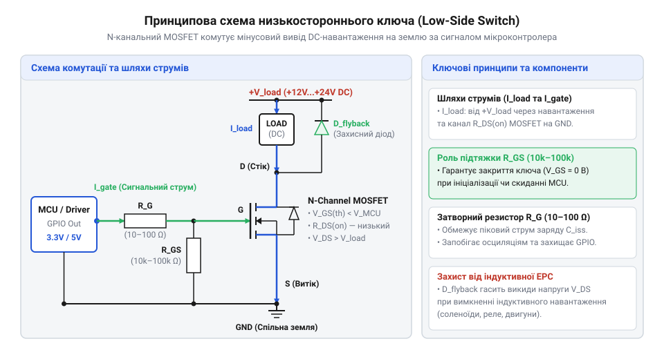
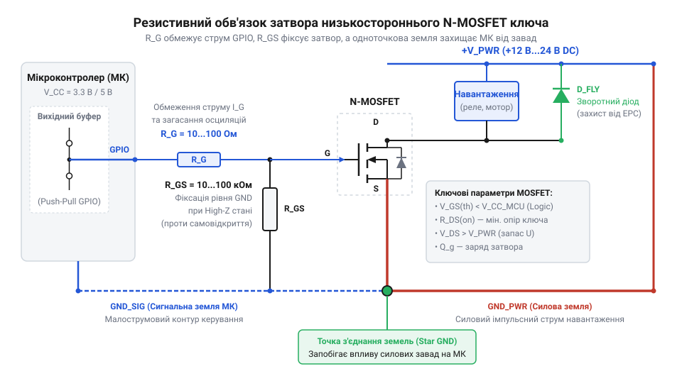
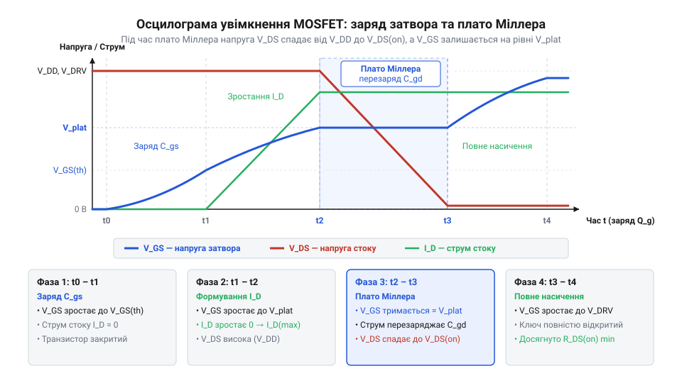
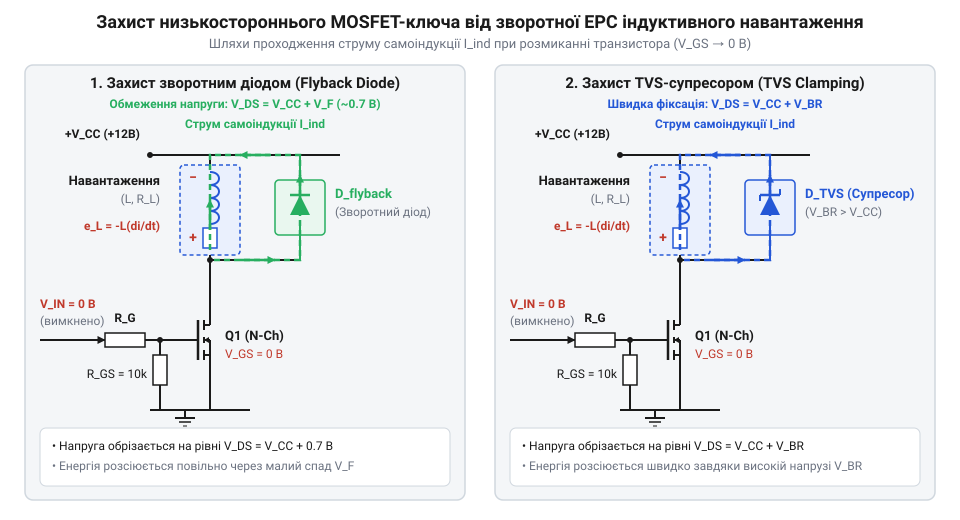

# Схемотехніка низькостороннього ключа на MOSFET для керування навантаженням

<preknowlist>
- [MOSFET логічного рівня (IRLZ44N, IRL540N, IRL2203N, FDD8447L)](root:cat-hw-drivers/logic-level-mosfets) — порогова напруга затвора V_{GS(th)}, відмінності транзисторів логічного рівня від стандартних MOSFET та залежність опору каналу $R_{DS(on)}$ від напруги затвора
</preknowlist>

## Проблема прямого керування потужним навантаженням

Цифрові виходи мікроконтролера розраховані на струми у кілька мікроампер чи міліампер. Якщо підключити силовий електродвигун, реле чи світлодіодну стрічку безпосередньо до порту, струм у сотні міліампер миттєво виведе мікросхему з ладу. Для безпечної комутації силового кола застосовують електронний ключ на @@en|N-канальному MOSFET@@ (англ. @@en|metal-oxide-semiconductor field-effect transistor@@).

У схемотехніці низькостороннього ключа (англ. @@en|low-side switch@@, від @@en|low@@ — низький) N-канальний транзистор вмикають у розрив мінусового провідника навантаження. Плюс живлення підключають напряму до навантаження, а мінус — через канал транзистора до спільної землі `GND`. Коли на затвор (англ. @@en|gate@@) подають високий рівень, опір між стоком (англ. @@en|drain@@) та витоком (англ. @@en|source@@) падає до нуля, і струм тече через навантаження.

Головна перевага низькостороннього включення — керування напругою затвора відносно спільної землі `GND`. Витік транзистора з'єднаний із землею мікроконтролера, тому керуючий сигнал не потребує схем зсуву рівнів чи ізольованих драйверів. Для комутації плюсової лінії живлення застосовують [схемотехніку високостороннього ключа на P-канальному та N-канальному MOSFET](root:hw-components/high-side-mosfet-switch).

*Схема низькостороннього увімкнення N-канального MOSFET для безпечного керування силовим DC-навантаженням відносно спільної землі.*

## Схемотехніка та елементи обв'язки затвора

Щоб силовий ключ не перегрівався, @@en|N-канальний MOSFET@@ має перебувати у насиченні з мінімальним опором відкритого каналу `R_DS(on)`. При недостатній напрузі затвора опір зростає, викликаючи тепловий пробой. Для прямого керування від мікроконтролера обирають [транзистори логічного рівня](root:cat-hw-drivers/logic-level-mosfets), у яких опір `R_DS(on)` мінімальний вже при напрузі 3.3 В або 5 В.

Керування затвором потребує обв'язки з двох резисторів. Затвор MOSFET ізольований і має вхідну ємність `C_iss`. Під час перемикання вона заряджається, викликаючи кидок струму. Для захисту цифрового виходу послідовно вмикають обмежувальний резистор `R_G` (10–100 Ом).

Підтягувальний резистор `R_PD` (10–100 кОм) між затвором та витоком `GND` фіксує вимкнений стан. Під час скидання мікроконтролера його вихід перебуває у високоімпедансному стані, і `R_PD` розряджає затвор, запобігаючи самовільному ввімкненню навантаження через завади.

*Схема обв'язки затвора MOSFET з обмежувальним резистором R_G для захисту порту мікроконтролера та підтягувальним резистором R_PD.*

## Динаміка комутації та ефект Міллера

При високочастотній @@en|ШІМ@@-комутації (англ. @@en|pulse-width modulation@@) на швидкість ключа впливають паразитні ємності: затвор-витік `C_gs` та затвор-стік `C_gd`. Коли транзистор відкривається, напруга на стоку спадає. Через ємність `C_gd` виникає негативний зворотний зв'язок — @@en|ефект Міллера@@ (англ. @@en|Miller effect@@, на честь інженера Джонна Міллера).

Він формує на діаграмі заряду @@en|плато Міллера@@ (англ. @@en|Miller plateau@@), де напруга затвора завмирає, а струм керування витрачається на перезаряд `C_gd`. У цей момент транзистор розсіює пікову динамічну потужність. плато Міллера@@ | Для форсування перезаряджання ємності затвора та зменшення динамічних втрат застосовують [драйвери затвора силових MOSFET-транзисторів](root:hw-power/gate-driver).

Занадто швидкий заряд ємностей через індуктивність друкованих провідників викликає високочастотний @@en|затворний дзвін@@ (англ. @@en|gate ringing@@). Резистор `R_G` гасить ці коливання, шукаючи компроміс між дзвоном та динамічним нагріванням.

*Часова діаграма заряду затвора з плато Міллера, що ілюструє затримку перемикання та динамічні втрати.*

## Захист ключа від індуктивних викидів

Вимикання індуктивного навантаження (соленоїда, реле чи двигуна) викликає сплеск зворотної ЕРС. Струм індуктивності прагне зберегти значення, створюючи на стоку високовольтний пік напруги, що загрожує лавинним пробоєм MOSFET.

Для захисту паралельно навантаженню вмикають демпферний діод (англ. @@en|flyback diode@@, від @@en|flyback@@ — зворотний хід) анодом до стоку, а катодом до плюса живлення. Під час вимкнення ключа діод закорочує струм самоіндукції, розсіюючи енергію на опорі котушки. Застосовують діоди Шотткі через малий час відновлення.

Якщо демпферний діод надто затягує відпускання механічних реле, паралельно транзистору встановлюють @@en|TVS-супресор@@ (англ. @@en|transient voltage suppressor@@). Він зрізає високовольтний пік напруги на безпечному рівні, прискорюючи розряд котушки.

*Схеми включення паралельного демпферного діода та TVS-супресора для гасіння сплесків зворотної ЕРС індуктивного навантаження.*
