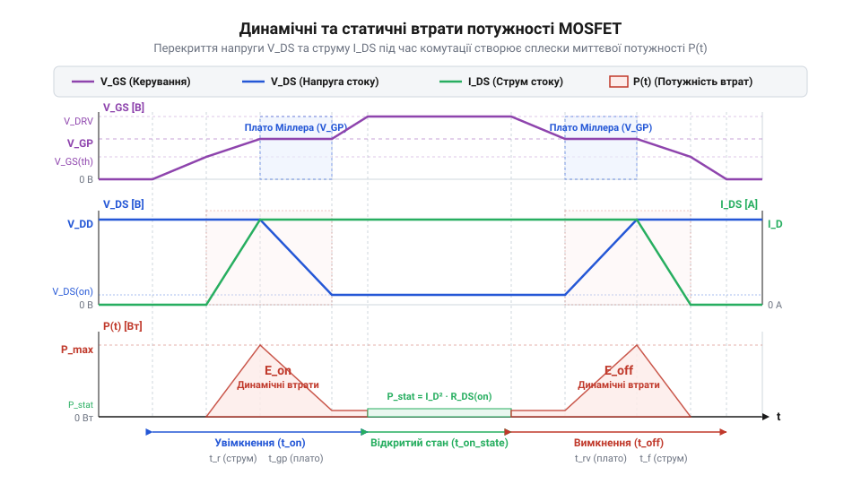

# Розрахунок параметрів, затворного резистора та втрат потужності низькостороннього MOSFET-ключа

<preknowlist>
- [MOSFET логічного рівня (IRLZ44N, IRL540N, IRL2203N, FDD8447L)](root:cat-hw-drivers/logic-level-mosfets) — Порогова напруга затвора V_{GS(th)}, залежність $R_{DS(on)}$ від напруги затвора та специфіка прямого керування від 3.3В/5В виходів мікроконтролера.
</preknowlist>

## Перегрів ключа в наївній схемі

Спроба обрати N-канальний польовий транзистор (англ. @@en|MOSFET@@, від *Metal-Oxide-Semiconductor Field-Effect Transistor* — польовий транзистор зі структурою метал-оксид-напівпровідник) лише за максимальним номінальним струмом зі специфікації часто призводить до того, що під час роботи ключ розжарюється й згоряє від @@en|теплового пробою@@ (від праслав. *teplъ* — теплий). Конструктор бачить у специфікації допустимий струм 50 А і вважає, що пристрій без проблем комутуватиме навантаження в 10 А у @@en|низькосторонній схемі@@ (англ. @@en|low-side switch@@), де навантаження під'єднане між плюсовою шиною живлення та стоком (англ. @@en|drain@@) транзистора, а його витік (англ. @@en|source@@) сполучено зі спільною землею. Проте реальний силовий ключ працює у двох принципово різних режимах: статичному й динамічному. У закритому стані напруга між стоком і витоком `V_DS` дорівнює напрузі живлення, а в повністю відкритому — падає майже до нуля через низький опір каналу. Головна проблема ховається у перехідних фронтах: затвор (англ. @@en|gate@@) має внутрішню ємність, і поки вона перезаряджається, струм `I_D` уже досягає повного значення навантаження, коли напруга `V_DS` ще висока. На цей короткий проміжок часу транзистор потрапляє в @@en|активний режим@@ (англ. @@en|active region@@, від лат. *activus* — дієвий), працюючи як напівпровідниковий баластний опір та розсіюючи пікову миттєву потужність `P = V_DS × I_D`.

У статичному стані відкритий канал транзистора має постійний опір відкритого каналу `R_DS(on)`. У цей час втрати визначаються лише проходженням струму навантаження через опір каналу. Під час широтно-імпульсної модуляції ключ постійно перемикається між відкритим і закритим станами. Процес переходу не відбувається миттєво: упродовж фронтів увімкнення та вимкнення напруга між стоком і витоком ще висока, а струм через канал уже досяг максимального значення.

У цей коротким проміжок часу ключ перебуває в активній зоні, а миттєва потужність на транзисторі досягає пікових значень. Якщо частота комутації висока, сумарне тепловиділення від таких перехідних процесів перевищує статичні втрати. Для розрахунку надійного ключа необхідно роздільно обчислювати статичну та динамічну складові втрат потужності, щоб визначити повний тепловий баланс кристала.

Особливо виразно ця проблема проявляється під час прямого керування ключем від виходів мікроконтролера. Через обмежений вихідний струм цифрового виводу перезарядження внутрішньої ємності затвора затягується, змушуючи транзистор довше залишатися у стані високого опору. Навіть спеціальні [транзистори логічного рівня](root:cat-hw-drivers/logic-level-mosfets) при високій частоті комутації починають критично нагріватися, якщо затворний резистор `R_G` та струм керування підібрано наосліп. Збалансований розрахунок усіх складових втрат і @@en|теплового опору@@ `R_θJA` дозволяє заздалегідь визначити межі безпечної роботи ключа та вчасно передбачити необхідність додаткового охолодження.

## Розрахунок статичних і динамічних втрат

Статична потужність втрат виникає внаслідок виділення тепла на опорі відкритого каналу `R_DS(on)` під час проходження струму стоку `I_D`. Коли ключ керований широтно-імпульсною модуляцією з коефіцієнтом заповнення `D` (англ. @@en|duty cycle@@), струм протікає лише частку періоду:

```
P_stat
= I_D² × R_DS(on) × D      [закон Джоуля-Ленца з урахуванням коефіцієнта заповнення ШІМ]
```

Динамічні втрати виникають під час фронтів комутації, коли напруга на стоці падає від напруги живлення `V_DD` до нуля, а струм зростає від нуля до значення `I_D`.


_*Осцилограми перехідних процесів увімкнення та вимкнення ключа з імпульсами миттєвих втрат потужності.*_

Упродовж тривалості вмикання `t_on` та вимикання `t_off` середня потужність перекриття струму й напруги на кожен фронт становить одну шосту від їхнього добутку. За частоти комутації `f_sw` втрати перемикання каналу `P_sw` обчислюють за формулою:

```
P_sw
= 0.5 × V_DD × I_D × (t_on + t_off) × f_sw      [сумарні втрати перемикання каналу за частоти f_sw]
```

Крім втрат у каналі, керувальний драйвер витрачає потужність `P_gate` на перезаряд відновлюваної ємності затвора з повним зарядом `Q_g` при напрузі затвора `V_GS`:

```
P_gate
= Q_g × V_GS × f_sw      [потужність перезаряду ємності затвора]
```

Сумарна динамічна потужність втрат `P_dyn` додає обидві складові:

```
P_dyn
= P_sw + P_gate      [сума втрат перемикання каналу та затвора]
```

Загальна потужність розсіювання `P_total`, яка перетворюється на тепло всередині корпусу:

```
P_total
= P_stat + P_dyn      [сумарна потужність розсіювання ключа]
```

**Обчислення втрат ключа при I_D = 10 A, V_DD = 24 V, R_DS(on) = 0.02 Ом, D = 0.5, f_sw = 100000 Гц, t_on = 30 нс, t_off = 50 нс, Q_g = 20 нКл, V_GS = 5 V:**

```
P_stat
= 10² × 0.02 × 0.5
= 100 × 0.02 × 0.5
= 1.0 Вт      [статичні втрати в відкритому каналі]

P_sw
= 0.5 × 24 × 10 × (30×10⁻⁹ + 50×10⁻⁹) × 100000
= 120 × 80×10⁻⁹ × 100000
= 0.96 Вт      [динамічні втрати комутації каналу]

P_gate
= 20×10⁻⁹ × 5 × 100000
= 0.01 Вт      [динамічні втрати перезаряду затвора]

P_total
= 1.0 + 0.96 + 0.01
= 1.97 Вт      [сумарна потужність розсіювання]
```

## Обчислення затворного резистора та режимів

Затворний резистор `R_G` визначає швидкість заряджання вхідної ємності та тривалість @@en|плато Міллера@@ (англ. @@en|Miller plateau@@, за ім'ям інженера Джона Міллера) — ділянки, де напруга затвора лишається постійною, поки струм затвора перезаряджає ємність між стоком і затвором.

При використанні мікроконтролерів керуючі сигнали часто подають безпосередньо на [транзистори логічного рівня](root:cat-hw-drivers/logic-level-mosfets), які відкриваються від низької напруги затвора. У момент перемикання виводу з напругою `V_CC` розряджений затвор створює коротке замикання. Для захисту виводу керування від струмового перевантаження вище допустимого `I_MCU,max` резистор повинен обмежувати піковий струм. З урахуванням вихідного опору драйвера `R_out` та внутрішнього опору затвора `R_g,int` нижня межа затворного опору становить:

```
R_G,min
= (V_CC ÷ I_MCU,max) - R_out - R_g,int      [мінімальний опір для захисту виводу керування]
```

Паразитна індуктивність доріжки затвора `L_g` утворює разом із вхідною ємністю ключа `C_iss` послідовний коливальний контур. Щоб запобігти високочастотним зворотним осциляціям та хибним спрацьовуванням, опір затвора повинен забезпечувати демпфування. Умова критичного демпфування розраховується як:

```
R_G,crit
= 2 × √(L_g ÷ C_iss) - R_out - R_g,int      [критичний опір демпфування паразитного контуру]
```

Верхня межа затворного опору `R_G,max` обмежується максимально допустимим часом перемикання `t_m`, щоб занадто повільний розряд ємності затвора з зарядом сток-затвор `Q_gd` при напрузі плато Міллера `V_plat` не призводив до надмірних динамічних втрат:

```
R_G,max
= (V_CC - V_plat) × t_m ÷ Q_gd      [максимальний опір за часом перемикання]
```

**Розрахунок межі затворного резистора при V_CC = 5 V, I_MCU,max = 0.02 А (20 мА), R_out = 25 Ом, R_g,int = 2 Ом, L_g = 10 нГн, C_iss = 1000 пФ:**

```
R_G,min
= (5 ÷ 0.02) - 25 - 2
= 250 - 27
= 223 Ом      [мінімальний опір для обмеження струму виводу мікроконтролера до 20 мА]

R_G,crit
= 2 × √(10⁻⁸ ÷ 10⁻⁹) - 25 - 2
= 2 × 3.162 - 27
= -20.68 Ом      [контур задемпфовано внутрішніми опорами схеми]
```

Оскільки мінімальний опір обмеження струму мікроконтролера дорівнює 223 Ом, обирають стандартний резистор номіналом 240 Ом.

## Тепловий розрахунок стану кристала транзистора

Виділення потужності втрат `P_total` призводить до нагрівання напівпровідникового переходу транзистора. Розрахунок теплового стану базується на концепції, де @@en|тепловий опір@@ (англ. @@en|thermal resistance@@) `R_θJA` описує передачу тепла від P-N переходу до навколишнього середовища з температурою `T_a`.

Усталена температура кристала `T_j` без використання зовнішнього радіатора обчислюється за формулою:

```
T_j
= T_a + P_total × R_θJA      [температура кристала без зовнішнього радіатора]
```

Якщо тепловий опір корпуса не дає змоги розсіяти потужність у повітря, монтують зовнішній радіатор. Тоді загальний тепловий опір дорівнює сумі опорів перехід-корпус `R_θJC`, прокладки термоінтерфейсу `R_θCS` та радіатор-середовище `R_θSA`:

```
R_θJA,total
= R_θJC + R_θCS + R_θSA      [сумарний тепловий опір системи з радіатором]
```

Температура кристала з радіатором обчислюється як:

```
T_j
= T_a + P_total × (R_θJC + R_θCS + R_θSA)      [температура кристала з радіатором]
```

Розраховане значення `T_j` порівнюють із граничною температурою `T_j,max` зі специфікації (зазвичай 150 °C або 175 °C). Для надійної роботи робоча температура не повинна перевищувати 80% від `T_j,max`.

**Розрахунок температури кристала при P_total = 1.97 Вт, T_a = 40 °C, R_θJA = 62 °C/Вт, T_j,max = 175 °C:**

```
T_j
= 40 + 1.97 × 62
= 40 + 122.14
= 162.14 °C      [температура кристала без зовнішнього радіатора]
```

Розрахована температура 162.14 °C перевищує безпечний рівень 140 °C (80% від 175 °C), що вимагає встановлення зовнішнього радіатора або використання транзистора з меншим опором каналу `R_DS(on)`.

## Розрахунок захисту від індуктивних сплесків

При комутації індуктивного навантаження (котушок реле, соленоїдів, двигунів) раптове закривання ключа перериває струм `I_D`. Згідно з законом самоіндукції, індуктивність `L` підтримує протікання струму, генеруючи сплеск напруги на стоці, який спричиняє @@en|лавинний пробій@@ (від фр. *avalanche* — лавина) каналу транзистора.

Енергія `E_L`, накопичена в магнітному полі індуктивності перед вимкненням:

```
E_L
= 0.5 × L × I_D²      [енергія самоіндукції навантаження]
```

Для безпечного розряджання індуктивної енергії паралельно навантаженню встановлюють @@en|зворотний діод@@ (англ. @@en|freewheeling diode@@). Під час закривання ключа діод відкривається й замикає струм індуктивності у контур навантаження.

Максимальна зворотна напруга діода `V_R,max` повинна перевищувати напругу живлення схеми з коефіцієнтом запасу:

```
V_R,max
≥ 1.2 × V_DD      [запас по зворотній напрузі захисного діода]
```

Піковий прямий струм діода `I_F,peak` повинен витримувати повний струм стоку:

```
I_F,peak
≥ I_D      [піковий прямий струм діода]
```

Для швидкодіючих схем ШІМ @@en|час зворотного відновлення@@ (англ. @@en|reverse recovery time@@) діода `t_rr` має бути суттєво меншим за час увімкнення ключа `t_on`, щоб уникнути короткого замикання джерела живлення під час відкривання ключа.

Альтернативою паралельному діоду є застосування @@en|TVS-супресора@@ (англ. @@en|transient voltage suppressor@@) паралельно стоку та витоку ключа. Напруга пробою TVS-супресора `V_BR,TVS` обережно обирається між напругою живлення та максимальною напругою стока `V_BR(DSS)`:

```
V_DD < V_BR,TVS < V_BR(DSS)      [діапазон напруги пробою TVS-супресора]
```

**Розрахунок захисту при L = 50 мГн (0.05 Гн), I_D = 2 A, V_DD = 12 V, V_BR(DSS) = 55 V:**

```
E_L
= 0.5 × 0.05 × 2²
= 0.5 × 0.05 × 4
= 0.1 Дж      [енергія самоіндукції, яку розсіює захисний елемент]

V_R,min
= 1.2 × 12
= 14.4 V      [мінімальна зворотна напруга діода]
```

Обирають діод Шотткі з параметрами `V_R = 30 V`, `I_F = 3 A` та `t_rr < 20 нс`, який забезпечує повний захист ключа від руйнування перенапругою.
