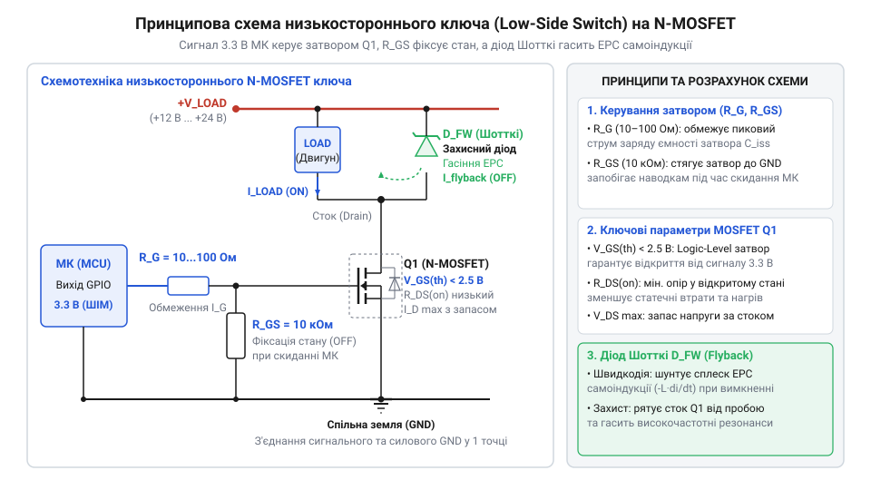
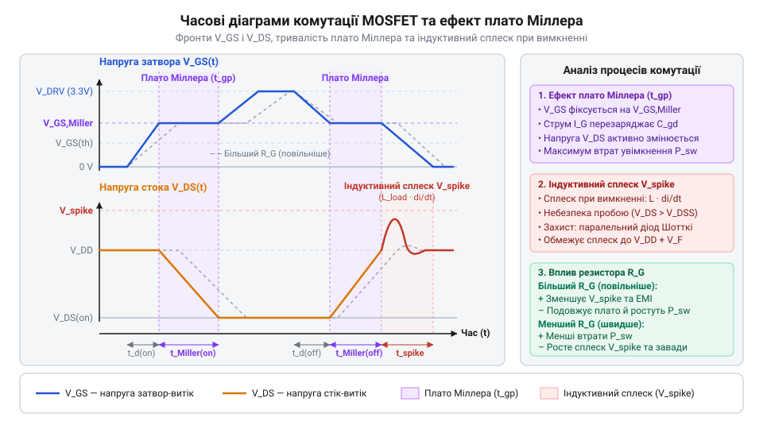

# Розробка та випробування модуля низькостороннього MOSFET-ключа для керування DC-мотором

<preknowlist>
- [MOSFET логічного рівня (IRLZ44N, IRL540N, IRL2203N, FDD8447L)](root:cat-hw-drivers/logic-level-mosfets) — Особливості керування затвором від 3.3 В логіки та значення V_{GS(th)} для повного відкриття каналу
</preknowlist>

## Проблема прямого живлення мотора мікроконтролером

Пряме підключення обмотки @@en|DC-мотора@@ (англ. *Direct Current motor* — двигун постійного струму) до цифрового виводу @@en|GPIO@@ (англ. *General Purpose Input/Output* — вивід загального призначення) мікроконтролера майже миттєво виводить з ладу вихідний драйвер кристала. Причина полягає в двох фізичних обмеженнях: критичному перевантаженні за струмом та руйнівній @@en|ЕРС самоіндукції@@ (електрорушійна сила, англ. *electromotive force*).

Внутрішній вихідний каскад цифрового виводу мікроконтролера побудований на комплементарних @@en|CMOS-транзисторах@@ (від англ. *Complementary Metal-Oxide-Semiconductor* — комплементарна структура метал-оксид-напівпровідник), розрахованих на сигнальні струми від 10 до 20 мА. Електричний мотор навіть невеликої потужності в момент пуску або під навантаженням споживає струм від сотень міліампер до кількох ампер. Спроба прокачати такий струм через мікроскопічний внутрішній транзистор спричиняє миттєвий перегрів напівпровідникової структури та її незворотне теплове пробивання.

Друга загроза ховається у властивостях обмоток мотора. Обмотка двигуна є індуктивним навантаженням, яке накопичує енергію в магнітному полі. Під час вимикання сигнального виводу струм у колі намагається зупинитися миттєво, що, згідно з законом електромагнітної індукції Фарадея, викликає високовольтний сплеск напруги протилежної полярності. Короткий імпульс перенапруги амплітудою в десятки або сотні вольт пробиває внутрішні захисні діоди мікроконтролера й випалює його логічне ядро.

Для безпечного керування силовим навантаженням між мікроконтролером і мотором встановлюють зовнішній @@en|силовий ключ@@ (англ. *power switch*). Найпоширенішим і найефективнішим рішенням є @@en|Low-Side Switch@@ (англ. *low-side* — нижня сторона, *switch* — перемикач), у якому комутувальний @@en|N-канальний MOSFET@@ (від англ. *N-channel Metal-Oxide-Semiconductor Field-Effect Transistor* — N-канальний польовий транзистор зі структурою метал-оксид-напівпровідник) розміщують у нижньому плечі схеми — між негативним виводом навантаження та загальною шиною заземлення (`GND`).

## Розрахунок і вибір силових компонентів

Схема низькостороннього ключа складається з чотирьох основних елементів: N-канального транзистора, затворного резистора `R_G`, підтягувального резистора `R_GS` та захисного діода Шотткі.


*Принципова схема низькостороннього N-MOSFET ключа з захистом від індуктивних сплесків.*

Першим кроком добирають @@en|N-канальний MOSFET@@. Для керування від логічного сигналу 3.3 В звичайні транзистори не підходять: їхня порогова напруга затвора `V_GS(th)` становить 2.0–4.0 В, а для повного відкриття каналу потрібна напруга `V_GS` = 10 В. При напрузі затвора 3.3 В звичайний транзистор залишиться в лінійному режимі з високим опором, що призведе до швидкого перегріву. Тому використовують [транзистори логічного рівня](root:cat-hw-drivers/logic-level-mosfets), нормовані на малий @@en|опір відкритого каналу@@ `R_DS(on)` при напругах `V_GS` від 2.5 В до 4.5 В.

Статичну потужність втрат на відкритому каналі транзистора `P_cond` обчислюють на основі робочого струму стоку `I_D` та опору відкритого каналу `R_DS(on)`:

P_cond
= I_D² · R_DS(on)        [законом Джоуля-Ленца для опору каналу]

З отриманої формули видно, що втрати потужності зростають квадратично від струму навантаження, тому низьке значення `R_DS(on)` є визначальним чинником.

**Умова розрахунку:** Необхідно керувати мотором із робочим струмом `I_D` = 2.0 A від напруги затвора `V_GS` = 3.3 В за допомогою транзистора IRLZ44N, який має `R_DS(on)` = 0.035 Ом.

```
P_cond
= (2.0 A)² · 0.035 Ом    [підстановка робочого струму та опору каналу]
= 4.0 A² · 0.035 Ом      [піднесення струму до квадрата]
= 0.14 Вт               [множення значень]
```

Отримана потужність 0.14 Вт свідчить, що транзистор працюватиме без додаткового радіатора.

Другим кроком розраховують @@en|затворний резистор@@ `R_G` (англ. *gate resistor*). Оскільки затвор має велику вхідну ємність `C_iss`, під час перемикання виникає кидок струму заряду. Для захисту виводу мікроконтролера мінімальний опір `R_G` обчислюють за допомогою ділення вихідної напруги `V_GPIO` на максимально допустимий струм виводу `I_GPIO_max`:

R_G
= V_GPIO ÷ I_GPIO_max    [законом Ома для пікового струму заряду затвора]

Вираз визначає найменше значення опору, яке обмежує імпульсний струм виводу у безпечних межах.

**Умова розрахунку:** Напруга `V_GPIO` = 3.3 В, а допустимий струм виводу `I_GPIO_max` = 20 мА (0.020 А).

```
R_G
= 3.3 В ÷ 0.020 А       [закон Ома для обмеження вихідного струму]
= 165 Ом                [ділення напруги на струм]
```

Для надійності вибирають найближчий більший стандартний номінал — 180 Ом або 220 Ом.

Для забезпечення визначеного стану затвора під час скидання або ініціалізації мікроконтролера між затвором та землею встановлюють @@en|підтягувальний резистор@@ `R_GS` (англ. *pull-down resistor*) номіналом 10 кОм. Він притягує затвор до 0 В, коли вивід @@en|GPIO@@ перебуває в високоімпедансному стані (Hi-Z).

Третім кроком паралельно мотору підключають @@en|захисний діод Шотткі@@ (англ. *flyback Schottky diode*, на честь фізика Вальтера Шотткі). Його катод під'єднують до плюсової шини живлення `V_CC`, а анод — до стоку MOSFET. Під час закривання транзистора діод відкривається і замикає струм індуктивної ЕРС через себе, запобігаючи високовольтному сплеску на стоці `V_DS`. Діод Шотткі вибирають за моментом швидкого відновлення та низькою прямою спадною напругою `V_F` (0.3–0.4 В). Для вибору компонента розраховують два ключові параметри: @@en|максимальну зворотну напругу@@ `V_R` (англ. *reverse voltage*) та @@en|допустимий прямий струм@@ `I_F` (англ. *forward current*). Коли транзистор відкритий, до діода прикладена зворотна напруга живлення `V_CC`. Щоб запобігти зворотному пробою переходу, напруга `V_R` має перевищувати `V_CC` з коефіцієнтом запасу `k_safe` = 1.25–1.5:

V_R
≥ k_safe · V_CC          [критерій за зворотною напругою з коефіцієнтом запасу]

**Умова розрахунку:** Напруга живлення схеми `V_CC` = 12 В, а коефіцієнт запасу `k_safe` = 1.25.

```
V_R
≥ 1.25 · 12 В            [підстановка напруги живлення та коефіцієнта запасу]
≥ 15 В                   [множення значень]
```

За критерієм струму враховують, що в момент вимкнення MOSFET весь робочий струм навантаження `I_D` миттєво переключається у коло діода. Тому допустимий тривалий прямий струм діода `I_F` вибирають не меншим за струм `I_D`:

I_F
≥ I_D                    [критерій за тривалим прямим струмом навантаження]

**Умова розрахунку:** Робочий струм двигуна `I_D` = 2.0 А.

```
I_F
≥ 2.0 А                  [підстановка робочого струму навантаження]
```

Для заданих умов `V_CC` = 12 В та `I_D` = 2.0 А вибирають діод Шотткі з номіналами `V_R` ≥ 15 В та `I_F` ≥ 2.0 А (наприклад, 1N5822 або SS34 на 40 В / 3 А), а його @@en|імпульсний струм@@ `I_FSM` (англ. *surge current*) витримуватиме пусковий струм мотора.


*Форма сигналів напруги на затворі та стоці під час перемикання N-канального транзистора.*

На часових діаграмах видно, що при зростанні `V_GS` під час розряджання ємності затвор-сток виникає @@en|плато Міллера@@ (англ. *Miller plateau*, на честь інженера Джона Міллера), протягом якого напруга стоку `V_DS` падає до нуля. При вимикненні діод Шотткі обмежує індуктивний сплеск напруги на рівні живлення, захищаючи транзистор від пробою.

## Складання схеми та монтаж модуля

Коли силовий ключ комутує струм у кілька ампер за десятки наносекунд, найменша недбалість у трасуванні плати перетворює схему на джерело імпульсних завад. Головна небезпека полягає у спільному опорі силового та сигнального кіл. Якщо струм DC-мотора повертається до джерела живлення через ту саму доріжку або дріт, що й земля мікроконтролера, імпульсні падіння напруги створюють різницю потенціалів між цифровою землею та виводом керування. Це спричиняє збої мікроконтролера, скидання програмного стану та хибні спрацьовування.

Щоб уникнути завад, використовують топологію [зіркового заземлення](root:hw-pcb/ground-loops). Силова земля `@@en|Power GND@@` (від джерела живлення та витоку транзистора) та сигнальна земля `@@en|Signal GND@@` (від мікроконтролера) повинні з'єднуватися суворо в одній фізичній точці — безпосередньо на виводі `@@en|Source@@` силового `@@en|MOSFET@@`.


*Схема розділення силової й сигнальної землі низькостороннього ключа та розміщення захисних компонентів.*

Другим чинником є [паразитна індуктивність](root:hw-pcb/parasitic-inductance-pcb) силових провідників. Будь-яка петля провідника має власну індуктивність `L_parasitic`. Коли транзистор закривається, висока швидкість зміни струму `di/dt` на цій індуктивності наводить сплеск перенапруги `V = L_parasitic * (di/dt)`. Для мінімізації цього ефекту дотримуються трьох правил монтажу:

1. Силовий контур (плюс живлення — мотор — `@@en|Drain@@` — `@@en|Source@@` — мінус живлення) виконують найкоротшими та найширшими провідниками.
2. Зворотний діод Шотткі `D_flyback` запаюють безпосередньо на клемах мотора або поруч із ними, щоб струм самоіндукції замикався у мінімальному фізичному об'ємі.
3. Підтягувальний резистор `R_GS` номіналом 10 кОм монтують якомога ближче до виводів `@@en|Gate@@` та `@@en|Source@@`. Це гарантує, що під час ініціалізації мікроконтролера, коли вивід `@@en|GPIO@@` перебуває у високоімпедансному стані, ємність затвора не підзарядиться від наводок.

Затворний резистор `R_G` (10–100 Ом) ставлять послідовно між виводом мікроконтролера та затвором для демпфування високочастотних коливань. Використання [транзисторів логічного рівня](root:cat-hw-drivers/logic-level-mosfets) дозволяє повністю відкривати канал від напруги 3.3 В.

Після завершення монтажу роботу периферійного таймера та вихідного ШІМ-сигналу перевіряють за допомогою програмного драйвера, який узгоджує апаратні регістри мікроконтролера з параметрами силового навантаження. Для DC-мотора критично правильно обрати частоту широтно-імпульсної модуляції `@@en|Pulse-Width Modulation@@` (від англ. *pulse* — імпульс, *width* — ширина та лат. *modulatio* — регулювання, `@@en|PWM@@`). Обмотка якоря двигуна має власну індуктивність `@@en|Inductance@@` (від лат. *inductio* — наведення) `L_m` та опір `R_m`, які утворюють електричну постійну часу `τ = L_m / R_m`. Якщо частота занадто низька (нижча за 15–20 кГц), струм у обмотках між імпульсами встигає впасти до нуля, спричиняючи пульсації обертового моменту й неприємний акустичний писк. Щоб струм залишався безперервним, період модуляції `T_PWM` мусить бути значно меншим за постійну часу `τ`. Водночас надмірне підвищення частоти збільшує динамічні втрати на перемикання транзистора, адже під час кожного перезаряду вхідної ємності затворний резистор `R_G` розсіює енергію, поки [транзистори логічного рівня](root:cat-hw-drivers/logic-level-mosfets) проходять лінійну область. Вибір частоти `f_PWM = 20` кГц є оптимальним компромісом: вона лежить вище порогу чутності людського вуха й забезпечує згладжування струму без перегріву ключа.

Частоту генератора та коефіцієнт заповнення `@@en|Duty Cycle@@` (від англ. *duty* — робота та грец. *kyklos* — коло) задають через апаратні регістри таймера: преддільник `@@en|Prescaler@@` (від англ. *pre-* — попередньо та *scale* — шкала, ділити) `PSC`, регістр автоперезавантаження `@@en|Auto-Reload Register@@` `ARR` та регістр порівняння `@@en|Capture/Compare Register@@` `CCR1`. Базова частота імпульсів обчислюється шляхом ділення системної частоти таймера `f_timer` на добуток коефіцієнтів лічильника:

```
f_PWM = f_timer / ((PSC + 1) · (ARR + 1))
(PSC + 1) · (ARR + 1) = f_timer / f_PWM      [ділення обох частин на f_PWM]
```

Розглянемо практичний розрахунок для системної частоти `f_timer = 72` МГц (`72 000 000` Гц) і цільової частоти ШІМ `f_PWM = 20` кГц (`20 000` Гц). Для забезпечення дискретності керування 0.1% обираємо кількість відліків періоду `ARR + 1 = 1000` (тобто `ARR = 999`). Обчислення преддільника `PSC` виконується покроково:

```
(PSC + 1) · 1000 = 72 000 000 / 20 000
(PSC + 1) · 1000 = 3600                       [обчислення загального дільника частоти]
PSC + 1 = 3600 / 1000                         [визначення коефіцієнта преддільника]
PSC + 1 = 3.6                                 [округлення дільника до цілого значення 3]
PSC = 3 - 1 = 2                               [значення для запису в регістр PSC]
```

Оскільки цілочисельний преддільник округлено до `PSC = 2` (що дає ділення на `PSC + 1 = 3`), точне значення регістру `ARR` уточнюють зворотним розрахунком:

```
ARR + 1 = 3600 / 3
ARR + 1 = 1200                                [ділення загального коефіцієнта на PSC+1]
ARR = 1200 - 1 = 1199                         [значення для запису в регістр ARR]
```

У наведеному коді драйвера налаштування регістрів відбувається послідовно. Спочатку у регістр `HW_TIM1.PSC` записується обчислений преддільник `2`, а в `HW_TIM1.ARR` — період `1199`, що визначає частоту 20 кГц. Потім регістр `HW_TIM1.CCR1` примусово обнуляється, а режим `PWM Mode 1` програмується у `HW_TIM1.CCMR1` бітовим зсувом `(6U << 4)`. У цьому режимі вивід `@@en|GPIO@@` утримує високий рівень `HIGH`, поки лічильник `CNT < CCR1`, і скидає його в `LOW`, коли `CNT ≥ CCR1`. Для низькостороннього `@@en|MOSFET@@` рівень `HIGH` відкриває ключ і подає струм на мотор, а `LOW` — закриває транзистор. Біт дозволу виходу в `HW_TIM1.CCER` зв'язує канал таймера з фізичним виводом мікроконтролера, а біт `CEN` у регістрі `HW_TIM1.CR1` запускає апаратний лічильник. Така послідовність гарантує, що під час ініціалізації периферії вивід затвора не опиниться в стані високого імпедансу `@@en|High-Z@@`, а мотор залишиться знеструмленим до моменту явного встановлення коефіцієнта заповнення.

:::tabs
@tab C
:::code proj-low-side-mosfet-driver-board/c/pwm_driver.c 23-92
:::
@tab C++
:::code proj-low-side-mosfet-driver-board/cpp/LowSideMosfet.cpp 21-51
:::
:::

Послідовне виконання цього алгоритму розв'язує критичну проблему запуску периферії: під час подачі живлення або скидання мікроконтролера його виводи @@en|GPIO@@ перебувають у високоімпедансному стані @@en|High-Z@@. У цей момент вхідна ємність затвора @@en|MOSFET@@ залишається вразливою до електричних наводок, що може спричинити самочинне відкриття каналу й неконтрольований ривок мотора. Програмна ініціалізація спочатку примусово фіксує низький рівень на затворі та завантажує нульове значення у регістр порівняння @@en|Capture/Compare Register@@ (`CCR`), а вже потім програмує період у регістрі автоперезавантаження @@en|Auto-Reload Register@@ (`ARR`) та дозволяє вихід ШІМ. Такий порядок унеможливлює появу короткочасних імпульсних завад на затворі під час конфігурування таймера й гарантує повністю знеструмлений стан навантаження до моменту запуску генерації.

## Осцилографічні випробування та аналіз фронтів

Пряме підключення звичайного щупа осцилографа з довгим земляним провідником типу «крокодил» спотворює реальну картину перехідних процесів. Довгий дріт заземлення щупа утворює індуктивну петлю, яка під час швидкого перемикання силового струму наводить хибний високочастотний дзвін `@@en|Ringing@@` (від англ. *ring* — дзвонити, згасаючі осциляції). Для точних вимірювань із головки щупа знімають пластиковий ковпачок та крокодил і встановлюють коротку [земляну пружинку](root:hw-sensing/oscilloscope-probe-grounding), яку підключають безпосередньо до виводу `@@en|Source@@`.

Перший канал осцилографа підключають між `@@en|Gate@@` та `@@en|Source@@` (`V_GS`), а другий — між `@@en|Drain@@` та `@@en|Source@@` (`V_DS`).


*Часові діаграми перемикання N-MOSFET ключа з плато Міллера та сплеском перенапруги.*

На осцилограмі `V_GS` під час увімкнення виразно видно горизонтальну ділянку — `@@en|Miller Plateau@@` (плато Міллера). На цій напрузі `V_plat` струм затвора витрачається не на підйом напруги `V_GS`, а на перезаряд прохідної ємності затвор-сток `C_gd` (ємність Міллера), поки напруга `V_DS` падає від напруги живлення до нуля. Тривалість плато Міллера визначає основний час активного перемикання ключа.

На осцилограмі `V_DS` під час вимкнення спостерігається короткий сплеск перенапруги:

```
V_spike = V_CC + V_diode_forward + L_parasitic * (di/dt)
```

Захисний діод Шотткі обмежує цей сплеск на рівні `V_CC + V_diode_forward`. Якщо на осцилограмі видно високий вузький пік над цим рівнем, це свідчить про занадто велику паразитну індуктивність доріжок плати до діода.

Номінал затворного резистора `R_G` вибирають як компроміс між тепловими втратами та електромагнітними завадами:

- **Зменшення `R_G` (наприклад, до 10 Ом):** збільшує піковий струм перезаряду ємності затвора, скорочує тривалість плато Міллера та зменшує динамічні втрати перемикання `P_sw`. Однак круті фронти `di/dt` підвищують рівень завад `@@en|EMI@@` та амплітуду індуктивних сплесків.
- **Збільшення `R_G` (наприклад, до 100 Ом):** розтягує фронти перемикання, робить процес м'якшим і пригнічує дзвін, але транзистор довше перебуває в лінійному режимі, що спричиняє його підвищений нагрів.

Для безпечного розгону та зупинки DC-мотора без механічних ударів і струмових перевантажень застосовують плавну зміну коефіцієнта заповнення `@@en|Duty Cycle@@` (режим плавного пуску `@@en|Soft Start@@`, від англ. *soft* — м'який, *start* — пуск):

:::tabs
@tab C
:::code proj-low-side-mosfet-driver-board/c/main.c 71-95
:::
@tab C++
:::code proj-low-side-mosfet-driver-board/cpp/LowSideMosfet.cpp 135-167
:::
:::
