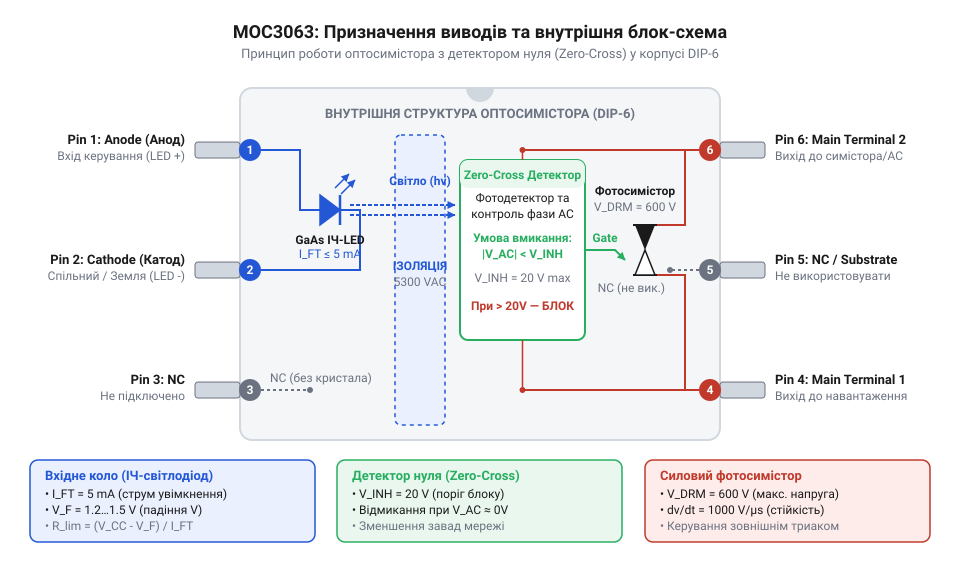
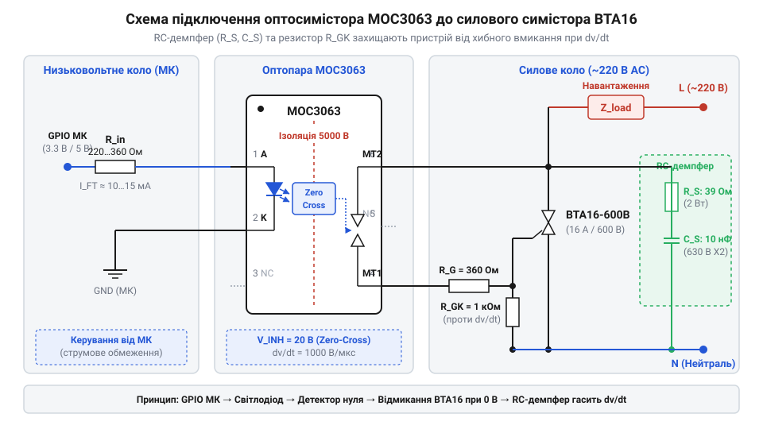

# Апаратний інтерфейс та типові схеми включення MOC3063

<preknowlist>
- [Симістор BTA16-600B](root:cat-hw-drivers/triac-bta16) — параметри затвора силового симістора, граничні струми та відмінності між квадрантами керування.
</preknowlist>

## Небезпека прямої комутації мережевого навантаження

Коли цифровий @@en|мікроконтролер@@ (англ. @@en|microcontroller@@, від *micro* — малий + *controller* — управитель) керує побутовими приладами, виникає фундаментальний конфлікт електричних рівнів. Виходи @@en|GPIO@@ працюють на низькій постійній напрузі 3.3 В або 5 В з обмеженням струму в кілька міліампер, тоді як силова мережа змінного струму має діючу напругу 220 В з амплітудними піками понад 311 В. Пряме електричне з'єднання між цими контурами призводить до миттєвого пробою напівпровідникових структур мікроконтролера та створює загрозу ураження електричним струмом для людини.

Особлива небезпека полягає у відсутності розділення спільних шин заземлення та виникненні імпульсних завад. Під час вимикання або вмикання потужного навантаження в довільний момент синусоїди виникають високі швидкості зміни напруги та струму, що викликають сплески зворотної ЕРС. Без бар'єру ці високовольтні транзієнти проникають безпосередньо в низьковольтне ядро.

Для усунення цієї небезпеки застосовується @@en|гальванічна розв'язка@@ (від італ. *Galvani* — прізвища вченого Луїджі Гальвані). Вона передає керуючий сигнал через оптичний канал без фізичного електричного контакту між кола керування та силовою мережею. Проте простого світловодного розв'язання недостатньо: вмикання силіконового ключа на піку напруги синусоїди спричиняє колосальний кидок струму. Щоб уникнути цього, потрібен спеціалізований @@en|оптосимістор@@ (від грец. *optikos* — зоровий + англ. @@en|triac@@) зі схемою детектування переходу через нуль.

Саме такий оптичний драйвер узгоджує роботу виходу @@en|GPIO@@ із високовольтною мережею, оскільки керування здійснюється безпечним низьким струмом. Вбудована інтегральна схема очікує найближчого моменту зниження синусоїдальної напруги і лише тоді дозволяє струму текти у силову мережу. Завдяки цьому @@en|мікроконтролер@@ повністю захищений від сплесків напруги, а для керування потужними приладами цей вузол відкриває [зовнішній силовий симістор](root:cat-hw-drivers/triac-bta16).

## Будова та принцип роботи MOC3063

Мікросхема @@en|MOC3063@@ — це оптично розв'язаний тригерний драйвер у 6-вивідному корпусі @@en|DIP-6@@, призначений для керування силовими ключами змінного струму. Всередині пристрою інтегровано інфрачервоний @@en|світлодіод@@ на основі арсеніду галію (GaAs), схему контролю переходу напруги через нуль та силіконовий фотосимістор. Оптична ізоляція між вхідним та вихідним контурами витримує пікову напругу пробою до 7500 В.


*Принципова структура MOC3063 у корпусі DIP-6 з внутрішньою схемою синхронізації та вхідним світлодіодом.*

Призначення виводів корпусу @@en|DIP-6@@ розпределено наступним чином:
- Вивід 1: @@en|анод@@ вхідного інфрачервоного світлодіода;
- Вивід 2: @@en|катод@@ вхідного світлодіода;
- Вивід 3: незадіяний вивід (NC);
- Вивід 4: основний силовий вивід MT1 внутрішнього фотосимістора;
- Вивід 5: підкладка (NC, не підключається у схемах);
- Вивід 6: основний силовий вивід MT2 внутрішнього фотосимістора.

Головна особливість пристрою — вбудований @@en|детектор переходу через нуль@@ (англ. @@en|Zero-Cross@@, від *zero* — нуль + *cross* — перетинати). Цей вузол вимірює миттєву напругу між виводами 4 та 6 і порівнює її з пороговим значенням. Для пристрою @@en|MOC3063@@ @@en|порогова напруга блокування@@ (англ. @@en|inhibit voltage@@, від *inhibit* — стримувати) `V_INH` становить не більше 20 В (типово 5–12 В).

Коли на вхідний світлодіод подається струм керування, випромінюване світло активує фототранзистори внутрішньої логики. Якщо миттєва напруга мережі перевищує `V_INH`, внутрішній @@en|детектор переходу через нуль@@ блокує відкривання фотосимістора. Ключ чекає, поки синусоїда мережевої напруги спаде й наблизиться до нульового значення. Як тільки напруга опиняється в межах вікна `±V_INH`, фотосимістор відкривається й залишається у провідному стані до кінця напівперіоду, поки струм не впаде нижче струму утримання.

## Розрахунок вхідного кола керування світлодіодом

Надійне функціонування @@en|MOC3063@@ залежить від точного нормування вхідного струму світлодіода. Головним параметром переключення є @@en|струм спрацьовування світлодіода@@ `I_FT` (англ. @@en|LED trigger current@@). Для модифікації @@en|MOC3063@@ цей струм становить 5 мА, що робить її найчутливішою у своїй серії (на відміну від MOC3061 з `I_FT` = 15 мА чи MOC3062 з `I_FT` = 10 мА). Пряме падіння напруги на випромінювачі `V_F` за робочого струму дорівнює 1.3 В (максимум 1.5 В).

Щоб забезпечити надійну роботу пристрою з урахуванням температурної деградації світлодіода та розкиду параметрів, розрахунковий струм `I_F` вибирають із запасом 1.5 рази від порогового: біля 7.5 мА. Для обмеження струму послідовно зі світлодіодом вмикають обмежувальний резистор `R_in`.

Розрахунок величини обмежувального резистора проводиться за законом Ома:

```
R_in = (V_CC - V_F) / I_F
```

Для керування від п'ятивольтової логіки `V_CC = 5.0 В` з бажаним струмом `I_F = 7.5 мА` та падінням `V_F = 1.3 В` обчислення має такий вигляд:

```
R_in = (V_CC - V_F) / I_F
     = (5.0 - 1.3) / 0.0075      [підстановка значень V_CC, V_F та I_F]
     = 3.7 / 0.0075               [обчислення різниці напруг]
     = 493.33                     [ділення на струм]
```

Найближчим стабільним номіналом із ряду E24 є резистор 470 Ом (забезпечує струм близько 7.87 мА) або 510 Ом (забезпечує струм 7.25 мА).

Для мікроконтролерів із живленням 3.3 В підстановка значень `V_CC = 3.3 В` дає наступний розрахунок:

```
R_in = (V_CC - V_F) / I_F
     = (3.3 - 1.3) / 0.0075      [підстановка значень V_CC, V_F та I_F]
     = 2.0 / 0.0075               [обчислення різниці напруг]
     = 266.67                     [ділення на струм]
```

Стандартний номінал резистора складає 270 Ом (струм 7.41 мА).

При схемотехнічному підключенні до виводу мікроконтролера рекомендується схема із замиканням на землю (Active-Low / Sink current). У цьому режимі ніжка @@en|GPIO@@ тягне катод до нуля, оскільки вихідні транзистори мікроконтролерів здатні поглинати більший струм, ніж віддавати на вихід, і захищені від випадкових спрацьовувань під час скидання виводів при запуску.

## Схеми комутації навантаження та RC-демпфер

Внутрішній фотосимістор оптодрайвера розрахований на максимальний струм не більше 100 мА, тому він не може комутувати потужне мережеве навантаження напряму. Замість цього він виступає в ролі керуючого елемента для силового ключа. Щоб комутувати високі струми, використовують [силовий симістор BTA16](root:cat-hw-drivers/triac-bta16), затвор якого підключається через виводи 4 та 6 оптодрайвера.


*Електрична принципова схема узгодження MOC3063 з силовим симістором BTA16 та RC-демпфером.*

У схемі узгодження струмообмежувальний резистор `R_g1` (номіналом 360 Ом) встановлюється послідовно з силовим виводом 6 для захисту внутрішнього фотосимістора від пікового струму в момент відкривання затвора. Додатковий резистор `R_g2` (номіналом 330 Ом – 1 кОм), увімкнений між затвором та основним виводом MT1 силового симістора, запобігає хибному відкриванню від наводек та витоків струму.

Під час робочих перехідних процесів, особливо при комутації індуктивних навантажень (електродвигуни, трансформатори, реле), струм відстає від напруги за фазою. Коли струм падає нижче струму утримання й симістор закривається, напруга на його виводах миттєво зростає. Якщо швидкість наростання напруги перевищує критичну величину `dv/dt` (для MOC3063 статичний параметр `dv/dt` становить 1500 В/мкс), внутрішня ємність напівпровідника викличе самовільне відкривання ключа без сигналу на світлодіоді.

Для придушення високовольтних сплесків паралельно силовим виводам встановлюють @@en|демпферний ланцюг@@ (англ. @@en|snubber@@, від *snub* — глушити). Він складається з послідовно з'єднаних резистора `R_s` (39–100 Ом, потужністю 1–2 Вт) та конденсатора `C_s` (10–100 нФ, розрахованого на напругу не менше 400 В змінного струму класу X2). Конденсатор поглинає енергію високочастотного стрибка напруги, обмежуючи `dv/dt`, а резистор розряджає конденсатор і обмежує амплітуду струму розряду під час вмикання симістора.

За потреби спрощення схемотехнічного вузла можна використати [твердотільне реле G3MB-202P](root:cat-hw-drivers/ssr-g3mb-202p), яке вже містить оптичний драйвер із контролем переходу через нуль, силовий ключ та демпферні елементи у єдиному герметичному корпусі.

## Проектування плати та гальванічна ізоляція

Створення надійної друкованої плати вимагає суворого дотримання ізоляційних зазорів між високовольтною силовою частиною (220 В) та низьковольтною цифровою лінією керування. Навіть ідеальна схема вийде з ладу, якщо електричний пробій відбудеться по поверхні текстоліту або через повітря.

У розробці плати оперують двома фізичними нормами:
- @@en|повітряний зазор@@ (англ. @@en|clearance distance@@, від *clear* — вільний) — найкоротша відстань між двома провідниками через повітряне середовище;
- @@en|шлях витоку@@ (англ. @@en|creepage distance@@, від *creep* — повзти) — найкоротша відстань між провідниками вздовж поверхні діелектричної підкладки плати.

Для мережевої напруги 220 В змінного струму нормативні стандарти безпеки (IEC/EN 60950-1) вимагають мінімальний @@en|повітряний зазор@@ не менше 3 мм, а посилений @@en|шлях витоку@@ — не менше 6–8 мм. Оскільки між виводами 1–3 та 4–6 корпусу @@en|DIP-6@@ відстань становить близько 7.62 мм, плата повинна підтримувати цю ізоляцію по всій довжині роздільної лінії.

Щоб запобігти поверхневому перекриттю та пробою через пил чи вологу, у текстоліті безпосередньо під корпусом @@en|MOC3063@@ прорізають ізоляційне віконце (паз шириною 1.5–2 мм). Категорично забороняється заливати мідні полігони заземлення або проводити сигнальні доріжки під бар'єром ізоляції оптопари. Силова й низьковольтна зони плати мають бути повністю рознесені по різних боках від лінії прорізу.
