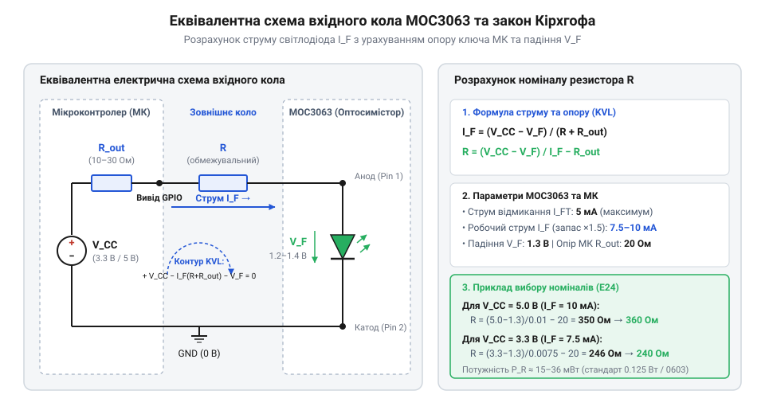

# Розрахунок обмежувального резистора вхідного світлодіода оптопари

## Наслідки помилок у розрахунку опору

Кола гальванічної розв'язки між низьковольтною мікроконтролерною частиною та силовим змінним струмом будують на базі пристроїв оптичного спряження. Коли керуючий @@en|мікроконтролер@@ (англ. @@en|microcontroller@@, від грец. *mikros* — малий та лат. *controllare* — перевіряти) вмикає навантаження, його вивід подає струм на вхідний @@en|інфрачервоний світлодіод@@ (англ. @@en|LED@@, від англ. *Light-Emitting Diode*) оптопари. Якщо при цьому @@en|струмообмежувальний резистор@@ (англ. @@en|resistor@@, від лат. *resistere* — чинити опір) обрано без точного розрахунку, вся схема втрачає надійність.

Занадто великий опір резистора обмежує струм світлодіода на рівні, недостатньому для генерації потрібного світлового потоку. У результаті @@en|оптосимістор@@ (англ. @@en|optotriac@@, від грец. *optikos* — зоровий та англ. *TRIAC*) не відмикається або робить це нестабільно. Коли схема керує [потужним дискретним симістором](root:cat-hw-drivers/triac-bta16) чи [компактним твердотільним реле](root:cat-hw-drivers/ssr-g3mb-202p), пропуски вхідного оптичного імпульсу призводять до випадання напівхвиль мережевої напруги, перегріву силових елементів та асинхронних збоїв навантаження.

Занадто малий опір спричиняє зворотну проблему: через вхідний кристал світлодіода тече надмірний струм. Підвищена густина струму викликає локальне розігрівання напівпровідникового переходу. Електричне перевантаження та висока температура прискорюють розростання дефектів у кристалічній ґратці. Ці дефекти стають центрами безопромінювальної рекомбінації носіїв заряду. У таких центрах енергія електронів перетворюється на тепло замість випромінювання фотонів світла. У результаті падає оптична віддача кристала та зменшується @@en|коефіцієнт передачі струму@@ (англ. @@en|CTR@@, від англ. *Current Transfer Ratio*, де *current* — струм, *transfer* — передача, *ratio* — співвідношення). Через деградацію світлодіода початковий струм керування з часом перестає відмикати @@en|оптосимістор@@. Одночасно надмірний струм створює недопустиме перевантаження виводу мікроконтролера. Вихідні транзистори порту МК виходять за межі безпечної робочої зони. Це створює загрозу локального перегріву кристала та виходу мікроконтролера з ладу. Тому вибір опору є знаходженням точного балансу між гарантованим відмиканням та довговічністю компонентів.

## Ключові параметри вхідного світлодіода MOC3063

Перед обчисленням опору необхідно визначити електричні межі вхідного світлодіода @@en|MOC3063@@, вказані в даташиті виробника. Головними параметрами є пряме падіння напруги `V_F` та тригерний струм відмикання `I_FT`.

Пряме падіння напруги `V_F` (англ. @@en|forward voltage@@) виникає на відкритому `p-n`-переході інфрачервоного світлодіода при проходженні робочого струму. Для компонента @@en|MOC3063@@ типове значення падіння напруги становить `1.2 В`, однак при максимальному струмі та крайніх значеннях технологічного розкиду даташит нормує граничну величину `V_F_max = 1.5 В`.

Тригерний струм відмикання `I_FT` (англ. @@en|trigger current@@) визначає пороговий рівень оптичного випромінювання, за якого внутрішній фотосимістор гарантовано переходить у провідний стан. Для серії @@en|MOC3063@@ цей параметр становить `I_FT_max = 5 мА` за нормальної температури `25 °C`. Слід ураховувати температурну залежність `I_FT(T)`: зі зниженням температури до `-40 °C` квантовий вихід інфрачервоного світлодіода зменшується, і для генерації порогового фотопотоку потрібний вищий струм, через що тригерний рівень зростає в `1.2–1.4` рази. Окрім температури, на роботу впливає часове старіння кристала (англ. @@en|degradation@@, від лат. @@la|degradatio@@ — зниження ступеня): упродовж тривалої експлуатації в напівпровідниковій структурі накопичуються дефекти, і випромінювальна здатність світлодіода падає ще на `10–20 %`. Якщо не врахувати ці чинники й розрахувати опір без запасу, при охолодженні пристрою або з плином часу оптопара припинить відмикатися. Розрахунок вхідного кола завжди базують на найгіршому сценарії — поєднанні максимального падіння напруги `V_F_max` із тригерним струмом, помноженим на температурний коефіцієнт та коефіцієнт часової деградації.

## Математична модель струмообмежувального кола

Для складання рівняння електричного стану розглядають послідовний контур, що складається з джерела живлення мікроконтролера `V_CC`, внутрішнього опору вихідного ключа МК `R_out`, обмежувального резистора `R` та світлодіода оптопари з падінням напруги `V_F`.


*Еквівалентна схема вхідного кола зображує послідовне з'єднання джерела живлення МК, внутрішнього опору вихідного ключа, обмежувального резистора та інфрачервоного світлодіода MOC3063.*

Згідно з другим законом Кірхгофа (від нім. фізика Г. Кірхгофа), сума падінь напруги на всіх елементах замкненого контуру дорівнює напрузі живлення `V_CC`. Падіння напруги на відкритому вихідному ключі МК позначимо як `V_out`. Тоді рівняння балансу напруг має вигляд:

```
V_CC = V_out + I_F · R + V_F      [законом Кірхгофа для контуру]
```

Для забезпечення надійного спрацьовування в усьому діапазоні температур вводять @@en|запасовий коефіцієнт@@ (англ. @@en|derating factor@@) `k_d`, значення якого зазвичай обирають у межах від `1.2` до `1.5`. Робочий струм світлодіода `I_F` розраховують через пороговий струм відмикання `I_FT_max`:

```
I_F = k_d · I_FT_max              [визначення робочого струму із запасом]
```

Виразивши опір резистора `R` з рівняння балансу напруг, отримуємо математичну модель для обчислення максимального допустимого опору `R_max`, який ще гарантує стабільне відмикання [компонентом оптосимісторного драйвера](root:cat-hw-drivers/moc3063-optotriac-overview). Водночас для запобігання перевищенню граничного струму виводу мікроконтролера `I_pin_max` за максимальної напруги живлення `V_CC_max`, найменшого падіння напруги на ключі `V_out_min` та на світлодіоді `V_F_min` виводять також мінімальний допустимий опір `R_min`. Якщо опір резистора буде меншим за `R_min`, вихідний ключ МК зазнає @@en|термічної деградації@@ (англ. @@en|thermal degradation@@ від лат. *thermalis* — тепловий). Математичний вираз для межі `R_min` випливає із закону Ома:

```
R_min = (V_CC_max - V_out_min - V_F_min) / I_pin_max      [перетворення за законом Ома]
```

Формула для обчислення верхньої межі `R_max` має вигляд:

```
R_max = (V_CC_min - V_out_max - V_F_max) / (k_d · I_FT_max)      [перетворення за законом Ома]
```

Отриманий опір `R_max` дає верхню межу значення резистора. Будь-який обраний номінал, менший за `R_max`, гарантує впевнене відкривання оптосимістора.

## Розрахунок номіналів і потужності резистора

Практичне застосування математичної моделі розглянемо для двох найпоширеніших стандартів живлення мікроконтролерів: `5 В` та `3.3 В`. Для розрахунку візьмемо гарантований пороговий струм `I_FT_max = 5 мА`, запасовий коефіцієнт `k_d = 1.5` (робочий струм `I_F = 7.5 мА`) та падіння напруги `V_F_max = 1.5 В`.

**Розрахунок для системи з живленням 5 В:**
Вважаємо мінімальну напругу живлення `V_CC = 5.0 В`, падіння напруги на ключі МК `V_out = 0.4 В`.

```
R_calc = (5.0 - 0.4 - 1.5) / 0.0075      [підстановка параметрів 5 В кола]
       = 3.1 / 0.0075                    [обчислення спаду напруги на резисторі]
       = 413.33 Ом                       [значення розрахованого опору]
```

Найближчий менший @@en|стандартний номінал@@ із @@en|ряду E24@@ становить `390 Ом`, що відповідає номінальному фактичному струму `I_F_fact = 3.1 / 390 = 7.95 мА`. Проте в реальній схемі на струм впливають @@en|технологічний розкид@@ опору (для @@en|ряду E24@@ допуск становить `±5%`) і @@en|нестабільність напруги@@ живлення шини `5 В` (відхилення `±5%`, тобто від `4.75 В` до `5.25 В`). У найгіршому разі мінімального струму — за напруги `4.75 В` і максимального опору `R_max = 390 · 1.05 = 409.5 Ом` — струм спадає до `I_F_min = (4.75 - 0.4 - 1.5) / 409.5 = 2.85 / 409.5 ≈ 6.96 мА`. Отримане значення перевищує тригерне порогове значення `I_FT_max = 5 мА`, тому оптосимістор гарантовано відмикається навіть за просідання живлення. За максимальної напруги `5.25 В` і мінімального опору `R_min = 390 · 0.95 = 370.5 Ом` струм зростає до `I_F_max = (5.25 - 0.4 - 1.5) / 370.5 = 3.35 / 370.5 ≈ 9.04 мА`, що є повністю безпечним для порту мікроконтролера та світлодіода. Згідно із @@de|законом Джоуля-Ленца@@ (від англ. Д. Джоуля та нім. Е. Ленца), розсіювана потужність на резисторі `P_R` дорівнює:

```
P_R = (I_F_fact)² · R                    [законом Джоуля-Ленца]
    = (0.00795)² · 390                   [підстановка струму й опору]
    = 0.0000632 × 390                    [піднесення струму до квадрата]
    = 0.0246 Вт                          [розрахована розсіювана потужність]
```

Отримане значення `24.6 мВт` значно менше за стандартну допустиму потужність для SMD-резисторів типорозміру 0603 (`100 мВт`) або 0805 (`125 мВт`).

**Розрахунок для системи з живленням 3.3 В:**
Вважаємо напругу живлення `V_CC = 3.3 В`, падіння на ключі `V_out = 0.3 В`, а падіння на світлодіоді при малій напрузі `V_F = 1.3 В`.

```
R_calc = (3.3 - 0.3 - 1.3) / 0.0075      [підстановка параметрів 3.3 В кола]
       = 1.7 / 0.0075                    [обчислення спаду напруги на резисторі]
       = 226.67 Ом                       [значення розрахованого опору]
```

З рядів E24/E96 обираємо стандартний номінал `220 Ом`. Фактичний струм становить `I_F_fact = 1.7 / 220 = 7.73 мА`. Розсіювана потужність складає `P_R = (0.00773)² · 220 = 0.0131 Вт` (`13.1 мВт`), що також повністю вкладається у допуски корпусу 0603.

## Перевірка навантаження виводу мікроконтролера

Фінальним етапом проектування вхідного кола є перевірка режиму роботи цифрового виводу МК на відсутність перевантаження за струмом та вибір схеми підключення.

Більшість сучасних мікроконтролерів мають максимально допустимий струм одного виводу `I_GPIO_max` у межах від `8 мА` до `20 мА`. Розраховані фактичні струми `7.73 мА` (для 3.3 В) та `7.95 мА` (для 5 В) не перевищують безпечного порогу для поодинокого виводу. Проте слід також контролювати сумарний струм порту та шини живлення МК (зазвичай обмежений `100–150 мА`), якщо МК керує кількома оптопарами одночасно.

Для мінімізації втрат напруги на внутрішньому ключі МК використовують схему втікаючого струму (англ. @@en|Sink current@@). У такій схемі анод світлодіода через резистор підключають до шини `V_CC`, а катод — до виводу МК. При вихідному рівні `LOW` внутрішній N-канальний MOSFET-транзистор відкривається до землі. Оскільки N-канальні транзистори мають менший опір каналу `R_DS(on)`, падіння напруги `V_out` виявляється нижчим, а допустимий струм — вищим, ніж у протилежній схемі витікаючого струму (англ. @@en|Source current@@).
