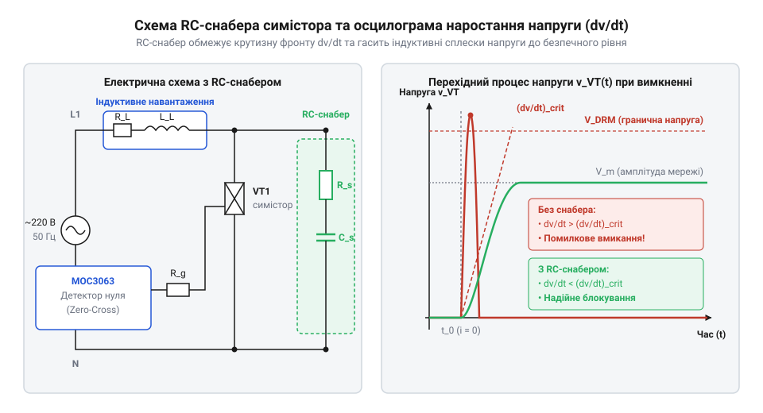

# Розрахунок RC-снабера та захисту симістора від критичного dv/dt

<preknowlist>
- [Симістор BTA16-600B](root:cat-hw-drivers/triac-bta16) — Вольт-амперна характеристика симістора, значення граничної напруги VDRM, струми керування затвора та критичні параметри dv/dt з даташиту.
- [Твердотільне реле G3MB-202P (2 А / 240 В)](root:cat-hw-drivers/ssr-g3mb-202p) — Принцип внутрішньої структури твердотільного реле із вбудованим фотосимістором та обмеження максимального струму комутації.
</preknowlist>

## Самочинне відмикання симістора індуктивним сплеском

Коли @@en|симістор@@ (від англ. @@en|triac@@, triode for alternating current) комутує @@la|індуктивне навантаження@@ (наприклад, електродвигун, соленоїд чи трансформатор), струм у колі відстає від напруги через @@en|фазовий зсув@@. У момент, коли змінний струм проходить через нуль і падає нижче @@en|струму утримання@@ (англ. @@en|holding current@@ `I_H`), напівпровідниковий ключ закривається. Проте напруга мережі в цей же момент близька до свого амплітудного значення `V_peak = 220 × √2 ≈ 311 V`. Раптове припинення струму викликає миттєвий стрибок напруги на основних виводах симістора `MT1` та `MT2`.

Стрімке зростання напруги в часі описують величиною `dv/dt`. Внутрішня структура симістора містить чотири послідовні p-n переходи, які у закритому стані володіють @@en|паразитною ємністю@@ `C_j`. Згідно з законом електродинаміки, зміна напруги на ємності породжує реактивний струм перезаряду:

```
i_c = C_j × (dv/dt)
```

Цей ємкісний струм протікає через внутрішній базовий шар напівпровідника безпосередньо у область затвора. Якщо швидкість наростання напруги `dv/dt` занадто висока, струм `i_c` досягає порогу відмикання внутрішньої транзисторної структури. У результаті симістор самочинно відкривається без подачі імпульсу керування від зовнішньої схеми.

У документації на силові ключі розрізняють два параметри стійкості:
1. @@en|Статичний dv/dt@@ (англ. @@en|static dv/dt@@, `(dv/dt)_s`) — допустима швидкість наростання напруги на закритому симісторі за відсутності струму провідності та при вимкненому затворі.
2. @@en|Комутаційний dv/dt@@ (англ. @@en|commutating dv/dt@@, `(dv/dt)_c`) — гранична швидкість наростання напруги безпосередньо у момент вимкнення приладу. Вона значно менша за статичну, оскільки у напівпровідниковій структурі ще зберігаються залишкові носії заряду.

Якщо комутаційна швидкість `dv/dt` перевищує паспортний поріг ключа, виникає некероване хибне ввімкнення, що порушує фазове регулювання або призводить до збоїв у системі автоматики. Для запобігання цьому явищу застосовують зовнішнє демпфування.

## Фізико-математична модель критичного dv/dt

Захист силового ключа базується на пригніченні високочастотних коливань, що виникають під час розриву індуктивного кола. Після закріплення симістора у закритому стані джерело живлення, індуктивність навантаження `L`, його власний опір `R_load` та паразитні ємності схеми утворюють послідовний коливальний контур.


*Схема демпфування симісторного ключа та порівняння швидкості наростання напруги dv/dt з демпфуванням і без нього.*

За відсутності зовнішнього демпфування паразитна ємність монтажу та p-n переходів `C_p` виявляється дуже малою (порядок десятків або сотень пікофарад). При розриві струму енергія магнітного поля індуктивності `W = (1/2) × L × I²` миттєво перезаряджає ємність `C_p`, створюючи високочастотний резонанс з амплітудою, що може вдвічі перевищувати мережеву напругу, та з гігантським початковим нахилом напруги `dv/dt`.

Щоб обмежити швидкість наростання напруги, паралельно симістору вмикають демпфувальний @@en|RC-снабер@@ (від англ. @@en|snubber@@ — гасник, @@de|демпфер@@). Ємність снабера `C_sn` обирається значно більшою за паразитну ємність `C_p`, що перенаправляє струм індуктивності в зовнішню демпфувальну гілку.

Математично перехідний процес у колі описується диференціальним рівнянням другого порядку для напруги на симісторі `v(t)`:

```
L × C_sn × (d²v / dt²) + (R_load + R_sn) × C_sn × (dv / dt) + v(t) = V_m
```

Де:
- `V_m` — амплітудна напруга мережі (`V_m = U_rms × √2`);
- `L` — еквівалентна індуктивність навантаження;
- `R_sn` — опір снаберного резистора;
- `C_sn` — ємність снаберного конденсатора.

Для запобігання самочинному відмиканню ключа максимальна швидкість наростання напруги перехідного процесу `(dv/dt)_max` не повинна перевищувати критичне комутаційне значення симістора `(dv/dt)_crit`:

```
(dv/dt)_max < (dv/dt)_crit
```

Наприклад, якщо для приладу як [силовий симістор BTA16-600B](root:cat-hw-drivers/triac-bta16) паспортне значення `(dv/dt)_c` становить `10 V/µs`, розрахований перехідний процес зобов'язаний мати нахил напруги нижче цієї межі.

## Розрахунок ємності та опору снабера

Розрахунок номіналів `C_sn` та `R_sn` полягає у розв'язанні двох задач: обмеженні максимального нахилу напруги `dv/dt` та забезпеченні належного коефіцієнта затухання коливань для уникнення перенапруг.

Початкова швидкість наростання напруги на симісторі у момент вимкнення визначається струмом заряджання ємності `C_sn` через опір `R_sn`. Максимальний нахил напруги для аперіодичного або слабоколебательного режиму наближено оцінюється формулою:

```
(dv/dt)_max = (V_m × R_sn) / L
```

Звідси визначають верхню межу опору снаберного резистора:

```
R_sn ≤ (L × (dv/dt)_crit) / V_m
```

Щоб запобігти високочастотному резонансу між індуктивністю навантаження та снабером, еквівалентний коливальний контур повинен мати @@en|коефіцієнт затухання@@ `ζ` (англ. @@en|damping factor@@) у межах `0.5 ≤ ζ ≤ 1.0`. Вираз для коефіцієнта затухання має вигляд:

```
ζ = (R_sn / 2) × √(C_sn / L)
```

Поклавши `ζ = 0.707` (оптимальне @@en|критичне демпфування@@), отримуємо формулу для розрахунку ємності снаберного конденсатора:

```
C_sn = 4 × ζ² × L / R_sn²
```

Розглянемо покроковий розрахунок на конкретному прикладі.

**Умови розрахунку:**
- Мережева напруга: `U_rms = 230 V` (`V_m = 230 × 1.414 ≈ 325 V`).
- Індуктивність навантаження: `L = 100 mH` (`0.1 H`).
- Силовий ключ: [силовий симістор BTA16-600B](root:cat-hw-drivers/triac-bta16) з допустимим комутаційним `(dv/dt)_crit = 10 V/µs = 10 × 10⁶ V/s`.

**Крок 1. Обчислення граничного опору резистора:**

```
R_sn = (L × (dv/dt)_crit) / V_m
= (0.1 × 10 × 10⁶) ÷ 325            [підстановка параметрів]
= 1000000 ÷ 325                      [проміжний розрахунок]
≈ 3077 Ω                            [граничне значення]
```

Обираємо робоче значення опору з запасом стійкості: `R_sn = 100 Ω` (це гарантовано задовольняє умову `R_sn ≤ 3077 Ω` і додатково обмежує струмові імпульси).

**Крок 2. Обчислення необхідної ємності конденсатора при R_sn = 100 Ω та ζ = 0.7:**

```
C_sn = (4 × 0.7² × L) / R_sn²
= (4 × 0.49 × 0.1) ÷ 100²           [підстановка значення R_sn = 100 Ω]
= 0.196 ÷ 10000                     [проміжний розрахунок]
= 19.6 × 10⁻⁸ F                     [значення в фарадах]
= 0.0196 µF                         [переведення в мікрофаради]
```

Обираємо найближчий стандартний номінал конденсатора з ряду E24: `C_sn = 0.022 µF` (`22 nF`) з робочою напругою не менше `630 V DC` (або `275 V AC` класу X2).

## Теплові й струмові межі резистора

Вибір ємності та опору снабера встановлює вимоги до електричного й теплового режиму самого резистора. При кожному плановому ввімкненні симістора накопичений у конденсаторі `C_sn` заряд розряджається через відкритий напівпровідниковий канал та опір `R_sn`.

@@en|Піковий струм розряду@@ (англ. @@en|peak discharge current@@) обчислюється за законом Ома для найнесприятливішого випадку, коли симістор вмикається на піку мережевої напруги `V_m`:

```
I_peak = V_m / R_sn
```

Для `V_m = 325 V` та `R_sn = 100 Ω` амплітуда струмового сплеску становить:

```
I_peak = 325 ÷ 100 = 3.25 A
```

Цей короткочасний імпульс протікає протягом декількох мікросекунд. Резистор повинен витримувати такі повторювані струмові навантаження без деградації струмопровідного шару.

Крім того, під час роботи в мережі змінного струму через RC-снабер постійно протікає реактивний струм. Енергія, що розсіюється на резисторі за один період мережевої напруги, складається з втрат від проходження реактивного струму та втрат при розрядженні конденсатора під час комутації. Середня @@en|розсіювана потужність@@ `P_sn` обчислюється за формулою:

```
P_sn = C_sn × V_rms² × 2 × π × f
```

Де:
- `V_rms` — діюче значення напруги мережі (`230 V`);
- `f` — частота мережі (`50 Hz`).

Обчислимо теплові втрати для номіналів `C_sn = 22 nF` та `V_rms = 230 V`:

```
P_sn = 22 × 10⁻⁹ × 230² × 2 × 3.14159 × 50
= 22 × 10⁻⁹ × 52900 × 314.16        [проміжне множення]
= 1.1638 × 314.16 × 10⁻³            [перетворення одиниць]
≈ 0.365 W                           [теплова потужність]
```

З урахуванням можливих мережевих завад та вищих гармонік розраховану потужність помножують на коефіцієнт запасу `2 ÷ 3`. Таким чином, вибирають резистор із номінальною конструктивною потужністю не менше `1 W` (оптимально `2 W`).

Ззвичайні тонкоплівкові та безнайтові SMD-резистори не підходять для снаберів через високий ризик електричного пробою імпульсом напруги. Застосовують металооксидні (англ. @@en|metal oxide film@@) або дротяні безіндуктивні (англ. @@en|non-inductive wirewound@@) резистори у негорючому корпусі.

## Захист кола керування з оптосимістором

Силовий симістор керується струмовим імпульсом затвора. У сучасних схемах автоматики для гальванічної розв'язки мікроконтролера від високовольтної мережі 220 В використовують @@en|оптосимістор@@ (від англ. @@en|optotriac@@, фотосимісторна оптопара). Детальніше про принципи керування силовим ключем у чотирьох квадрантах читайте у статті про [запуск симістора затвором](root:hw-components/quadrant-triggering).

Однак фотосимістор усередині оптопари сам є напівпровідниковим приладом і володіє власним обмеженням по критичному `(dv/dt)_d`. Якщо імпульсна завада у мережі відкриє оптосимістор, він подасть струм на затвор силового ключа й відкриє його.

Для надійної роботи кола керування застосовують два захисні елементи:
1. @@en|Обмежувальний резистор затвора@@ `R_in` — вмикається послідовно з виходом оптосимістора для обмеження амплітуди відмикального струму затвора.
2. @@en|Шунтувальний резистор затвора@@ `R_GK` — вмикається між затвором `G` та основним виводом `MT1` силового симістора. Він шунтує паразитичні ємкісні струми перезаряду p-n переходу, підвищуючи статичну стійкість ключа `dv/dt`.

Схема керування на основі компонента типу [твердотільне реле G3MB-202P](root:cat-hw-drivers/ssr-g3mb-202p) або окремої оптопари часто містить внутрішній @@en|вузол контролю переходу через нуль@@ (англ. @@en|zero-crossing circuit@@). Цей вузол дозволяє фотосимістору відмикатися лише тоді, коли миттєва напруга мережі перебуває поблизу нуля (`V_line < 20 V`), що повністю усуває початковий стрибок `dv/dt` під час вмикання.

Мінімальний опір обмежувального резистора `R_in` розраховують виходячи з максимально допустимого пікового струму фотосимістора `I_TSM_opto` (зазвичай `1 A` для оптопар серії MOC3063):

```
R_in = V_m / I_TSM_opto
```

Для амплітуди `V_m = 325 V`:

```
R_in = 325 ÷ 1.0 = 325 Ω
```

Вибирають стандартний номінал `R_in = 360 Ω` (потужністю `0.25 W` або `0.5 W`). Опір шунтувального резистора `R_GK` зазвичай обирають у діапазоні `1 kΩ ÷ 4.7 kΩ`. Він скидає паразитна напругу на затворі нижче порогу відмикання `V_GT`, гарантуючи стійкість всієї системи комутації.
