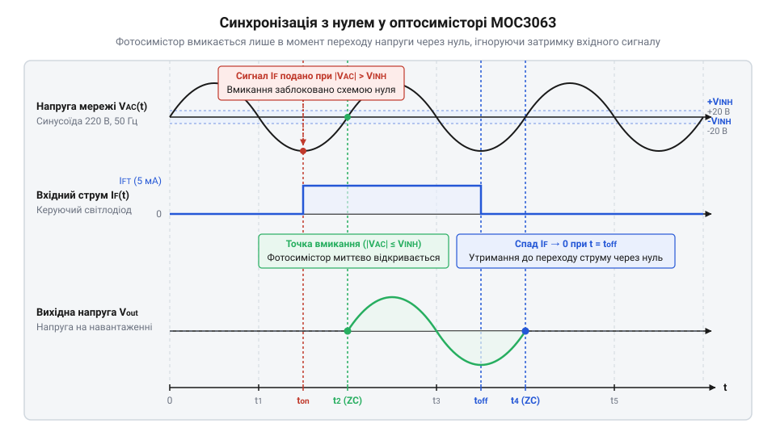
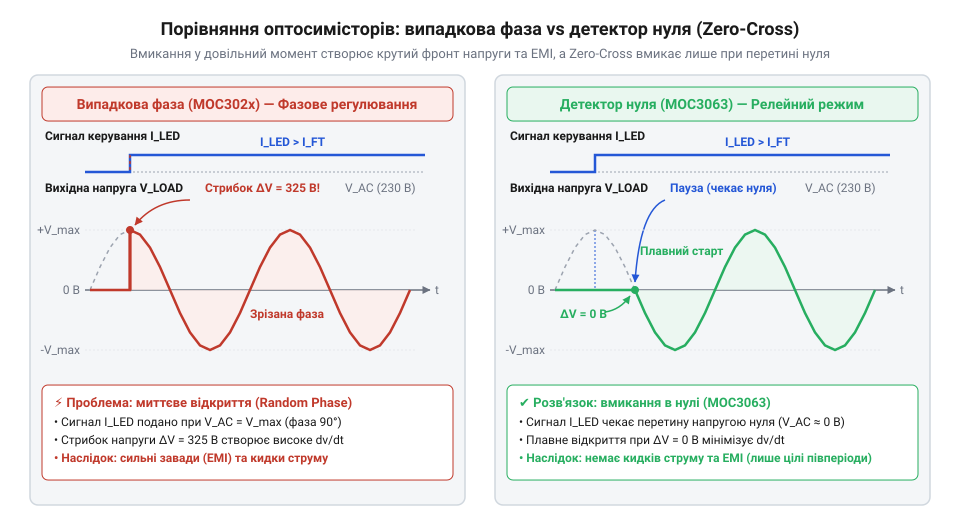
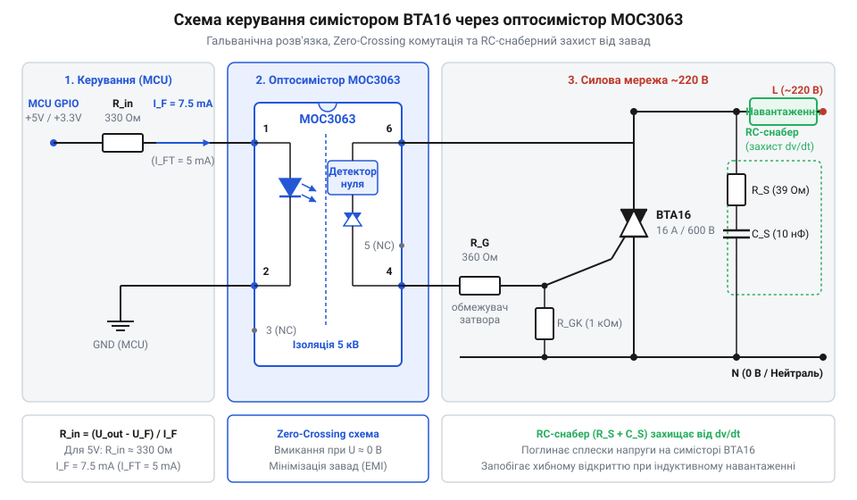

# MOC3063 — оптосимістор з детектором нуля

<preknowlist>
- [Симістор BTA16-600B](root:cat-hw-drivers/triac-bta16) — принцип роботи симетричного тиристора, роль керуючого електрода та параметри силової комутації змінного струму
- [Твердотільне реле G3MB-202P (2 А / 240 В)](root:cat-hw-drivers/ssr-g3mb-202p) — базові поняття твердотільної комутації мережевого струму та концепцію безконтактного реле
</preknowlist>

## Небезпека комутації мережі 220 В

Спроба керувати силовим навантаженням змінної мережі з напругою 220 В безпосередньо виходами цифрової мікросхеми створює колосальні ризики для обладнання та людини. Справа в тому, що низьковольтний @@en|мікроконтролер@@ (від англ. @@en|microcontroller@@, з @@gr|mikros@@ — малий та @@en|controller@@ — регулятор) працює з потенціалами 3.3 В або 5 В відносно власної низьковольтної землі. Силова мережа змінного струму має діючу напругу 220 В, що відповідає амплітудному значенню `U_peak ≈ 311 В` (`220 В × √2`). Безпосереднє з'єднання елементної бази автоматики із мережевими провідниками за найменшого дефекту чи пробою напівпровідникового ключа призведе до миттєвого потрапляння високої напруги у вимірювальні та обчислювальні кола. Це спричиняє фізичне руйнування мікроконтролера, збій джерел живлення та створює смертельну загрозу ураження електричним струмом.

Друга суттєва проблема виникає саме в момент перемикання струму. Змінна напруга мережі постійно змінюється за синусоїдальним законом. Якщо увімкнути електричне навантаження в довільний момент часу — наприклад, на піку синусоїди при амплітудній напрузі 311 В, — напруга на навантаженні змінюється від нуля до максимуму за лічені наносекунди. Фізично такий крутий ступінчастий стрибок викликає екстремально високу швидкість наростання напруги `dV/dt` та відповідну швидкість наростання струму `dI/dt`. При комутації ємнісного чи активного навантаження це спричиняє потужні кидки струму, адже розряджена ємність у момент увімкнення поводиться як коротке замикання. З точки зору спектрального аналізу, миттєвий амплітудний перепад з високим `dV/dt` формує широкий @@en|спектр@@ (від лат. @@la|spectrum@@ — образ) високочастотних гармонік, які сягають десятків мегагерц. Саме цей сплеск викликає сильні @@en|електромагнітні завади@@ (від англ. @@en|electromagnetic interference@@, @@en|EMI@@): високочастотні завади через паразитні ємності проникають у кола живлення та випромінюються мережевими проводами мов антенами, спричиняючи хибні спрацьовування сусідніх цифрових пристроїв і перезавантаження процесорів.

Для безпечного керування мережевим навантаженням необхідно розв'язати дві задачі. По-перше, забезпечити повне фізичне ізолювання цифрової частини від високовольтної мережі, для чого застосовується @@en|гальванічна розв'язка@@ (від прізвища вченого @@it|Galvani@@). Вона унеможливлює протікання струму між виходом мікроконтролера та фазним провідником. По-друге, необхідно синхронізувати момент замикання ключа з точкою, коли напруга синусоїди дорівнює нулю. Для цього служить @@en|детектор нуля@@ (від англ. @@en|zero-crossing circuit@@), який дозволяє вмикати навантаження виключно при мінімальній напрузі, усуваючи кидки струму та електромагнітні завади. Зіставити такий підхід із готовими модулями дозволяє [твердотільне реле G3MB-202P](root:cat-hw-drivers/ssr-g3mb-202p), але для довільних потужностей схемотехніку будують на дискретних компонентах.

Побудова подібних дискретних вузлів вимагає поєднання фотовипромінювача, світлочутливого ключа та схеми стеження за фазою в єдиному захищеному елементі. Замість громіздких схем із десятків окремих деталей застосовують спеціалізовані інтегральні ключі, де світловий промінь виступає єдиним містком між керувальним виходом і мережею. Це дозволяє безпосередньо зв'язати низьковольтний @@en|мікроконтролер@@ із затвором дискретного комутатора, яким виступає [силовий симістор BTA16](root:cat-hw-drivers/triac-bta16). Завдяки цьому забезпечується надійна @@en|гальванічна розв'язка@@ та автоматичне блокування вмикання на високій напрузі, що повністю усуває комутаційні @@en|електромагнітні завади@@ та робить безпечним керування потужними навантаженнями.

## Будова MOC3063 та детектор нуля

Щоб поєднати безпеку ізольованого керування та низький рівень завад в одному корпусі, розроблено спеціальний оптичний компонент — @@en|оптосимістор@@ (від @@gr|optos@@ — зоровий та @@en|triac@@ — симетричний тиристор) серії @@en|MOC3063@@. Усередині компактного шестививідного DIP-корпусу розташовані три основні функціональні вузли: вхідний інфрачервоний @@en|світлодіод@@ (від @@en|light-emitting diode@@, @@en|LED@@) на основі арсеніду галію, кремнієвий фоточутливий @@en|фотосимістор@@ (від @@gr|phos@@ — світло) та вбудована схема контролю переходу через нуль.

Гальванічне розділення між вхідним світлодіодом і вихідним фотосимістором здійснюється прозорим діелектричним проміжком. Світловий імпульс вільно долає цей бар'єр, тоді як електричний струм через нього протікати не може. Завдяки цьому @@en|гальванічна розв'язка@@ витримує пікову напругу пробою до 7500 В, надійно захищаючи @@en|мікроконтролер@@ від потенціалу силової мережі. Згідно з [апаратним описом MOC3063](root:cat-hw-drivers/moc3063-optotriac/api-moc3063-hardware.md), вихідний фотосимістор може витримувати закритим напругу до 600 В, що робить його придатним для роботи в мережах 220 В.

Вбудований @@en|детектор нуля@@ являє собою кремнієву транзисторну схему шунтування, включену паралельно затвору внутрішнього фотосимістора. Фізика його роботи полягає в постійному моніторингу миттєвої напруги між силовими виводами пристрою. Оскільки синусоїдальна напруга мережі щопівперіоду змінює полярність, потенціал із силових виводів знімається через внутрішній малопотужний @@en|діодний міст@@ (від @@gr|dis@@ — два та @@en|electrode@@ — електрод), який перетворює змінний потенціал на однополярний і подає його на вимірювальний резистивний дільник. Вихід цього дільника керує базовим переходом шунтувального кремнієвого транзистора, включеного паралельно затвору вихідного фотосимістора. Коли подається струм на вхідний @@en|світлодіод@@, він випромінює світло, але вихідний @@en|фотосимістор@@ відкривається не одразу. Якщо миттєва напруга мережі перевищує пороговий рівень `U_INH` (типово від 5 В до 20 В), напруга на дільнику відкриває шунтувальний @@en|транзистор@@ (від @@en|transfer resistor@@ — перехідний резистор) до стану насичення. У насиченому стані транзистор утворює низькоомний обхідний шлях і шунтує згенерований фотострум на внутрішню спільну шину, позбавляючи затвор енергії відмикання і не даючи затвору відкрити прилад. Тільки коли синусоїда напруги опускається нижче `U_INH`, напруга на дільнику стає недостатньою для утримання транзистора відкритим, він закривається, і фотострум розблокованого затвора вільно відмикає пристрій.

Історично твердотільна комутація еволюціонувала від шумних та повільних електромеханічних реле до безконтактних напівпровідникових ключів. Проте перші оптосимістори відкривалися в довільний момент фази, спричиняючи потужні імпульсні електромагнітні завади та кидки струму через комутацію на піку синусоїди. Цей недолік вимагав встановлення громіздких зовнішніх фільтрів. Щоб розв'язати проблему в корені, інженери інтегрували детектування нуля безпосередньо в кремнієву структуру оптосимісторів серії MOC, перетворивши пристрій на компактне й завадозахищене релейне ядро.

Щойно змінна напруга мережі в процесі свого синусоїдального коливання опускається нижче порогового значення `U_INH`, шунтувальний транзистор закривається. Фотострум від світлодіода безперешкодно потрапляє на затвор, і вихідний @@en|фотосимістор@@ відмикається. З цього моменту він залишається у відкритому стані до кінця півперіоду, поки струм навантаження не впаде нижче струму утримання `I_H ≈ 0`.


*Часові діаграми показують, що вихідний фотосимістор відкривається тільки після того, як миттєва напруга мережі перетне порогову зону нуля.*

## Релейне вмикання проти фазового регулювання

Наявність внутрішньої схеми синхронізації визначає чітке функціональне розмежування між приладами з детектором нуля та оптосимісторами випадкової фази. Пристрій @@en|MOC3063@@ оптимізований виключно для релейної комутації у режимі «ввімкнено/вимкнено» (ON/OFF). Він ідеально підходить для керування ТЕНами, клапанами, вентиляторами та ламповими групами, де важлива відсутність комутаційних завад.

Проте @@en|MOC3063@@ принципово не дозволяє здійснювати @@en|фазове регулювання@@ (від англ. @@en|phase-angle control@@) потужності або @@en|димування@@ (від англ. @@en|dimming@@, з @@en|dim@@ — тьмяний). Якщо @@en|мікроконтролер@@ подасть керуючий імпульс посередині півперіоду (наприклад, під кутом 90°), внутрішній @@en|детектор нуля@@ заблокує відкриття фотосимістора, оскільки миттєва напруга мережі значно перевищує порогову. Вмикання буде відкладено до початку наступного півперіоду. Для задач зрізу фази застосовують [прилади випадкової фази](root:cat-hw-drivers/moc3021-random-phase-optotriac), такі як MOC3021, які реалізують [фазове регулювання потужності](root:hw-power/phase-control-dimmer) за допомогою зовнішнього контролера переривань.

Утім, неможливість фазового зрізу не означає цілковитої відсутності регулювання потужності: для інерційних навантажень з @@en|MOC3063@@ застосовують @@en|число-імпульсне регулювання@@ (від англ. @@en|burst firing control@@ або @@en|cycle skipping@@, з @@en|burst@@ — пакет). Метод полягає в дозованому пропуску цілих півперіодів синусоїди протягом фіксованого часового вікна. Наприклад, якщо @@en|мікроконтролер@@ утримує керуючий сигнал увімкненим протягом 50 півперіодів зі 100 (що при частоті мережі 50 Гц відповідає вікну в 1 секунду), навантаження отримує рівно половину максимальної потужності. Оскільки @@en|MOC3063@@ відкривається виключно в момент переходу напруги через нуль, кожен пакет струму починається й завершується плавно, не створюючи високовольтних сплесків та @@en|електромагнітних завад@@. Такий підхід ідеально підходить для керування ТЕНами й нагрівальними елементами, проте непридатний для освітлення через виникнення низькочастотного мерехтіння.


*Порівняльні осцилограми показують відсутність високочастотних завад при синхронній комутації на відміну від фазового регулювання.*

Для надійної роботи вхідного кола @@en|MOC3063@@ необхідно правильно розрахувати струмообмежувальний резистор вхідного світлодіода `R_in`. Головний параметр відмикання оптопари — пороговий струм відмикання `I_FT` (від англ. @@en|trigger current@@). Для версії MOC3063 цей струм становить не більше 5 мА. Для гарантованого відмикання в усьому діапазоні температур робочий струм обирають з запасом 1.5–2 рази, тобто `I_F = 7.5 мА`. При прямому падінні напруги на ІЧ-світлодіоді `U_F ≈ 1.3 В` опір баластного резистора обчислюється з виразу для вхідного кола.

Розрахуємо опір резистора `R_in` для управляючої напруги `U_in = 5 В` від мікроконтролера:

```
R_in = (U_in - U_F) / I_F
     = (5 - 1.3) / 0.0075    [підстановка значень для живлення 5 В при струмі 7.5 мА]
     = 493.3 Ом              [обчислення необхідного опору]
```

Отримане значення округлюють до найближчого стандартного номіналу E24 — 470 Ом або 510 Ом. При робоці з логікою 3.3 В розрахунок виконується аналогічно:

```
R_in = (U_in - U_F) / I_F
     = (3.3 - 1.3) / 0.0075  [підстановка значень для живлення 3.3 В при струмі 7.5 мА]
     = 266.7 Ом              [обчислення необхідного опору]
```

У цьому випадку обирають стандартний номінал 240 Ом або 270 Ом. Докладніше математичну модель описано в [розрахунку вхідного резистора](root:cat-hw-drivers/moc3063-optotriac/math-led-drive-resistor.md).

Оскільки внутрішній фотосимістор оптопари розрахований на малий струм (до 100 мА), для комутації потужного навантаження 220 В його використовують як драйвер затвора зовнішнього симістора. Найчастіше застосовують [силовий симістор BTA16](root:cat-hw-drivers/triac-bta16), що витримує струм до 16 А.

Вхідне коло затвора силова мікросхема керує через обмежувальний резистор затвора `R_G ≈ 330 Ом`. Для захисту від хибних спрацьовувань при високій швидкості наростання напруги `dV/dt` паралельно силовим електродам симістора встановлюють @@en|снабер@@ (від англ. @@en|snubber@@, з @@en|snub@@ — гасити). Він складається з послідовно з'єднаних резистора `R_S = 39...100 Ом` та конденсатора `C_S = 10...100 нФ` з робочою напругою не менше 400 В.


*Принципова схема підключення ілюструє гальванічне розділення кіл та обв'язку силового симістора захисними резисторами і снабером.*

Точні формули та вибір номіналів для індуктивного навантаження подано в [розрахунку ланцюга снабера](root:cat-hw-drivers/moc3063-optotriac/math-triac-snubber-calculation.md), а готова практична схема зібрана в [модулі твердотільної комутації](root:cat-hw-drivers/moc3063-optotriac/proj-moc3063-triac-switch-module.md). Цей принцип притаманний усій [родині компонентів MOC30xx](root:cat-hw-drivers/moc30xx-optotriac-family), де MOC3063 займає чільне місце серед рішень із синхронним перемиканням.

## Керування зовнішнім силовим симістором BTA16

Внутрішній @@en|фотосимістор@@ (від @@en|phototriac@@ — світлокерований симетричний тиристор) мікросхеми @@en|MOC3063@@ спроможний пропустити через себе безперервний струм лише до `100 мА`. Спроба подати через нього живильний струм потужного нагрівача чи електродвигуна призведе до миттєвого теплового руйнування кремнієвого кристала. З цієї причини @@en|MOC3063@@ використовують як оптичний @@en|драйвер@@ (від @@en|driver@@ — керуючий пристрій), вихід якого комутує коло затвора потужного зовнішнього ключа — [симетричного тиристора BTA16](root:cat-hw-drivers/triac-bta16). Такий зв'язок дає змогу безпечно керувати струмом до `16 А` при напрузі мережі `220 В`.


*Принципова схема керування силовим симістором BTA16 через оптодрайвер MOC3063 із захисними резисторами затвора.*

Процес відмикання силової частини розгортається у кілька етапів, залежно від полярності мережевої напруги. Коли світлодіод оптопари випромінює світло і напруга переходить через нуль, внутрішній @@en|фотосимістор@@ відкривається, але напрямок струму керування визначається півперіодом синусоїди. Під час позитивного півперіоду, коли потенціал верхнього анода `MT2` вищий за `MT1`, струм тече від `MT2` через вивід `6` @@en|MOC3063@@, відкритий @@en|фотосимістор@@, вивід `4` і входить у @@en|затвор@@ (від @@en|gate@@ — ворота, керуючий електрод) ключа @@en|BTA16@@, виходячи через `MT1`. Це забезпечує вмикання симістора у першому @@en|квадранті@@ (від @@la|quadrans@@ — четверта частина) відмикання `I` (позитивна напруга `MT2` і позитивний струм затвора). У негативному півперіоді, коли `MT1` стає позитивнішим за `MT2`, напрямок струму реверсується: він тече від `MT1` через затвор силового ключа, вивід `4` оптодрайвера, @@en|фотосимістор@@, вивід `6` і повертається у `MT2`, реалізуючи відмикання у третьому квадранті `III` (негативна напруга `MT2` і від'ємний струм затвора). Оскільки @@en|MOC3063@@ увімкнений між `MT2` та затвором, він автоматично перемикає роботу @@en|BTA16@@ між найчутливішими квадрантами `I` та `III`. Щойно струм затвора досягає порогу відмикання в будь-якому з півперіодів, силовий @@en|симістор@@ (від @@en|TRIODE FOR ALTERNATING CURRENT@@ — тріод для змінного струму) @@en|BTA16@@ відкривається між `MT2` та `MT1`. У цей же момент спад напруги на силових електродах падає до прямого падіння на p-n переході — близько `1.5 В`. Оскільки вихід @@en|MOC3063@@ підключений паралельно силовому переходу, напруга між його виводами `6` та `4` також знижується до `1.5 В`, і струм через внутрішній @@en|фотосимістор@@ припиняється. Таким чином, @@en|оптодрайвер@@ проводить струм лише протягом кількох мікросекунд, необхідних для відмикання зовнішнього ключа.

Для захисту @@en|MOC3063@@ та затвора @@en|BTA16@@ у коло підключають струмообмежувальні резистори. Основний резистор `R_g1` опором `330–360 Ом` встановлюють послідовно з виходом @@en|фотосимістор@@. Схема детектора нуля дозволяє вмикання при напрузі блокування до `V_inhibit = 20 В`. Оцінимо піковий струм затвора у момент включення:

I_gate_peak = V_inhibit ÷ R_g1
            = 20 ÷ 360
            = 0.055 A          [амплітуда струмового імпульсу затвора 55 мА]

Значення `55 мА` надійно перевищує поріг відмикання затвора @@en|BTA16@@ і знаходиться в безпечних межах для оптодрайвера. Додатковий шунтуючий резистор `R_g2` опором `1–3.3 кОм` між затвором та виводом `MT1` відводить струми витоку при високій температурі. Конструктивні деталі розміщення елементів містить [апаратна специфікація модуля](root:cat-hw-drivers/moc3063-optotriac/api-moc3063-hardware.md), а готова конструкція представлена у [практичного проєкту комутації](root:cat-hw-drivers/moc3063-optotriac/proj-moc3063-triac-switch-module.md).

Описаний каскад із оптодрайвера @@en|MOC3063@@ та силового ключа @@en|BTA16@@ утворює дискретне [твердотільне реле G3MB-202P](root:cat-hw-drivers/ssr-g3mb-202p) високої потужності, оптимізоване для роботи з активним навантаженням. Оскільки для чисто активного навантаження струм і напруга збігаються за фазою, вмикання силового ключа суворо в момент нульової напруги автоматично означає вмикання при нульовому струмі. Це повністю усуває пускові кидки струму в мережі та високочастотні електромагнітні завади, залишаючи дискретну схему надійним і ремонтопридатним рішенням для комутації потужних електронагрівачів чи ламп розжарювання.

## Захист від індуктивних завад dv/dt

При роботі з чисто [активного навантаження](root:hw-power/phase-control-dimmer) (від @@en|resistive load@@ — омислове навантаження) синусоїди струму та напруги збігаються у часі, тому в момент нульового струму напруга мережи також дорівнює нулю. Однак під час комутації @@en|індуктивне навантаження@@ (від @@en|inductive load@@ — навантаження з реактивною індуктивністю, таке як електродвигуни або трансформатори) виникає @@en|зсув фаз@@ (від @@en|phase shift@@ — часовий зсув синусоїд), через який струм відстає від напруги на кут до `90°`.


*Стрибок напруги dv/dt на симісторі в момент спадання індуктивного струму до нуля.*

Силовий @@en|симістор@@ @@en|BTA16@@ вимикається не за сигналом світлодіода, а лише тоді, коли змінний струм навантаження спадає нижче @@en|струм утримання@@ (від @@en|holding current@@ — мінімальний струм для втримання стану). Оскільки струм відстає від напруги, у момент обнулення струму мережева напруга знаходиться біля свого амплітудного піку `310 В`. Під час закриття ключа напруга на його силових виводах стрибає від `1.5 В` до сотень вольт за часток мікросекунди. Швидкість цього наростання відображає величина @@en|dv/dt@@ (від @@en|derivative of voltage with respect to time@@ — швидкість наростання напруги).

Кожен напівпровідниковий @@en|симістор@@ має @@en|паразитну ємність@@ (від @@en|parasitic capacitance@@ — небажана внутрішня ємність) p-n переходів `C_j`. Висока швидкість наростання напруги викликає через цю ємність струм перезаряду:

i_cap = C_j × (dv ÷ dt)        [струм перезаряду паразитної ємності переходу]

Якщо утворений струм `i_cap` перевищить поріг затвора, @@en|симістор@@ самочинно відкриється знову без сигналу керування. Це викликає втрату контролю над силовим колом та перегрів напівпровідника.

Для обмеження швидкості наростання напруги застосовують захисний @@en|снабер@@ (від @@en|to snub@@ — гасити, придушувати сплески) з послідовно з'єднаних резистора `R_s` та конденсатора `C_s`, включених паралельно силовим електродам. Конденсатор `C_s` шунтує стрибок напруги, поглинаючи високочастотний енергетичний імпульс, а резистор `R_s` обмежує швидкість наростання струму @@en|di/dt@@ (від @@en|derivative of current with respect to time@@ — швидкість наростання струму) під час розряду конденсатора в момент наступного вмикання симістора. Для силових мереж `220 В` використовують резистор опором `39–100 Ом` потужністю `1–2 Вт` та плівковий конденсатор ємністю `0.01–0.1 мкФ` класу безпеки `X2`. Покроковий підбір елементів наведено у [математичному розрахунку снабера](root:cat-hw-drivers/moc3063-optotriac/math-triac-snubber-calculation.md), а готові промислові модулі реалізує [твердотільне реле G3MB-202P](root:cat-hw-drivers/ssr-g3mb-202p).
