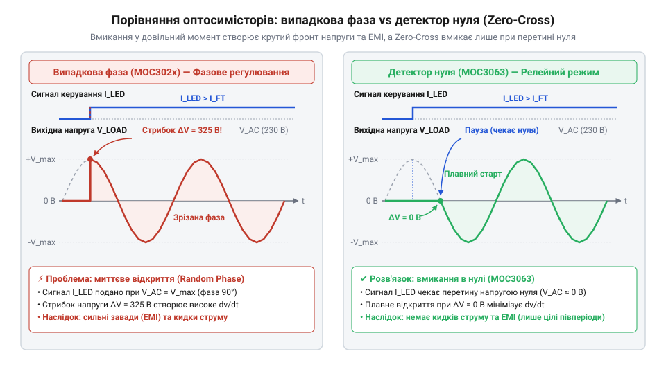
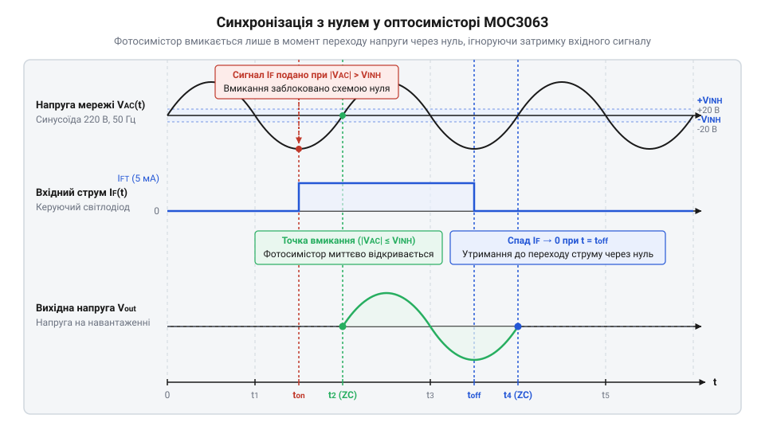

# MOC3063 — оптосимістор з детектором нуля

<preknowlist>
- [Симістор BTA16-600B](root:cat-hw-drivers/triac-bta16) — принцип роботи симетричного тиристора, роль керуючого електрода та параметри силової комутації змінного струму
- [Твердотільне реле G3MB-202P (2 А / 240 В)](root:cat-hw-drivers/ssr-g3mb-202p) — базові поняття твердотільної комутації мережевого струму та концепцію безконтактного реле
</preknowlist>

## Небезпека комутації мережі 220 В

Пряме з'єднання низьковольтних цифрових мікроконтролерів із силовою мережею змінного струму 220 В створює високі ризики електричного пробою та виходу з ладу всієї автоматики. До того ж замикання кола у довільний момент синусоїди, коли напруга досягає пікових значень, викликає потужні кидки струму та електромагнітні завади в мережі. Для безпечної комутації потрібні оптичне розділення кіл — @@en|гальванічна розв'язка@@ (італ. *Galvani* — на честь Луїджі Гальвані) — та синхронізація вмикання із моментом переходу напруги через нуль.


*Форма мережевої напруги та струмові сплески при фазовому й синхронному вмиканні.*

Коли мережева напруга досягає пікового значення `311 В`, її миттєва комутація викликає стрімкий стрибок струму, що породжує потужні @@en|електромагнітні завади@@ у довколишніх провідниках. При прямому з'єднанні будь-який пробій силового ключа спрямовує високовольтний потенціал безпосередньо у низьковольтні кола, випалюючи чутливі цифрові входи мікроконтролера. Використання світлового каналу забезпечує надійну @@en|гальванічну розв'язку@@ між мережею та автоматикою, а внутрішній @@en|детектор нуля@@ (лат. *detector* — виявник) затримує увімкнення до моменту переходу напруги через `0 В`, завдяки чому комутація відбувається без сплесків струму, як це працює у [промислових твердотільних реле](root:cat-hw-drivers/ssr-g3mb-202p).

## Будова MOC3063 та детектор нуля

Пристрій @@en|MOC3063@@ — це @@en|оптосимістор@@ (грец. *optos* — зоровий), що поєднує в одному корпусі вхідний інфрачервоний світлодіод та вихідний фотосимістор зі схемою синхронізації. Оптичний канал забезпечує високовольтну ізоляцію цифрових і силових кіл. Внутрішній @@en|детектор нуля@@ (англ. *@@en|zero-crossing detector@@*) шунтує керуючий затвор фотосимістора доти, доки миттєва напруга мережі перевищує порогове значення 5–20 В. Щойно синусоїда проходить через нуль, шунтування знімається, ключ відмикається і залишається відкритим до кінця півперіоду, усуваючи струмові кидки.


*Затримка увімкнення фотосимістора до моменту найближчого переходу напруги через нульове значення.*

## Релейне вмикання проти фазового регулювання

Внутрішній детектор нуля робить @@en|MOC3063@@ придатним лише для синхронного релейного перемикання й унеможливлює @@en|фазове регулювання@@ (грец. *phasis* — поява) потужності шляхом зрізу довільної частини півхвилі. Для плавного керування інерційними навантаженнями застосовують @@en|число-імпульсне регулювання@@ (лат. *impulsus* — поштовх), пропускаючи цілі півперіоди напруги. Щоб обчислити опір баластного резистора `R_in` для забезпечення вхідного струму відмикання `I_FT` при напрузі живлення `V_CC` та спаді напруги на світлодіоді `V_F`, застосовують розрахунок:

```
R_in = (V_CC - V_F) ÷ I_FT
     = (5 - 1.2) ÷ 0.005      [підстановка параметрів V_CC = 5 В, V_F = 1.2 В, I_FT = 5 мА]
     = 3.8 ÷ 0.005             [обчислення різниці потенціалів]
     = 760 Ом                  [значення опору]
```

Отримане значення `R_in` задає мінімально необхідний опір, тому обирають стандартний номінал 680 Ом або 750 Ом для гарантованого відмикання оптопари.

## Керування зовнішнім силовим симістором BTA16

Внутрішній ключ @@en|MOC3063@@ витримує струм лише до 100 мА, тому виступає драйвером для зовнішнього ключа. Щоб комутувати потужні прилади, використовують [силовий симістор BTA16](root:cat-hw-drivers/triac-bta16). При відкритті фотосимістора струм мережі подається на керуючий електрод силового ключа, відмикаючи його в I або III @@en|квадрант@@ (лат. *quadrans* — четверта частина) залежно від полярності півхвилі. За цим принципом побудоване й готове [твердотільне реле G3MB-202P](root:cat-hw-drivers/ssr-g3mb-202p).


*Типове увімкнення оптодрайвера MOC3063 для керування силовим симістором BTA16.*

## Захист від індуктивних завад dv/dt

При комутації індуктивного навантаження виникає зсув фаз між струмом та напругою. У момент згасання струму симістор закривається при високій миттєвій напрузі мережі, створюючи високу швидкість наростання напруги `dv/dt`. Цей стрибок через внутрішню ємність може спричинити самочинне відкриття ключа. Для захисту симістора паралельно йому підключають @@en|снаберне коло@@ (англ. *snub* — гасити) з послідовно з'єднаних резистора та конденсатора.


*Виникнення високочастотного піку напруги dv/dt при розмиканні індуктивного кола.*
