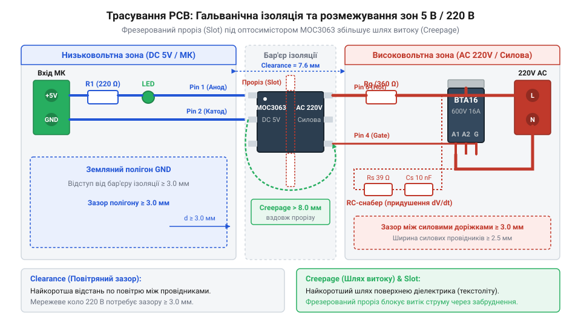
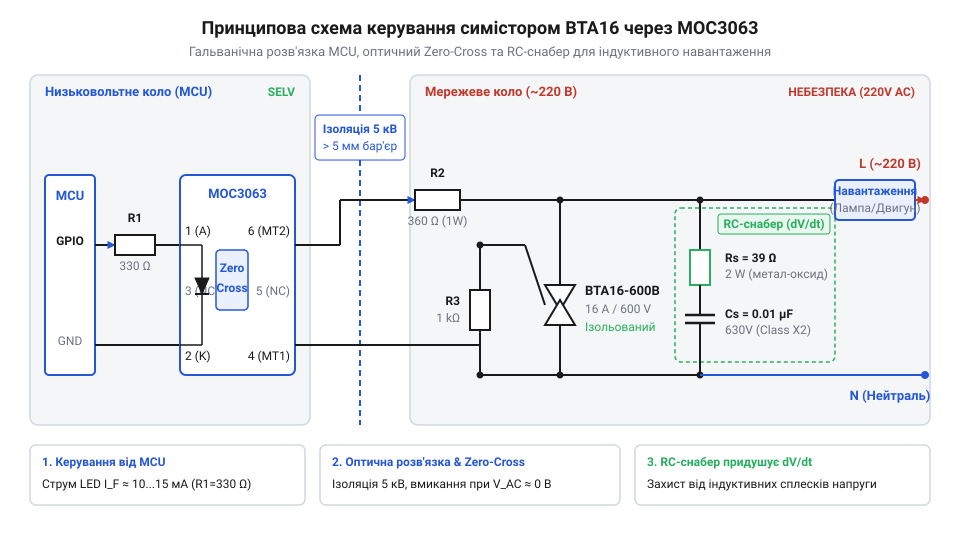

# Складання твердотільного релейного модуля на MOC3063 та BTA16

<preknowlist>
- [Твердотільне реле G3MB-202P (2 А / 240 В)](root:cat-hw-drivers/ssr-g3mb-202p) — принцип роботи оптично розв'язаного твердотільного ключа та обмеження по струму готових інтегральних SSR
- [Симістор BTA16-600B](root:cat-hw-drivers/triac-bta16) — електричні характеристики симістора, критичні швидкості наростання напруги й струму та призначення силових і керуючих виводів
</preknowlist>

## Небезпека прямого керування мережевим навантаженням

Під час розробки пристроїв автоматики часто виникає потреба керувати потужними приладами змінної напруги `220 В` з частотою `50 Гц` — нагрівачами, лампами розжарювання або електродвигунами. Низьковольтний @@en|мікроконтролер@@ працює з сигналами постійного струму `3.3 В` або `5 В`. Спроба прямого електричного з'єднання цифрових виводів обчислювальної плати з силовою мережею створює критичні загрози для обладнання та людини.

Головна небезпека полягає у відсутності фізичного бар'єра між високовольтним колом і чутливою мікроелектронікою. Мережева напруга `220 В` має амплітудне значення близько `311 В`. У разі пробою або неправильного підключення потенціал мережі потрапляє безпосередньо на логічний вивід @@en|GPIO@@, що призводить до миттєвого теплового руйнування кристала мікроконтролера та виходу з ладу всієї обчислювальної плати. Окрім того, відсутність ізоляції створює смертельний ризик ураження електричним струмом для оператора, якщо торкнутися органів керування або підключеного кабелю програмування.

Захистити обчислювальний вузол дає змогу принцип @@en|гальванічної ізоляції@@ (від прізвища італ. вченого Луїджі Гальвані), який повністю розриває прямий електричний контакт між низьковольтною та високовольтною частинами схеми. Без такого розриву виникає @@en|пробій діелектрика@@ — фізичне руйнування ізоляційного проміжку під дією високої напруженості електричного поля. Фізично пробій відбувається або як іонізація повітря з утворенням електричної дуги, або як поверхневий розряд (англ. @@en|tracking@@), коли під дією напруги та забруднень на поверхні ізолятора виникають струмопровідні вуглецеві містки. Порівняно з @@en|електромеханічними реле@@, що мають піддані дугуванню й зносу механічні контакти, та @@en|ізоляційними трансформаторами@@, які передають лише змінні сигнали через магнітне поле й не здатні утримувати постійний стан без модуляції, @@en|оптична ізоляція@@ передає сигнал безконтактним фотонним потоком через прозорий твердий діелектрик. Це гарантує безшумність, відсутність механічного зносу й здатність утримувати стабільний логічний стан, хоча обмежено тривалістю служби світлодіода та мікроскопічною паразитною ємністю між обкладками ізолятора. На відміну від слабкострумових [модулів твердотільних реле](root:cat-hw-drivers/ssr-g3mb-202p), де силовий ключ уже інтегровано в корпус, розробка дискретного модуля вимагає належного проектування топології плати. На друкованій платі керуюча та силова зони розмежовуються з дотриманням [норм ізоляційних зазорів](root:hw-pcb/creepage-clearance) — повітряного зазору (англ. @@en|clearance@@) та шляху витоку по поверхні текстоліту (англ. @@en|creepage distance@@).


*Фізичне розділення низьковольтної керуючої та високовольтної силової зон на друкованій платі із запобіжним прорізом у текстоліті для запобігання пробою.*

## Гальванічна розв'язка з детектором нуля

Для безпечної передачі керуючого сигналу з виводу мікроконтролера у високовольтне коло використовують @@en|оптосимістор@@ (від грец. *optikos* — зоровий та англ. *triac*) MOC3063. Всередині цього мікрочипа розміщено вхідний інфрачервоний світлодіод і вихідний фотосимістор, розділені прозорим діелектриком, який витримує напругу пробою до `7500 В`.

Ключовою особливістю MOC3063 є вбудована апаратна схема виявлення переходу напруги через нуль (англ. @@en|Zero-Cross@@ або @@en|Zero-Crossing@@). Коли мікроконтролер подає струм на вхідний світлодіод, внутрішній фотосимістор відкривається не миттєво, а чекає моменту, коли синусоїда мережевої напруги наблизиться до нульового значення (у межах `±5...20 В`). Комутація в момент найменшої миттєвої напруги мінімізує пускові кидки струму та усуває високочастотні електромагнітні завади (англ. @@en|EMI@@, від *Electromagnetic Interference*), які виникають при ввімкненні під напругою.

Щоб заживити вхідний світлодіод @@en|оптопари@@ без ризику його перегорання, послідовно з ним вмикають струмообмежувальний резистор `R_in`. Для мікроконтролера з живленням `V_mcu = 5 В`, прямим падінням напруги на світлодіоді `V_f = 1.2 В` та робочим струмом відмикання `I_f = 15 мА` розрахунок величини опору має вигляд:

```
R_in = (V_mcu - V_f) / I_f
     = (5 - 1.2) / 0.015    [підстановка параметрів для 5 В живлення]
     = 253.3 Ом             [теоретичне значення опору]
```

Отримане значення округлюють до найближчого стандартного номіналу `240 Ом` або `270 Ом` з потужністю розсіювання `0.25 Вт`. Для керуючих сигналів `3.3 В` розрахований опір становить `140 Ом` (обирають `150 Ом`).

Програмна реалізація драйвера керування вхідним світлодіодом MOC3063 через цифровий вивід @@en|GPIO@@ побудована на принципі абстракції від апаратного рівня (англ. @@en|HAL@@, від *Hardware Abstraction Layer*), що дозволяє відокремити логіку комутації від конкретної периферії мікроконтролера за допомогою функцій-зворотного виклику. У версії мовою C конфігураційна структура `moc3063_config_t` об'єднує номер виводу `gpio_pin`, полярність керування `active_level` (де `MOC3063_ACTIVE_HIGH` задає ввімкнення світлодіода високим рівнем, коли МК виступає джерелом струму, а `MOC3063_ACTIVE_LOW` — низьким рівнем у режимі стоку струму), початковий стан навантаження `initial_state` та вказівник `gpio_write` на функцію запису в регістр виводу. Ініціалізація у `moc3063_init()` спершу розраховує фізичний рівень штифта для вимкненого або початкового стану за допомогою функції `get_physical_level()` та негайно подає його на вивід @@en|GPIO@@ до встановлення прапорця ініціалізації `is_initialized`, запобігаючи хаотичним комутаційним сплескам під час завантаження МК. Функції `moc3063_set_state()`, `moc3063_turn_on()`, `moc3063_turn_off()` та `moc3063_toggle()` реалізують безпечне перемикання та зчитування стану драйвера. У реалізації мовою C++ клас `Moc3063` розширює цю модель строго типізованими переліками `enum class` та додає апаратне налаштування через функцію-зворотний виклик `init_fn`. Метод `init()` обчислює неактивний електричний рівень `inactive_level` та передає його у функцію налаштування периферії, забезпечуючи переведення штифта в режим виходу без небажаного проміжного плаваючого стану. Для уникнення апаратних конфліктів конструктор копіювання класу вилучено, проте збережено семантику переміщення. Окрім того, реалізація застосовує парадигму @@en|RAII@@ (від англ. *Resource Acquisition Is Initialization*): деструктор `~Moc3063()` гарантовано викликає `turnOff()` при знищенні об'єкта, що примусово знеструмлює вхідну оптопару та забезпечує безпечне вимкнення силового [симістора BTA16](root:cat-hw-drivers/triac-bta16). Нижче наведено повний сирцевий код реалізації обома мовами:

:::tabs
:::code proj-moc3063-triac-switch-module/c/moc3063.h
:::code proj-moc3063-triac-switch-module/c/moc3063.c
:::code proj-moc3063-triac-switch-module/c/main.c

:::code proj-moc3063-triac-switch-module/cpp/Moc3063.hpp
:::code proj-moc3063-triac-switch-module/cpp/Moc3063.cpp
:::code proj-moc3063-triac-switch-module/cpp/main.cpp
:::

## Керування симістором BTA16 та снабер

Внутрішній фотосимістор оптопари MOC3063 розрахований на невеликий максимальний струм (до `100 мА`) і не може безпосередньо живити потужні мережеві прилади. Тому він виконує роль драйвера керуючого електрода для потужного силового елемента — комутацію навантаження здійснює [силовий симістор BTA16](root:cat-hw-drivers/triac-bta16), який витримує довготривалий струм до `16 А` і напругу до `600 В`.

Керуючий вивід MOC3063 підключається до затвора (англ. @@en|Gate@@) симістора BTA16 через обмежувальний резистор `R_g` номіналом `330...360 Ом`. Коли оптичний канал MOC3063 відкривається в момент @@en|Zero-Cross@@, струм мережі протікає через затвор BTA16, вмикаючи головний силовий перехід між виводами `MT1` та `MT2`. Силовий @@en|симістор@@ залишається у відкритому стані доти, доки струм навантаження не впаде нижче значення струму утримання (англ. @@en|holding current@@, `I_h`).

При роботі з реактивним індуктивним навантаженням (електродвигуни, трансформатори, соленоїди) струм відстає за фазою від напруги. Коли струм падає нижче струму утримання, [силовий симістор BTA16](root:cat-hw-drivers/triac-bta16) закривається, але мережева напруга в цю мить досягає амплітудного значення `V_peak` (для мережі `220 В` амплітуда становить `V_peak = V_rms × √2 ≈ 311 В`). Стрибкоподібне прикладання напруги до закритих силових виводів створює високу швидкість наростання напруги (англ. @@en|dV/dt@@). Цей перепад викликає внутрішній паразитний ємнісний струм затвора, який може хибно відкрити силовий ключ без вхідного сигналу. Для придушення завад паралельно симістору вмикають ємність `C_snub` демпфувального RC-кола, яка разом із індуктивністю навантаження `L_L` (від лат. *inductio* — наведення) утворює коливальний LC-контур. Амплітудна напруга мережі `V_peak`, індуктивність навантаження `L_L` та гранично припустима швидкість наростання напруги `(dV/dt)_safe` визначають мінімальну ємність демпфувального конденсатора `C_snub`.

```
C_snub
= (V_peak ÷ (dV/dt)_safe)² ÷ L_L      [виділення ємності з умови обмеження dV/dt]
= V_peak² ÷ (L_L × (dV/dt)_safe²)     [зведення дробу до підсумкового вигляду]
```

Із цієї формули видно, що більша індуктивність `L_L` або вищий допустимий поріг `(dV/dt)_safe` дозволяють застосовувати конденсатор меншої ємності `C_snub` для [захисту від наростання dV/dt](root:cat-hw-drivers/moc3063-optotriac/math-triac-snubber-calculation.md). Однак чистий LC-контур викликає незатухаючі високочастотні коливання напруги з ризиком пробою. Щоб забезпечити демпфування (від нім. *dämpfen* — глушити, приборкувати) коливань та обмежити розрядний струм конденсатора під час увімкнення ключа, послідовно з конденсатором вмикають резистор `R_snub`. Опір снаберного резистора `R_snub` розраховують через коефіцієнт демпфування `ζ` та співвідношення індуктивності навантаження `L_L` і ємності `C_snub`.

```
R_snub
= 2 × ζ × √(L_L ÷ C_snub)              [обчислення опору з умови демпфування]
```

Для досягнення оптимального демпфування без перенапруг обирають коефіцієнт `ζ ≈ 0.5...0.707`, що дає опір `R_snub ≈ √(L_L ÷ C_snub)`.

**Приклад розрахунку RC-снабера для індуктивного навантаження `L_L = 1.0 мГн` (`0.001 Гн`) у мережі `220 В` (`V_peak = 311 В`) при безпечному обмеженні `(dV/dt)_safe = 50 В/мкс` (`5 × 10⁷ В/с`):**

```
C_snub
= 311² ÷ (0.001 × (5 × 10⁷)²)          [підстановка значень V_peak, L_L та (dV/dt)_safe]
= 96721 ÷ (0.001 × 2.5 × 10¹⁵)         [піднесення до квадрата]
= 96721 ÷ (2.5 × 10¹²)                 [перемноження індуктивності та швидкості]
≈ 3.87 × 10⁻⁸ Ф                        [обчислення ємності в фарадах]
≈ 0.039 мкФ                            [переведення в мікрофаради]

R_snub
= 2 × 0.5 × √(0.001 ÷ (3.9 × 10⁻⁸))    [підстановка C_snub та коефіцієнта демпфування ζ = 0.5]
= 1.0 × √25641                         [обчислення характеристичного опору]
≈ 160 Ом                               [значення опору для демпфування]
```

Отримані розрахункові значення `C_snub ≈ 0.039 мкФ` та `R_snub ≈ 160 Ом` вкладаються в типовий діапазон демпфувальних кіл для мережевих симісторів і надійно блокують хибні спрацьовування силового ключа.

Для придушення завад паралельно силовим виводам `MT1`-`MT2` вмикають демпфувальний RC-@@en|снабер@@ (від англ. *snub* — приборкувати, гасити). Резистор `R_snub` обмежує розрядний струм конденсатора під час увімкнення ключа, а конденсатор `C_snub` поглинає сплески напруги та реалізує [захист від наростання dV/dt](root:cat-hw-drivers/moc3063-optotriac/math-triac-snubber-calculation.md). Типові номінали для мережі `220 В` становлять `R_snub = 39...100 Ом` (потужністю `1...2 Вт`) та `C_snub = 0.01...0.1 мкФ` (поліпропіленовий конденсатор класу X2 на робочу напругу `400 В` або `630 В`).


*Принципова схема узгодження оптосимістора MOC3063 із силовим симістором BTA16 та завадопригнічувальним RC-снабером.*

## Трасування плати з ізоляційними зазорами

Створення друкованої плати для комутації напруги 220 В та струму до 16 А вимагає одночасного розв'язання двох фізичних задач: відведення тепла від мідних провідників та запобігання електричному пробою між низьковольтним мікроконтролером і силовою мережею. На відміну від слабкострумових цифрових схем, силові доріжки піддаються вираженому омічному нагріву, а висока напруга здатна іонізувати повітря або сформувати струмопровідний місток по поверхні текстоліту `@@en|FR-4@@`.

Пропускання струму 16 А через стандартну мідну фольгу завтовшки 35 мкм вимагає розрахунку @@en|trace width@@ (англ. *trace* — доріжка, *width* — ширина). Завузький провідник діє як запобіжник і швидко руйнується від перегріву. Щоб температура доріжки не перевищувала норму при тривалому навантаженні, [трасування силових доріжок](root:hw-pcb/shyryna-dorizhky-strum-i-nahriv) вимагає ширини провідника не менше 6–8 мм для фольги 35 мкм або 3.5–4 мм для фольги 70 мкм. Якщо габарити плати обмежують ширину, силові лінії залишають без захисної маски й додатково пропаюють товстим шаром припою або мідним дротом.


*Топологія плати з фізичним розділенням високовольтних доріжок 220 В від кіл мікроконтролера та фрезерованим пазом під корпусом оптосимістора.*

Для гарантії електробезпеки плату віртуально ділять на дві ізольовані зони: низьковольтну (виводи `@@en|GPIO@@`, живлення 5 В) та високовольтну (фаза `L`, neutral `N`, виводи симістора). Повітряний зазор `@@en|clearance@@` між цими зонами має становити щонайменше 3 мм, а шлях витоку струму поверхнею `@@en|creepage distance@@` — не менше 6 мм.

Найкритичнішим місцем є корпус оптосимістора MOC3063, де відстань між низьковольтними виводами 1–2 та силовими виводами 4–6 становить лише 2.54 мм. Осідання пилу, волога або залишки флюсу на платі створюють ризик поверхневого перекриття. Для усунення цієї загрози прямо під корпусом оптопари між керуючою та силовою групами ніжок виконують наскрізне фрезерування — @@en|slot@@ (англ. *slot* — паз, проріз) завширшки 1.5–2 мм. Фізичний проріз у текстоліті знищує поверхню для витоку струму й залишає лише чисте повітряне середовище з високою пробійною міцністю.

## Збирання та випробування силового модуля

Монтаж силового модуля починають із низьковольтних компонентів та оптопари, після чого встановлюють силові термінали, елементи `@@en|snubber@@` (RC-ланцюга) та фланець [силового симістора BTA16](root:cat-hw-drivers/triac-bta16). Корпус `@@en|TO-220AB@@` симісторів серії BTA має внутрішню гальванічну ізоляцію кристала від металевого вушка, що дозволяє кріпити його до радіатора без миканітової прокладки. Проте при струмах понад 2–3 А без примусового охолодження кристал миттєво перегрівається.


*Порядок збирання силового вузла з ізольованим фланцем симістора, радіатором та підключенням навантаження через гвинтові термінали.*

Для розрахунку необхідного металевого тепловідводу — @@en|heat sink@@ (англ. *heat* — тепло, *sink* — сток, приймач) обчислюємо потужність статичних втрат `P_dis` у ватах на напівпровідниковій структурі від напруги порогового відкриття `V_TO`, діючого струму `I_RMS` = 16 А та динамічного опору відкритого каналу `R_D`:

```
P_dis = V_TO × I_RMS + R_D × I_RMS²    [формула статичних втрат симістора]
      = 0.85 × 16 + 0.01 × 16²          [підстановка параметрів BTA16 при 16 А]
      = 13.6 + 2.56                     [проміжні обчислення]
      = 16.16 Вт                        [підсумкова потужність тепловиділення]
```

Значення `16.16 Вт` вимагає встановлення алюмінієвого радіатора з площею поверхні не менше 150–200 см². Визначити exact параметри охолодження допомагає [розрахунок теплового опору радіатора](root:hw-components/heatsink). Для запобігання тепловому руйнуванню застосовують @@en|derating@@ (англ. *de-* — зниження, *rate* — рівень, номінал) — зниження робочого струму при підвищенні температури довкілля.

Перше випробування зібраного модуля проводять без подачі 220 В: мультиметром у режимі омметра перевіряють відсутність короткого замикання між силовою та низьковольтною зоною. Переконавшись у повній ізоляції, модуль підключають до мікроконтролера й мережі 220 В через послідовно ввімкнену лампу розжарювання потужністю 60 Вт. На відміну від невеликих готових рішень типу [твердотільного реле G3MB-202P](root:cat-hw-drivers/ssr-g3mb-202p), дискретний модуль на MOC3063 легко витримує високі пускові струми.

Програмний драйвер подає активний логічний рівень на вхідний світлодіод MOC3063. Завдяки системі @@en|zero-cross@@ відкриття відбудеться строго в момент переходу напруги через 0 В. Для перевірки індуктивного навантаження (електродвигун, трансформатор) замість лампи підключають відповідний прилад: відсутність самовільних спрацьвувань при вимкненні підтверджує правильний розрахунок RC-снабера.

:::tabs
@tab C
:::code proj-moc3063-triac-switch-module/c/moc3063.h
:::code proj-moc3063-triac-switch-module/c/moc3063.c
:::code proj-moc3063-triac-switch-module/c/main.c

@tab C++
:::code proj-moc3063-triac-switch-module/cpp/Moc3063.hpp
:::code proj-moc3063-triac-switch-module/cpp/Moc3063.cpp
:::code proj-moc3063-triac-switch-module/cpp/main.cpp
:::
