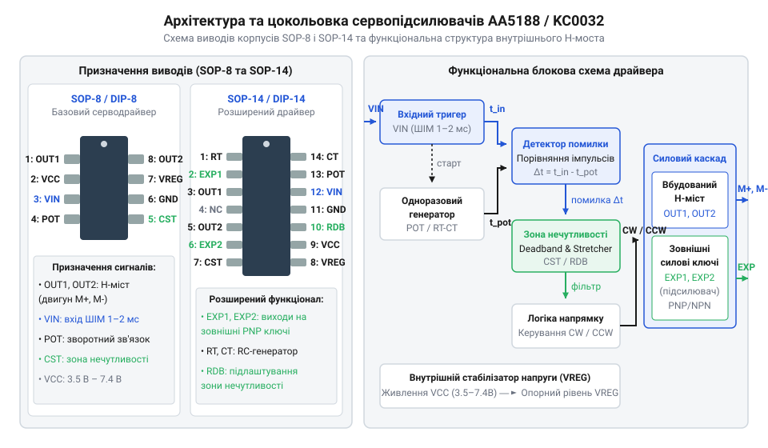
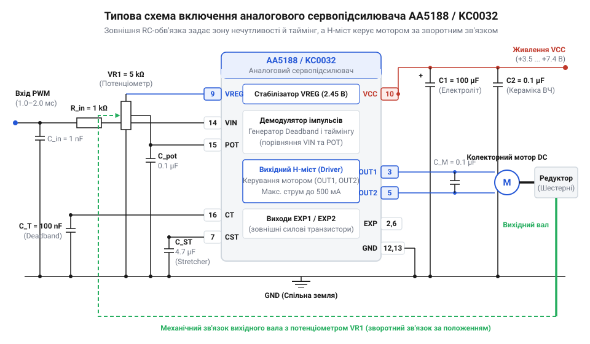

# Апаратний інтерфейс, цокольовка та типові схеми включення AA5188 і KC0032

## Проблема автономного позиціонування аналогового сервоприводу

Пряме керування силовим колекторним двигуном постійного струму від @@en|мікроконтролер@@а створює високе обчислювальне навантаження та призводить до нестабільності позиціонування вала. Якщо керуюча програма змушена безперервно опитувати аналогово-цифровий перетворювач для зчитування сигналу з потенціометра та самостійно формувати широтно-імпульсну модуляцію для H-моста, найменша затримка у виконання переривань спричиняє проскок заданого кута й механічний удар. Для позбавлення центрального процесора від рутинної роботи створено @@en|сервопідсилювач@@ (від лат. *servus* — слуга або виконавець команди) — аналогову мікросхему, яка автономно реалізує замкнений контур утримання положення.

Аналогові чипи сервопідсилювачів, такі як AA5188 та KC0032, приймають стандартний зовнішній керувальний імпульс тривалістю від 1.0 до 2.0 мс із періодом повторення близько 20 мс, що є основою [поширеного керування імпульсами](root:hw-arch/pwm-on-mcu). Вхідний фронт цього сигналу запускає внутрішній моностабільний генератор, тривалість опорного імпульсу якого визначається часом заряду конденсатора через опір потенціометра зворотного зв'язку, приєднаного до вала. Зміна кута повороту змінює опір елемента й пропорційно перетворює його на внутрішній часовий інтервал. Аналоговий дискримінатор порівнює моменти завершення зовнішнього та внутрішнього імпульсів і формує сигнал неузгодженості: якщо вхідний імпульс довший за внутрішній, логіка драйвера відкриває відповідні ключі @@en|H-міст@@а для обертання двигуна в один бік, а якщо коротший — вмикає протилежну діагональ транзисторів, змінюючи полярність напруги на обмотці. Якщо виявляється неузгодженість між заданим та фактичним кутом повороту [механічної передачі сервоприводу](root:hw-motion/servo-gearbox-mechanics), аналоговий порівнювач миттєво подає струм відповідної полярності на моторизований привід до зрівняння часових інтервалів, забезпечуючи жорстке утримання вала без участі зовнішнього процесора.

## Призначення виводів AA5188 та KC0032

Внутрішня архітектура аналогових сервопідсилювачів AA5188 та KC0032 містить підсилювач помилки, моностабільний часовий дискримінатор, віконний @@en|компаратор@@ (від лат. *comparare* — порівнювати), логіку напрямку обертання та інтегрований @@en|H-міст@@ (від англ. @@en|H-bridge@@, через H-подібну форму схемотехнічного включення чотирьох транзисторних ключів). Мікросхеми випускаються у компактних корпусах @@en|SOP-8@@ (від англ. @@en|Small Outline Package@@), @@en|DIP-8@@ та розширеному @@en|SOP-14@@ для сильніших вихідних каскадів.


*Крихітна площа корпусу SOP-8 вміщує повний аналоговий контур керування та силові ключі, тоді як SOP-14 виводить назовні керування силових транзисторів.*

У 8-вивідній конфігурації призначення ніжок є наступним:
* `INPUT` (вивід 1) — сигнальний вхід для прийому зовнішньо сформованих керувальних прямокутних імпульсів амплітудою логічного рівня.
* `OSC` / `RC` (вивід 2) — точка підключення зовнішнього керамічного конденсатора й резистора для задання опорної частоти внутрішнього моностабільного мультивібратора.
* `FB` / `VR` (вивід 3) — аналоговий вхід зворотного зв'язку, що підключається до рухомого контакту (повзунка) потенціометра позиціонування вала.
* `GND` (вивід 4) — спільна шина заземлення для аналогової та силової частин схеми.
* `OUT1` (вивід 5) — перший силовий вихід внутрішнього H-моста для підключення обмотки колекторного двигуна.
* `VCC` (вивід 6) — вивід живлення мікросхеми та силового моста, що приймає напругу від 3.5 до 7.4 В.
* `OUT2` (вивід 7) — другий силовий вихід H-моста, який разом із `OUT1` визначає полярність напруги на двигуні.
* `DB` (вивід 8) — вхід налаштування @@en|зони нечутливості@@ (від англ. @@en|deadband@@), що визначає мінімальну величину розсогласування, на яку реагує двигун.

У корпусі SOP-14 замість прямих силових виходів `OUT1` та `OUT2` виведено розділені сигнальні лінії керування затворами або базами зовні розташованих ключових транзисторних пар, що дозволяє комутувати струми у кілька ампер. Зокрема, виводи 5 та 10 відповідають за керування верхніми ключами H-моста (P-канальними польовими або PNP біполярними транзисторами), а виводи 6 та 9 — за керування нижніми ключами (N-канальними польовими або NPN біполярними транзисторами). Таке роздільне керування силовою периферією виносить тепловиділення за межі мікросхеми та запобігає деградації її внутрішньої аналогової схеми.

## Налаштування часових параметрів та зони нечутливості

Часовий дискримінатор сервопідсилювача постійно зіставляє тривалість вхідного імпульсу керування `t_in` із тривалістю опорного імпульсу `t_fb`, який генерується внутрішнім моностабільним таймером і прямо пропорційний поточному положенню потенціометра. Різниця цих тривалостей визначає сигнал помилки позиціонування:

```
Δt = t_in - t_fb
```
[визначення часової різниці імпульсів]

Щоб запобігти неперервній осциляції двигуна навколо точної позиції через дрібні завади або обмежену роздільну здатність потенціометра, у чипах AA5188 і KC0032 передбачено часову мертву зону `t_db`. Двигун залишається знеструмленим, поки абсолютна величина розсогласування не перевищить заданий поріг. Тривалість цієї зони визначається номіналами зовнішнього RC-ланцюга, підключеного до виводу `DB`:

```
t_db = R_db × C_db
```
[знаходження ширини зони нечутливості за номіналами RC-компонентів]

Підбір номіналу резистора `R_db` дозволяє гнучко адаптувати сервопривід до механічної інерції редуктора. Зменшення опору робить мертву зону вужчою, підвищуючи точність позиціонування, однак надмірно мала зона нечутливості викликає @@en|джиттер@@ (від англ. @@en|jitter@@ — тремтіння або високочастотне коливання) та призводить до прискореного зносу колектора й перегріву чипа. Збільшення опору `R_db` повністю усуває джиттер, але створює відчутний люфт позиціонування. У реальних малопотужних сервоприводах для отримання необхідної зони нечутливості `t_db` тривалістю від `3` до `10 мкс` найчастіше застосовують постійний конденсатор `C_db` ємністю `0.1 нФ` (або `47 пФ`) у паралелі з резистором `R_db` номіналом від `47 кОм` до `330 кОм`. Для мікросервоприводів із легкими пластиковими шестернями типовим є вибір `R_db = 100 кОм` та `C_db = 47 пФ`, що забезпечує мертву зону близько `5 мкс` — оптимальний баланс між відсутністю тремтіння та чітким утриманням кута, тоді як для важчих металевих редукторів опір `R_db` збільшують до `220–330 кОм` для компенсації більшого механічного люфту й інерції вала.

## Схема підключення мікросервоприводів та електричні режими

При принциповій організації схеми керування малопотужними аналоговими сервоприводами мікросхеми AA5188 та KC0032 живляться постійною напругою в допустимому робочому діапазоні від 3.5 до 7.4 В. Найдрібніші сервоприводи типорозміру micro зазвичай розраховані на номінальне живлення 4.8–6.0 В.


*Типове підключення аналогового сервопідсилювача містить мінімум зовнішніх компонентів, зосереджених навколо фільтрації живлення та RC-ланцюгів таймінгу.*

Колекторний двигун підключається безпосередньо між виводами `OUT1` та `OUT2`. Потенціометр зворотного зв'язку опірністю 4.7–10 кОм вмикається між шинами `VCC` та `GND`, а його рухомий контакт виводиться на вхід `FB`. Через комутаційні пікові струми двигуна в момент пуску напруга живлення піддається сильним пульсаціям, а механічне перемикання щіток колектора ґенерує іскріння та високочастотні завади. Для усунення низькочастотних збоїв аналогового порівнювача безпосередньо біля виводів `VCC` та `GND` обов'язково встановлюють блокувальний електролітичний конденсатор ємністю 47–100 мкФ паралельно з керамічним конденсатором на 0.1 мкФ. Джерела високочастотних завад гасять безпосередньо на виводах двигуна: керамічний шунтувальний конденсатор ємністю 0.01–0.1 мкФ, припаяний між клемами `OUT1` та `OUT2`, нейтралізує диференціальні сплески напруги, а два додаткові конденсатори по 0.01–0.047 мкФ, з'єднані від кожної клеми на металевий корпус двигуна, відводять синфазний радіочастотний шум. Для захисту ключів H-моста від високовольтних викидів ЕРС самоіндукції при різкій зміні напрямку обертання паралельно клемам двигуна також встановлюють двонапрямлений супресор або варистор.

## Підсилення виходів зовнішніми силовими транзисторами

Інтегрований H-міст мікросхем AA5188 і KC0032 у корпусі SOP-8 розрахований на тривалий струм навантаження до 300–500 мА. У потужних серводвигунах стандартного розміру струм у режимі утримання або при раптовому заклинюванні вала досягає 2–3 А, що викликає негайне теплове руйнування кристала драйвера.

Для керування високострумовими навантаженнями застосовують розширений корпус SOP-14 або схему підсилення виходів за допомогою зовнішніх комплементарних транзисторних пар. Виходи драйвера підключаються до баз або затворів зовні розташованих P-канальних і N-канальних [силових транзисторних мостів](root:hw-motion/h-bridge). При проектуванні такої схеми узгодження необхідно додавати обмежувальні резистори в кола затворів та забезпечувати апаратний затримковий інтервал для усунення @@en|наскрізного струму@@ (від англ. @@en|shoot-through current@@ — короткого замикання джерела живлення через одночасне відкриття верхнього й нижнього ключів одного плеча моста). Послідовно між виходом драйвера та затвором кожного @@en|MOSFET-ключа@@ вмикають обмежувальний резистор номіналом 22 Ом (у діапазоні від 10 до 47 Ом), який обмежує піковий струм перезаряджання ємності затвора та демпфує високочастотні резонансні коливання на друкованій платі. Додатково кола затворів оснащують підтягувальними резисторами номіналом 10 кОм (у діапазоні від 4.7 до 10 кОм): P-канальний затвор підтягують до шини живлення, а N-канальний — до землі. Ці резистори надійно фіксують транзистори в закритому стані під час підключення живлення або перебування виходів мікросхеми у високоімпедансному стані, не дозволяючи затворам «плавати» й запобігаючи самовільному відкриттю обох ключів плеча.

## Діагностика та усунення апаратних збоїв

Діагностика несправностей аналогового сервоприводу виконується за допомогою двоканального осцилографа шляхом контролю сигналу на вході `INPUT` та виходах `OUT1`/`OUT2`. Основні апаратні збої та методи їх усунення розбивають на три категорії:

1. Джиттер вала в статичному стані: виникає через надто вузьку зону нечутливості або шуми на повзунку потенціометра. Усувається збільшенням опору резистора `R_db` або промиванням доріжки потенціометра.
2. Втрата моменту утримання та просідання позиції під навантаженням: зумовлені високим внутрішнім опором джерела живлення. Пульсації напруги на лінії `VCC` зсувають опорний рівень внутрішнього генератора. Виправляється встановленням конденсатора з низьким еквівалентним послідовним опором безпосередньо на платі драйвера.
3. Перегрів корпусу мікросхеми: виникає при постійному обертанні двигуна в режимі перерегулювання або при механічному заклинюванні редуктора. Необхідно перевірити плавність ходу шестерень та розширити мертву зону `t_db`.
