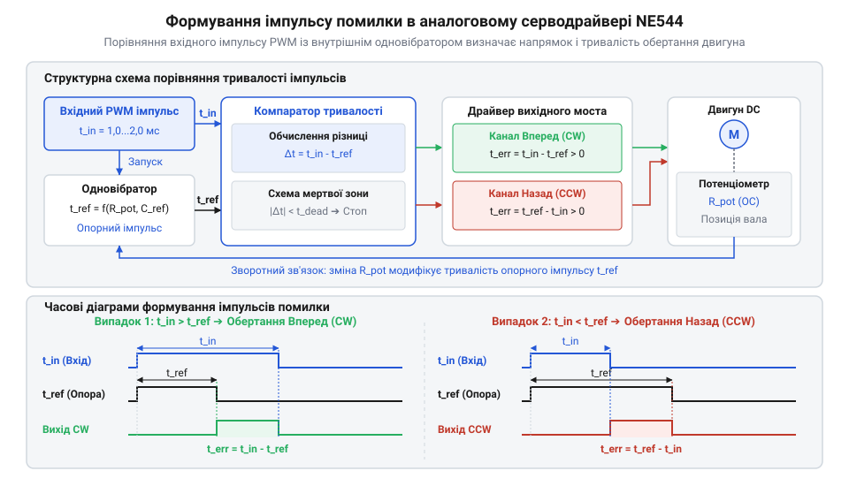
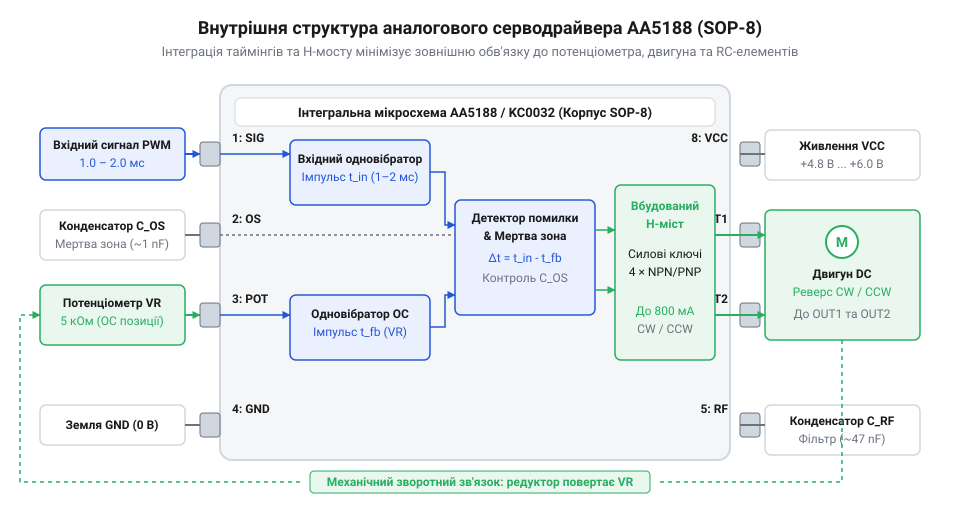

# Еволюція аналогових мікросхем сервопідсилювачів: від NE544 до AA5188

## Проблема дискретних сервопідсилювачів ранньої авіамоделістіки

У 1960-х роках пілот радіокерованої моделі літака під час польоту стикався з неминучим лихом: варто було температурі повітря змінитися на кілька градусів, як модель довільно змінювала курс через зміщення нейтрального положення керма. Сервопривід (від латинського *servus* — слуга; @@en|servo@@) повинен точнісінько повторювати кут повороту ручки на передавачі. Перші моделі використовували [імпульсно-пропорційне керування сервоприводами](root:cat-hw-drivers/pulse-proportional-servo-control), де кут задавався тривалістю вхідного прямокутного імпульсу в межах від 1,0 ms до 2,0 ms із періодом повторення близько 20 ms. Проте весь серводрайвер — схема, яка приймає цей імпульс, порівнює його з поточною позицією вала та живить двигун — збирався на дискретних компонентах: германієвих і кремнієвих транзисторах, резисторах та конденсаторах.

Головною технічною перепоною дискретної схемотехніки став виражений температурний дрейф (від англійського *drift* — відхилення; @@en|temperature drift@@) напівпровідникових переходів та пасивних елементів. У дискретному одновібраторі (від латинського *unus* — один та *vibro* — коливаюсь; @@en|monostable multivibrator@@) тривалість внутрішнього порівняльного імпульсу визначається розрядом таймінгового конденсатора (@@en|timing capacitor@@) через резистор до порогової напруги відкривання транзистора. Падіння напруги `V_be` на базово-емітерному переході (@@en|base-emitter junction@@) біполярного транзистора має негативний температурний коефіцієнт близько `−2.2 mV/°C`: при нагріванні від сонця або робочих струмів двигуна транзистор відкривається раніше, знижуючи порогову напругу компарації. Одночасно зміна ємності таймінгового конденсатора та опору резисторів у RC-ланцюгу (@@en|RC circuit@@) додатково викривляла часову постійну `τ = R · C`. У результаті тривалість внутрішнього імпульсу зміщувалася на десятки мікросекунд навіть без зміни вхідного сигналу, змушуючи підсилювач повертати двигун для компенсації уявного розбалансу — виникав так званий дрейф нейтралі (@@en|neutral drift@@), за якого сервопривід зміщував нульову позицію вала навіть за нерухомої ручки керування.

Окрім нестабільності, дискретні підсилювачі вимагали складної ручної збірки та кропіткого калібрування кожного екземпляра підлаштовними резисторами. Плата з десятками паяних з'єднань ламалася під дією вібрацій від поршневих авіамодельних двигунів. Для подальшого розвитку радіокерованої техніки знадобилося принципово нове рішення — перенесення схеми формування часових інтервалів та порівняння сигналів на єдиний напівпровідниковий кристал, де всі компоненти перебувають у тотожних термічних умовах.

## Поява NE544 та стандартизація одновібраторів

У 1970-х роках компанія @@en|Signetics@@ розв'язала проблему дрейфу нейтралі, випустивши спеціалізовану аналогову мікросхему @@en|NE544@@ у 14-вивідному корпусі @@en|DIP-14@@. Розробники об'єднали на одному біполярному кристалі прецизійний одновібратор (від латинського *vibro* — коливатися; @@en|monostable multivibrator@@), компаратор (від латинського *comparo* — порівнювати; @@en|comparator@@) тривалості імпульсів, підсилювач помилки та вихідні тригери керування силовою частиною.

В основі аналогового сервоциклу @@en|NE544@@ лежало пряме порівняння часових інтервалів. Вхідний керувальний імпульс запуску надходив на мікросхему й одночасно стартував внутрішній опорний одновібратор. Тривалість генеруваного опорного імпульсу визначалася зовнішнім прецизійним конденсатором і опором, у ролі якого виступав [потенціометр зворотного зв'язку](root:cat-hw-drivers/servo-feedback-potentiometers), механічно з'єднаний із вихідним валом редуктора. Компаратор віднімав тривалість опорного імпульсу від вхідного й формував сигнал помилки. Для запобігання безперервним осциляціям мотора навколо точки рівноваги цей сигнал подавався через допоміжний часозадаючий @@en|RC-ланцюг@@. Якщо різниця тривалостей була меншою за сталу часу ланцюга, накопичувальний конденсатор не встигав зарядитися до порогу відкриття вихідних транзисторів. Завдяки такому фільтруванню коротких імпульсів двигун залишався нерухомим у зоні нечутливості (@@en|deadband@@), поки відхилення вала не перевищувало встановлену часову межу.

*Блок-схема порівняння імпульсів NE544: вхідний імпульс запускає одновібратор, різниця тривалостей відкриває силові виходи.*

Якщо вхідний імпульс ставав довшим або коротшим за опорний, внутрішня схема формувала імпульс помилки пропорційної ширини. Цей сигнал відкривав відповідну пару вихідних транзисторів, які подавали напругу на моторчик доти, доки потенціометр не повертав вал у точку балансу тривалостей. Розміщення всіх вимірювальних кіл на одному кристалі гарантувало однакову температуру елементів, що практично повністю усунуло температурний дрейф і зробило @@en|NE544@@ світовим стандартом серводрайверів 1970-х років.

## Інтеграція силового мосту M51660L

Попри успіх @@en|NE544@@, схема сервоприводу першого покоління все ще потребувала чотирьох-шести зовнішніх силових транзисторів для формування мостового виходу. У 1980-х роках японська корпорація @@en|Mitsubishi Electric@@ представила мікросхему другого покоління @@en|M51660L@@ у корпусі @@en|SIP-14@@, яка інтегрувала вихідні силові ключі безпосередньо на напівпровідниковий кристал.

Вбудований силовий мостовий каскад мікросхеми @@en|M51660L@@ міг комутувати струми двигуна до 500 mA без застосування зовнішніх ключових транзисторів. Фізичне об'єднання керувальної та силової частин дозволило винести загальні принципи комутації у [структуру силових H-мостів](root:cat-hw-drivers/h-bridge-motor-driver-circuits) та реалізувати надійний захист від наскрізного струму (@@en|shoot-through current@@). Внутрішня логіка затримки гарантувала, що верхнє й нижнє плече одного боку мосту ніколи не відкривалися одночасно під час зміни напрямку обертання.

Іншим вагомим інженерним досягненням @@en|M51660L@@ стала схема активного динамічного гальмування. Під час швидкого підходу вала до рівноважної позиції моментно-інерційні маси ротора й редуктора намагалися проскочити точку балансу, викликаючи автоколивання. Щоб зупинити цей рух, внутрішня логіка @@en|M51660L@@ у момент зникнення імпульсу помилки формувала короткий пропорційний керувальний імпульс гальмування, тривалість якого відповідала амплітуді попереднього неузгодження. Під час цього імпульсу верхні транзистори мосту вимикалися, а обидва нижні ключі одночасно відкривалися, закорочуючи виводи двигуна між собою. Накопичена в індуктивності обмоток магнітна енергія разом із проти-ЕРС обертального ротора створювала замкнений контур для великого зворотного струму. Цей струм швидко розсіювався у вигляді тепла на активному опорі обмоток і відкритих нижніх транзисторів, генеруючи гальмівний електромагнітний момент, пропорційний кутовій швидкості. Стрімке примусове згасання кінетичної енергії ротора чітко зупиняло вал у заданій точці без перельоту зони нечутливості. Завдяки цьому розміри друкованої плати серводрайвера скоротилися вдвічі, що відкрило шлях до масового виробництва компактних «мікро»-сервоприводів.

## Оптимізація обв'язки та серія AA5188

Спроба розмістити серводрайвер другого покоління на кшталт @@en|M51660L@@ у компактний корпус авіамоделі зустрічала фізичне обмеження розміру друкованої плати. Сам чип у корпусі @@en|DIP-14@@ (від англ. @@en|Dual In-line Package@@ — «дворядний корпус») разом із десятком зовнішніх пасивних компонентів — резисторів та конденсаторів для задання тривалості імпульсів одновібраторів і зони нечутливості — вимагав плати площею понад 6 см². Для нового класу авіамоделей та мікророботів потрібен був @@en|мікросервопривод@@ (від грец. @@grc|mikros@@ — «малий»), де вся електроніка мала вміститися в об'єм менше ніж 1 см³.

Прорив відбувся наприкінці 1990-х років завдяки вдосконаленню напівпровідникового виробництва, яке дозволило формувати високоточні резистори та конденсатори безпосередньо на силіцієвому кристалі. Головною перешкодою для такої інтеграції був технологічний розкид параметрів кремнію: на монолітній пластині абсолютні значення опору та ємності варіювалися в межах 15–20%, що спричиняло б неприпустимий дрейф нейтрального положення сервоприводу. Для подолання цього відхилення застосували лазерне підганяння (англ. @@en|laser trimming@@) тонкоплівкових полікремнієвих резисторів безпосередньо під час тестування кристала, коли лазер підпалював мікроскопічні перемички й виводив опір із точністю до часток відсотка. Термостабільність без зовнішнього калібрування забезпечили топологічним узгодженням: парні компоненти таймінгових ланцюгів розміщували в симетричних блоках поруч один з одним, завдяки чому їхні температурні коефіцієнти компенсували один одного при зміні температури. Додатково у кристал інтегрували прецизійне джерело опорної напруги (від англ. @@en|bandgap reference@@ — «джерело на базі забороненої зони»), що зберігало стабільність внутрішніх порівняльних імпульсів у діапазоні від -20 °C до +70 °C. Хоча використання лазерного підганяння підвищувало вартість виготовлення пластини, це компенсувалося повним усуненням ручного налаштування сервоприводу на складальному конвеєрі. Обмеженням монолітного підходу залишалося сильне самонагрівання силового H-мосту: при тривалих навантаженнях тепловий градієнт від силових транзисторів до аналогового ядра міг викликати невеликий зсув нейтралі. Попри це, таймінгові RC-ланцюги, які раніше вимагали зовнішніх виводів мікросхеми, були інтегровані всередину аналогового ядра. На початку 2000-х років компанія @@en|Agamem Microelectronics@@ випустила мікросхему @@en|AA5188@@, а згодом з'явилися її аналоги, такі як @@en|KC0032@@. Завдяки переносу обв'язки всередину кристала кількість виводів скоротилася до восьми, що дозволило випускати драйвери у корпусі @@en|SOP-8@@ (від англ. @@en|Small Outline Package@@ — «малогабаритний корпус»).

*Блок-схема мікросхеми AA5188, яка об'єднує внутрішній генератор порівняльних імпульсів, підсилювач помилки та силовий H-міст у корпусі SOP-8.*

Нова архітектура звільнила плату від зовнішньої пасивної обв'язки. Зворотний зв'язок поєднувався безпосередньо з виводом внутрішнього порівнювача, а силовий H-міст керував двигуном без додаткових транзисторів. Скорочення площі плати у 4–5 разів відкрило шлях до масового виробництва мікросервоприводів масою 9 грамів та менше, зберігши аналогову точність позиціонування.

## Протистояння з мікроконтролерами та міфи

З появою у 2000-х роках дешевих цифрових сервоконтролерів на [основі мікроконтролерів](root:cat-hw-drivers/digital-servo-controllers-microcontrollers) (від грец. @@grc|mikros@@ — «малий» та лат. @@la|contra@@ — «проти», @@la|rotula@@ — «коліщатко») виникла тенденція витіснення аналогових схем. Цифрові драйвери пропонували програмовані зони нечутливості, вищу частоту імпульсів керування двигуном та адаптивні алгоритми. Проте у масовому бюджетному сегменті аналогові мікросхеми серії @@en|AA5188@@ зберегли домінування.

Головною інженерною причиною стійкості аналогового підходу є нульовий час завантаження. Аналоговий серводрайвер починає обробку вхідного PWM-сигналу в момент подачі живлення, не витрачаючи час на ініціалізацію тактового генератора чи виконання інструкцій завантажувача. У системах, де короткочасне просідання напруги живлення може призвести до перезавантаження мікроконтролера, аналогова схема продовжує функціонувати без ризику зависання програмного забезпечення чи руйнування стеку пам'яті.

Економічний чинник залишається не менш вагомим. Виробництво силіцієвого кристала @@en|AA5188@@ без пам'яті Flash та цифрових шин коштує у кілька разів дешевше за найпростіший мікроконтролер. Це спростовує поширений міф про повну застарілість аналогової керувальної електроніки: у приладобудуванні та бюджетному моделізмі аналогові серводрайвери є свідомим вибором на користь максимальної надійності, мінімальної ціни та миттєвого відгуку.
