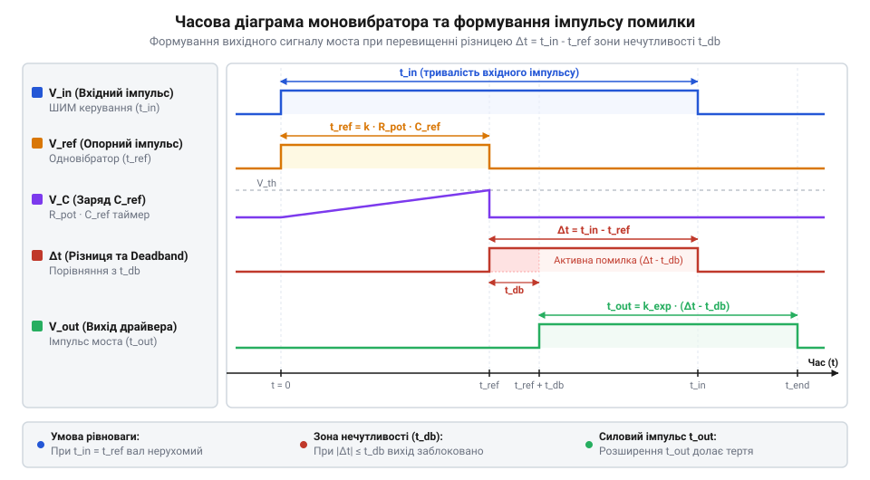
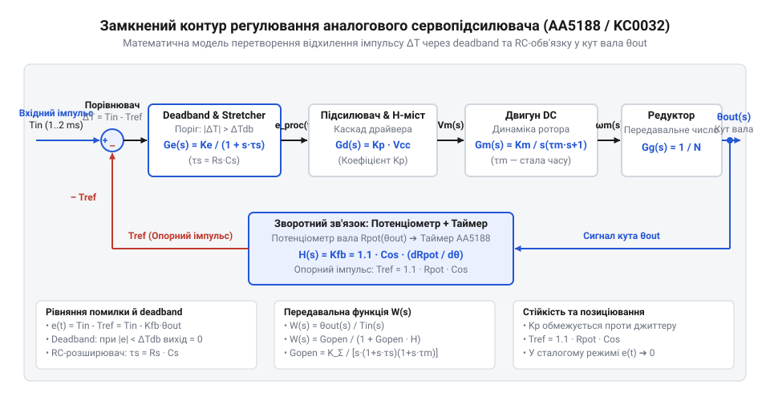

# Математичний розрахунок часових ланцюгів та динамічної стабільності аналогового сервоприводу

## Необхідність узгодження часових інтервалів сервопідсилювача

У класичних системах дистанційного керування положенням виконавчого механізму вхідний командувальний сигнал передається у вигляді періодичної широтно-імпульсної модуляції (ШІМ). Цей сигнал має фіксований період повторення (зазвичай `20 ms`, або `50 Hz`) та тривалість активного імпульсу від `1.0 ms` до `2.0 ms`, де тривалість `1.5 ms` відповідає нейтральному (середньому) положенню вала. Якщо спробувати подати такий керуючий імпульс безпосередньо на силові транзистори [H-моста](root:cat-hw-drivers/h-bridge-power-stage), які живлять обмотки электродвигуна, система виявиться повністю непрацездатною.

Пряме керування силовими ключами без порівняльного ланцюга призводить до двох критичних проблем. Перша проблема полягає у відсутності інформації про поточне механічне положення вала. Силові ключі @@en|сервопідсилювача@@ (від латинського @@la|servus@@ — слуга, що виконує команди) просто відкриватимуться на `1.5 ms` під час кожного періоду, викликаючи безперервне обертання мотора в одному напрямку незалежно від того, де вал перебуває в конкретний момент.

Друга проблема пов'язана з високою чутливістю до імпульсних завад на лінії зв'язку. Будь-який високочастотний шум або випадковий сплеск напруги спричинить хибне змикання силових ключів драйвера, призводячи до хаотичних ударних навантажень на редуктор, перегріву напівпровідникових структур та швидкого виходу приводу з ладу.

Для побудови замкненого контуру позиціювання спеціалізовані мікросхеми сервопідсилювачів (такі як @@en|AA5188@@ або @@en|KC0032@@) мусять зіставляти тривалість вхідного керуючого імпульсу з поточним кутом повороту вала. Для цього механічний кут повороту перетворюється на внутрішній часовий інтервал. Пряме порівняння напруги потенціометра через аналоговий дільник вимагало б попереднього перетворення вхідної тривалості на сталий рівень напруги за допомогою інтегратора, що створило б фазову затримку регулювання та високу чутливість до пульсацій живлення. Перетворення ж опору потенціометра у тривалість опорного імпульсу дає змогу виконувати віднімання двох часових інтервалів безпосередньо на цифрових логічних вентилях. Зіставляючи тривалість вхідного імпульсу з цим внутрішнім часовим інтервалом, електронна схема визначає як знак (напрямок), так і величину неузгодженості положення.

Отже, першочерговою вимогою до сервопідсилювача є наявність внутрішнього часового ланцюга — @@en|одноразового таймера@@ або @@en|моностабільного мультивібратора@@ (від грецького @@el|монос@@ — один, єдиний; англ. @@en|monostable multivibrator@@). Саме цей таймер формує опорний часовий інтервал, пропорційний поточному положенню потенціометра зворотного зв'язку, що створює підґрунтя для точного обчислення сигналів помилки.

## Математика одноразового таймера та вимірювання помилки

Формування опорного часового інтервалу в [аналогових сервопідсилювачах](root:cat-hw-drivers/analog-servo-ic-architecture) @@en|AA5188@@ та @@en|KC0032@@ базується на процесі заряду задавального конденсатора `C_mono` через @@en|потенціометр зворотного зв'язку@@ `R_pot`, який механічно з'єднаний з вихідним валом редуктора.

Передній фронт вхідного керуючого імпульсу тривалістю `T_in` запускає внутрішній @@en|одноразовий таймер@@. У момент запуску починається заряд конденсатора `C_mono` від джерела живлення `V_dd`. Зміна напруги `V_c(t)` на задавальному конденсаторі підпорядковується класичному експоненційному закону RC-ланцюга:

```
V_c(t) = V_dd · (1 - e^(-t / (R_pot · C_mono)))
```

Внутрішній компаратор @@en|сервопідсилювача@@ порівнює зростаючу напругу `V_c(t)` з фіксованим пороговим рівнем `V_th`. Цей поріг задається внутрішнім дільником мікросхеми як частка від напруги живлення: `V_th = k_th · V_dd`, де `k_th` — внутрішній коефіцієнт компаратора. У момент, коли напруга `V_c(t)` досягає значення `V_th`, компаратор змінює свій стан і скидає таймер, завершуючи формування внутрішнього опорного імпульсу тривалістю `T_ref`. Знайдемо тривалість `T_ref`:

```
k_th · V_dd = V_dd · (1 - e^(-T_ref / (R_pot · C_mono)))
1 - k_th = e^(-T_ref / (R_pot · C_mono))                  [ділення обидвох частин на V_dd]
-T_ref / (R_pot · C_mono) = ln(1 - k_th)                 [логарифмування двох частин]
T_ref = -ln(1 - k_th) · R_pot · C_mono                   [множення на -R_pot · C_mono]
```

Ввівши конструктивний коефіцієнт мікросхеми `K_mono = -ln(1 - k_th)` (для ІС AA5188 значення `K_mono ≈ 0.9`), отримуємо підсумкову формулу тривалості опорного імпульсу:

```
T_ref = K_mono · R_pot · C_mono
```

Оскільки опір потенціометра `R_pot` прямо пропорційний кутові повороту вала `θ` (`R_pot(θ) = R_0 + k_p · θ`), тривалість опорного імпульсу `T_ref` є точним часовим еквівалентом поточного кутового положення сервоприводу.

Вимірювання неузгодженості здійснюється шляхом часового віднімання тривалості вхідного імпульсу `T_in` та внутрішнього імпульсу `T_ref`. Тривалість імпульсу помилки `Δt` визначається виразом:

```
Δt = T_in - T_ref
```

Якщо `T_in > T_ref`, виникає додатний імпульс помилки `Δt_cw = T_in - T_ref`, який через внутрішню логіку спрямовується на відкриття ключів [H-моста](root:cat-hw-drivers/h-bridge-power-stage) для обертання мотора за годинниковою стрілкою. Якщо `T_in < T_ref`, формується імпульс помилки від'ємного напрямку тривалістю `Δt_ccw = T_ref - T_in`, що вмикає обертання проти годинникової стрілки.


*Співвідношення вхідного імпульсу керування, внутрішнього опорного імпульсу RC-таймера та імпульсів помилки із зоною нечутливості.*

Завершення формування опорного імпульсу `T_ref` вимагає негайного скидання таймера для підготовки до наступного періоду @@en|ШІМ@@. Якщо накопичений на задавальному конденсаторі `C_mono` заряд не видалити повністю, початкова напруга `V_c(0)` у наступному циклі перевищуватиме нуль. Унаслідок цього напруга на конденсаторі досягне порогового рівня `V_th` швидше, ніж слід, що штучно скоротить тривалість `T_ref` і спричинить хибний дрейф виміряної позиції вала. Щоб запобігти цьому накопиченню, у момент перепаду вихідного сигналу @@en|компаратора@@ спрацьовує внутрішній тригер (від англ. @@en|trigger@@ — спусковий гачок) мікросхеми, який відкриває низькоомний @@en|розрядний транзистор@@, увімкнений паралельно до конденсатора `C_mono`.

Через відкритий канал ключа конденсатор `C_mono` швидко розряджається на спільну шину землі через опір відкритого транзистора `R_dis`. Динаміка спадання напруги `V_c(t)` під час розряду описується експоненційною залежністю:

```
V_c(t) = V_th · e^(-t / τ_dis)
       = V_th · e^(-t / (R_dis · C_mono))        [підстановка сталої часу розряду τ_dis = R_dis · C_mono]
```

Тут `V_th` — порогова напруга компаратора, `e` — основа натурального логарифма, а `τ_dis` — стала часу розряду, визначена добутком опору ключа `R_dis` на ємність `C_mono`. Оскільки опір відкритого транзистора `R_dis` становить лише десятки ом (що на кілька порядків менше за опір потенціометра `R_pot`), стала часу `τ_dis` становить частки мікросекунди. Упродовж інтервалу `t_dis ≈ 5 · τ_dis` залишкова напруга спадає нижче ніж `0.01 · V_th`, тобто практично до нуля. Ключ розряду залишається відкритим аж до надходження переднього фронту наступного вхідного імпульсу `T_in`, що відновлює умову `V_c(0) = 0` для кожного нового періоду керування та гарантує стабільну повторюваність вимірювання помилки.

## Розрахунок зони нечутливості та розширювача імпульсів

Пряме використання імпульсу помилки `Δt` для керування мотором призводить до нестійкості позиціювання. У реальних умовах вхідний сигнал ШІМ містить фазовий джиттер, а потенціометр зворотного зв'язку піддається мікровібраціям. Якби @@en|сервопідсилювач@@ реагував на будь-які невідповідності `|Δt| > 0`, силовий H-міст безперервно перемикався б туди-сюди, викликаючи високочастотний джиттер (тремтіння вала), підвищений шум і прискорене зношення шестерень.

Для усунення цього явища в мікросхемах @@en|AA5188@@ та @@en|KC0032@@ введено @@en|зону нечутливості@@ (англ. @@en|deadband@@) з пороговою тривалістю `t_db`. Якщо модуль помилки не перевищує поріг (`|Δt| ≤ t_db`), логіка блокує вихідні транзистори. Ефективний імпульс помилки `Δt_eff` формується лише при перевищенні порогу:

```
Δt_eff = |T_in - T_ref| - t_db
```

Ширина зони нечутливості `t_db` визначається зовнішніми RC-компонентами (`R_db`, `C_db`), підключеними до спеціалізованих виводів мікросхеми:

```
t_db = K_db · R_db · C_db
```

де `K_db` — внутрішній коефіцієнт компаратора зони нечутливості (для AA5188 значення `K_db ≈ 0.6`).

Однак самої зони нечутливості недостатньо для точного позиціювання. Колекторний електродвигун постійного струму та його механічний редуктор мають [електромеханічну інерцію та сухе тертя](root:hw-motion/dc-motor-electromechanical-dynamics) (англ. @@en|stiction@@, від @@en|static friction@@). Якщо ефективна помилка `Δt_eff` є дуже малою (наприклад, `5 μs`), подавання імпульсу такої короткої тривалості на обмотки мотора не дозволить струму зрости до значення, необхідного для подолання моменту сухого тертя. У результаті сервопривід зупиняється, не дійшовши до точної позиції. Фізично цей ефект зумовлений індуктивністю `L_m` та опором `R_m` обмоток мотора, які визначають електричну сталу часу `τ_e = L_m / R_m`. Під час подавання напруги струм в обмотці зростає експоненційно `i(t) = (V / R_m) · (1 - e^(-t / τ_e))`, тому за надто короткого імпульсу він не встигає досягти порогу, при якому електромагнітний момент перевищує сухе тертя. Для створення достатнього пускового моменту тривалість імпульсу струму повинна перевищувати мінімальне значення `t_min`, що забезпечує необхідне накопичення енергії в індуктивності `L_m`. Внутрішня стала часу `t_0` у схемах драйверів відповідає базовій електричній сталій `τ_e` типового мотора і визначає часовий масштаб, відносно якого додатковий RC-ланцюг `R_st · C_st` розширює вихідний силовий імпульс.

Розв'язанням цієї проблеми є @@en|розширювач імпульсів@@ (англ. @@en|pulse stretcher@@). Він розширює короткий імпульс помилки `Δt_eff` за допомогою додаткового накопичувального конденсатора `C_st` та резистора `R_st`. Тривалість підсумкового силового імпульсу на виході драйвера `T_out` обчислюється як:

```
T_out = t_min + k_st · Δt_eff
```

де `t_min` — мінімальний вихідний імпульс струму, а `k_st` — коефіцієнт розширення:

```
k_st = 1 + (R_st · C_st) / t_0
```

або у розгорнутому вигляді через параметри обв'язки:

```
T_out = K_st · R_st · C_st · (|T_in - T_ref| - t_db)
```

де `K_st` — коефіцієнт підсилення розширювача імпульсів.

Правильний добір номіналів вимагає компромісу: занадто мала зона нечутливості `t_db` спричиняє високочастотні автоколивання вала, а занадто велика — знижує точність позиціювання. Водночас надмірний коефіцієнт розширення `k_st` призводить до перерегулювання та низькочастотного розгойдування приводу, а занижений — до нездатності подолати сухе тертя.

**Обчислення номіналів для сервопідсилювача AA5188**
Розрахуємо номінали задавального ланцюга для забезпечення тривалості опорного імпульсу `T_ref = 1.5 ms` у нейтральному положенні вала (`R_pot = 5 kΩ`) та зони нечутливості `t_db = 6 μs`.
```
T_ref = K_mono · R_pot · C_mono                          [базова формула таймера]
C_mono = T_ref / (K_mono · R_pot)                        [вираження ємності]
= 1.5×10⁻³ / (0.9 · 5000)                               [підстановка K_mono = 0.9, R_pot = 5 kΩ]
= 0.333×10⁻⁶ F = 333 nF                                 [результат розрахунку C_mono]

t_db = K_db · R_db · C_db                                [формула зони нечутливості]
R_db = t_db / (K_db · C_db)                              [вираження опору]
= 6×10⁻⁶ / (0.6 · 10×10⁻⁹)                              [підстановка K_db = 0.6, C_db = 10 nF]
= 1000 Ω = 1 kΩ                                          [опрацьований номінал R_db]
```
Обчислені номінали `C_mono = 333 nF` та `R_db = 1 kΩ` забезпечують стабільне позиціювання без джиттеру та з високою точністю повторюваності кута.

## Передавальна функція замкненого контуру сервоприводу

При зміні тривалості вхідного імпульсу сервопривід мусить плавно та швидко перемістити вихідний вал у нове кутове положення. Проте реальний двигун володіє механічною інерцією, а часові ланцюги мікросхеми перетворюють неузгодженість кута на дискретні імпульси живлення, усереднені за період повторення @@en|ШІМ@@ `T_pwm`. Математично таке усереднення напруги описується інтегруванням миттєвого значення `v_m(t)` на інтервалі кадру: `V_m = (1 / T_pwm) · ∫₀^{T_pwm} v_m(t) dt`. Перехід від імпульсного керування до безперервної передавальної функції можливий завдяки тому, що механічна стала часу двигуна `τ_m` виступає в ролі електромеханічного @@en|фільтра низьких частот@@ (англ. @@en|low-pass filter@@, від середньов. лат. *filtrum* — цідилок). Якщо період кадрів значно менший за механічну сталу часу (`T_pwm « τ_m`), інерційність ротора ефективно згладжує високочастотні пульсації моменту й швидкості. Ця апроксимація ламається, якщо `τ_m` стає співрозмірною з `T_pwm` або коли тривалість імпульсу досягає насичення (`t_pulse ≈ T_pwm`), що вносить додаткове запізнення дискретизації та нелінійність. Щоб спрогнозувати реакцію системи на різку зміну команди у лінійному режимі, необхідно побудувати її @@en|передавальну функцію@@ (англ. @@en|transfer function@@) у @@en|замкненому контурі@@ (англ. @@en|closed-loop system@@).

Різниця між заданим кутом `θ_in` та поточним кутом вала `θ_out` визначає різницю тривалостей вхідного `T_in` та опорного `T_ref` імпульсів: `Δt = K_mono · k_p · C_mono · (θ_in - θ_out)`, де `k_p` — крутизна потенціометра (Ом/рад). Після обробки розширювачем імпульсів з коефіцієнтом `K_st` та подавання через H-міст з періодом повторення ШІМ `T_pwm` (зазвичай `20 ms`), середня напруга `V_m`, прикладена до обмоток двигуна, пропорційна кутовій помилці `Δθ = θ_in - θ_out`:

```
V_m(s) = K_e · (θ_in(s) - θ_out(s))
```

де еквівалентний коефіцієнт підсилення помилки `K_e` (у В/рад) виражається через номінали RC-ланцюгів та напругу живлення `V_dd`:

```
K_e = (V_dd · K_st · K_mono · k_p · C_mono) / T_pwm
```

Обмотки та редуктор аналогового приводу описуються через [динамічну модель электродвигуна](root:hw-motion/dc-motor-electromechanical-dynamics) першого порядку. Його передавальна функція від напруги `V_m(s)` до кута повороту `θ_out(s)` має вигляд `G_m(s) = K_m / (s · (τ_m · s + 1))`, де `K_m` — крутизна швидкості (рад/(В·с)), а `τ_m` — @@en|механічна стала часу@@ двигуна та редуктора.


*Структурна схема замкненого контуру аналогового сервоприводу із зазначенням передавальних ланок часового порівняння та електродвигуна.*

Об'єднавши ланку порівняння та ланку двигуна, отримуємо передавальну функцію розімкненого контуру `W_open(s) = K_e · G_m(s) = K_loop / (s · (τ_m · s + 1))`, де `K_loop = K_e · K_m` — загальний коефіцієнт підсилення контуру (с⁻¹). Тоді передавальна функція замкненого контуру `W_cl(s) = θ_out(s) / θ_in(s)` набуває вигляду:

```
W_cl(s) = W_open(s) / (1 + W_open(s))
= (K_loop / (s · (τ_m · s + 1))) / (1 + K_loop / (s · (τ_m · s + 1))) [підстановка W_open(s)]
= K_loop / (τ_m · s² + s + K_loop)                                    [зведення до спільного знаменника]
= (K_loop / τ_m) / (s² + (1 / τ_m) · s + (K_loop / τ_m))              [ділення чисельника й знаменника на τ_m]
```

Це канонічна передавальна функція другого порядку `W_cl(s) = ω_n² / (s² + 2·ζ·ω_n·s + ω_n²)`. Тут @@en|власна частота@@ `ω_n = √(K_loop / τ_m)`, а @@en|коефіцієнт згасання@@ `ζ = 1 / (2 · √(K_loop · τ_m))`. Співвідношення значень `K_loop` та `τ_m` повністю визначає, чи буде вал сервоприводу підходити до цілі плавно, чи з коливаннями.

## Критерії стійкості та усунення джиттеру вала

Намагання підвищити точність позиціювання шляхом збільшення опору `R_st` розширювача імпульсів або зниження зони нечутливості часто призводить до зворотного ефекту: вихідний вал починає безперервно тремтіти в околиці цільової точки. Цей високочастотний @@en|джиттер@@ (від англ. @@en|jitter@@ — тремтіння) не лише створює акустичний шум, а й викликає катастрофічний перегрів силових транзисторів H-моста.

Причиною виникнення автоколивань є зменшення коефіцієнта згасання `ζ < 0.707` та наявність фазового запізнення в розімкненому контурі. У реальному аналоговому сервоприводі дискретне подавання імпульсів з періодом `T_pwm = 20 ms` створює чистого роду затримку транспортування `T_d ≈ T_pwm / 2 = 10 ms`. Щоб обчислити сумарний фазовий зсув `φ_total(ω_c)` на частоті зрізу `ω_c`, підсумовують внески всіх ланок контуру: постійний зсув інтегруючої ланки мотора `-π / 2` рад (або `-90°`), фазовий зсув інерційної ланки двигуна `-arctan(ω_c · τ_m)` від механічної сталої часу `τ_m`, фазову затримку RC-ланцюга розширювача `-arctan(ω_c · R_st · C_st)` та лінійний фазовий зсув затримки транспортування `φ_delay(ω_c) = -ω_c · T_d` рад. У підсумку повний фазовий зсув становить `φ_total(ω_c) = -π / 2 - arctan(ω_c · τ_m) - arctan(ω_c · R_st · C_st) - ω_c · T_d` в радіанах або `φ_total(ω_c) = -90° - arctan(ω_c · τ_m) · (180° ÷ π) - arctan(ω_c · R_st · C_st) · (180° ÷ π) - ω_c · T_d · (180° ÷ π)` у градусах. Відповідно до [частотного критерію Найквіста](root:math-analysis/bode-stability-analysis-servos), якщо сумарне запізнення сягає або перевищує `-180°`, @@en|запас за фазою@@ (англ. @@en|phase margin@@), який визначається як `γ = 180° + φ_total(ω_c)`, опускається нижче нуля, перетворюючи замкнену систему позиціювання на нестійкий автоколивальний генератор.

З огляду на @@en|характеристичне рівняння@@ знаменника `s² + (1 / τ_m) · s + (K_loop / τ_m) = 0`, умова критичного згасання без @@en|перерегулювання@@ (англ. @@en|overshoot@@) відповідає `ζ = 1`. Для забезпечення стабільної роботи без джиттеру під навантаженням допускається `ζ ≥ 0.707`, що накладає жорстке обмеження на підсилення контуру:

```
K_loop ≤ 1 / (2 · τ_m)
```

Оскільки `K_loop = K_e · K_m`, граничний коефіцієнт підсилення розширювача імпульсів `K_st` обмежується параметрами двигуна. Знайдемо допустимий добуток `R_st · C_st` для RC-обв'язки розширювача, виразивши його з формули `K_e`:

```
K_e_max = 1 / (2 · τ_m · K_m)                                         [гранична умова стійкості]
K_st_max = (T_pwm · K_e_max) / (V_dd · K_mono · k_p · C_mono)         [вираження K_st з K_e]
= T_pwm / (2 · τ_m · K_m · V_dd · K_mono · k_p · C_mono)              [підстановка K_e_max]
```

**Практичний розрахунок обв'язки для усунення джиттеру**
Нехай сервопривід має статичну крутизну потенціометра `k_p = 2 kΩ/rad`, задавальний конденсатор `C_mono = 333 nF`, напругу `V_dd = 5 V`, мотор з `K_m = 12 rad/(V·s)` та інерційну сталу `τ_m = 15 ms`. Період ШІМ `T_pwm = 20 ms`, коефіцієнт `K_mono = 0.9`.
```
K_e_max = 1 / (2 · 0.015 · 12) = 2.778 V/rad                          [максимальне допустиме K_e]
K_st_max = 0.020 / (2 · 0.015 · 12 · 5 · 0.9 · 2000 · 333×10⁻⁹)       [підстановка параметрів у K_st]
= 0.020 / 0.001798 = 11.12                                            [граничний коефіцієнт розширення]
```
Якщо обрати `K_st > 11.12`, коефіцієнт згасання впаде нижче `0.707`, і система увійде в режим високочастотного джиттеру. Задавши номінал `C_st = 100 nF`, опір `R_st` розширювача обчислюють так, щоб `K_st ≈ (R_st · C_st) / t_0 ≤ 11.12`, що забезпечує максимальну швидкодію приводу при повній відсутності автоколивань вихідного вала.
