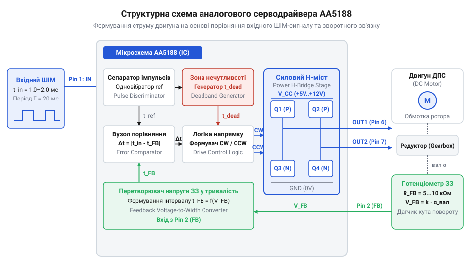
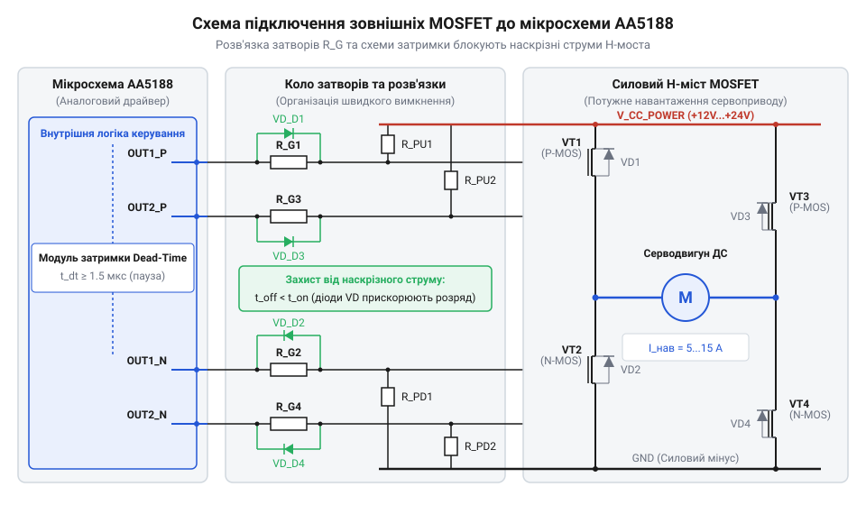

# Практичне збирання, налагодження та ремонт аналогового серводрайвера на мікросхемі AA5188

## Неконтрольований дрейф вала двигуна постійного струму

Пряме підключення колекторного `@@en|DC motor@@` (від англ. *Direct Current* — прямий струм) до джерела живлення викликає безперервне обертання його ротора. При відключенні напруги вал зупиняється, однак будь-яке зовнішнє механічне зусилля легко прокручує його на довільний кут. 

Швидкість обертання двигуна постійного струму визначається рівновагою між прикладеною напругою, внутрішнім опором обмоток та моментом навантаження на валу. Під час подачі живлення струм у якорі створює електромагнітний момент. По мірі розгону ротора виникає проти-ЕРС, яка зменшує струм доти, доки магнітний момент не зрівняється з моментом тертя й корисного навантаження. 

Через такий фізичний механізм електродвигун за своєю природою регулює швидкість або момент, але не кутове положення. Якщо навантаження змінюється, швидкість вала флуктуюватиме. Спроба виставити точний кут (наприклад, 45 градусів) і утримувати його під змінним навантаженням шляхом чистої зміни живлення неможлива: система не має інформації про поточний кут ротора.

Для стабілізації вала необхідний датчик положення та коло порівняння, яке визначає відхилення між цільовим і фактичним кутом. Різниця цих величин формує сигнал помилки. Лише замкнена система із `@@en|feedback@@` (від англ. *feed* — подавати, *back* — назад), що автоматично подає живлення потрібної полярності для обнулення помилки, здатна утримувати вал. Цей принцип покладено в основу керування `@@en|servo@@` (від лат. *servus* — слуга) приводом.

## Архітектура аналогового серводрайвера на мікросхемі AA5188

Спеціалізована мікросхема AA5188 (а також її аналог KC0032) об'єднує всі вузли аналогового регулятора положення на одному кремнієвому кристалі. Вона приймає керуючий `@@en|PWM@@` (від англ. *Pulse Width Modulation* — широтно-імпульсна модуляція) сигнал стандартного RC-формату з частотою 50 Гц (період 20 мс) та тривалістю імпульсу від 1.0 мс до 2.0 мс, де 1.5 мс відповідає нейтральному положенню.

Внутрішній перетворювач мікросхеми трансформує тривалість вхідного імпульсу на опорну напругу через аналогове накопичення заряду. Протягом активного високого рівня імпульсу `t_in` внутрішнє `@@en|current source@@` (від англ. *current* — струм, *source* — джерело, джерело стабільного струму) подає стабільний струм на накопичувальний конденсатор, формуючи лінійно зростаючу напругу. У момент спадного фронту імпульсу вузол `@@en|sample-and-hold@@` (від англ. *sample* — вибірка, *hold* — утримання, пристрій вибірки-зберігання) фіксує накопичений піковий рівень як постійну опорну напругу `V_ref`, а конденсатор розряджається до нуля для наступного кадру. Одночасно потенціометр, жорстко зв'язаний із вихідним валом редуктора, формує напругу зворотного зв'язку `V_fb`, пропорційну фактичному куту повернення. Внутрішній `@@en|error amplifier@@` (підсилювач помилки) обчислює різницю між цією опорною напругою `V_ref` та напругою зворотного зв'язку `V_fb`.


*Функціональна архітектура аналогового сервопідсилювача AA5188 із колами формування зони нечутливості та силовими ключами.*

Сигнал із підсилювача помилки надходить на `@@en|window comparator@@` (віконний компаратор). Якщо величина помилки знаходиться всередині вузького діапазону поблизу нуля — `@@en|deadband@@` (від англ. *dead* — мертвий, *band* — смуга), — компаратор утримує виходи вимкненими. Це блокує високочастотне тремтіння ротора та захищає транзистори силового `@@en|H-bridge@@` (Н-міст) від перегріву. 

Коли неузгодження перевищує `@@en|deadband@@`, компаратор відкриває відповідну діагональ `@@en|H-bridge@@`, подаючи напругу на `@@en|DC motor@@`. Двигун обертає редуктор і потенціометр у бік зменшення помилки. Як тільки напруга зворотного зв'язку зрівнюється з опорною, сигнал помилки повертається в `@@en|deadband@@`, і мостові ключі розмикаються. На відміну від складних систем, де реалізують [шинні протоколи керування](root:com-devices/bus-driven-digital-servos) або [мікроконтролерні алгоритми ПІД-регулювання](root:com-signal/discrete-pid), аналоговий драйвер AA5188 виконує всі обчислення безпосередньо у безперервному часі.

## Збирання базової макетної схеми сервопідсилювача

Для випробування аналогового серводрайвера схему збирають на безпайковій @@en|breadboard@@ (макетна плата). Мікросхема AA5188 потребує пасивної обв'язки: двох вимірювальних RC-ланок, які задають внутрішній час порівняння та ширину @@en|deadband@@. Перша RC-ланка відповідає за формування тривалості внутрішнього еталонного імпульсу порівняння. Її резистор `R_ref` підключають між лінією живлення VCC та часозадаючим виводом одноразового генератора імпульсів AA5188, а керамічний конденсатор `C_ref` з'єднують із сигнальною землею. Друга RC-ланка визначає поріг спрацьовування віконного компаратора — ширину зони нечутливості @@en|deadband@@. Її резистор `R_db` встановлюють між спеціалізованим виводом налаштування порогу та землею, а конденсатор `C_db` вмикають паралельно резистору для інтегрування вихідного сигналу помилки. Розрахунок обох ланок спирається на постійну часу `τ = R · C` з урахуванням внутрішнього коефіцієнта компаратора `k ≈ 1.1`. Для забезпечення стандартної зони нечутливості `t_db = 4 мкс` необхідне значення резистора `R_db` визначають із рівняння:

```
t_db = k · R_db · C_db
= 1.1 · R_db · C_db      [підстановка коефіцієнта компаратора]
```

Обираючи керамічний конденсатор ємністю `C_db = 4.7 нФ`, обчислюють необхідний опір `R_db`:

```
R_db = t_db / (1.1 · C_db)
= 4·10⁻⁶ / (1.1 · 4.7·10⁻⁹)      [підстановка часу 4 мкс та ємності 4.7 нФ]
≈ 773 Ом                         [обчислення значення]
```

На практиці встановлюють найближчий резистор зі стандартного ряду номіналом 750 Ом або 820 Ом. Аналогічно для опорної ланки порівняння тривалість імпульсу `t_ref = 1.5 мс` при `C_ref = 100 нФ` вимагає опору `R_ref = 1.5·10⁻³ / (1.1 · 100·10⁻⁹) ≈ 13.6 кОм`. Точність підбору цих номіналів визначає стійкість сервоприводу. Якщо опір або ємність ланки @@en|deadband@@ виявляться занадто малими (часовий інтервал `t_db < 1 мкс`), найменші електричні наводки та шум контакту потенціометра викликатимуть безперервні хибні спрацьовування віконного компаратора. Це призведе до високочастотного тремтіння вала, непотрібної перекомутації силових транзисторів H-моста та їх катастрофічного перегріву. Якщо ж номінали занадто великі (`t_db > 15 мкс`), система втрачає чутливість до малих відхилень, що викликає високу статичну похибку позиціонування.

Потенціометр зворотного зв'язку опором 4.7–10 кОм механічно фіксують на вихідному валу редуктора. Його рухомий контакт підключають до виводу зворотного зв'язку AA5188, а крайні виводи — між землею та лінією живлення VCC. Механічна передача повинна мати мінімальний люфт, оскільки будь-який люфт перетворюється на статичну похибку позиціонування вала.

Під час комутації струму обмоток двигуна виникають імпульсні завади. Для запобігання збоям аналогового порівнювача силовий контур живлення `@@en|DC motor@@` прокладають окремими провідниками від сигнального контуру AA5188. Безпосередньо біля виводів живлення мікросхеми встановлюють керамічний конденсатор ємністю 0.1 мкФ, а на силове коло двигуна — електролітичний конденсатор ємністю 100–470 мкФ.

Для первинного аналізу макет зручно збирати на безпайковій платі, проте під час випуску готового виробу здійснюють [проектування друкованої плати](root:hw-pcb/servo-driver-pcb-design), що мінімізує паразитичну індуктивність провідників. Зібрана макетна схема готова до підключення джерела імпульсів та інструментального налаштування нульового положення.

## Калібрування нуля та усунення автоколивань вала

При першому ввімкненні зібраного аналогового серводрайвера на макетній платі (англ. @@en|breadboard@@, від bread — хліб, board — дошка) вал двигуна нерідко починає безперервно дрижати або густи у стаціонарному положенні. Це явище високочастотних автоколивань (англ. @@en|hunting@@ або @@en|jitter@@) виникає через те, що підсилювач помилки мікросхеми @@en|AA5188@@ реагує на найменші шумові флуктуації між вхідним сигналом @@en|PWM@@ та напругою потенціометра зворотного зв'язку.

Налаштування сервосистеми починають із точного виставлення механічного нуля. На вхід серводрайвера від мікроконтролера подається еталонний опорний імпульс тривалістю `1500 мкс`, який відповідає нейтральному положенню (`90°`). Для випробування та калібрування застосовують тестову програму:

:::code proj-analog-servo-driver-board-repair-and-tuning/c/servo_tester.c 117-121

У цей момент осцилографом (англ. @@en|oscilloscope@@) контролюють напругу на середньому виводі (англ. @@en|wiper@@) потенціометра. Повертаючи корпус потенціометра відносно редуктора, домагаються того, щоб вихідна напруга зворотного зв'язку точно дорівнювала половині напруги живлення `V_CC / 2`.

Після встановлення нуля переходять до придушення автоколивань вала через вибір зони нечутливості (англ. @@en|deadband@@, від dead — мертвий, band — смуга). Завузька зона нечутливості змушує віконний компаратор постійно перемикати плечі силового моста (англ. @@en|H-bridge@@), розігріваючи мікросхему та зношуючи механіку. Щоб стабілізувати систему, підключають щупи осцилографа до виходів драйвера `Out1` та `Out2`. У стані спокою на обох виходах має утримуватися стабільний низький рівень. Появу вузьких хаотичних імпульсів усувають збільшенням ємності часозадаючого конденсатора RC-ланцюга зони нечутливості на платі або програмним фільтруванням дрібних флуктуацій:

:::code proj-analog-servo-driver-board-repair-and-tuning/cpp/ServoController.cpp 65-87

Правильно відкалібрована система залишається повністю безшумною в утримуваному положенні й миттєво відпрацьовує зміну ширини керуючого імпульсу.

Проте під час вибору зони нечутливості важливо дотримуватися компромісу між стабільністю та точністю позиціонування. Надмірне збільшення порогу придушує будь-які шумові флуктуації, але утворює гістерезис (англ. @@en|hysteresis@@, від грец. ὕστερησις — запізнення): вал приводу зупиняється в трохи різних позиціях залежно від напрямку підходу до заданого кута. Крім того, зовнішнє механічне навантаження зміщує вал у межах цієї невизначеності без активації силового моста, погіршуючи жорсткість утримання. Через це оптимальною вважають мінімальну ємність конденсатора RC-ланцюга зони нечутливості, за якої зникають хаотичні перемикання на виходах мікросхеми @@en|AA5188@@ під навантаженням.

## Покрокова діагностика та ремонт апаратних несправностей

У реальних умовах експлуатації аналоговий серводрайвер піддається механічним перевантаженням та температурним кидкам. Коли вал сервоприводу раптово перестає реагувати на команди або беззупино обертається до механічного упору, локалізувати несправність допомагає системна перевірка кіл мультиметром (англ. @@en|multimeter@@).

Перша типова несправність — пробій транзисторів внутрішнього моста @@en|AA5188@@. Вона проявляється тим, що двигун починає безперервно обертатися в один бік одразу після подачі живлення, або ж джерело живлення уходить у захист через коротке замикання. Для діагностики від'єднують двигун і у знеструмленому стані вимірюють опір між виходами `Out1`/`Out2` та шинами живлення й землі. Опір менше `5 Ом` вказує на пробій силового ключа. У такому разі мікросхему @@en|AA5188@@ замінюють, обов'язково перевіряючи наявність захисних діодів (англ. @@en|flyback diode@@) від зворотної ЕРС мотора.

Друга поширена проблема — обрив резистивної доріжки потенціометра зворотного зв'язку. При втраті контакту з рухомим виводом підсилювач помилки бачить максимальне відхилення напруги і подає повну напругу на двигун, змушуючи його з силою вдарятися об крайні механічні обмежувачі. Несправність виявляють вимірюванням напруги на виводі потенціометра при повільному ручному повертанні вала: стрибки до `0 В` або `V_CC` підтверджують знос або обрив доріжки. Для усунення зламу замінюють потенціометр або встановлюють захисний підтягуючий резистор.

Третя несправність — зсув нульової точки. Якщо серводрайвер зміщує нейтраль або самовільно зміщує кут під навантаженням, перевіряють якість пульсацій живлення та опір спільного провідника землі. Окиснення контактів чи падіння напруги на спільній доріжці зміщує опорну напругу компаратора, що усувається відновленням якісного заземлення та заміною фільтруючих керамічних конденсаторів.

## Масштабування потужності зовнішніми силовими MOSFET

Внутрішній H-міст мікросхеми @@en|AA5188@@ розрахований на відносно невеликі струми (до `500 mA`), що обмежує її використання малими сервоприводами. Для керування потужними двигунами постійного струму з робочими струмами у десятки ампер застосовують схему масштабування з зовнішніми силовими транзисторами (англ. @@en|MOSFET@@, від metal-oxide-semiconductor field-effect transistor).

У цій топології виходи @@en|AA5188@@ перестають живити мотор безпосередньо і стають керуючими сигналами для затворів зовнішніх мосфетів. Виходи підключаються до зовнішнього силового H-моста, побудованого на P-канальних транзисторах у верхніх плечах та N-канальних у нижніх плечах.


*Принципова схема зовнішнього силового каскаду на N- та P-канальних MOSFET-транзисторах для розширення струмового навантаження драйвера AA5188.*

Щоб забезпечити надійне запирання силових ключів під час пауз, між затворами та шинами живлення встановлюють підтягуючі резистори (англ. @@en|pull-up@@). Для швидкого перезаряджання ємностей затвора потужних ключів при високих частотах перемикання рекомендується використовувати проміжні драйвери затворів (англ. @@en|gate driver@@), детально описані в [огляді драйверів затворів](root:hw-power/mosfet-gate-drivers-in-h-bridge).

При проектуванні потужного серводрайвера критично важливо розділити силові та сигнальні кола. Високі імпульсні струми мотора створюють завади на спільній шині землі, що може збивати роботу чутливого аналогового компаратора @@en|AA5188@@. Силову землю мотора та сигнальну землю мікросхеми з'єднують в одній точці за схемою зіркового заземлення (англ. @@en|star ground@@). Це дає змогу будувати надійні та масштабовані аналогові серводрайвери для будь-яких рівнів навантаження.
