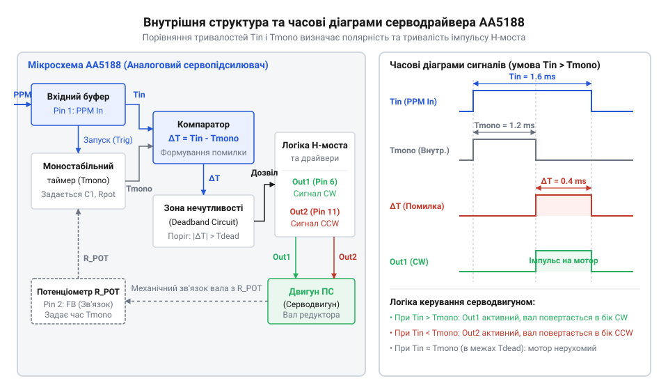
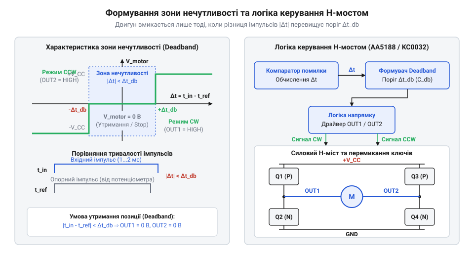
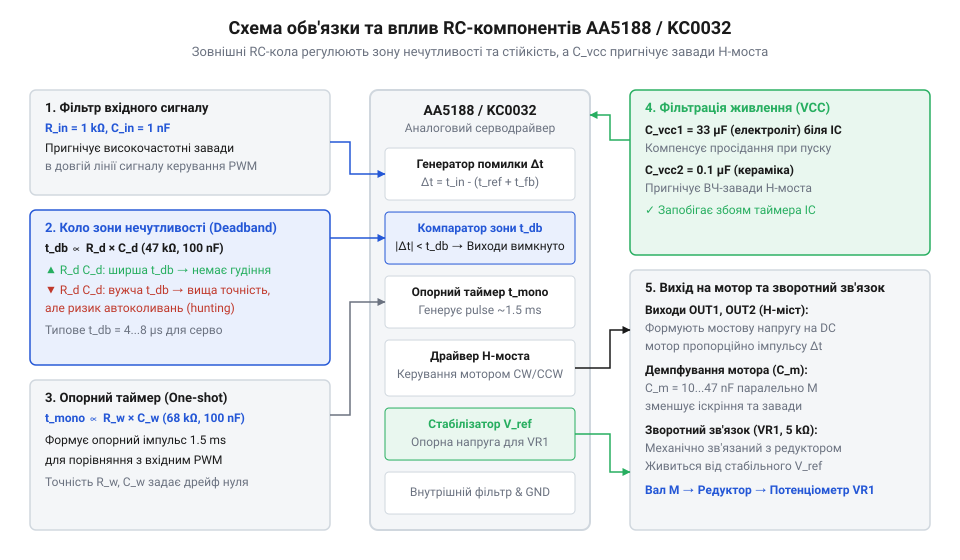
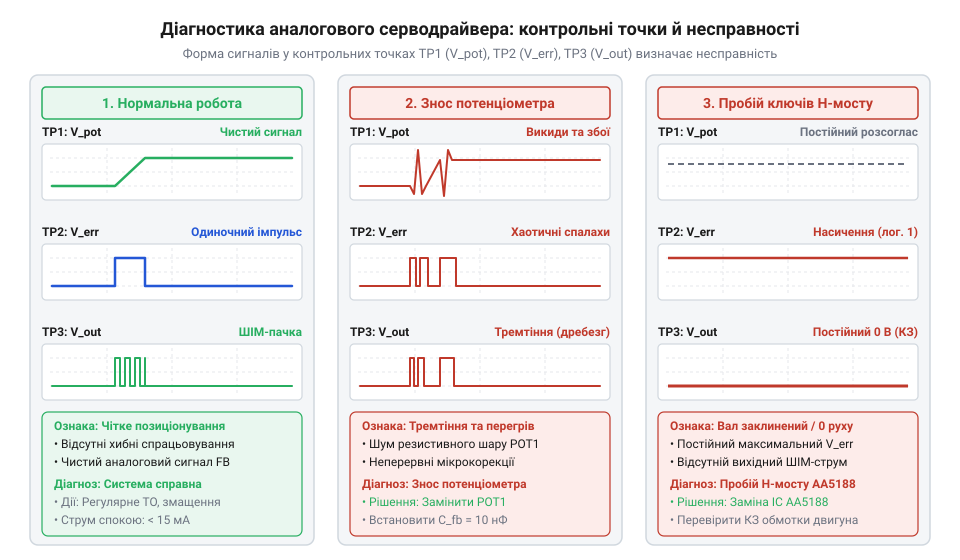

# Спеціалізовані мікросхеми сервопідсилювачів AA5188 та KC0032

## Нестабільність позиціонування двигуна без сервопідсилювача

Звичайний колекторний двигун постійного струму (лат. *collector* — збирач, лат. *directus* — прямий) @@en|DC motor@@, сполучений із механічним зменшувальним редуктором (лат. *reductor* — той, що відводить назад) @@en|gearmotor@@, створює високий обертальний момент і чудово підходить для безперервного обертання вала. Проте спроба використати такий мотор для точного позиціонування та утримання заданого кута повороту натрапляє на фундаментальну фізичну проблему.

Подання постійної напруги від джерела живлення змушує ротор обертатися зі швидкістю, що залежить від напруги та механічного опору. Зміна полярності живлення змінює напрямок обертання. Якщо виникає завдання зупинити вихідний вал у чітко визначеній кутовій координаті, просте зняття живлення у момент проходження цільової точки не працює. Механічна інерція (лат. *inertia* — бездіяльність) @@en|inertia@@ обмотки ротора, масивних ґірлянд шестерень та закріпленого навантаження змушує вал продовжувати рух за інерцією, спричиняючи проскок цільового положення — перерегулювання (англ. *overshoot*) @@en|overshoot@@. Кінематичний люфт (нім. *Zahnspiel* — гра зубів) @@en|backlash@@ між зубцями шестерень додатково погіршує ситуацію, утворюючи зону невизначеності, у межах якої двигун уже зупинився, але вихідний вал вільно зміщується під дією зовнішніх сил.

Подача коротких імпульсів живлення або дискретне перемикання полярності тумблерами чи реле не вирішує проблему. При зміні зовнішнього механічного моменту навантаження — наприклад, при викривленні важеля чи протидії вітру — швидкість повертання вала змінюється. У відкритому контурі керування система не має жодної інформації про поточний фактичний кут повороту. Якщо зовнішня сила зміщує вал зупиненого двигуна, знеструмлена система уступає навантаженню. Спроба ж тримати двигун під постійною напругою в заблокованому стані призводить до струмового перевантаження та швидкого теплового пробою обмоток.

Для точного позиціонування необхідний замкнений контур зворотного зв'язку (англ. *feedback loop*) @@en|feedback loop@@. Кутове положення вихідного вала має постійно вимірюватися аналоговим давачем положення, найчастіше резистивним потенціометром (лат. *potentia* — сила, грец. *metron* — міра) @@en|potentiometer@@, ротор якого жорстко зв'язаний із вихідним валом редуктора. У цій системі потенціометр працює як резистивний дільник напруги (лат. *divisio* — ділення) @@en|voltage divider@@ між напругою живлення `V_cc` та землею `0 V`. Обертання вала переміщує ковзний контакт (англ. *wiper*) @@en|wiper@@ уздовж резистивного шару, змінюючи співвідношення опорів дільника. Вихідний потенціал (лат. *potentialis* — можливий) @@en|potential@@ `V_pot` на ковзному контакті визначають через поточний кут повороту `θ` та максимальний робочий кут `θ_max`.

        V_pot = V_cc × (θ ÷ θ_max)      [пропорційне ділення напруги]

З цього виразу видно лінійну залежність напруги від кута, що перетворює механічне положення вала на пропорційний аналоговий сигнал. Для узгодження бажаного кута з фактичним застосовують [відповідні датчики положення](root:hw-sensing/servo-potentiometer-feedback-sensors) або потенціометричні мости. Проте реальний резистивний трек виходить далеко за межі ідеального математичного розрахунку. Виробнича нелінійність (лат. *linea* — лінія) @@en|non-linearity@@ розподілу опору вздовж підкладки (яка навіть у якісних елементах становить ±1…3%) призводить до того, що однаковим приростам кута `θ` відповідають неоднакові зміни потенціалу `ΔV_pot`, спричиняючи кутову похибку (грец. *gonia* — кут) @@en|angular positioning error@@ позиціонування вала на різних ділянках робочої дуги. На це накладається температурний дрейф (голл. *drijven* — гнати, плавати) @@en|temperature drift@@: під час нагрівання приводу змінюється загальний опір треку відповідно до його температурного коефіцієнта (лат. *coefficiens* — той, що сприяє) @@en|temperature coefficient of resistance@@ @@en|TCR@@. Хоча дільник концептуально є логометричним, вхідний опір вимірювального каскаду схемотехніки шунтує ковзний контакт, перетворюючи зміну абсолютного опору на температурний зсув напруги `V_pot` і призводячи до «плавання» нульової точки вала при зміні температури. Додатково механічне зношення резистивного шару створює контактний шум (англ. *wiper noise*) @@en|wiper noise@@, а коливання `V_cc` викривляють `V_pot`, спричиняючи хибні спрацьовування двигуна.

Цільове положення вала задається тривалістю вхідного імпульсу Pulse-Position Modulation (лат. *pulsus* — поштовх, *positio* — положення, *modulatio* — розміреність) @@en|PPM@@, де тривалість високого рівня (зазвичай від 1.0 до 2.0 мс із періодом повторення 20 мс) кодує бажаний кут повороту. Частота повторення цих імпульсів (зазвичай 50 Гц) визначає темп оновлення внутрішнього сигналу помилки @@en|error signal@@. При занадто низькій частоті (наприклад, 10–20 Гц) контур порівняння тривалий час залишається без нових даних про відхилення, через що силовий міст живить двигун дискретними порціями струму — вал рухається ривками, а привід втрачає плавність і повільно реагує на зміну механічного навантаження. Натомість надмірне підвищення частоти (понад 70–100 Гц) не дає аналоговому часозадаючому RC-колу повністю відновлювати початковий заряд між сусідніми імпульсами. У результаті опорний і вхідний часові інтервали починають накладатися один на одного, викривляючи сигнал помилки та спричиняючи втрату точності позиціонування. Оптимальна частота 50 Гц забезпечує повний перезапуск аналогової схеми порівняння перед кожним новим імпульсом і водночас гарантує достатню безперервність підтримання обертального моменту.

Історично перші спроби побудови аналогових контурів сервокерування спиралися на дискретні транзисторні схеми, які згодом поступилися першим інтеграційним мікросхемам Signetics NE544 та Mitsubishi M51660L. Детальний шлях розвитку цих рішень висвітлено в матеріалі про [еволюцію аналогових мікросхем](root:cat-hw-drivers/servo-analog-driver-ic/hist-analog-servo-controllers-evolution.md). Для зв'язку вхідного часового імпульсу з силоводіями моста, такими як [інтегровані H-мости](root:cat-hw-drivers/integrated-h-bridge-motor-drivers), використовують спеціалізовані аналогові мікросхеми сервопідсилювачів. Вони порівнюють тривалість вхідного керуючого імпульсу з напругою потенціометра зворотного зв'язку і формують пропорційний сигнал помилки для вихідного моста.

Таке аналогове порівняння (грец. *analogia* — відповідність) @@en|analog comparison@@ відбувається безперервно у реальному часі. На відміну від систем, де обчислення виконують [циффрові серводрайвери](root:cat-hw-drivers/digital-servo-controllers-microcontrollers), аналоговий контур працює без обчислювальних затримок чи дискретизації за часом. Коли тривалість вхідного керуючого імпульсу @@en|PPM@@ збігається з внутрішнім часовим інтервалом, сформованим на основі напруги @@en|potentiometer@@, вихідний @@en|error signal@@ зменшується до нуля. Силові ключі знеструмлюють обмотки двигуна, і вал зупиняється точно у заданій точці. Якщо зовнішнє навантаження зміщує вихідний вал, зміна напруги на давачі миттєво відновлює неузгодженість часових інтервалів, змушуючи схему знову подавати живильний імпульс необхідної полярності. Саме це утримує вал у стані динамічної рівноваги (грец. *dynamis* — сила, лат. *aequus* — рівний, *libra* — ваги) @@en|dynamic equilibrium@@ та забезпечує пропорційне керування (лат. *proportio* — співвідношення) @@en|proportional control@@ зусиллям двигуна.

## Формування імпульсу помилки внутрішнім таймером

Спеціалізовані мікросхеми аналогових сервопідсилювачів AA5188 та KC0032 вирішують завдання стеження за кутом шляхом прецизійного аналогового порівняння часових інтервалів усередині кристала.

Основою архітектури мікросхеми є вбудований моностабільний мультивібратор (грец. *monos* — один, лат. *stabilis* — стійкий, *multus* — багатий, *vibro* — коливаюсь) @@en|monostable multivibrator@@, який працює як опорний одноразовий таймер (англ. *one-shot timer*) @@en|one-shot timer@@. 

Кожний вхідний керуючий @@en|PPM@@-імпульс по своєму передньому фронту запускає внутрішній генератор. Тривалість опорного імпульсу `T_ref`, який генерує внутрішній таймер, визначається ємністю зовнішнього часозадаючого конденсатора `C_t` та поточним опором потенціометра зворотного зв'язку, підключеного до аналогового входу мікросхеми. Напруга `V_pot`, знята з рухомого контакту потенціометра, задає струм заряду конденсатора або поріг спрацьовування внутрішнього компаратора @@en|comparator@@. Фізично цей процес полягає в тому, що з прибуттям переднього фронту вхідного сигналу внутрішнє джерело струму починає лінійно заряджати часозадаючий конденсатор `C_t`. Напруга `V_pot` задає величину цього струму або поріг перемикання: із зростанням `V_pot` час, необхідний для накопичення заряду на `C_t` до порівнюваного рівня, лінійно збільшується. Коли напруга на `C_t` досягає порогу компаратора, внутрішній таймер завершує формування `T_ref` і відкриває розрядний транзистор @@en|discharge transistor@@, який замикає обкладку конденсатора на спільну шину. Оскільки відкритий канал транзистора має скінченний опір, скидання накопиченого заряду відбувається не миттєво, а триває певний час. Якщо тривалість відкриття розрядного транзистора виявляється недостатньою або пауза між вхідними керуючими імпульсами коротша за час повного розряду `C_t`, на конденсаторі залишається залишковий потенціал. У наступному циклі заряджання починається не з нульового рівня, а з цієї залишкової напруги, що штучно скорочує тривалість `T_ref` та викривляє формувальний імпульс помилки. Через це час відкриття розрядного транзистора задає жорстку нижню межу для паузи між керуючими імпульсами, недотримання якої призводить до часового зсуву та дрижання вала.

Внутрішня логіка мікросхеми здійснює віднімання тривалостей вхідного та опорного імпульсів. Різниця тривалостей визначає імпульс помилки (англ. *error pulse*) @@en|error pulse@@ `ΔT`, що подається на логіку керування мостом. Схемотехнічно цей формувач працює як часовий фазовий дискримінатор (лат. *discrimino* — розділяю) @@en|phase discriminator@@ на двох логічних вентилях збігу @@en|coincidence gate@@, які порівнюють прямі й інвертовані сигнали `T_in` та `T_ref`. Оскільки обидва імпульси запускаються синхронно по передньому фронту вхідного сигналу, у період їхнього взаємного перекриття виходи обох вентилів заблоковані. Якщо вхідний сигнал триває довше (`T_in > T_ref`), то після завершення `T_ref` вентиль прямого каналу реалізує логічну умову `T_in AND NOT T_ref` і формує активний імпульс тривалістю `T_in - T_ref`, який відкриває ключі прямого обертання моста. Якщо ж довшим є опорний інтервал (`T_ref > T_in`), то після спаду `T_in` спрацьовує вентиль реверсного каналу за умовою `NOT T_in AND T_ref`, видаючи імпульс тривалістю `T_ref - T_in` на ключі протилежного напрямку. У разі точної рівності `T_in = T_ref` жоден вентиль не відкривається, а підсумкова різниця тривалостей описується співвідношенням:

```
T_ref = k · V_pot · C_t
ΔT = T_in - T_ref            [віднімання тривалості опорного імпульсу від вхідного]
```

де `T_in` — тривалість вхідного керуючого імпульсу, `T_ref` — тривалість імпульсу внутрішнього таймера, `V_pot` — напруга з рухомого контакту потенціометра, `C_t` — ємність часозадаючого конденсатора, а `k` — коефіцієнт пропорційності внутрішнього генератора струму.

Якщо тривалість вхідного імпульсу перевищує тривалість внутрішнього (`T_in > T_ref`), схема порівняння генерує імпульс помилки `ΔT` однієї полярності. Цей сигнал відкриває відповідну пару транзисторів H-моста, змушуючи @@en|gearmotor@@ обертатися в бік збільшення кута. Якщо вхідний імпульс коротший за внутрішній (`T_in < T_ref`), формується імпульс помилки протилежної фази, який вмикає реверсну пару транзисторів моста.

Вал двигуна повертає ротор потенціометра, змінюючи напругу `V_pot` таким чином, щоб тривалість `T_ref` наближалася до `T_in`. Як тільки `T_ref` дорівнює `T_in`, різниця `ΔT` прямує до нуля, вихідні імпульси керування мостом зникають, і двигун зупиняється точно в заданому положенні.


*Внутрішня структура аналогового сервопідсилювача AA5188 та діаграми порівняння вхідного PPM-сигналу з імпульсом внутрішнього таймера для формування сигналу помилки.*

Детальний перелік виводів та призначення ніжок мікросхем AA5188 та KC0032 у корпусах SOP-8 та DIP-8 наведено у [довіднику з цокольовки AA5188](root:cat-hw-drivers/servo-analog-driver-ic/api-aa5188-kc0032-hardware-interface.md).

Математичний аналіз часових констант та передаточних функцій ланцюгів порівняння викладено у матеріалі про [математичний розрахунок часових ланцюгів](root:cat-hw-drivers/servo-analog-driver-ic/math-analog-servo-timing-and-stability.md).

## Зона нечутливості та драйвер H-моста

Коли аналоговий компаратор вираховує різницю тривалостей імпульсів, навіть у стані повного спокою на виході залишається мікроскопічна похибка через шуми потенціометра та пульсації живлення. Якщо подати цей залишковий сигнал прямо на силові ключі, двигун почне постійно зміщувати ротор на частки градуса вліво й вправо, що спричинить безперервне @@en|дрижання вала@@ (англ. *hunting*, від *hunt* — переслідувати). Для усунення цього ефекту вихідний сигнал спочатку потрапляє у формувач, де діє @@en|зона нечутливості@@ (англ. *deadband*, від *dead* — мертвий + *band* — смуга).

Внутрішній формувач зони нечутливості порівнює тривалість тригерованого імпульсу з фіксованим пороговим значенням `t_DB`. Якщо відхилення за тривалістю менше за налаштоване порогове вікно, внутрішній логічний вентиль блокує проходження сигналу на силовий вихід. Тільки коли механічний зсув вала формує тривалість помилки, яка перевищує допустимий поріг, система активує керуючий імпульс відповідної полярності.


*Формувач зони нечутливості блокує малі імпульси помилки, забезпечуючи чітке й стабільне керування силовим H-мостом.*

Сформований сигнал керування надходить на вбудований @@en|H-міст@@ (англ. *H-bridge*, від форми схеми у вигляді літери H), побудований на двох @@en|верхніх ключах@@ (англ. *high-side switches*, від *high* — верхній + *side* — сторона) P-типу, підключених до позитивної шини живлення, та двох @@en|нижніх ключах@@ (англ. *low-side switches*, від *low* — нижній + *side* — сторона) N-типу, з'єднаних із землею. Для узгодження рівнів і розподілу сигналів керування мікросхема містить внутрішній @@en|преддрайвер@@ (англ. *pre-driver*, від *pre* — перед + *driver* — керувач), який розщеплює імпульс помилки на чотири окремі лінії для баз чи затворів силових транзисторів. Залежно від знака похибки @@en|преддрайвер@@ відкриває відповідну діагональну пару ключів, забезпечуючи проходження струму через обмотку двигуна у потрібному напрямку. Проте через фізичну затримку вимкнення транзисторів — розсмоктування неосновних носіїв заряду або розряд ємності затвора — швидка зміна напрямку струму загрожує тимчасовим відкриттям обох ключів однієї стійки моста. Ситуацію ускладнює те, що обмотка двигуна працює як @@en|індуктивне навантаження@@ (англ. *inductive load*, від *induce* — наводити + *load* — навантаження), яке підтримує проходження струму протягом усього часу вимкнення транзистора `t_off`. Щоб усунути загрозу прямого короткого замикання між шинами, внутрішні логічні елементи та часозадаючі RC-кола @@en|преддрайвера@@ затримують увімкнення нових транзисторів, формуючи @@en|захисну паузу@@ (англ. *dead-time*, від *dead* — мертвий + *time* — час) тривалістю `t_DT`, протягом якої всі чотири ключі короткочасно закриті. Під час цієї паузи, коли канали всіх транзисторів повністю заперті, спадаюче магнітне поле обмотки генерує @@en|зворотну ЕРС@@ (англ. *back EMF*, від *back* — зворотний + *electromotive force* — електрорушійна сила), яка прагне зберегти напрямок струму. Оскільки прямий шлях через транзистори перекрито, накопичений індуктивний струм розмикання проходить через зворотні @@en|паразитні діоди@@ (англ. *parasitic diodes*, від *parasite* — паразит + *diode* — двоелектродний елемент) протилежного діагонального плеча моста. Формується @@en|струм рекуперації@@ (англ. *recirculation current*, від *re* — знову + *circulare* — обертатися), який повертає збережену реактивну енергію індуктивності назад у шину живлення та гасить небезпечні високовольтні сплески напруги. Для надійного захисту схеми тривалість цієї паузи має суворо перевищувати час вимкнення ключів: `t_DT > t_off`. Якщо часовий інтервал паузи недостатній (`t_DT ≤ t_off`), новий транзистор відкривається до повного знеструмлення попереднього, що спричиняє потужний @@en|наскрізний струм@@ (англ. *shoot-through*, від *shoot* — проскакувати + *through* — наскрізь) напряму між шинами живлення. З іншого боку, надмірне розширення `t_DT` збільшує некеровану затримку та погіршує динаміку позиціонування. Продуманий вибір співвідношення `t_DT > t_off` упереджує @@en|наскрізний струм@@ і запобігає виникненню зворотної реверсивної генерації, коли ротор за інерцією проскочив точку рівноваги.

Коли зовнішня механічна сила намагається відхилити вал серводвигуна від заданого положення, потенціометр миттєво змінює опір, розбалансовуючи таймер. Похибка перевищує пороги зони нечутливості, викликаючи відкриття ключів містка та створення реактивного зусилля. Внутрішня динаміка описує @@en|утримуючий момент@@ (англ. *holding torque*), який пропорційний тривалості та амплітуді відновлювальних імпульсів живлення. Висока дискретність і симетрія мостового каскаду гарантують жорстке фіксування вала без втрати моменту.

Для підключення зовнішніх навантажень або розширення комутаційних можливостей схема спирається на [апаратний інтерфейс мікросхем](root:cat-hw-drivers/servo-analog-driver-ic/api-aa5188-kc0032-hardware-interface.md), який визначає допустимі струмові межі вихідних транзисторів. У разі потреби керування потужнішими двигунами розробники інтегрують [зовнішній силовий міст](root:cat-hw-drivers/integrated-h-bridge-motor-drivers), залишаючи AA5188 або KC0032 роль точного аналогового контролера. Математичний аналіз стійкості замкненої системи та розрахунок динамічних режимів детально розкрито у матеріалі про [математичний розрахунок часових ланцюгів](root:cat-hw-drivers/servo-analog-driver-ic/math-analog-servo-timing-and-stability.md). Точність позиціонування при цьому напряму визначають [давачі зворотного зв'язку](root:hw-sensing/servo-potentiometer-feedback-sensors), які формують вихідне опорне напруження.

Практичний розрахунок ширини зони нечутливості вимагає компромісу між точністю позиціонування та тепловим навантаженням на силовий каскад. Якщо встановити занадто вузький поріг спрацьовування, найменший електричний шум потенціометра змушуватиме @@en|преддрайвер@@ постійно перемикати транзистори, через що внутрішній @@en|H-міст@@ працюватиме у режимі високої частоти й швидко перегріватиметься. Надто широка @@en|зона нечутливості@@, навпаки, призводить до втрати точності позиціонування та зниження @@en|утримуючого моменту@@ біля точки рівноваги. У той час як аналогові мікросхеми AA5188 і KC0032 спираються на фіксовані параметри пасивного RC-ланцюга, сучасні [цифрові серводрайвери](root:cat-hw-drivers/digital-servo-controllers-microcontrollers) здатні адаптивно змінювати поріг фільтрації за допомогою мікроконтролерних алгоритмів.

## Розрахунок обв'язки та пригнічення завад

Навіть найточніша внутрішня аналогова архітектура AA5188 або KC0032 втрачає стабільність, якщо її @@en|обв'язка@@ (англ. *peripheral circuit*) підібрана некоректно. Колекторний двигун під час комутації щіток генерує сильні імпульсні завади в колі живлення. Якщо ці завади потрапляють на виводи внутрішнього генератора або компаратора, сервопривід входить у стан @@en|автоколивання@@ (англ. *self-excitation*), дрижить під навантаженням або самочинно зміщує позицію вала. Для зменшення впливу комутаційних сплесків на внутрішні компаратори застосовують розраховане [пригнічення реактивних та комутаційних завад колекторних двигунів](root:hw-power/dc-motor-brush-noise-suppression).

Ширина зони нечутливості `t_DB` визначається номіналами зовнішнього резистора `R_DB` та конденсатора `C_DB`. Для розрахунку часової затримки, необхідної для пригнічення мікроколівань, використовують співвідношення часової сталої RC-кола з урахуванням внутрішнього струму заряджання. Зовнішній резистор `R_DB` формує внутрішній @@en|зарядний струм@@ (англ. *charging current*) мікросхеми `I_charge = V_ref ÷ R_DB`, де `V_ref` — опорна напруга. Цей струм лінійно заряджає конденсатор `C_DB` до досягнення @@en|порогової напруги@@ (англ. *threshold voltage*, від англ. *threshold* — поріг) `V_th` внутрішнього @@en|компаратора@@ (англ. *comparator*, від лат. *comparare* — порівнювати). Оскільки тривалість заряджання становить `t_DB = (V_th ÷ V_ref) × R_DB × C_DB`, внутрішній коефіцієнт `k_DB` має чітке фізичне походження: він виражає відношення порогової напруги компаратора до опорної напруги мікросхеми `V_th ÷ V_ref` з урахуванням масштабного коефіцієнта одиниць вимірювання.

Розрахунок тривалості зони нечутливості `t_DB` виконують за такою формулою:

`t_DB` — тривалість затримки зони нечутливості у мікросекундах (`мкс`),
`C_DB` — ємність часозадаючого конденсатора у пікофарадах (`пФ`),
`R_DB` — опір резистора налаштування зони нечутливості у кілоомах (`кОм`),
`k_DB` — коефіцієнт передачі внутрішньої схеми порівняння (`k_DB = 0.0012`).

```
t_DB = k_DB × R_DB × C_DB                       [базова формула часової сталої RC-ланцюга]
     = 0.0012 × 47 кОм × 1000 пФ                 [підстановка типових номіналів елементів]
     = 56.4 мкс                                  [розрахункова ширина зони нечутливості]
```

Отримане значення `t_DB = 56.4 мкс` забезпечує оптимальний баланс між точністю позиціонування ротора та стійкістю до механічних резонансів редуктора. Зменшення ємності `C_DB` робить сервопривід чутливішим до мікропереміщень, однак підвищує ризик виникнення високочастотного дрижання.

**Обчислення на прикладі** розрахунку оптимального розв'язувального конденсатора для пригнічення імпульсних завад живлення розглядається з огляду на амплітуду струмових сплесків двигуна:

`C_dec` — мінімальна ємність розв'язувального конденсатора у мікрофарадах (`мкФ`),
`I_peak` — піковий струм пуску двигуна у міліамперах (`мА`),
`Δt_sw` — тривалість комутаційного сплеску щіток у мікросекундах (`мкс`),
`ΔV_max` — максимально припустима пульсація напруги живлення мікросхеми у вольтах (`В`).

```
C_dec = (I_peak × Δt_sw) ÷ ΔV_max              [співвідношення заряду та пульсації напруги]
      = (800 мА × 5 мкс) ÷ 0.1 В                [підстановка параметрів навантаження]
      = 40 мкФ                                  [необхідна ємність фільтра]
```

Значення `C_dec = 40 мкФ` показує, що для надійної фільтрації необхідно встановити паралельно керамічний конденсатор `0.1 мкФ` (для високочастотних завад) та електролітичний конденсатор ємністю `47 мкФ` у безпосередній близькості до виводів живлення мікросхеми.


*Принципова схема з підключенням часозадаючих пасивних компонентів для стабілізації внутрішнього таймера.*

Для захисту від низькочастотних просідань живлення силову шину двигуна та сигнальне живлення мікросхеми розділяють за допомогою малоомного резистора або діодної розв'язки. Для пригнічення високочастотних завад застосовують @@en|розв'язувальний конденсатор@@ (англ. *decoupling capacitor*, від *decouple* — розв'язувати), розташований з мінімальною довжиною друкованих провідників. Опір розділювального резистора `R_dec` обчислюють на основі допустимого @@en|падіння напруги@@ `ΔV_max` від струму споживання мікросхеми `I_chip` за співвідношенням `R_dec ≤ ΔV_max ÷ I_chip`. Для мікросхем AA5188 та KC0032 зі струмом `I_chip = 5 мА` і межею `ΔV_max = 0.2 В` розраховане значення `R_dec ≤ 40 Ом`, тому зазвичай обирають номінал `10...33 Ом`. Перевищення цього опору спричиняє брак напруги живлення логіки, а заниження нижче `4.7 Ом` зводить нанівець фільтрацію пульсацій. Коли просідання силової шини є тривалими, замість резистора застосовують діодну розв'язку. Головними параметрами діода є мінімальне падіння прямої напруги `V_F ≤ 0.3...0.4 В`, для забезпечення якого обирають @@en|діод Шотткі@@ (англ. *Schottky diode*, від прізвища фізика В. Шотткі), та допустимий @@en|прямий струм@@ `I_F_max > I_chip`. Під час пуску двигуна цей діод закривається і не дає конденсатору `C_dec` розряджатися в силову шину. Малий @@en|час зворотного відновлення@@ `t_rr` діода додатково блокує негативні індуктивні викиди від комутації обмоток.


*Часові діаграми показують виникнення високочастотних завад і зсув фази при неправильно підбраній обв'язці.*

Аналіз осцилограм у контрольних точках дозволяє швидко ідентифікувати джерело нестабільності: сплески на виводі опорного таймера свідчать про недостатню фільтрацію VCC, а розмиті фронти вихідного імпульсу — про наявність наводок на колі потенціометра.

Історично [розвиток аналогових серводрайверів](root:cat-hw-drivers/servo-analog-driver-ic/hist-analog-servo-controllers-evolution.md) пройшов шлях від критичних до номіналів обв'язки схем до інтегрованих рішень зі стійкими внутрішніми джерелами струму. Практичний [процес налагодження платформи](root:cat-hw-drivers/servo-analog-driver-ic/proj-analog-servo-driver-board-repair-and-tuning.md) включає методи підбору пасивних елементів під конкретний редуктор. У високоточних системах замість аналогового налаштування застосовують [сучасні цифрові сервоконтролери](root:cat-hw-drivers/digital-servo-controllers-microcontrollers), де зона нечутливості задається програмно.

## Діагностика серводрайвера та адаптація двигунів

Під час тривалої експлуатації аналогового сервоприводу виникають відхилення в роботі: вал починає спонтанно дрижати, сервопривід втрачає точність позиціонування або входить у режим теплового захисту. Головними джерелами таких несправностей є механічний знос резистивної доріжки, яку містить @@en|potentiometer@@ зворотного зв'язку, теплове перевантаження силових транзисторів, якими оснащений внутрішній @@en|H-bridge@@, та зміна індуктивності й опору обмоток при заміні двигуна. Розуміння зв'язку між електричними сигналами мікросхем AA5188 або KC0032 та фізичним станом вузлів дозволяє здійснювати послідовний пошук дефектів.

Послідовна осцилографічна діагностика починається з перевірки сигнальних точок мікросхеми. Першим кроком оцінюють амплітуду та часові параметри вхідного @@en|PPM@@-імпульсу на сигнальному виводі. Зміщення базового рівня або зрізані фронти свідчать про наявність паразитної ємності в лінії зв'язку. Другим кроком перевіряють вихід зворотного зв'язку: під час повільного примусового повертання вала напруга має змінюватися строго лінійно без шуму та провалів. Наявність вузьких сплесків на осцилограмі вказує на стирання струмопровідного шару. Детальні рекомендації щодо вимірювань розкриває [налагодження аналогового серводрайвера](root:cat-hw-drivers/servo-analog-driver-ic/proj-analog-servo-driver-board-repair-and-tuning.md).

Третім кроком перевіряють сигнальний вивід часозадаючого конденсатора, де внутрішній @@en|one-shot timer@@ формує пилоподібну напругу заряду. Якщо тривалість опорного імпульсу хаотично змінюється при нерухомому валі, причиною є витік струму через пасивний компонент або завади на колі @@en|peripheral circuit@@. Четвертим кроком аналізують виходи на мостові транзистори: відсутність пауз між перемиканнями верхніх та нижніх ключів викликає @@en|shoot-through@@, що призводить до стрімкого нагріву корпусу мікросхеми AA5188. Для швидкого звірення номіналів та призначення контактів використовують [цокольовку мікросхем AA5188](root:cat-hw-drivers/servo-analog-driver-ic/api-aa5188-kc0032-hardware-interface.md) у відповідних корпусах.

При використанні потужнішого @@en|DC motor@@ із більшим пусковим струмом внутрішній каскад мікросхеми не здатний забезпечити необхідну потужність без перегріву. Для адаптації схеми до підвищених навантажень виходи AA5188 або KC0032 підключають до зовнішніх ключів, використовуючи [зовнішній силовий мост](root:cat-hw-drivers/integrated-h-bridge-motor-drivers). Однак пряме підключення виходів мікросхеми до затворів силових транзисторів (англ. *MOSFET*, від *metal* — метал + *oxide* — оксид + *semiconductor* — напівпровідник) @@en|MOSFET@@ обмежене різницею напруг між керувальною та силовою шинами. Керувальний сигнал AA5188 з амплітудою 5 В не здатний повністю закрити верхні P-канальні ключі при напрузі живлення мотора 12 В. Залишковий потенціал на затворі утримує транзистори в активному лінійному режимі та викликає їхнє швидке перегрівання. Водночас обмежений вихідний струм мікросхеми повільно заряджає вхідну ємність затворів і затягує комутаційні фронти. Для усунення різниці потенціалів та прискорення комутації між мікросхемою та затворами встановлюють зсувач рівнів (англ. *level shifter*, від *level* — рівень + *shift* — зсувати) @@en|level shifter@@ із двотактним транзисторним буфером (англ. *push-pull*, від *push* — штовхати + *pull* — тягнути) @@en|push-pull buffer@@. Вхідний NPN-транзистор зсувача рівнів керується сигналом 5 В і перемикає свій колекторний вузол між землею та силовою шиною 12 В через резистор підтяжки. До цього вузла підключено комплементарну пару біполярних транзисторів NPN та PNP, включених за схемою зі спільним колектором. Верхній NPN-транзистор активно форсує заряд вхідної ємності затвора від силової шини під час відкриття, а нижній PNP-транзистор швидко розряджає затвор на землю при закритті. Пряме підключення виходу буфера до затвора викликає надмірні пікові струми перезаряду та високочастотні осциляції на паразитній індуктивності друкованих провідників. Для обмеження кидків струму та демпфування збудження послідовно із затвором встановлюють затворно-обмежувальний резистор (англ. *gate resistor*, від *gate* — затвор + *resist* — чинити опір) @@en|gate resistor@@ `R_g`. Мінімальний опір `R_g` розраховують виходячи з напруги силового живлення `V_mot`, спаду напруги на насиченому транзисторі буфера `V_CE` та гранично допустимого пікового струму буферного транзистора `I_peak`:

R_g = (V_mot - V_CE) / I_peak
    = (12 - 0.2) / 0.5            [підстановка V_mot = 12 В, V_CE = 0.2 В, I_peak = 0.5 А]
    = 23.6 Ом                     [ділення різниці напруг на піковий струм]

Вибір стандартного номіналу `R_g` 24 Ом або 27 Ом обмежує струмовий сплеск на рівні 0.5 А, що захищає буферні транзистори та забезпечує перемикання силового @@en|MOSFET@@ за десятки наносекунд без динамічного перегріву. Підключення потужнішого мотора з важким ротором збільшує параметр @@en|inertia@@, що призводить до вискоку вала за межі цільового кута, викликаючи @@en|overshoot@@ та безперервне @@en|hunting@@. Для складних застосувань із динамічною зміною алгоритмів керування аналоговий привід замінюють на [цифрові сервоконтролери](root:cat-hw-drivers/digital-servo-controllers-microcontrollers), де розрахунок контуру виконується програмно.

Усунення осциляцій при заміні двигуна виконують шляхом коригування часових параметрів зони нечутливості. Збільшення опору резистора або ємності конденсатора у колі @@en|deadband@@ розширює часове вікно затримки, компенсуючи механічний @@en|backlash@@ редуктора та інерцію вала. Додатково для пригнічення високовольтних індуктивних сплесків при комутації обмоток паралельно двигуну встановлюють демпфуючий ланцюг (англ. *snubber*, від *snub* — приборкувати) @@en|snubber@@ або захисний діод (англ. *flyback diode*, від *fly* — летіти + *back* — назад) @@en|flyback diode@@. Математичне обґрунтування вибору часових сталих для забезпечення стійкості замкненого контуру викладено в матеріалі про [розрахунок часових ланцюгів](root:cat-hw-drivers/servo-analog-driver-ic/math-analog-servo-timing-and-stability.md). При проведення модифікацій також слід ураховувати особливості, які мають [давачі зворотного зв'язку](root:hw-sensing/servo-potentiometer-feedback-sensors) в умовах підвищеного рівня завад.

Різкі стрибки струму під час пуску потужного двигуна створюють високочастотні пульсації на силовій шині живлення. Ці пульсації проникають через спільний опір землі в сигнальну частину мікросхеми та викликають її спонтанне (англ. *self-excitation*, від *self* — сам + *excite* — збуджувати) @@en|self-excitation@@. Розділення силового й сигнального заземлення в єдиній точці блокує паразитні контури зворотного струму. Для фільтрації високочастотних завад безпосередньо біля виводів живлення AA5188 або KC0032 встановлюють розв'язувальний конденсатор (англ. *decoupling capacitor*, від *de-* — відокремлювати + *couple* — з'єднувати + *capacitor* — конденсатор) @@en|decoupling capacitor@@. Фінальна перевірка адаптованого драйвера під максимальним моментом утримання (англ. *holding torque*, від *hold* — утримувати + *torque* — крутний момент) @@en|holding torque@@ підтверджує відсутність перегріву та збереження точності позиціонування.
