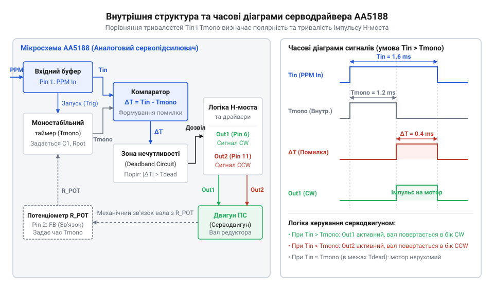
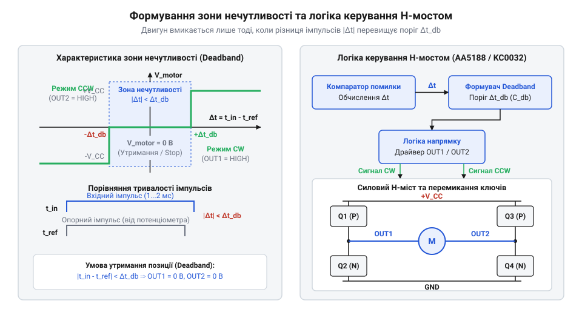
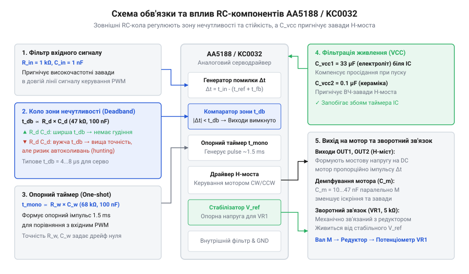
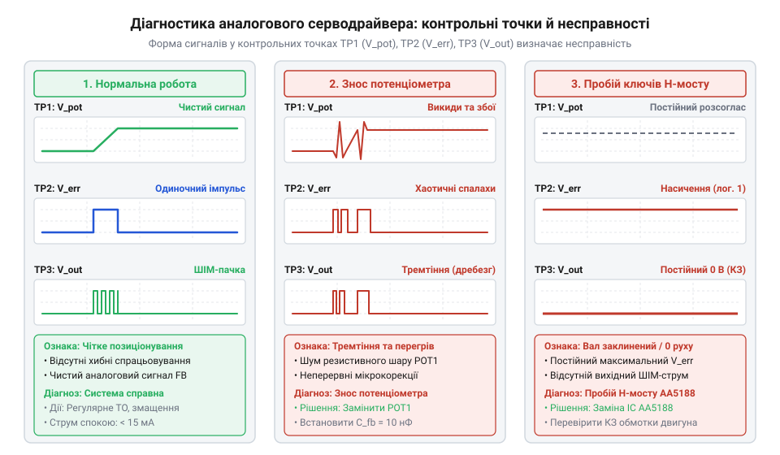

# Спеціалізовані мікросхеми сервопідсилювачів AA5188 та KC0032

<preknowlist>
- [Інтегровані H-мости](root:cat-hw-drivers/integrated-h-bridge-motor-drivers) — принцип двополярної комутації струму двигуна та роботи силових транзисторних ключів
- [Давачі положення сервоприводів](root:hw-sensing/servo-potentiometer-feedback-sensors) — пропорційне перетворення кутового зсуву вала в аналогову напругу зворотного зв'язку
- [Пригнічення завад колекторних двигунів](root:hw-power/dc-motor-brush-noise-suppression) — фізика виникнення комутаційних сплесків струму та основи їх апаратного пригнічення
</preknowlist>

## Нестабільність позиціонування двигуна без сервопідсилювача

При прямому подаванні живлення @@en|колекторний двигун постійного струму@@ не здатний утримувати вал у заданій кутовій координаті. Механічна @@en|інерція@@ (від лат. @@la|inertia@@ — бездіяльність) ротора та шестерень редуктора викликає @@en|перерегулювання@@ з проскоком цільової точки, а @@en|кінематичний люфт@@ (від нім. @@de|Luft@@ — повітря) створює зону невизначеності. Для точності вимагається @@en|замкнений контур зворотного зв'язку@@ (від англ. @@en|feedback loop@@ — петля зворотного зв'язку). Кут повороту перетворює в напругу @@en|потенціометр@@ (від лат. @@la|potentia@@ — сила та грец. @@el|metron@@ — вимір), вимірюваний [аналоговою напругою зворотного зв'язку](root:hw-sensing/servo-potentiometer-feedback-sensors). Проте система зазнає похибок через @@en|нелінійність@@ резистивної доріжки, @@en|температурний дрейф@@ нульової точки та @@en|контактний шум@@ ковзаючого щіткового вузла.

## Формування імпульсу помилки внутрішнім таймером

Спеціалізовані мікросхеми @@en|AA5188@@ та @@en|KC5188@@ узгоджують положення вала через внутрішній @@en|моностабільний мультивібратор@@ (від грец. @@el|monos@@ — один та лат. @@la|stabilis@@ — стійкий), що працює як опорний таймер. Передній фронт вхідного @@en|PPM-сигнал|PPM-сигналу@@ (від англ. @@en|Pulse-Position Modulation@@ — позиційно-імпульсна модуляція) запускає лінійне заряджання часозадаючого конденсатора струмом, величина якого задана напругою @@en|потенціометр|потенціометра@@. Внутрішній @@en|фазовий дискримінатор@@ (від лат. @@la|discriminare@@ — розрізняти) віднімає тривалість вхідного імпульсу від опорного, формуючи пропорційний @@en|імпульс помилки@@ відповідної полярності.


*Внутрішня архітектура AA5188 та принцип віднімання тривалостей імпульсів фазовим дискримінатором.*

Для запобігання часовому зсуву наступних циклів і дрижання вала конденсатор повністю розряджається під час паузи між вхідними імпульсами.

## Зона нечутливості та драйвер H-моста

Щоб @@en|контактний шум@@ потенціометра не викликав дрижання ротора, внутрішній формувач блокує малі імпульси похибки, які не перевищують @@en|зону нечутливості@@ (від англ. @@en|deadband@@ — мертва смуга). Сигнали неузгодження надходять на @@en|преддрайвер@@, який реалізує [принцип двополярної комутації струму](root:cat-hw-drivers/integrated-h-bridge-motor-drivers) через вбудований @@en|драйвер H-моста@@ на P- та N-канальних транзисторах.


*Схема зони нечутливості та преддрайвер H-моста із захисною паузою.*

Між перемиканнями ключів преддрайвер формує @@en|захисну паузу@@ (від англ. @@en|dead-time@@ — мертвий час), запобігаючи руйнівним @@en|наскрізний струм|наскрізним струмам@@. У цей інтервал відбувається @@en|рекуперація@@ (від лат. @@la|recuperatio@@ — повернення) індуктивного струму обмоток через @@en|паразитний діод|паразитні діоди@@ для гасіння сплесків @@en|зворотна ЕРС|зворотної ЕРС@@.

## Розрахунок обв'язки та пригнічення завад

Ширина @@en|зони нечутливості@@ задається параметром `t_db`, який обчислюють через опір резистора `R_db`, ємність конденсатора `C_db` та внутрішній коефіцієнт порівняння `k`:

```
t_db = R_db × C_db × k
```

Множник `k` визначає внутрішній поріг компаратора мікросхеми, а отримана тривалість `t_db` задає часове вікно, в межах якого малі зміни PPM-сигналу не викликають спрацювання H-моста. Для захисту логіки від просідань живлення під час пуску двигуна застосовують [пригнічення комутаційних сплесків струму](root:hw-power/dc-motor-brush-noise-suppression) через @@en|розв'язувальний конденсатор@@ `C_dec` та розділювальний @@en|діод Шотткі@@ `D_s`.


*Розрахункова схема пасивних часозадаючих та фільтруючих елементів.*

Аналіз осцилограм у контрольних точках дозволяє виявляти фазові зсуви та @@en|автоколивання@@ контуру.

## Діагностика серводрайвера та адаптація двигунів

Послідовна @@en|осцилографічна діагностика@@ (від лат. @@la|oscillare@@ — гойдатися та грец. @@el|grapho@@ — писати) охоплює перевірку сигналів @@en|PPM-сигнал|PPM-сигналу@@, @@en|потенціометр|потенціометра@@, опорного таймера та виходів H-моста. Для керування потужними двигунами мікросхеми @@en|AA5188@@ і @@en|KC0032@@ підключають до зовнішнього @@en|MOSFET-міст|MOSFET-моста@@ через буферний @@en|зсувач рівнів@@.


*Діагностичні осцилограми сигналів у контрольних точках контуру.*

Опір @@en|затворний резистор|затворного резистора@@ `R_g` обмежує піковий струм перезаряду затворів і демпфує високочастотні осциляції. Для усунення @@en|автоколивання|автоколивань@@ і явища @@en|вискоку вала@@ коригують параметр `t_db` та розділяють силову й сигнальну шини заземлення.
