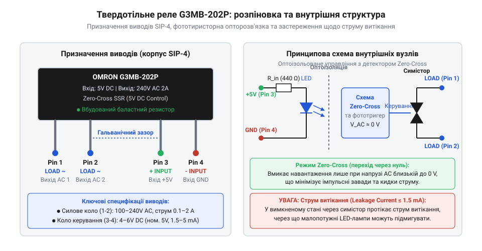
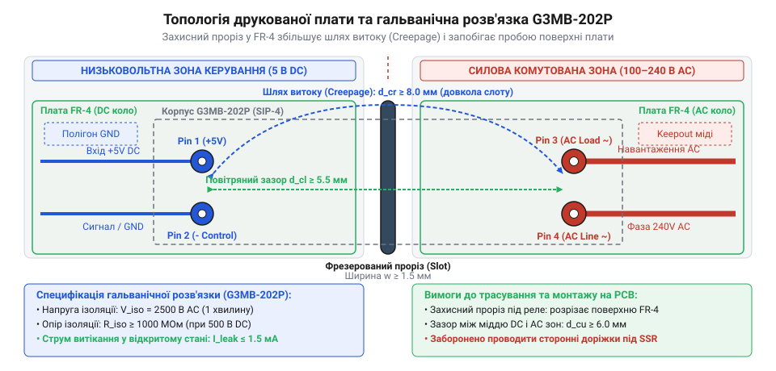

# Залізний інтерфейс та специфікація виводів G3MB-202P

<preknowlist>
- [MOC3063 — оптосимістор з детектором нуля](root:cat-hw-drivers/moc3063-optotriac) — Принцип оптичної розв'язки та функціонування схеми детектування нуля
- [Симістор BTA16-600B](root:cat-hw-drivers/triac-bta16) — Базові принципи напівпровідникової комутації кіл змінної напруги симісторним ключем
</preknowlist>

## Небезпека прямого комутування змінної напруги

У цифрових пристроях мікроконтролерні системи працюють із низькою постійною напругою `3.3 В` або `5 В` DC. При намаганні безпосередньо комутувати силові навантаження мережі змінної напруги `100–240 В` AC (з піковими амплітудами понад `340 В`) виникає критична небезпека для всієї електроніки. Будь-який прямий електричний контакт між високовольтною та низьковольтною зонами під час короткого замикання або високовольтного пробою миттєво виводить з ладу цифрові мікросхеми й створює ризик ураження користувача електричним струмом.

Для безпечного розв'язання цієї задачі традиційно застосовують електромеханічне реле (англ. electromechanical relay, від electro — електричний, mechanical — механічний та relay — реле; @@en|electromechanical relay@@). Проте механічні контакти мають серйозні обмеження. Під час комутації виникає електричне іскріння (англ. arcing, від arc — дуга; @@en|arcing@@), яке руйнує контактні площадки й генерує сильні електромагнітні перешкоди (англ. electromagnetic interference; @@en|EMI@@). Крім того, механічні реле мають обмежений ресурс спрацьовувань (зазвичай до 100 000 циклів під навантаженням), повільно перемикаються (`5–15 мс`), видають акустичне клацання та потребують значного струму для утримання котушки.

При частому перемиканні — наприклад, у системах терморегулювання з повільною широтно-імпульсною модуляцією — механічне реле швидко зношується. У таких вузлах необхідне твердотільне реле (англ. solid-state relay, від solid — твердий, state — стан та relay — реле; @@en|solid-state relay@@), прикладом якого є модуль @@en|G3MB-202P@@. Для комутації силового кола використовують напівпровідниковий [симісторний ключ](root:cat-hw-drivers/triac-bta16), який працює без механічного зносу. Водночас управління передається через світлодіодную [оптичну розв'язку](root:cat-hw-drivers/moc3063-optotriac), що гарантує електричне розділення кіл. Поєднання світлодіода, оптичного каналу та силового ключа у герметичному корпусі усуває знос і захищає низьковольтну частину.

## Призначення виводів корпусу SIP-4

Модуль @@en|G3MB-202P@@ виконано у компактному прямокутному корпусі SIP-4 (англ. single in-line package, від single — один, in-line — в лінію та package — корпус; @@en|SIP-4@@) із чотирма виводами, розташованими в один ряд. Геометрія корпусу чітко розділяє вхідну низьковольтну та вихідну силову сторони.


*Призначення та полярність виводів корпусу SIP-4 реле G3MB-202P.*

Вхідна частина керування складається з двох виводів:

- **Вивід 1 (`+Input`)** — анод вхідного світлодіода оптичної розв'язки. Сюди подається позитивний потенціал сигналу керування.
- **Вивід 2 (`-Input`)** — катод вхідного світлодіода. З'єднується з спільним провідником (`GND`) або вихідним транзисторним ключем.

Вхідне коло розраховане на номінальну напругу `5 В DC` (допустимий робочий діапазон становить від `4 В` до `6 В` DC). Всередині корпусу @@en|G3MB-202P@@ послідовно зі світлодіодом уже інтегровано обмежувальний резистор. При напрузі `5 В` вхідний опір становить `440 Ом` ±20% (вхідний струм близько `11.4 мА`). Поріг гарантованого спрацьовування реле становить `4 В DC`, а напруга надійного вимкнення — не менше `1 В DC`.

Силова комутована частина містить два виводи без полярності:

- **Вивід 1 (`Load`) та Вивід 2 (`Load`)** — силові термінали (англ. main terminals; @@en|main terminals@@) внутрішнього симісторного ключа. Вони вмикаються послідовно у розрив кола живлення навантаження змінної напруги.

Вихідні термінали розраховані на робочу змінну напругу від `100 В` до `240 В` AC (максимальний допуск від `75 В` до `264 В` AC) частотою 50/60 Гц. Номінальний середньоквадратичний струм (англ. root mean square; @@en|RMS@@) навантаження становить від `0.1 А` до `2 А`. Нижнє обмеження у `0.1 А` є критичним: якщо струм навантаження менший за `100 мА`, силовий симістор не зможе утримуватися у відкритому стані. Максимальний ударний струм (англ. surge current; @@en|surge current@@) становить `30 А` (протягом одного періоду частоти 60 Гц).

## Перехід через нуль і струм витікання

Для мінімізації комутаційних завад у модуль @@en|G3MB-202P@@ вбудовано схему детектування нуля (англ. zero-crossing detector, від zero — нуль та crossing — перетин; @@en|zero-cross circuit@@). Коли на вхідні виводи 1–2 подається напруга керування `5 В DC`, вхідний світлодіод випромінює світло миттєво. Проте моментом увімкнення керує вбудована схема [детектування нуля](root:cat-hw-drivers/moc3063-optotriac), яка чекає найменшого значення напруги.

Силовий симістор відкривається лише тоді, коли синусоїдальна напруга між вихідними терміналами 1–2 проходить поблизу нульового значення (у межах `±15 В`). Включення напруги при переході через нуль запобігає кидкам струму `di/dt` та стрибкам напруги `dv/dt`, що захищає навантаження й знижує рівень @@en|EMI@@.

Така логіка впливає на часові характеристики спрацьовування:

- **Затримка ввімкнення (@@en|turn-on time@@)** — становить від десятків мікросекунд до `1/2 півперіоду` змінної напруги. Для мережі 50 Гц максимальна затримка відкриття ключа після подачі сигналу керування становить `11 мс` (`9.3 мс` для 60 Гц).
- **Затримка вимкнення (@@en|turn-off time@@)** — після зняття керуючої напруги `5 В` симістор не закривається миттєво. Він залишається відкритим доти, доки струм навантаження природно не спаде нижче струму утримання (англ. holding current; @@en|holding current@@), що також відбувається під час переходу струму через нуль. Максимальний час вимкнення становить `11 мс`.

У вимкненому стані симісторний ключ не забезпечує абсолютного гальванічного розриву. Через внутрішні напівпровідникові шари та захисні кола протікає струм витікання (англ. leakage current, від leakage — витік та current — струм; @@en|leakage current@@). Для @@en|G3MB-202P@@ максимальний струм витікання становить `1.5 мА` при напрузі `200 В` AC.

При комутації потужних навантажень (двигуни, ТЕНи, лампи розжарювання) струм `1.5 мА` є непомітним. Однак при підключенні малопотужних світлодіодних ламп або індикаторів струм витікання поступово заряджає вхідний конденсатор драйвера лампи. Це призводить до фонового жевріння або періодичного спалахування світлодіодів у вимкненому стані. Для усунення цього ефекту паралельно навантаженню підключають шунтуючий резистор (англ. bleeder resistor, від bleed — витікати; @@en|bleeder resistor@@) або спеціальний шунтувальний конденсатор, який відводить струм витікання.

## Топологія друкованої плати та ізоляція

Внутрішня світлодіодна оптопара реле @@en|G3MB-202P@@ забезпечує електричну міцність ізоляції (англ. isolation voltage; @@en|isolation voltage@@) на рівні `2500 В` AC протягом 1 хвилини між вхідним та вихідним колами. Щоб ця характеристика реалізувалася у готовому пристрої, друкована плата (англ. printed circuit board; @@en|PCB@@) має бути спроєктована з дотриманням нормативних відстаней між провідниками.


*Геометрія виводів, повітряні зазори та ізоляційний проріз друкованої плати.*

При розводці @@en|PCB@@ дотримуються двох основних геометричних параметрів:

- **Повітряний зазор (англ. clearance, від clear — чистий/вільний; @@en|clearance@@)** — найкоротша відстань через повітря між низьковольтними трасами DC та високовольтними трасами AC. Для напруги `240 В` AC мінімальний зазор має становити не менше `3.0–4.0 мм`.
- **Шлях витоку (англ. creepage distance, від creep — повзти; @@en|creepage distance@@)** — найкоротша відстань по поверхні діелектрика плати між провідниками з різними потенціалами. Через поверхневе забруднення, пил та вологу шлях витоку для мережі `240 В` AC має становити не менше `4.0–6.0 мм`.

Відстань між вихідним виводом 2 та вхідним виводом 3 корпусу @@en|SIP-4@@ становить 7.62 мм. Для запобігання пробою по поверхні склотекстоліту (@@en|FR-4@@) під корпусом реле між низьковольтною та високовольтною зонами роблять захисний проріз (англ. isolation slot; @@en|isolation slot@@). Це неметалізований фрезерований паз у платі шириною `1.5–2.0 мм`.

Проріз видаляє діелектрик плати безпосередньо під корпусом пристрою, перетворюючи поверхневий шлях витоку на повітряний зазор. Крім того, на @@en|PCB@@ суворо розмежовують полигони заземлення: земля керування `GND` ніколи не заходить у силову зону AC, а під самим корпусом @@en|G3MB-202P@@ заборонено проводити будь-які сторонні сигнальні траси.

## Схеми підключення та обмежувальні кола

Для подачі сигналу керування на вхід реле @@en|G3MB-202P@@ використовують виводи мікроконтролера (англ. general-purpose input/output; @@en|GPIO@@) або транзисторні ключі.

Оскільки поріг увімкнення @@en|G3MB-202P@@ становить `4.0 В` DC, прямого виходу мікроконтролерів із логічним рівнем `3.3 В` (наприклад, ESP32 або STM32) недостатньо для надійного відкриття вхідного світлодіода. У таких системах застосовують транзисторний ключ на NPN-транзисторі або N-канальному польовому транзисторі. Вивід 1 (`+Input`) підключають до лінії живлення `+5 В`, а вивід 2 (`-Input`) комутують на `GND` через транзистор, керований від `3.3 В` @@en|GPIO@@.

Якщо керування здійснюється від джерела з напругою, вищою за `5 В` (наприклад, `12 В` DC), у коло входу послідовно вмикають додатковий обмежувальний резистор `R_ext`.

Для розрахунку необхідного опору `R_ext` приймаємо:
`V_cc` — напруга живлення кола керування (`12 В`),
`V_drop` — падіння напруги на ключовому транзисторі (`0.2 В`),
`V_LED` — падіння напруги на вхідному світлодіоді (`1.2 В`),
`I_in` — вхідний струм керування (`0.005 А`),
`R_int` — внутрішній опір реле (`440 Ом`).

Покроковий розрахунок опору:

```
R_ext
= ((V_cc - V_drop - V_LED) ÷ I_in) - R_int    [закон Ома для кола керування]
= ((12 - 0.2 - 1.2) ÷ 0.005) - 440           [підстановка числових значень]
= 2120 - 440                                [обчислення загального опору]
= 1680 Ом                                   [підсумкове значення зовнішнього опору]
```

Отримане значення округлюють до найближчого стандартного номіналу `1.8 кОм`.

При комутації індуктивних навантажень (трансформатори, соленоїди, котушки контакторів) виникає різкий стрибок напруги при вимкненні. Для захисту симістора паралельно силовим виводам 1–2 підключають зовнішній демпферний ланцюг (англ. snubber, від snub — зупиняти/гасити; @@en|snubber@@), що складається з послідовно з'єднаних резистора `47 Ом` (1 Вт) та конденсатора `0.1 мкФ` (250 В AC класу X2), або варистор (англ. metal-oxide varistor; @@en|MOV@@) з напругою спрацьовування `275 В`.

Для оцінки теплового стану реле без додаткового радіатора вираховують потужність теплових втрат. Падіння напруги на відкритому симісторі (англ. on-state voltage drop; @@en|on-state voltage drop@@) становить `V_TM = 1.6 В`.

Обчислення теплової потужності розсіювання `P_d` при максимальному струмі `I_load = 2 А`:

```
P_d
= V_TM × I_load                       [потужність теплових втрат]
= 1.6 В × 2 А                         [підстановка максимальних значень]
= 3.2 Вт                              [обчислена потужність розсіювання]
```

При потужності `3.2 Вт` корпус @@en|SIP-4@@ реле @@en|G3MB-202P@@ забезпечує відведення тепла за рахунок природної конвекції повітря без радіатора при температурі навколишнього середовища до `40 °C`. При вищих температурах струм навантаження необхідно знижувати. SIP-4@@ | Детальніше про розрахунок теплового опору та залежність граничного струму від температури читайте у статті про [тепловий режим та дерейтинг реле G3MB-202P](root:cat-hw-drivers/ssr-g3mb-202p/math-ssr-thermal-derating.md).

Нижче наведено приклад програмної ініціалізації та керування реле @@en|G3MB-202P@@ через цифровий вивід мікроконтролера.

:::tabs
@tab C
```c|esp-idf
#include "driver/gpio.h"

#define SSR_CONTROL_PIN GPIO_NUM_4

void ssr_init(void) {
    gpio_reset_pin(SSR_CONTROL_PIN);
    gpio_set_direction(SSR_CONTROL_PIN, GPIO_MODE_OUTPUT);
    gpio_set_level(SSR_CONTROL_PIN, 0);
}

void ssr_set_state(bool enable) {
    gpio_set_level(SSR_CONTROL_PIN, enable ? 1 : 0);
}
```
@tab C++
```cpp|arduino
#include <Arduino.h>

const uint8_t SSR_CONTROL_PIN = 4;

void setupSSR() {
    pinMode(SSR_CONTROL_PIN, OUTPUT);
    digitalWrite(SSR_CONTROL_PIN, LOW);
}

void setSSRState(bool enable) {
    digitalWrite(SSR_CONTROL_PIN, enable ? HIGH : LOW);
}
```
:::
