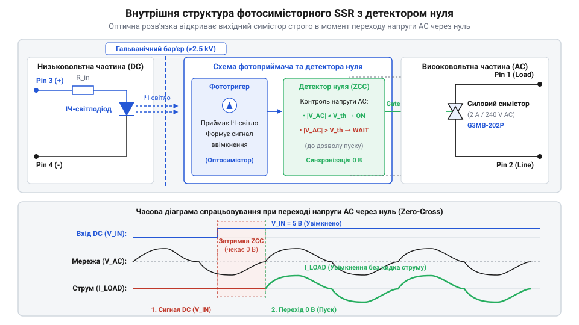
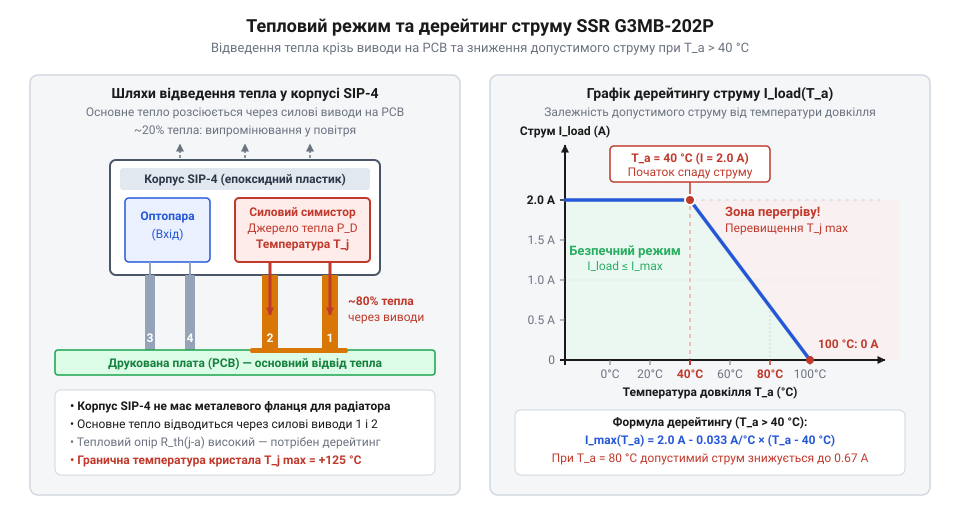

# Від електромеханічних реле до компактних фотосимісторних SSR

<preknowlist>
- [Симістор BTA16-600B](root:cat-hw-drivers/triac-bta16) — Принцип двоспрямованої комутації змінного струму напівпровідниковим силовим ключем та умови його утримання у відкритому стані.
- [MOC3063 — оптосимістор з детектором нуля](root:cat-hw-drivers/moc3063-optotriac) — Принцип гальванічної ізоляції за допомогою світлодіода й фотосимістора та функціонування вбудованого вузла детектування переходу напруги через нуль.
</preknowlist>

## Обмеження електромеханіки у силовій комутації

У 1835 році американський фізик Джозеф Генрі (Joseph Henry) розробив перший пристрій, у якому слабкий електричний струм керував замкненням потужнішого зовнішнього кола. Його винахід отримав назву @@en|реле@@ (від франц. *relais* — зміна коней) і швидко став основою телеграфії. Детальніше про [особливості будови реле](root:cat-hw-drivers/electromechanical-relay-principles) можна дізнатися у відповідній статті. До середини XX століття @@en|електромеханічне реле@@ перетворилося на головний комутаційний елемент промислової автоматики та побутової техніки для керування змінним струмом. Схема його роботи здавалася бездоганною: струм у низьковольтній котушці створює магнітне поле, яке притягує рухомий якір і фізично змикає або розмикає металеві контакти силової мережі.

Проте масштабування автоматизації та зростання частоти перемикань виявили фундаментальні фізичні обмеження механічного контакту. Під час комутації навантажень змінного струму — таких як потужні ТЕНИ, електродвигуни чи трансформатори — розмикання контактів відбувається при довільному миттєвому значенні напруги. Якщо розрив кола припадає на амплітудний пік, висока різниця потенціалів між контактами іонізує повітряний проміжок. Виникає @@en|електрична дуга@@ — високотемпературний плазмовий розряд, який випалює та окислює метал контактів. Постійне іскріння призводить до ерозії поверхні та навіть до термозварювання контактної групи, що повністю виводить пристрій з ладу.

Окрім фізичного руйнування контактів, дуговий розряд створює потужні @@en|електромагнітні завади@@. Високочастотні імпульсні сплески поширюються мережею живлення й випромінюються в простір, наводячи хибні сигнали у чутливій мікропроцесорній электроніці. До того ж кожен цикл перемикання супроводжується фізичним ударом якоря об нерухомий стопор, викликаючи виразний @@en|акустичний шум@@. У медичному обладнанні, житлових приміщеннях або на швидкісних автоматизованих лініях механічна пружина зношується за кілька місяців. Промисловість опинилася перед нагальною потребою створити повністю @@en|безконтактний комутатор@@, позбавлений рухомих частин, іскріння та зносу.

Системні алгоритми керування зіткнулися з ще одним обмеженням — низькою швидкістю перемикання. Маса рухомого якоря та інерція пружини обмежують @@en|час спрацьовування@@ реле в межах від десяти до п'ятдесяти мілісекунд. Така затримка унеможливлює високочастотну комутацію та точне імпульсне регулювання потужності в замкнених контурах автоматики. Крім того, обмежений @@en|комутаційний ресурс@@ механічних контактів рідко перевищує мільйон спрацьовувань під навантаженням. У режимі частої комутації цей запас вичерпується за кілька тижнів, що вимагало переходу до напівпровідникової фізики керування струмом.

## Поєднання напівпровідників та оптичної розв'язки

Рішенням проблеми механічного зносу став бурхливий розвиток силової напівпровідникової техніки у другій половині XX століття. У 1957 році інженер компанії @@en|General Electric@@ Френк Ґутцвіллер (Frank W. "Bill" Gutzwiller) створив перший комерційний @@en|тиристор@@ (від тиратрон + транзистор), а вже у 1964 році та ж компанія представила @@en|симістор@@ (від англ. *triac* — *triode for alternating current*). Симістор став революцією: один кристал кремнію з п'ятишаровою структурою зміг комутувати обидві напівхвилі змінного струму без жодної рухомої деталі чи електричної дуги.

Однак виникла нова вимога — як безпечно керувати силовим симістором від низьковольтної мікроконтролерної або логічної схеми. Прямий електричний зв'язок між керуючим електродом і фазним провідником мережі 220 В загрожував миттєвим спаленням мікросхем при будь-якій аварії. Виходом стало поєднання напівпровідника з оптикою. У 1962 році Нік Холоняк (Nick Holonyak Jr.) в @@en|General Electric@@ розробив перший практичний світлодіод. Невдовзі розробники об'єднали інфрачервоний світлодіод та фоточутливий напівпровідник у єдиному світлонепроникному корпусі, створивши першу оптичну розв'язку.

У такій схемі світлодіод перетворює струм керування на потік фотонів, який долає прозорий ізоляційний шар і відмикає @@en|фотосимістор@@. Між керуючим колом та силовими виводами утворилася надійна @@en|гальванічна ізоляція@@ з міцністю у кілька кіловольт. Використання [напівпровідникового силового ключа](root:cat-hw-drivers/triac-bta16) у поєднанні з оптопарою повністю усунуло іскріння, клацання та механічний знос.

Втім, перші оптосимісторні схеми зіткнулися з іншою серйозною проблемою — довільним моментом увімкнення. Якщо сигнал на світлодіод подавався у момент, коли напруга мережі досягала свого амплітудного значення (наприклад, 311 В для мережі 220 В), силовий ключ відкривався миттєво. Навантаження отримувало колосальний стрибок напруги, що викликало потужний @@en|кидок струму@@ `di/dt`. Це спричиняло високий рівень завад у мережі живлення та сильній тепловий удар по напівпровідниковому кристалу.

## Інтеграція детектора нуля у фотосимістор

Наприкінці 1970-х років інженери компанії @@en|Motorola@@ здійснили наступний вирішальний крок — інтегрували схему детектування нуля безпосередньо у кристал оптичного драйвера. Новий вузол отримав назву @@en|детектор нуля@@ (від англ. *zero-cross detector*). Принцип його роботи полягає у блокуванні вмикання силового ключа до моменту, поки напруга змінного струму не наблизиться до нульової позначки.

Коли низьковольтний сигнал запалює вхідний світлодіод, оптичний канал передає світло на фоточутливу матрицю. Проте внутрішній @@en|Zero-Cross@@ елемент перевіряє поточну напругу на силових виводах. Якщо миттєва напруга перевищує безпечний поріг (зазвичай 5–20 В), кристал утримує фотосимістор у закритому стані. Тільки коли синусоїда мережі перетинає нуль, розблоковується керуючий імпульс і ключ відкривається. Інтегрувавши [оптосимісторний керуючий драйвер](root:cat-hw-drivers/moc3063-optotriac) із внутрішнім детектором нуля, розробники забезпечили м'який пуск для резистивних та індуктивних навантажень.

Завдяки вмиканню при мінімальній напрузі початковий струм у колі дорівнює нулю (`I = 0`). Це радикально знизило швидкість наростання струму `di/dt` та рівень випромінюваних завад, а також усунуло теплові перевантаження кристала при пуску. Проте такий принцип безумовно ефективний лише для резистивного навантаження, де струм і напруга збігаються за фазою. При роботі з індуктивним навантаженням виникає значний @@en|зсув фази@@ між струмом і напругою. У момент перетину напругою нуля (`V = 0`) струм у колі відстає, тому подача напруги на знеструмлену індуктивність спричиняє насичення магнітопроводу та пусковий кидок струму. Коли ж симістор вимикається при обнуленні струму (`I = 0`), напруга мережі вже досягає піка, створюючи високу швидкість її наростання `dV/dt` та загрозу самовільного відкривання ключа. Через ці фізичні обмеження детектор нуля не застосовують для комутації навантажень із високою індуктивністю та великим фазовим кутом. Об'єднання трьох фундаментальних елементів в одному герметичному модулі сформувало класичну концепцію, за якою будується сучасне @@en|твердотільне реле@@.


*Функціональна блок-схема фотосимісторного SSR, що демонструє послідовну передачу сигналу від вхідного світлодіода через оптичний канал до детектора нуля й вихідного симістора.*

Вхідний @@en|інфрачервоний світлодіод@@ забезпечує безпечну гальванічну розв'язку, оптичний канал передає команду керування, детектор нуля синхронізує моменти перемикання з фазою мережі, а вихідний симістор безконтактно керує потужним AC-навантаженням. Ця триєдина архітектура стала основою для створення надкомпактних твердотільних модулів комутації.

## Мініатюризація у корпусі SIP-4 G3MB-202P

Раніше для побудови безконтактного ключа доводилося поєднувати окремий [оптосимістор MOC3063](root:cat-hw-drivers/moc3063-optotriac) із зовнішніми потужними [симісторами BTA16](root:cat-hw-drivers/triac-bta16), що вимагало значної площі на друкованій платі. Коли для керування малопотужними пристроями змінного струму — клапанами, вентиляторами чи насосами — знадобилося швидке та безшумне перемикання без застосування зовнішніх габаритних обв'язок, виникло рішення об'єднати світлодіод, оптичну розв'язку, схему детектування нуля та силовий ключ в єдиний герметичний монолітний модуль. Прикладом такого інтегрованого рішення став модуль Omron @@en|G3MB-202P@@ у корпусі @@en|SIP-4@@ (від англ. *Single In-line Package* — корпус із однорядним розташуванням виводів).

Корпус @@en|SIP-4@@ не має металевого фланця для встановлення на зовнішній @@en|радіатор@@ (від лат. *radiator* — випромінювач), тому вся теплова енергія відводиться виключно крізь пластмасову оболонку модуля та мідні виводи друкованої плати. Ключовим обмеженням такої щільної компоновки є пряме падіння напруги `V` на внутрішньому напівпровідниковому симісторі під час проходження струму `I`.


*Конструкція модуля G3MB-202P у корпусі SIP-4 та шляхи відведення тепла через виводи на друковану плату.*

Теплова потужність `P` у ватах (Вт), що виділяється всередині модуля, визначається як добуток діючого струму навантаження `I` в амперах (А) на пряме падіння напруги `V` у вольтах (В). Розрахуємо підвищення температури переходу `ΔT` у градусах Цельсія (°C) для струму навантаження 2 А за значення падіння напруги 1.2 В та теплового опору «перехід-довкілля» `R_th` на рівні 50 Кельвін на ват (К/Вт).

**Розрахунок теплового виділення та температури кристала G3MB-202P:**
```
P = I × V
= 2 × 1.2                [множення струму на падіння напруги]
= 2.4 Вт                 [обчислена теплова потужність]

ΔT = P × R_th
= 2.4 × 50               [множення потужності на тепловий опір]
= 120 °C                 [перевищення температури кристала над довкіллям]
```

За температури навколишнього середовища 25 °C температура внутрішнього кристала досягає 145 °C, що перевищує максимально припустиму межу в 125 °C для напівпровідників. Через це для модулів у корпусі @@en|SIP-4@@ критично застосовувати @@en|дерейтінг@@ (від англ. *derating* — зниження номіналів): при підвищенні температури понад 25 °C максимально дозволений струм комутації лінійно зменшується, обмеживши реальне довготривале навантаження значенням 0.8–1 А.

## Розвінчання міфів про ідеальність SSR

Широке впровадження @@en|SSR@@ (від англ. *Solid State Relay* — твердотільне реле) породило міф про їхню абсолютну безвідмовність та повну відсутність втрат енергії порівняно з механічними контактами. На відміну від ідеального замкненого контакту, відкритий напівпровідниковий ключ завжди має залишкове падіння напруги величиною 1.0–1.6 В. На високих струмах це призводить до значного нагріву, через що потужні твердотільні реле вимагають встановлення масивних зовнішніх радіаторів, а компактні версії різко втрачають допустиму робочу потужність.

Друга суттєва пастка — наявність @@en|струму витоку@@ у вимкненому стані. Через внутрішній напівпровідниковий p-n перехід та захисні кола крізь навантаження постійно протікає незначний струм величиною від одиниць до десятків міліампер. Цього струму достатньо, щоб малопотужні світлодіодні лампи або неонові індикатори самовільно блимали чи слабко світилися навіть у разі повністю знятого сигналу керування.

Третім обмеженням є чутливість до швидкості наростання напруги, відомої як параметр @@en|dV/dt@@. Швидкі стрибки напруги у мережі змінного струму, які виникають під час комутації індуктивних навантажень, здатні самовільно відкрити симістор без подачі сигналу на світлодіод. Для запобігання хибним спрацьовуванням паралельно силовим виводам додають [снабберний RC-ланцюг](root:hw-power/snubbers-dvdt), який обмежує крутизну фронту напруги. У результаті твердотільне реле є не «абсолютно безвідмовною» заміною електромеханіці, а спеціалізованим інструментом зі чітко визначеними межами теплового режиму, витоків та напругових завад.
