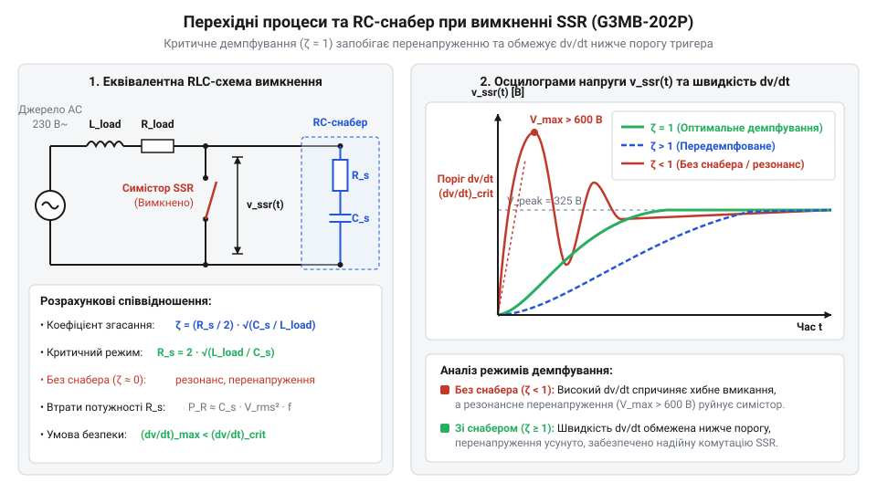

# Розрахунок RC-снабера для обмеження dv/dt при комутації індуктивності

<preknowlist>
- [Симістор BTA16-600B](root:cat-hw-drivers/triac-bta16) — фізика перемикання напівпровідникової структури та гранично допустимі значення параметра (dv/dt)_com
- [MOC3063 — оптосимістор з детектором нуля](root:cat-hw-drivers/moc3063-optotriac) — принцип оптозв'язку та логіка спрацьовування детектора переходу через нуль напруги
</preknowlist>

## Самочинне відкривання симістора на індуктивності

Коли симістор (від англ. @@en|triac@@, @@en|triode for alternating current@@) вимикає коло змінного струму, синусоїдальний струм природним чином зменшується до нуля. У суто резистивному навантаженні напруга джерела та струм проходять через нуль одночасно. Проте якщо навантаження має індуктивність (від лат. @@la|inductio@@ — наведення), виникає фазовий зсув: струм відстає від напруги на кут, близький до 90 градусів.

У момент, коли струм зменшується нижче за струм утримання напівпровідникової структури, ключ закривається й припиняє провідність. Оскільки струм згасає поблизу свого нульового значення, напруга мережі в цей самий момент перебуває поблизу свого амплітудного піку. У результаті до закритих виводів силового ключа раптово прикладається повна амплітудна напруга джерела живлення.

Такий стрибок викликає високу швидкість наростання напруги `d v / d t` (від англ. @@en|rate of rise of voltage@@). Внутрішня чотиришарова p-n-p-n структура симістора містить зворотно зміщений p-n перехід, який у закритому стані володіє бар'єрною ємністю `C_j`. Швидка зміна напруги на виводах ключа викликає перезаряд цієї ємності, утворюючи ємнісний струм зміщення `i_c` (від англ. @@en|displacement current@@). Усередині напівпровідникової структури цей струм протікає через базову область еквівалентної транзисторної структури й діє точнісінько так само, як і зовнішній струм керування. Потрапляючи в базу, струм `i_c` ініціює інжекцію носіїв заряду та вмикає перший внутрішній транзистор, який починає подавати струм у базу другого транзистора. Між ними виникає позитивний зворотний зв'язок (від англ. @@en|positive feedback@@) — лавиноподібний регенеративний процес (від лат. @@la|regeneratio@@ — відновлення; від англ. @@en|regenerative process@@), під час якого струм самопідсилюється й повністю відкриває p-n-p-n структуру без зовнішнього керуючого сигналу. Для визначення ємнісного струму зміщення `i_c`, що протікає через внутрішню ємність p-n переходу `C_j` під дією швидкості зміни напруги `d v / d t`, застосовують базовий закон ємності:

```
i_c
= C_j × (dv/dt)      [закон ємнісного струму зміщення]
```

Тут `i_c` — струм перезаряду внутрішньої ємності ключа, `C_j` — бар'єрна ємність p-n переходу, а `d v / d t` — швидкість наростання комутаційної напруги на виводах ключа.

Якщо швидкість наростання напруги перевищує гранично припустиме значення для даного приладу — комутаційне `(dv/dt)_com` (від англ. @@en|commutation dv/dt@@), згенерований ємнісний струм `i_c` досягає величини струму вмикання керуючого електрода. Цей струм інжектує носії заряду в базу напівпровідникової структури, викликаючи самочинне хибне відкривання (від англ. @@en|false triggering@@) ключа без наявності зовнішнього сигналу керування. Наприклад, якщо [силовий симістор BTA16-600B](root:cat-hw-drivers/triac-bta16) або [оптосимістор з детектором нуля](root:cat-hw-drivers/moc3063-optotriac) MOC3063 зазнають впливу `d v / d t`, що перевищує їхній паспортний поріг `(dv/dt)_com`, комутація індуктивного навантаження стає некерованою. Для запобігання такому самоввімкненню швидкість наростання напруги необхідно примусово обмежити.

## Коливальний контур та обмеження dv/dt

Для обмеження стрімкого стрибка напруги паралельно силовому ключу підключають демпфувальне RC-коло, яке називають снабером (від англ. @@en|snubber@@ — приборкувач, глушник). У момент розмикання симістора ємність снабера `C_s`, опір снабера `R_s`, а також індуктивність `L` та опір `R_L` навантаження утворюють послідовний коливальний RLC-контур, підключений до джерела живлення.


*Принципова схема еквівалентного RLC-контуру при вимкненні симістора та сімейство часових діаграм напруги v_ssr(t) для піддемпфованого, критичного та передемпфованого режимів.*

На початку перехідного процесу незаряджений конденсатор `C_s` діє як коротке замикання для високочастотного стрибка, приймаючи на себе струм індуктивності й не дозволяючи напрузі на ключі зрости миттєво. Власна кутова частота `ω₀` утвореного коливального контуру без урахування активних втрат визначається за формулою Томсона:

```
ω₀
= 1 / √(L × C_s)      [формула власної резонансної частоти]
```

Тут `ω₀` — кутова резонансна частота контуру, `L` — індуктивність навантаження, `C_s` — ємність конденсатора снабера.

У незадемпфованому LC-контурі після розмикання симістора при прикладанні амплітудної напруги мережі `V_m` напруга на ємності `v_ssr(t)` змінюється за гармонічним законом:

```
v_ssr(t)
= V_m × (1 - cos(ω₀ × t))      [часова залежність напруги на ємності]
```

Тут `v_ssr(t)` — миттєве значення напруги на ключі, `V_m` — амплітудне значення напруги мережі, `ω₀` — кутова резонансна частота контуру, а `t` — час від моменту комутації. Щоб знайти миттєву швидкість наростання напруги `dv/dt`, обчислюємо першу похідну від функції напруги за часом `t`:

```
dv/dt
= d/dt [V_m × (1 - cos(ω₀ × t))]      [диференціювання напруги за часом]
= V_m × ω₀ × sin(ω₀ × t)              [обчислення похідної косинуса]
```

Отримана похідна показує, що швидкість зміни напруги коливається за синусоїдальним законом, а її максимальне значення `(dv/dt)_max` досягається в момент, коли `sin(ω₀ × t) = 1`:

```
(dv/dt)_max
= V_m × ω₀      [максимум похідної при sin(ω₀ × t) = 1]
= V_m / √(L × C_s)      [підстановка власної частоти]
```

Тут `(dv/dt)_max` — максимальна швидкість наростання напруги на ємності, `L` — індуктивність навантаження, `C_s` — ємність конденсатора снабера, а `V_m` дорівнює діючій напрузі мережі `V_rms`, помноженій на `√2`.

```
(dv/dt)_max
= V_m × ω₀      [зв'язок швидкості наростання з резонансною частотою]
= V_m / √(L × C_s)      [підстановка власної частоти]
```

Тут `V_m` — амплітудне значення напруги мережі, що дорівнює діючій напрузі `V_rms`, помноженій на `√2`.

Для того щоб ключ не відкрився самочинно, максимальна швидкість наростання напруги контуру `(dv/dt)_max` не повинна перевищувати паспортну критичну швидкість симістора `(dv/dt)_com`. Звівши нерівність до квадрата, отримуємо умову для розрахунку мінімально необхідної ємності снабера `C_s`:

```
C_s
≥ (V_m / (dv/dt)_com)² / L      [визначення мінімальної ємності снабера]
```

Тут `C_s` — розрахована ємність демпфувального конденсатора, `V_m` — амплітудна напруга мережі, `(dv/dt)_com` — критична комутаційна швидкість наростання напруги симістора, `L` — індуктивність навантаження. Отримана формула дає нижню межу ємності, необхідну для безпечного поглинання реактивної енергії індуктивності.

## Розрахунок резистора та коефіцієнта згасання

Сама лише ємність `C_s` не вирішує проблему повністю: у чистому LC-контурі після розмикання виникає незагасаючий коливальний процес, при якому напруга на симісторі перезаряджається до подвоєного амплітудного значення `2 × V_m`. Для розсіювання накопиченої в індуктивності енергії та пригнічення осциляцій послідовно з конденсатором вмикають резистор `R_s`.

Процес згасання коливань у послідовному RLC-контурі описується коефіцієнтом демпфування (від нім. @@de|Dämpfung@@ — глушіння) `α` та безрозмірним коефіцієнтом згасання `ζ` (дзета). Коефіцієнт згасання `ζ` визначає відношення коефіцієнта демпфування `α` до власної резонансної частоти `ω₀`:

```
ζ
= α / ω₀      [визначення коефіцієнта згасання]
= (R_s / (2 × L)) × √(L × C_s)      [підстановка виразів для α та ω₀]
= (R_s / 2) × √(C_s / L)      [алгебраїчне спрощення]
```

Тут `ζ` — безрозмірний коефіцієнт згасання контуру, `R_s` — опір резистора снабера, `L` — індуктивність навантаження, `C_s` — ємність конденсатора.

Залежно від значення `ζ` виділяють три режими перехідного процесу:
1. Піддемпфований режим (`ζ < 1`): напруга наростає з коливаннями та перерегулюванням, що створює небезпечні амплітудні сплески.
2. Критично демпфований режим (`ζ = 1`): напруга досягає рівня мережі найшвидше без жодних осциляцій і викидів.
3. Передемпфований режим (`ζ > 1`): коливання відсутні, але наростання напруги стає надто повільним.

Для практичних схем з симісторами вибирають коефіцієнт згасання в діапазоні `0.7 ≤ ζ ≤ 1.0`. Виразивши `R_s` з формули коефіцієнта згасання, отримуємо розрахунковий вираз для опору демпфувального резистора:

```
R_s
= 2 × ζ × √(L / C_s)      [формула розрахунку опору снабера]
```

Тут `R_s` — опір резистора снабера, `ζ` — обраний коефіцієнт згасання, `L` — індуктивність, `C_s` — розрахована ємність.

Водночас опір `R_s` обмежує початковий стрибок швидкості наростання напруги в момент комутації `t = 0`. У цей момент розряджений конденсатор `C_s` поводиться як коротке замикання, і вся амплітудна напруга мережі `V_m` прикладається до індуктивності навантаження `L`. Це визначає початкову швидкість зміни струму індуктивності `di/dt = V_m / L`. Оскільки струм протікає через резистор `R_s`, швидкість наростання напруги на ключі задається спадом напруги на цьому резисторі: `(dv/dt)_{t=0} = R_s × (di/dt) = (V_m × R_s) / L`. Звідси виникає верхня межа опору: `R_s ≤ (L × (dv/dt)_com) / V_m`. Дотримання цієї умови разом із вибором `ζ ≈ 0.7...1.0` гарантує відсутність перенапруг та аперіодичне загасання перехідного процесу.

## Оцінка потужності та вибір компонентів

Після визначення розрахункових номіналів `R_s` та `C_s` необхідно оцінити електричне й теплове навантаження на компоненти. У вимкненому стані симістора через снаберне коло, підключене до мережі змінного струму частотою `f` (50 або 60 Гц), безперервно протікає реактивний струм витоку `I_rms`. Оскільки реактивний опір конденсатора `X_Cs = 1 / (2 × π × f × C_s)` зазвичай набагато перевищує опір `R_s`, активна потужність `P_off`, що розсіюється на резисторі у вимкненому стані, визначається виразом:

```
P_off
= I_rms² × R_s      [закон Джоуля-Ленца]
= (V_rms / X_Cs)² × R_s      [вираження струму через реактивний опір]
= (2 × π × f × C_s × V_rms)² × R_s      [підстановка реактивного опору X_Cs]
```

Тут `P_off` — активна теплова потужність розсіювання резистора, `V_rms` — діюча напруга мережі змінного струму, `f` — частота мережі, `C_s` — ємність конденсатора, `R_s` — опір резистора.

Окрім стаціонарного нагріву, під час кожного вмикання симістора накопичений у конденсаторі заряд розряджається через опір `R_s` та відкритий ключ, створюючи імпульс струму з амплітудою `I_peak = V_m / R_s`. Резистор мусить бути імпульсостійким (наприклад, металоплівковим або безіндуктивним керамічним). Конденсатор повинен мати клас безпеки @@en|Class X2@@ з робочою змінною напругою не менше 275 В (або постійною напругою не менше 630 В) для надійної роботи в мережі 230 В.

**Обчислення на прикладі: розрахунок снабера для контактора 230 В / 50 Гц**
Нехай симістор вимикає індуктивне навантаження з індуктивністю `L = 100` мГн (`0.1` Гн) у мережі 230 В, 50 Гц. Паспортний поріг симістора дорівнює `(dv/dt)_com = 20` В/мкс (`20 × 10⁶` В/с).

```
V_m
= 230 × √2      [обчислення амплітудної напруги]
≈ 325.27 В      [результат]

C_s_min
= (325.27 / (20 × 10⁶))² / 0.1      [обчислення мінімальної ємності]
≈ 2.65 × 10⁻⁹ Ф      [результат: 2.65 нФ]

C_s
= 47 × 10⁻⁹ Ф      [вибір номіналу з запасом: 47 нФ]

R_s
= 2 × 0.707 × √(0.1 / (47 × 10⁻⁹))      [обчислення опору для ζ = 0.707]
≈ 2062 Ом      [результат: обираємо стандартний номінал 2 кОм]

P_off
= (2 × π × 50 × 47 × 10⁻⁹ × 230)² × 2000      [обчислення потужності розсіювання]
≈ 0.023 Вт      [результат: 23 мВт]

I_peak
= 325.27 / 2000      [обчислення амплітуди імпульсного струму]
≈ 0.163 А      [результат: 163 мА]
```

За результатами розрахунку обираємо плівковий конденсатор ємністю 47 нФ на напругу 275 В AC (класу X2) та імпульсостійкий резистор опором 2 кОм потужністю 0.5 Вт. Таке демпфувальне коло надійно обмежує швидкість наростання напруги до безпечного рівня при мінімальному тепловиділенні.
