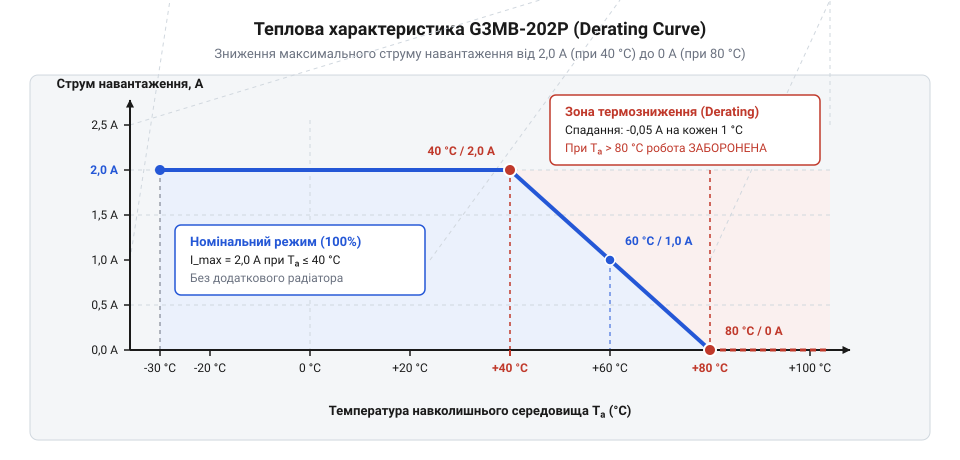

# Розрахунок теплового режиму та зниження струму (derating)

<preknowlist>
- [Симістор BTA16-600B](root:cat-hw-drivers/triac-bta16) — фізику роботи симістора у відкритому стані та поняття про пряме падіння напруги
- [MOC3063 — оптосимістор з детектором нуля](root:cat-hw-drivers/moc3063-optotriac) — принцип оптичної розв'язки та структуру внутрішньої комутаційної комірки
</preknowlist>

## Тепловий пробій SSR при номінальному струмі

Інженер збирає шафу автоматики й встановлює компактне твердотільне реле @@en|Solid State Relay@@ (англ. *solid-state relay*, від *solid* — твердий, суцільний, та *relay* — передавати, реле), скорочено @@en|SSR@@, моделі @@en|G3MB-202P@@ для комутації нагрівача зі споживанням 2 А змінного струму. У технічному паспорті пристрою зазначено граничний струм 2 А, тому комутація здається повністю безпечною без застосування додаткового охолодження. Сигнал керування надходить через [внутрішній оптосимісторний каскад](root:cat-hw-drivers/moc3063-optotriac), який забезпечує оптичну розв'язку низьковольтної схеми від силової мережі. Проте після кількох годин роботи у закритому щиті, де повітря нагрівається до 60 °C від сусідніх блоків живлення, реле раптово виходить з ладу і залишається замкненим наголубо.

Причина виходу з ладу полягає у хибному сприйнятті паспортного струму як абсолютної величини для будь-яких умов експлуатації. Паспортне значення 2 А дійсне лише за температури навколишнього середовища до 40 °C та вільного омивання корпусу повітрям. Всередині герметичного пластикового корпусу @@en|G3MB-202P@@ працює [комутаційний силовий симістор](root:cat-hw-drivers/triac-bta16) (англ. *triac*, від *triode for alternating current* — триод для змінного струму). Під час проходження струму через напівпровідниковий @@en|p-n junction@@ (англ. *p-n junction*, від *positive-negative* — позитивно-негативний, та *junction* — перехід, з'єднання) виділяється теплова потужність.

Оскільки модель @@en|G3MB-202P@@ виготовлена у компактному прямокутному корпусі для монтажу на друковану плату й не має відкритого металевого фланця для кріплення радіатора, усе згенероване тепло розсіюється виключно через пластикову поверхню в навколишнє повітря. Якщо швидкість генерації тепла кристалом перевищує швидкість його розсіювання в довкілля, температура напівпровідника неконтрольовано зростає. Це явище спричиняє @@en|thermal runaway@@ (англ. *thermal runaway*, від *thermal* — тепловий, та *runaway* — неконтрольований розгін), тобто термічний пробій, який безповоротно руйнує структуру симістора. Щоб відвернути аварію, необхідно кількісно обчислити теплові втрати всередині корпусу та оцінити спроможність реле передавати тепло в довкілля.

Тепловий потік виникає внаслідок різниці температур між гарячим напівпровідниковим кристалом і прохолоднішим довкіллям. Електрична потужність, яка виділяється під час комутації, спершу передається через товщу герметизувального компаунда (англ. *compound*, від *componere* — складати, з'єднувати) до зовнішніх граней корпусу, а далі розсіюється в повітрі шляхом конвекції (англ. *convection*, від *con-* — разом, та *vehere* — переносити) та теплового випромінювання. Якщо температура повітря всередині шафи управління зростає, температурний перепад зменшується, і природного відведення тепла стає недостатньо для підтримки теплової рівноваги. У результаті температура кристала @@en|G3MB-202P@@ перевищує допустиму межу в 125 °C, що призводить до руйнування внутрішньої структури @@en|SSR@@.

## Еквівалентна теплова схема твердотільного реле

Фізичний механізм нагріву твердотільного реле описується через втрати потужності на відкритому симісторі. Коли через силові контакти @@en|G3MB-202P@@ тече змінний струм, на відкритому ключі виникає @@en|on-state voltage drop@@ (англ. *on-state voltage drop*, від *on-state* — відкритий стан, *voltage* — напруга, та *drop* — падіння), яке позначають `V_TM`. Для симістора реле @@en|G3MB-202P@@ це падіння напруги за типових умов становить близько 1.2 В, а його максимально припустиме значення досягає 1.6 В.

Середня теплова потужність `P_d`, що виділяється на симісторі під час комутації синусоїдного струму, дорівнює добутку падіння напруги `V_TM` на діюче значення струму навантаження `I_RMS`. Символи у формулі означають:
- `P_d` — виділена теплова потужність (Вт);
- `V_TM` — падіння напруги на відкритому симісторі (В);
- `I_RMS` — діюче значення струму навантаження (А).

```
P_d = V_TM × I_RMS    [визначення теплових втрат на симісторі]
```

Для струму навантаження `I_RMS = 2 А` та типового падіння напруги `V_TM = 1.2 В` розрахунок виділення тепла має вигляд:

```
P_d = 1.2 × 2
    = 2.4             [множення падіння напруги на діючий струм]
```

Отримана потужність `P_d = 2.4 Вт` безперервно перетворюється на тепло всередині силіконового кристала. Для аналізу поширення цього тепла застосовують теплову еквівалентну схему, що є аналогом закону Ома для електричного кола. У цій схемі тепловий потік відповідає електричному струму, різниця температур між кристалом та повітрям — електричній напрузі, а @@en|thermal resistance@@ (англ. *thermal resistance*, від *therme* — тепло, та *resistere* — чинити опір) — електричному опору.

Тепловий опір між напівпровідниковим кристалом та навколишнім повітрям позначають `R_θJA`, де індекс `JA` означає @@en|junction-to-ambient@@ (від *junction* — перехід, кристал, та *ambient* — довкілля, оточення). Температура кристала `T_j` перевищує температуру навколишнього повітря `T_a` на величину, пропорційну виділеній потужності та тепловому опору. Символи у рівнянні теплового балансу означають:
- `T_j` — температура p-n переходу кристала (°C);
- `T_a` — температура навколишнього повітря (°C);
- `P_d` — виділена теплова потужність (Вт);
- `R_θJA` — тепловий опір кристал-середовище (°C/Вт).

```
T_j = T_a + P_d × R_θJA    [рівняння теплового балансу]
```

Це рівняння показує, що кожний ват виділеної потужності підвищує температуру кристала відносно довкілля на величину теплового опору `R_θJA`.

## Розрахунок допустимої температури та зниження струму

Напівпровідниковий кристал симістора має гранично допустиму температуру p-n переходу `T_j(max)`, перевищення якої призводить до втрати комутаційних властивостей та термічного руйнування. Для реле @@en|G3MB-202P@@ ця межа становить `T_j(max) = 125 °C`. Тепловий опір кристал-середовище без додаткового радіатора дорівнює `R_θJA = 25 °C/Вт`.

Щоб визначити максимально припустиму температуру навколишнього повітря `T_a(max)` при заданому струмі навантаження, підставимо значення граничної температури кристала в рівняння теплового балансу. Символи у формулі означають:
- `T_a(max)` — гранична температура навколишнього повітря (°C);
- `T_j(max)` — максимально допустима температура p-n переходу (°C);
- `V_TM` — падіння напруги на відкритому симісторі (В);
- `I_RMS` — діюче значення струму навантаження (А);
- `R_θJA` — тепловий опір кристал-середовище (°C/Вт).

```
T_a(max) = T_j(max) - P_d × R_θJA               [вираження температури довкілля з теплового балансу]
         = T_j(max) - (V_TM × I_RMS) × R_θJA    [підстановка виразу теплових втрат]
```

Розрахуємо граничну температуру середовища для номінального струму `I_RMS = 2 А` при `V_TM = 1.2 В`:

```
T_a(max) = 100 - (1.2 × 2) × 25
         = 100 - 2.4 × 25                       [обчислення виділення потужності]
         = 100 - 60                             [обчислення перегріву кристала]
         = 40                                   [віднімання температурного перепаду]
```

Обчислення доводять: за номінального струму 2 А температура навколишнього повітря не повинна перевищувати 40 °C. Якщо середовище нагрівається понад 40 °C, реле не здатне розсіювати 2.4 Вт тепла без перевищення допустимої температури кристала.

Коли температура довкілля `T_a` перевищує 40 °C, для збереження працездатності реле необхідно застосовувати @@en|derating@@ (англ. *derating*, від префікса *de-* — зниження, та *rate* — номінал, параметр), тобто примусово зменшувати робочий струм навантаження. Знайдемо вираз для максимально допустимого струму `I_RMS(max)` залежно від температури `T_a`:

```
I_RMS(max) = (T_j(max) - T_a) ÷ (V_TM × R_θJA)    [вираження допустимого струму з рівняння теплового балансу]
```

Для температури повітря `T_a = 60 °C` усередині закритого щита допустимий струм становить:

```
I_RMS(max) = (100 - 60) ÷ (1.2 × 25)
           = 40 ÷ 30                            [обчислення температурного запасу та теплового коефіцієнта]
           = 1.33                               [ділення запасу температури на тепловий коефіцієнт]
```

За температури 60 °C допустимий струм комутації знижується з 2 А до 1.33 А.


*Залежність допустимого струму комутації G3MB-202P від температури навколишнього повітря, яка демонструє необхідність дерейтингу після 40 °C.*

Графік дерейтингу чітко розмежовує робочу область: до 40 °C реле забезпечує номінальний струм 2 А, а в інтервалі від 40 °C до 100 °C допустимий струм лінійно спадає до нуля.

## Практичний розрахунок безпечного струму для G3MB-202P

Перевіримо безпеку експлуатації реле @@en|G3MB-202P@@ у реальному проекті. Нехай необхідно комутувати навантаження зі споживанням `I_RMS = 1.5 А` усередині шафи автоматики, де температура повітря влітку сягає `T_a = 55 °C`.

Першим кроком обчислимо реальні теплові втрати на симісторі при `V_TM = 1.2 В`:

```
P_d = V_TM × I_RMS    [обчислення втрат потужності]
    = 1.2 × 1.5
    = 1.8             [множення падіння напруги на робочий струм]
```

Другим кроком обчислимо очікувану температуру кристала `T_j`:

```
T_j = T_a + P_d × R_θJA    [обчислення температури p-n переходу]
    = 55 + 1.8 × 25
    = 55 + 45              [знаходження перегріву відносно середовища]
    = 100                  [додавання температури навколишнього повітря]
```

Температура кристала `T_j = 100 °C` дорівнює граничній межі `T_j(max) = 100 °C`. Це означає, що пристрій працюватиме на межі фізичного руйнування без жодного запасу міцності.

У найгіршому випадку, коли падіння напруги конкретного екземпляра реле сягає паспортного максимуму `V_TM = 1.6 В`, теплові втрати зростуть:

```
P_d(worst) = 1.6 × 1.5
           = 2.4              [обчислення найгіршого випадку втрат потужності]

T_j(worst) = 55 + 2.4 × 25
           = 55 + 60
           = 115              [кристалічна температура перевищує допустиму межу]
```

Температура `T_j(worst) = 115 °C` перевищує межу 100 °C, що гарантовано призведе до термічного пробою реле.

Для забезпечення надійної роботи при `T_a = 55 °C` необхідно обрати один із двох розв'язків:
1. Знизити струм комутації до безпечного значення (наприклад, до `I_RMS = 1.0 А`, за якого при `V_TM = 1.6 В` температура кристала дорівнює `T_j = 55 + 1.6 × 1.0 × 25 = 95 °C`, що менше 100 °C).
2. Якщо навантаження 1.5 А є критичним, перейти на реле з потужнішим корпусом, для якого застосовують [розрахунок зовнішнього тепловідводу](root:hw-components/heatsink), про що йдеться у відповідній статті.

Таким чином, практичний розрахунок дерейтингу дозволяє завчасно виявити ризик перегріву й заздалегідь обрати безпечний режим комутації.
