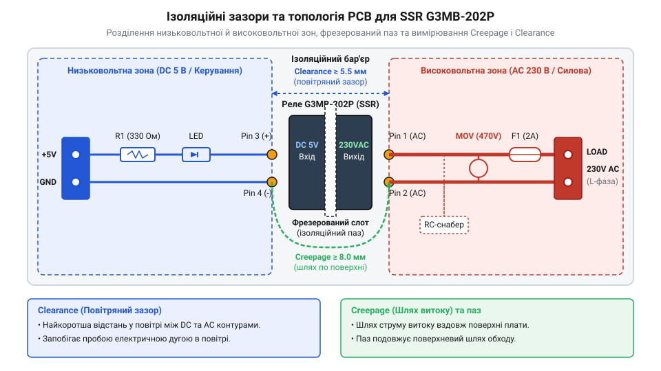
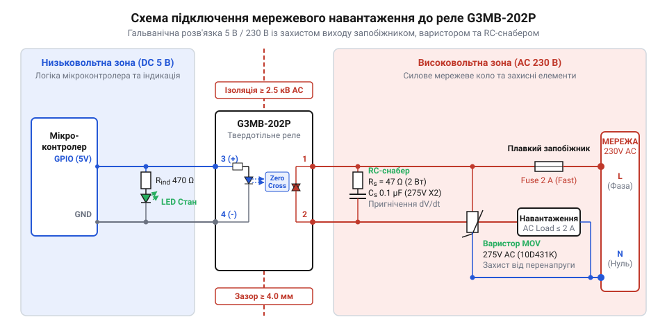

# Модуль комутації мережевого навантаження 230 В від мікроконтролера 5 В

<preknowlist>
- [Симістор BTA16-600B](root:cat-hw-drivers/triac-bta16) — принципи роботи напівпровідникового симістора та особливості комутації силового змінного струму
- [MOC3063 — оптосимістор з детектором нуля](root:cat-hw-drivers/moc3063-optotriac) — принцип оптичної розв'язки та внутрішню роботу вузла детектування нуля (Zero-Cross)
</preknowlist>

## Небезпека прямого керування мережевим навантаженням

Коли в інженерному проєкті постає завдання ввімкнути мережевий обігрівач чи лампу розжарювання від 5 V виходу мікроконтролера, першою помилкою початківця є спроба спроєктувати просте прямо з'єднане транзисторне або симісторне коло. У мережі змінного струму діє діюче значення напруги `U_RMS = 230 V`, а її амплітудне значення сягає `U_peak = 325 V`. Якщо підключити симісторний ключ без бар'єра ізоляції, будь-який пробій напівпровідникового переходу чи зсув потенціалу нейтралі викличе пряме потрапляння високої напруги 230 V на тонкі доріжки низьковольтної логіки. Внутрішні структури мікросхем розраховані лише на напругу 5 V або 3.3 V, тому такий електричний пробій миттєво випаровує кристал мікроконтролера, виводить з ладу периферію та створює смертельну загрозу ураження струмом для людини при торканні до органів керування.

Для усунення цієї небезпеки застосовують гальванічну розв'язку (від імені @@it|Luigi Galvani@@, @@en|Galvanic Isolation@@) — електричне розділення двох кіл, при якому між ними відсутній прямий кондуктивний зв'язок провідником. Сигнали керування передаються виключно через оптичне, магнітне або ємнісне поле. При комутації мережевого змінного струму силову частину відокремлюють захисним бар'єром, який повинен витримувати пробійну напругу не менше `U_iso = 2500 V_RMS`. Напівпровідникову комутацію високих струмів виконує [симетричний силовий симістор](root:cat-hw-drivers/triac-bta16), проте імпульси на його керуючий електрод мають надходити через повністю ізольоване коло.

На рівні друкованої плати створення надійного ізоляційного бар'єра вимагає жорсткого дотримання двох геометричних параметрів: шляху витоку (англ. @@en|Creepage@@, від @@en|creep@@ — повзти) та повітряного зазору (англ. @@en|Clearance@@, від @@en|clear@@ — вільний). Повітряний зазор `@@en|Clearance@@` вимірює найкоротшу відстань по повітрю між низьковольтною та високовольтною провідними доріжками, а `@@en|Creepage@@` визначає [відстані витоку та зазори](root:hw-pcb/creepage-clearance) уздовж поверхні текстоліту. Для мережевої напруги 230 V нормативна відстань `@@en|Creepage@@` має становити не менше `5.0 mm`. Щоб запобігти поверхневому перекриттю через пил чи вологу, у текстоліті під корпусом елемента гальванічної розв'язки фрезерують спеціальний ізоляційний паз завширшки `1.5..2.0 mm`.


*Топологія друкованої плати показує фізичний бар'єр ізоляції між колом 5 В та мережею 230 В із захисним прорізом.*

Фрезерування ізоляційного паза вилучає діелектричний матеріал склотекстоліту між низьковольтною та високовольтною зонами, унеможливлюючи утворення поверхневого струмопровідного каналу (англ. @@en|Tracking@@, від @@en|track@@ — слід) під дією пилу чи вологи. У поєднанні з дотриманням нормативної відстані `@@en|Creepage@@` та повітряного зазору `@@en|Clearance@@` цей проріз утворює надійний захисний бар'єр проти високовольтних пробоїв і дугових розрядів. Навіть під час комутаційних сплесків напруга мережі `230 V` залишається строго локалізованою у силовій зоні й не потрапляє на чутливі виводи мікроконтролера. Така фізична та [оптична розв'язка оптосимістора](root:cat-hw-drivers/moc3063-optotriac) гарантує повне збереження низьковольтної електронної платформи та безпеку людини при торканні до органів керування.

## Твердотільне реле G3MB-202P у керуванні AC

Зрозумівши вимоги до гальванічної розв'язки, для безпечного перемикання навантаження зручно застосувати твердотільне реле (англ. @@en|Solid State Relay@@, @@en|SSR@@) корпусного виконання `@@en|G3MB-202P@@`. Усередині цього компактного модуля поєднано вхідний інфрачервоний світлодіод, оптично зв'язаний з ним фотосимістор (від грец. @@el|optos@@ — видимий, @@en|Phototriac@@), апаратний детектор нуля (англ. @@en|Zero-Cross@@) та вихідний кремнієвий симісторний ключ. Такий внутрішній оптосимісторний вузол функціонує за принципом, який має [оптосимістор з детектором нуля](root:cat-hw-drivers/moc3063-optotriac), що дозволяє подавати струм у силове коло тільки тоді, коли синусоїда мережевої напруги перетинає значення 0 V. Це виключає різкі кидки струму `dI/dt` та високовольтні електромагнітні завади.

Керуючий вхід `@@en|G3MB-202P@@` розрахований на напругу `V_in = 5 V DC`. Для візуального контролю стану модуля послідовно або паралельно колу входу підключають індикаторний світлодіод (англ. @@en|LED@@). У разі послідовного ввімкнення зеленого світлодіода з прямою напругою `V_F_LED = 2.0 V` та внутрішнього світлодіода реле `V_F_SSR = 1.2 V`, додатковий струмообмежувальний резистор `R_ext` обчислюють для номінального струму керування `I_F = 10 mA`:

Розрахунок обмежувального резистора керуючого кола:
R_ext
= (V_CC - V_F_SSR - V_F_LED) ÷ I_F      [законом Ома для послідовного кола]
= (5.0 - 1.2 - 2.0) ÷ 0.010             [підстановка значень напруг і струму]
= 1.8 ÷ 0.010                            [обчислення спаду напруги на резисторі]
= 180 Ω                                 [підсумковий опір обмежувального резистора]

Отримане значення `R_ext = 180 Ω` забезпечує стабільний струм `10 mA` від 5 V виходу `@@en|GPIO@@` мікроконтролера, що гарантує надійне відкривання фотосимістора без перевантаження виходу МК. Для програмної реалізації керування реле з урахуванням затримок переходу через нуль та обмеження частоти комутації (англ. @@en|Throttling@@) використовують розроблені драйвери C та C++.

:::tabs
@tab C
:::code proj-mcu-ssr-ac-load-control/c/g3mb202p.h
:::code proj-mcu-ssr-ac-load-control/c/g3mb202p.c
:::code proj-mcu-ssr-ac-load-control/c/main.c
@tab C++
:::code proj-mcu-ssr-ac-load-control/cpp/include/g3mb202p.hpp
:::code proj-mcu-ssr-ac-load-control/cpp/src/g3mb202p.cpp
:::code proj-mcu-ssr-ac-load-control/cpp/src/main.cpp
:::

## Захист від індуктивних викидів та перенапруг

Після побудови базового кола комутації реле `@@en|G3MB-202P@@` зіштовхується з реальними завадами мережі 230 V. При вимкненні індуктивних навантажень (трансформаторів, вентиляторів, котушок контакторів) виникають високовольтні самоіндуктивні викиди `L × (dI/dt)` та швидкісні сплески напруги `dV/dt`. Якщо швидкість наростання напруги перевищить критичний поріг для фотосимістора (понад `100 V/μs`), реле самочинно відкриється або вийде з ладу.

Для захисту силового ключа паралельно вихідним контактам `@@en|SSR@@` встановлюють демпферний снабер (від англ. @@en|snubber@@ — приборкувати), який складається з послідовно з'єднаних резистора `R_s` та конденсатора `C_s`. Конденсатор `C_s = 10..47 nF` класу безпеки `X2` (розрахований на напругу `275 V AC`) поглинає високочастотний імпульс `dV/dt`, а резистор `R_s = 39..100 Ω` (потужністю `1 W`) обмежує струм розряду конденсатора через внутрішній симістор у момент його ввімкнення. Більш детально принцип розрахунку розкриває [демпферний RC-ланцюг](root:hw-power/snubbers-dvdt).

Для зрізання амплітудних імпульсних перенапруг (англ. @@en|Surge@@), спричинених грозовими розрядами або комутаціями в мережі, паралельно виходу 230 V підключають оксидно-металевий варистор (від англ. @@en|variable resistor@@, @@en|MOV@@). Його робоча змінна напруга обирається на рівні `U_VAR = 275 V RMS`. При перевищенні цієї межі опір варистора лавиноподібно падає від мегаом до часток ома, шунтуючи високовольтний імпульс.

Фінальним елементом захисту є плавкий запобіжник (англ. @@en|Fuse@@), який встановлюється послідовно у фазний провід `L`. Оскільки реле `@@en|G3MB-202P@@` розраховане на максимальний струм `I_max = 2 A`, застосовують швидкодіючий запобіжник (англ. @@en|Fast Blow@@) номіналом `2 A / 250 V`. У разі короткого замикання в навантаженні запобіжник розмикає коло раніше, ніж тепловий імпульс `I²t` зруйнує кристал вихідного симістора.


*Повна принципова електрична схема комутації навантаження 230 В містить запобіжник, варистор та RC-снабер.*

## Трасування друкованої плати з дотриманням зазорів

Підключення високовольтних мережевих кіл до низьковольтної друкованої плати (англ. *printed circuit board*, @@en|PCB@@) створює ризик електричного пробою крізь товщу повітря або по поверхні склотекстоліту @@en|FR-4@@. Амплітудна напруга мережі 230 В досягає понад 325 В:

```
V_peak = V_rms × √2
= 230 × 1.414      [підстановка ефективної мережевої напруги]
= 325.2 V          [обчислення пікової амплітуди AC]
```

При такій різниці потенціалів та мікроскопічному осіданні пилу чи вологи на платі звичайні мікроскопічні зазори між доріжками швидко іонізуються, спричиняючи дуговий пробій та виведення з ладу мікроконтролера.

Для запобігання аваріям у проєктуванні силових модулів застосовують нормовані [вимоги до ізоляційних зазорів](root:hw-power/pcb-creepage-clearance-standards). Зазором у повітрі називають @@en|Clearance@@ (від англ. *clear* — вільний від перешкод) — найкоротшу відстань між двома провідниками через об'єм повітря. Для робочої напруги 230 В змінного струму мінімальний прямий зазор у повітрі між доріжками 5 В та 230 В має становити не менше 3.0 мм (а для посиленої ізоляції — 5.5 мм). Натомість шлях витоку по поверхні @@en|Creepage@@ (від англ. *creep* — повзти) вимірюють уздовж поверхні діелектрика. Оскільки вологість і поверхневе забруднення створюють струмопровідні містки, відстань @@en|Creepage@@ має бути більшою — від 4.0 до 6.0 мм.

Компактний корпус реле G3MB-202P має відстань між вхідними пінами 5 В (виводи 1, 2) та вихідними пінами 230 В (виводи 3, 4) всього близько 7.62 мм. Утім, на поверхні плати цей шар діелектрика між суміжними майданчиками монтажних отворів скорочується. Для підвищення надійності без збільшення габаритів модуля під корпусом реле роблять крізний ізоляційний паз (англ. *isolation slot*, @@en|Air gap@@) завширшки 1.5–2.0 мм. Фрезерований проріз у текстоліті прибирає суцільну поверхню діелектрика, завдяки чому шлях витоку @@en|Creepage@@ перетворюється на повітряний зазор @@en|Clearance@@, унеможливлюючи утворення поверхневої електричної дуги.


*Геометрія розміщення ізоляційного пазу під реле G3MB-202P та забезпечення зазорів між колами 5 В і 230 В.*

Під час трасування плати необхідно строго розділити площину на дві незалежні зони: низьковольтну (DC 5 V / GND) та високовольтну (AC Line / Neutral / Load). У бар'єрній смузі під реле та захисними елементами заборонено заливати екранні полігони заземлення та проводити сторонні сигнальні доріжки. Плавкий запобіжник, варистор та демпферний RC-снабер розміщують безпосередньо біля вихідних клем, забезпечуючи мінімальну довжину високовольтних силових трас.

Окрім просторового зонування, важливу роль відіграє геометрія та ширина силових провідників. Через струм навантаження реле G3MB-202P до 2 А надто тонкі доріжки зазнають локального джоулевого нагріву, а гострі кути 90° створюють високу концентрацію напруженості електричного поля, підвищуючи ризик мікродугового пробою діелектрика. Тому високовольтні силові траси розводять розширеними доріжками завтовшки не менше 1.5–2.0 мм (для стандартного мідного покриття 35 мкм) із плавно згладженими поворотами під кутом 45°. Для запобігання відшаруванню фольги та поверхневим витокам на з'єднаннях контактних майданчиків застосовують краплеподібні розширення (від англ. *tear* — сльоза та *drop* — крапля, @@en|Teardrops@@). Водночас керуючу лінію світлодіода індикації стану прокладають виключно в низьковольтній зоні з підключенням до спільного DC GND, що запобігає ємнісному наведенню високочастотних комутаційних завад на вхід мікроконтролера.

## Збирання та безпечне тестування модуля 230 В

Після завершення монтажу друкованої плати категорично заборонено одразу підключати модуль до силової мережі 230 В. Насамперед виконують холодну перевірку без подачі високої напруги. За допомогою цифрового мультиметра (англ. *multimeter*, @@en|Multimeter@@) у режимі вимірювання опору перевіряють відсутність коротких замикань між низьковольтною землею (GND) та мережевими провідниками. Опір ізоляції між вхідними клемниками 5 В та силовою частиною має прямувати до нескінченності (понад 100 МОм). Далі підключають лише вхідне живлення 5 В від лабораторного блоку живлення й перевіряють спрацьовування вхідного світлодіода оптичної розв'язки реле та індикатора стану модуля.

Гаряче випробування під робочою напругою 230 В вимагає суворого дотримання правил електробезпеки. Силовий модуль монтують у діелектричному захисному корпусі або встановлюють на ізольовану стійку. Навантаження (наприклад, лампу розжарювання потужністю 40–60 Вт) підключають послідовно з фазовим провідником. Для першого включення рекомендується використовувати баластну захисну лампу або розділювальний трансформатор: якщо в силовій частині станеться коротке замикання, лампа спалахне на повну яскравість, обмеживши струм і зберігши симістор від руйнування. Усі переключення та заміри на платі під напругою виконують відповідно до правила «однієї руки», не торкаючись струмопровідних частин.

Програмне керування силовим модулем від мікроконтролера має враховувати специфіку внутрішньої структури G3MB-202P. Оскільки реле містить вбудований [оптосимістор з детектором нуля](root:cat-hw-drivers/moc3063-optotriac), фактичне відкриття силового ключа відбувається не в момент подачі сигналу з GPIO, а при найближчому переході напруги мережі через нуль (затримка до 10 мс для частоти 50 Гц). Для уникнення теплового перегріву та збоїв керування програма повинна реалізувати обмеження частоти комутації (англ. *throttling*, @@en|Throttling@@).

Нижче наведено практичну реалізацію C та C++ драйверів з підтримкою безпечної ініціалізації вхідного рівня (@@en|Active HIGH@@ / @@en|Active LOW@@), відстеження захисних часових інтервалів та коректного вимкнення навантаження у деструкторі:

:::tabs
== C | esp-idf
:::code proj-mcu-ssr-ac-load-control/c/g3mb202p.h 24-77
:::code proj-mcu-ssr-ac-load-control/c/g3mb202p.c 64-101
:::code proj-mcu-ssr-ac-load-control/c/main.c 76-129
== C++ | stm32
:::code proj-mcu-ssr-ac-load-control/cpp/include/g3mb202p.hpp 37-62
:::code proj-mcu-ssr-ac-load-control/cpp/src/g3mb202p.cpp 69-92
:::code proj-mcu-ssr-ac-load-control/cpp/src/main.cpp 21-48
:::

У наведеному коді драйвер перевіряє сплив безпечного інтервалу часу перед кожною зміною стану. Якщо спроба ввімкнення або вимкнення відбувається занадто швидко, функція повертає код помилки `G3MB202P_ERROR_THROTTLED` або `SwitchResult::Throttled`, запобігаючи високочастотному брязкоту силового ключа. На відміну від потужних дискретних комутаторів на базі [симістора BTA16-600B](root:cat-hw-drivers/triac-bta16), таке поєднання апаратної гальванічної розв'язки, бар'єрного паза на платі та програмного захисту драйвера робить модуль G3MB-202P готовим до надійної та безпечної експлуатації у пристроях автоматики.
