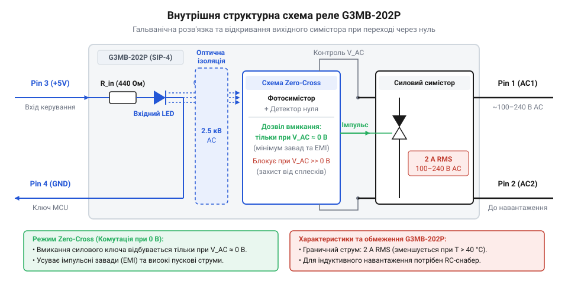
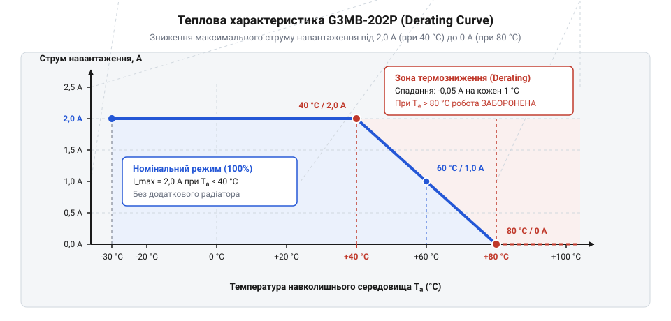
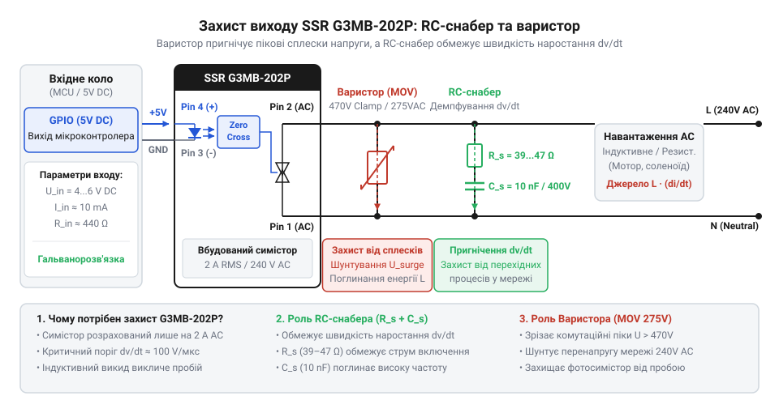
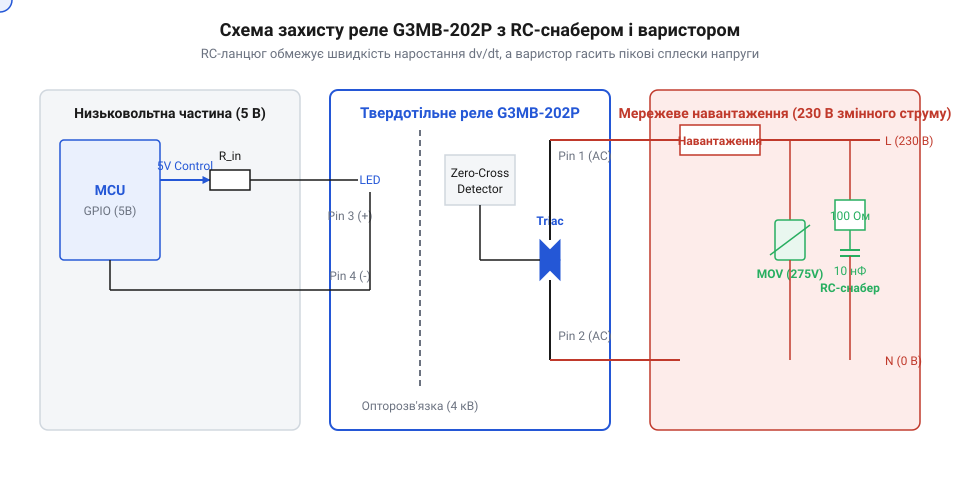

# Твердотільне реле G3MB-202P (2 А / 240 В)

<preknowlist>
- [Симістор BTA16-600B](root:cat-hw-drivers/triac-bta16) — принцип функціонування силового симістора, умови утримання струму та нелінійне перемикання змінного струму
- [MOC3063 — оптосимістор з детектором нуля](root:cat-hw-drivers/moc3063-optotriac) — принцип оптичної ізоляції вхідного кола та роботу схеми детектування нуля (zero-crossing)
</preknowlist>

## Чому механічна комутація мережі створює завади

Коли в системі автоматики виникає потреба регулярно вмикати та вимикати потужне мережеве навантаження змінного струму 230 В — наприклад, під час пропорційно-інтегрально-диференціального регулювання температури нагрівача — звичайне електромеханічне реле (англ. @@en|electromechanical relay@@, від фр. *relais* — зміна коней на поштовій станції) швидко перетворюється на джерело серйозних проблем. 

Першою фізичною перешкодою є брязкіт контактів (англ. @@en|contact bounce@@). Під час замкнення металеві контакти пружинять і кілька разів поспіль відскочують один від одного протягом 1–5 мілісекунд. У ці мікроінтервали між контактами виникає послідовність електричних іскор, яка генерує потужні високочастотні електромагнітні завади (англ. @@en|EMI@@, скорочення від *Electromagnetic Interference*), що здатні викликати збої у роботі сусідніх мікроконтролерів.

Другою, ще більш руйнівною проблемою є дугоутворення (англ. @@en|arcing@@). Коли контакти реле розмикаються в момент, коли струм змінного синусоїдального сигналу відмінний від нуля, між ними виникає висока напруженість електричного поля. Повітряний проміжок іонізується, утворюючи плазмову дугу. Дуга високої температури випалює та окислює металеве покриття контактів, що призводить до їх зварювання або швидкого виходу з ладу, обмеженого лише 100 000 циклами спрацьовування. Окрім цього, постійне механічне клацання створює відчутний акустичний шум.

Щоб позбутися зношування, іскріння та акустичного клацання, у сучасній електронній апаратурі застосовують твердотільне реле (англ. @@en|Solid-State Relay@@, від лат. *solidus* — щільний, монолітний). Воно виконує комутацію електронним способом без жодної рухомої деталі. Вивчити [еволюцію пристроїв комутації](root:cat-hw-drivers/ssr-g3mb-202p/hist-ssr-evolution.md) можна у відповідній історичній довідці, що детально показує перехід від громіздких контакторів до компактних модулів у корпусі @@en|SIP-4@@.

Проте безконтактна комутація напівпровідниками вимагає надійного розмежування низьковольтних кіл керування та високовольтної мережі. Пряме підключення виходів мікроконтролера до напруги 230 В призвело б до миттєвого виходу з ладу логічних мікросхем та створювало б небезпеку для користувача. У твердотільному реле це завдання вирішують за допомогою оптичного каналу: керуючий сигнал передається світловим променем, що повністю усуває електричний контакт між входом і виходом. На відміну від збирання [дискретних комутаційних вузлів](root:hw-power/power-triac-switching-circuits), такий підхід дає змогу безпечно комутувати силову мережу безпосередньо цифровими виходами з низьким рівнем напруги.

## Принцип роботи опторозв'язки та детектора нуля

Щоб безпечно керувати високовольтною мережею 230 В від низьковольтної мікроконтролерної плати, твердотільне реле G3MB-202P поєднує в одному корпусі оптопару та силовий напівпровідниковий ключ. Внутрішню будову пристрою розділено на чотири ключові блоки.


*Функціональна блок-схема внутрішньої структури твердотільного реле G3MB-202P із блоком детектування нуля.*

Вхідне коло складається з інфрачервоного світлодіода (англ. @@en|infrared LED@@). Коли через нього протікає струм, він випромінює світловий імпульс у герметичний світловод. На протилежному боці світло приймає світлочутливий фотосимістор (англ. @@en|phototriac@@). Такий зв'язок забезпечує гальванічну розв'язку (англ. @@en|galvanic isolation@@, від імені фізика Луїджі Гальвані) з ізоляційною міцністю до 2.5 кВ змінного струму. Електричного контакту між низьковольтною та мережевою частинами немає взагалі — сигнал передається виключно фотонами.

Вихідним силовим елементом виступає вбудований симістор (англ. @@en|triac@@, скорочення від *triode for alternating current* — триод для змінного струму). На відміну від звичайного тиристора, симістор здатний проводити струм в обох напрямках синусоїди після подачі короткого імпульсу керування на затвор. Порівняно з потужними [дискретними симісторами BTA16](root:cat-hw-drivers/triac-bta16) або автономними [оптосимісторами MOC3063](root:cat-hw-drivers/moc3063-optotriac), у реле G3MB-202P симістор та схема керування його затвором інтегровані в єдиний монолітний кристал.

Особливістю моделей G3MB-202P є наявність вбудованої схеми детектора нуля (англ. @@en|zero-crossing detector@@). Коли мікроконтролер подає напругу на вхідний світлодіод у довільний момент часу, внутрішній фотосимістор не відкриває силовий симістор негайно. Коло детектування нуля відстежує синусоїдальну напругу на вихідних клемах реле і дає дозвіл на відкриття ключа лише тоді, коли миттєва напруга мережі проходить крізь нульове значення (у межах ±15 В). Фізично цей механізм реалізовано на вимірювальному транзисторі, який шунтує керувальний електрод: якщо напруга між клемами перевищує поріг блокування, транзистор відводить фотострум і блокує відмикання. Щойно синусоїда знижується до нульового вікна, шунт закривається, спрямовуючи струм у затвор. Якщо керувальний імпульс надходить посеред фази, реле утримує вихід вимкненим до початку наступного напівперіоду синусоїди, спричиняючи затримку ввімкнення (англ. @@en|turn-on delay time@@) тривалістю до половини періоду — до 10 мс у мережі 50 Гц.

Ввімкнення навантаження у момент переходу через нуль усуває кидки струму (англ. @@en|inrush current@@) та запобігає виникненню високої швидкості наростання напруги dv/dt. Якщо вмикати навантаження на піку синусоїди (325 В), виникає різкий стрибок струму й сплеск @@en|EMI@@. Детектор нуля забезпечує плавне зростання струму разом із синусоїдою, роблячи комутацію резистивних навантажень абсолютного безшумною для радіоефіру.

## Розрахунок керування та комутація навантаження

Для підключення реле G3MB-202P до цифрового виходу мікроконтролера з напругою 5 В не потрібні зовнішні обмежувальні резистори, оскільки вони вже інтегровані всередину корпусу. Щоб переконатися у безпеці виходу мікроконтролера, розрахуємо струм вхідного світлодіода.

Приймемо напругу живлення виходу V_cc = 5.0 В, спад напруги на внутрішньому світлодіоді V_led = 1.2 В, а опір внутрішнього обмежувального резистора R_int = 440 Ом.

```
I_in = (V_cc - V_led) ÷ R_int
= (5.0 - 1.2) ÷ 440      [закон Ома для вхідного кола]
= 0.0086 A ≈ 8.6 mA      [номінальний вхідний струм]
```

Отримане значення 8.6 мА перебуває в безпечних межах для більшості мікроконтролерів (де допустимий струм на вивід становить 20 мА). Точні номери та опис призначень виводів наведено в довіднику [опис виводів G3MB-202P](root:cat-hw-drivers/ssr-g3mb-202p/api-g3mb-202p-hardware.md).

Вихідний ключ G3MB-202P розрахований на максимальний середньоквадратичний струм 2 А при напрузі 100–240 В змінного струму. Проте цей параметр досягається лише за кімнатної температури. Оскільки пластиковий корпус @@en|SIP-4@@ не має металевої фланець-підкладки для монтажу на зовнішній радіатор, тепловідведення відбувається виключно через корпус та друковані провідники плати.

При підвищенні температури довкілля застосовують зниження номіналу (англ. @@en|derating@@, від англ. *rate* — оцінювати, нормувати).


*Крива зниження допустимого робочого струму навантаження при зростанні температури довкілля.*

Як видно з графіка, при температурі 50 °C максимальний струм навантаження знижується до 1.2 А, а при 70 °C — до 0.5 А. Детальний [розрахунок теплового derating](root:cat-hw-drivers/ssr-g3mb-202p/math-ssr-thermal-derating.md) дозволяє обчислити допустиму потужність для закритого корпусу пристрою.

Ще однією фізичною властивістю @@en|Solid-State Relay@@ є струм витікання (англ. @@en|leakage current@@) у вимкненому стані. Через напівпровідниковий p-n перехід вимкненого @@en|triac@@ та паралельні захисні кола протікає незначний струм близько 1.5 мА. Для потужних тенів чи двигунів цей струм не помітний, однак малопотужні світлодіодні лампи можуть періодично блимати чи тьмяно світитися навіть при вимкненому реле.

При комутації індуктивного навантаження (реле, клапани, трансформатори) струм відстає за фазою від напруги. У момент розмикання @@en|triac@@ при нульовому струмі, напруга на його контактах миттєво зростає з високою швидкістю dv/dt. Якщо швидкість наростання перевищує критичне значення 100 В/мкс, симістор самовільно відкривається.


*Схема захисного обв'язування вихідних контактів реле для роботи з індуктивним навантаженням.*

Для захисту ключа паралельно контактам підключають демпфуюче коло — снабер (англ. @@en|snubber@@, від англ. *to snub* — приборкувати, гасити) та варистор (англ. @@en|varistor@@, від поєднання слів *variable* та *resistor* — змінний резистор). Виконати [обчислення параметрів снабера](root:cat-hw-drivers/ssr-g3mb-202p/math-rc-snubber-calculation.md) та обрати [захисні імпульсні варистори](root:hw-components/varistor) необхідно для запобігання хибним спрацьовуванням та пробою від високовольтних викидів.

Ознайомитися з реалізацією схеми у готовому виробі допоможе [практичний модуль комутації](root:cat-hw-drivers/ssr-g3mb-202p/proj-mcu-ssr-ac-load-control.md). Більш потужні рішення описані в оглядах про [серію реле G3MB](root:cat-hw-drivers/g3mb-series-ssr-overview) та [потужні симісторні вузли](root:hw-power/power-triac-switching-circuits).

Нижче наведено приклад програмного керування реле від мікроконтролера.

У середовищі @@en|ESP-IDF@@ налаштування виводу здійснюють через структуру `gpio_config_t`: бітова маска `.pin_bit_mask` обирає лінію @@en|GPIO@@ 4, режим `GPIO_MODE_OUTPUT` переводить її в стан цифрового виходу, а параметр `.pull_down_en = GPIO_PULLDOWN_ENABLE` вмикає внутрішнє підтягування до землі (англ. @@en|pull-down@@, від *pull down* — тягнути донизу). Ця підтяжка утримує нульову напругу на лінії керування під час перезавантаження мікроконтролера, запобігаючи хибному відкриттю симістора до ініціалізації периферії. У фреймворку @@en|Arduino@@ аналогічну функцію виконує виклик `pinMode(ssrPin, OUTPUT)`, після якого відразу застосовують `digitalWrite(ssrPin, LOW)` для гарантованого зафіксування вимкненого стану. Для ввімкнення навантаження на вивід подають високий рівень (`gpio_set_level` зі значенням `1` або `digitalWrite` зі значенням `HIGH`), що викликає протікання струму через внутрішній світлодіод реле та відкриття вихідного ключа. Паузи тривалістю 5000 мс утримують стан комутації: у @@en|ESP-IDF@@ функція `vTaskDelay` перераховує мілісекунди в системні такти операційної системи @@en|FreeRTOS@@ за допомогою макросу `pdMS_TO_TICKS` і переводить задачу в стан очікування без марного завантаження процесора, тоді як в @@en|Arduino@@ функція `delay` зупиняє виконання циклу на основі системного таймера.

:::tabs
:::code ssr-g3mb-202p-d/c/esp-idf/app-main.c

:::code ssr-g3mb-202p-d/cpp/arduino/setup.cpp
:::

## Тепловий derating та струм витікання реле

Спроба комутувати граничний струм через компактне твердотільне реле без урахування температури швидко призводить до теплового руйнування його внутрішньої напівпровідникової структури. Компактний пластиковий корпус @@en|SIP-4@@ реле @@en|G3MB-202P@@ не має металевого фланця для кріплення зовнішнього радіатора, тому все виділене тепло розсіюється виключно через пластикові стінки корпусу в навколишнє повітря.

Під час проходження змінного струму через вихідний @@en|triac@@ на його P-N перетині виникає прямий спад напруги `V_T`, який для кремнієвих структур становить від `1.2` до `1.6` В. Помноживши цей спад на навантаження, отримуємо значення виділюваної теплової потужності:

P_d = V_T × I_RMS
= 1.2 × 2.0      [множення прямого спаду напруги на номінальний струм]
= 2.4            [виділення теплової потужності у ватах]

Виділення `2.4` Вт тепла у монолітному пластиковому об'ємі спричиняє швидкий нагрів напівпровідникового кристала. Оскільки максимальна температура кристала обмежена значенням `125` °C, зі зростанням температури навколишнього середовища здатність реле відводити тепло падає. Через це виникає потреба в зниженні робочого струму — @@en|derating@@ (англ. *de-rate* — зменшувати номінал). Гранично припустимий струм розраховують за пропорцією температурного інтервалу:

I_max = I_nom × (T_jmax - T_amb) ÷ (T_jmax - T_ref)
= 2.0 × (120 - 60) ÷ (120 - 40)      [підстановка температурних режимів]
= 2.0 × 60 ÷ 80                       [відношення температурних інтервалів]
= 1.5                                 [допустимий струм в амперах при 60 °C]

При температурі довкілля `25` °C реле @@en|G3MB-202P@@ забезпечує комутацію струму `2` А. Однак при підвищенні температури понад `40` °C максимальний струм лінійно зменшується і при `80` °C падає до нуля.


*Залежність максимального припустимого струму навантаження від температури навколишнього середовища.*

Другою фізичною особливістю @@en|Solid-State Relay@@ у вимкненому стані є наявність струму витікання — @@en|leakage current@@ (англ. *leak* — протікати, прочувати). Усередині @@en|G3MB-202P@@ паралельно симістору вбудовано захисний @@en|RC-snubber@@ (англ. *snub* — гасити сплеск) із резистора `R_s` та конденсатора `C_s`. При змінній напрузі мережі `230` В й частоті `50` Гц цей конденсатор має скінченний реактивний опір:

X_C = 1 ÷ (2 × π × f × C_s)
= 1 ÷ (2 × 3.1416 × 50 × 4.7 × 10⁻⁹)      [розрахунок реактивного опору ємності]
≈ 677.25 × 10³                             [реактивний опір в омах]

Отриманий опір пропускає через вимкнене реле незначний реактивний струм:

I_leak = V_AC ÷ X_C
= 230 ÷ 677250      [ділення мережевої напруги на реактивний опір]
≈ 0.00034           [діючий струм витікання близько 0.34-1.5 мА]

Для потужних нагрівачів або ламп розжарювання струм `1.5` мА непомітний. Проте під час керування малопотужними світлодіодними джерелами світла цей струм витікання @@en|leakage current@@ поступово заряджає вхідний фільтрувальний конденсатор драйвера лампи. Коли напруга на ньому досягає порогу запуску, драйвер короткочасно вмикає світлодіоди, розряджаючи конденсатор, що викликає дратівливе періодичне мерехтіння або тьмяне світіння вимкненої лампи. Для усунення цього ефекту паралельно навантаженню підключають шунтувальний резистор або додатковий баластний конденсатор, які створюють обхідний шлях для реактивного струму. У разі використання резистора опором `R_p` для обмеження напруги на лампі `V_lamp` до безпечних `10` В при струмі витікання `I_leak = 1.5` мА потрібен опір близько `6.8` кОм, проте під час увімкнення реле на ньому марно розсіюватиметься понад `11` Вт активної потужності. Тому набагато ефективнішим є використання баластної ємності, яка разом із ємністю внутрішнього снабера `C_s` утворює ємнісний дільник напруги. Для утримання напруги на вимкненій лампі `V_lamp` нижче допустимої межі `10` В за мережевої напруги `V_AC = 230` В та ємності снабера `C_s = 4.7` нФ розраховуємо необхідну баластну ємність `C_p`:

C_p = C_s × (V_AC - V_lamp) ÷ V_lamp
= 4.7 × 10⁻⁹ × (230 - 10) ÷ 10      [підстановка параметрів мережі та напруг]
= 4.7 × 10⁻⁹ × 220 ÷ 10             [обчислення різниці напруг]
= 103.4 × 10⁻⁹                       [необхідна баластна ємність у фарадах]

Отримане значення `103.4` нФ відповідає стандартному номіналу плівкового захисного конденсатора `0.1` мкФ (`100` нФ) класу @@en|X2@@ з робочою напругою не менше `275` В змінного струму. На відміну від резистора, такий конденсатор пропускає реактивний струм витікання без виділення активного тепла, повністю усуваючи мерехтіння світлодіодів.

## Захист від сплесків напруги та альтернативи

Комутація індуктивних навантажень, таких як котушки реле, трансформатори чи малопотужні електродвигуни, супроводжується виділенням накопиченої в магнітному полі енергії. У момент розмикання кола індуктивність генерує високовольтний сплеск напруги із високою швидкістю наростання `dv/dt`.

Фізика небезпеки `dv/dt` полягає в наявності паразитної ємності P-N переходів вихідного симістора. Швидка зміна напруги на силових виводах викликає зміщувальний струм через внутрішню ємність кристала:

i_j = C_j × dv_dt

Якщо швидкість наростання напруги перевищує критичне значення для @@en|G3MB-202P@@ (близько `100` В/мкс), зміщувальний струм досягає порогу відкривання керуючого електрода. У результаті симістор самодовільно відмикається навіть за відсутності сигналу на вхідному світлодіоді. Для обмеження цієї швидкості паралельно силовим виводам встановлюють зовнішній @@en|RC-snubber@@, параметри якого визначають граничне значення наростання напруги:

dv_dt = V_peak ÷ (R_s × C_s)
= 325 ÷ (100 × 10 × 10⁻⁹)      [розрахунок швидкості наростання напруги]
= 325 ÷ 10⁻⁶                    [ділення амплітудної напруги на сталу часу]
= 325 × 10⁶                     [максимальне dv/dt у вольтах за секунду, тобто 325 В/мкс]

Конденсатор `C_s` поглинає імпульс напруги, сповільнюючи її наростання, а резистор `R_s` обмежує розрядний струм конденсатора через симістор у момент його ввімкнення.

Для захисту від високоенергетичних сплесків напруги, спричинених блискавками або перемиканнями в мережі, у кола комутації встановлюють [захисні метал-оксидні варистори](root:hw-components/varistor) з напругою спрацьовування близько `430` В. Варистор підключають паралельно мережевому навантаженню для шунтування небезпечних імпульсів.


*Паралельне підключення RC-снабера й варистора до комутованого навантаження.*

Можливості @@en|G3MB-202P@@ обмежені струмом `2` А, відсутністю можливості встановлення на радіатор та чутливістю до ударних пускових струмів (не більше `30` А протягом одного напівперіоду). Тому це реле застосовують для малопотужних задач: керування сигналізаційними лампами, котушками контакторів або невеликими вентиляторами.

Якщо навантаження перевищує `2` А або має високі пускові струми, використовують альтернативні рішення. Для гнучкого конструювання застосовують [оптосимістор з детектором](root:cat-hw-drivers/moc3063-optotriac) @@en|MOC3063@@, поєднаний із [потужним силовим симістором](root:cat-hw-drivers/triac-bta16) @@en|BTA16-600B@@ на зовнішньому алюмінієвому радіаторі. Такий підхід дає змогу будувати [дискретні симісторні схеми](root:hw-power/power-triac-switching-circuits) з комутацією струмів до `16` А та вище. Для промислових установок з високим рівнями завад обирають силові твердотільні модулі з металевою основою, які містить огляд у [лінійці твердотільних реле](root:cat-hw-drivers/g3mb-series-ssr-overview).
