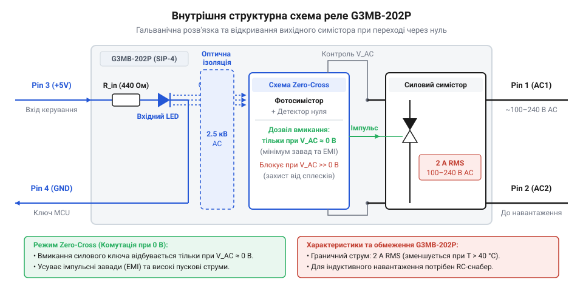
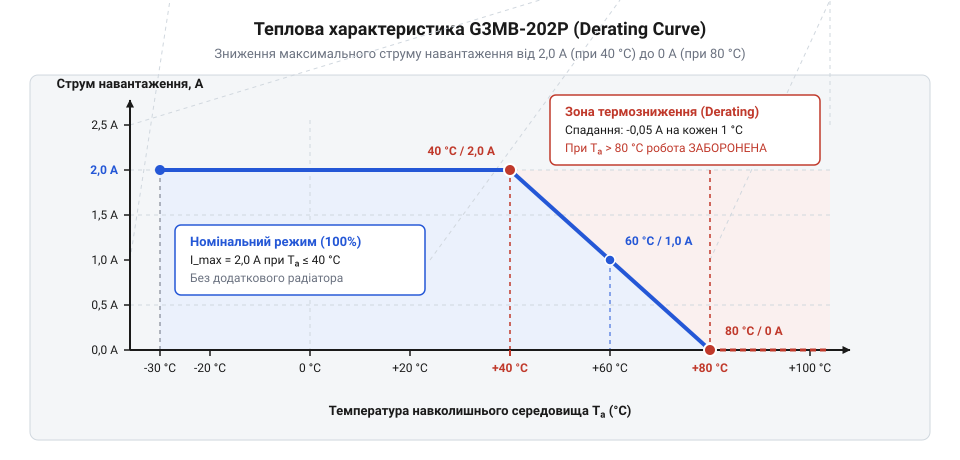
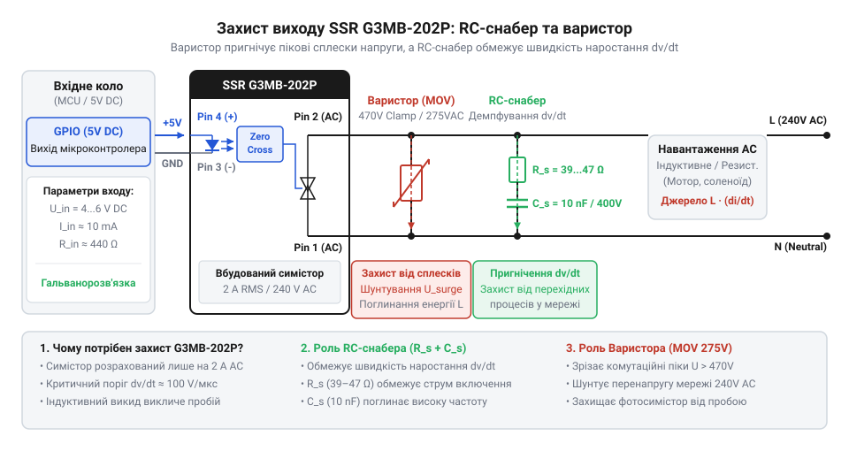

# Твердотільне реле G3MB-202P (2 А / 240 В)

<preknowlist>
- [Симістор BTA16-600B](root:cat-hw-drivers/triac-bta16) — принцип функціонування силового симістора, умови утримання струму та нелінійне перемикання змінного струму
- [MOC3063 — оптосимістор з детектором нуля](root:cat-hw-drivers/moc3063-optotriac) — принцип оптичної ізоляції вхідного кола та роботу схеми детектування нуля (zero-crossing)
</preknowlist>

## Чому механічна комутація створює завади

При комутації мережевого навантаження 230 В електромеханічним реле пружинний контакт фізично вдаряється об нерухомий електрод. У момент змикання виникає @@en|contact bounce@@ (від англ. *bounce* — відскок) — багаторазове розмикання та замикання кола впродовж кількох мілісекунд. Під підведеною напругою кожен такий відскок іонізує повітряний проміжок, формуючи @@en|electric arc@@ (від лат. *arcus* — дуга). Електрична дуга викликає ерозію металу, зварює контакти й генерує потужні високочастотні @@en|electromagnetic interference@@, які наводять імпульсні завади на шини живлення мікроконтролера та призводять до збоїв чи перезавантаження процесора.

Для захисту низьковольтної логіки від мережевого потенціалу застосовують @@en|solid-state relay@@ (від англ. *solid* — суцільний, твердий, та *state* — стан, SSR). У ньому немає рухомих деталей і механічного контакту. Силова мережа повністю відокремлена від цифрової системи через @@en|galvanic isolation@@, де керуючий сигнал передається світловим потоком через герметичний оптичний проміжок.

## Принцип роботи опторозв'язки та детектора нуля

Твердотільне реле G3MB-202P об'єднує керуючу та силову частини в єдиному корпусі. На вхідні контакти від мікроконтролера подається постійна напруга 5 В, яка живить внутрішній світлодіод. Світловий промінь долає прозорий ізолятор і потрапляє на фототиристор, забезпечуючи повноцінну оптичну ізоляцію між логікою та високовольтною мережею.

*Внутрішній світлодіод активує схему детектування нуля, яка відмикає симістор лише у момент мінімальної мережевої напруги.*

Як силовий ключ реле використовує вбудований [силовий симістор для комутації](root:cat-hw-drivers/triac-bta16) змінного струму. Щоб уникнути комутаційних завад, між світлочутливим елементом та затвором симістора вбудовано @@en|zero-crossing detector@@ (від англ. *zero* — нуль, *cross* — перетинати). Ця схема працює аналогічно до того, як окремий [оптосимістор з детектором нуля](root:cat-hw-drivers/moc3063-optotriac) аналізує миттєву фазу мережевої напруги. Якщо керуючий сигнал надходить у момент пікового значення синусоїди 325 В, схема затримує відкриття ключа до миті, коли напруга перетне нульове значення. Завдяки цьому комутація відбувається при мінімальному струмі, що повністю усуває пускові кидки струму й високочастотні випромінювання.

## Тепловий derating та захист реле

Компактний пластиковий корпус SIP-4 (від англ. @@en|single in-line package@@) не має масивного металевого прапорця для кріплення зовнішнього радіатора. Під час проходження струму на силовому ключі виникає падіння напруги близько 1,6 В, що викликає виділення тепла.

*Крива derating показує падіння допустимого струму з 2 А при 20 °C до 0,6 А при 70 °C.*

Зростання температури навколишнього середовища вимагає зниження робочого навантаження — процедури @@en|derating@@ (від англ. *de-* — зниження, *rate* — номінал). За номінального струму 2 А реле працює лише до +40 °C, а при +70 °C граничний струм зменшується до 0,6 А через ризик теплового пробою напівпровідника.

У вимкненому стані через внутрішні демпферні кола та напівпровідниковий перехід протікає @@en|leakage current@@ (від англ. *leak* — витікати, *current* — струм) близько 1,5 мА. Для малопотужних навантажень цього струму достатньо для хаотичного блимання. Проблему вирішують підключенням паралельно до навантаження баластного конденсатора ємністю 0,1–0,47 мкФ, який шунтує струм витікання.

*RC-снабер обмежує швидкість наростання напруги dv/dt, а варистор зрізає високовольтні сплески мережі.*

При комутації індуктивного навантаження виникає різкий стрибок напруги. Якщо швидкість наростання напруги перевищує критичну величину `dv/dt`, симістор самовільно відкривається без керуючого сигналу. Для обмеження `dv/dt` паралельно силовим виводам встановлюють @@en|snubber@@ (від англ. *snub* — гасити, приборкувати) — послідовне RC-коло (100 Ом і 10 нФ). Для захисту від імпульсних перенапруг у мережі паралельно навантаженню додають @@en|varistor@@ (від англ. *variable* — змінний, *resistor* — резистор).
