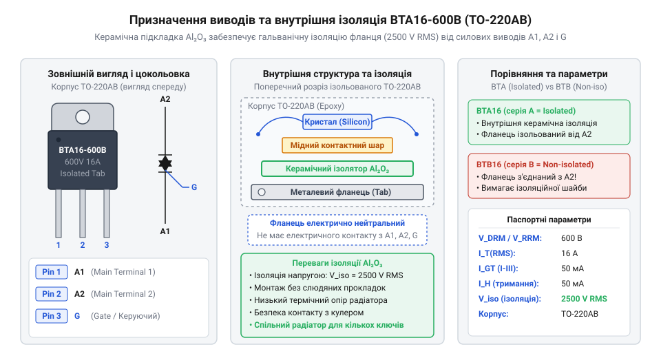
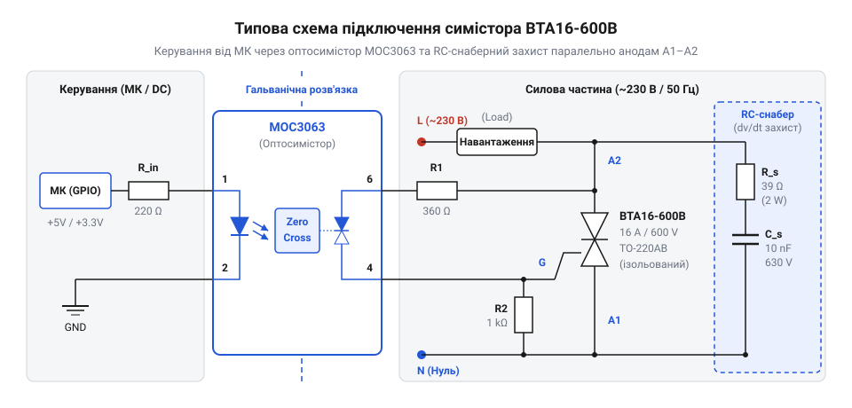

# Залізний інтерфейс, цокольовка та електричні параметри BTA16-600B

<preknowlist>
- [MOC3063 — оптосимістор з детектором нуля](root:cat-hw-drivers/moc3063-optotriac) — принципи оптичної розв'язки та керування силовим симістором через детектор переходу напруги через нуль
</preknowlist>

## Проблема комутації мережевого змінного струму

Керування потужними побутовими та промисловими приладами від цифрових мікроконтролерів вимагає комутації синусоїдальної напруги 220 В. Коли низьковольтний сигнал намагається безпосередньо керувати силовою мережею, постає проблема вибору комутаційного елемента. Традиційне @@en|електромеханічне реле@@ (фр. *relais* — зміна коней, перепряжка) використовує механічні контакти, які фізично замикають коло. Під час розмикання силових контактів під навантаженням між ними виникає @@en|дуговий розряд@@ (лат. *arcus* — дуга), який поступово руйнує контактну групу, викликає обгорання металу та може призвести до зварювання контактів. Крім того, механічна інерційність реле обмежує частоту перемикань кількома спрацьовуваннями на секунду, унеможливлюючи плавну регуляцію потужності.

Для комутації малопотужних кіл змінного струму застосовують [компактне твердотільне реле](root:cat-hw-drivers/ssr-g3mb-202p), проте струми понад 2 А вимагають дискретних напівпровідникових ключів. Безрухома комутація виконується за допомогою силових напівпровідників. Використання звичайного тиристора дозволяє проводити струм лише в одному напрямку, що зрізає половину хвилі змінного струму. Щоб забезпечити повну двонапрямлену провідність без механічного зносу, застосовують @@en|симістор@@ (англ. *triac*, від *triode for alternating current* — триелектродний ключ для змінного струму). Цей напівпровідниковий прилад перемикається за частки мікросекунд і проводить обидві напівхвилі синусоїдального струму.

Завдяки симетричній внутрішній структурі @@en|симістор@@ працює як два зустрічно-паралельно ввімкнені @@en|тиристори@@ зі спільним керуючим електродом. Його кристал містить п'ятишарову @@en|p-n-p-n структуру@@ з додатковими напівпровідниковими ділянками, що утворюють дві протилежно спрямовані провідні стежки. У закритому стані один із внутрішніх @@en|p-n переходів@@ блокує напругу мережі незалежно від її полярності. Короткий імпульс струму на @@en|керуючому електроді G@@ інжектує носії заряду у внутрішню базу кристала, викликаючи позитивний зворотний зв'язок між шарами та лавиноподібне відмикання відповідної ділянки. Після відмикання насичений носіями канал залишається відкритим до завершення поточної напівхвилі, поки струм мережі природно не знизиться до нуля. Такий режим автоматичного утримання дозволяє безшумно комутувати потужні навантаження без постійних втрат енергії в колі керування. Проте для безпечного узгодження низьковольтного мікроконтролера з високовольтною мережею потрібна гальванічна розв'язка, яку зручно реалізувати через [оптосимістор MOC3063](root:cat-hw-drivers/moc3063-optotriac).

## Цокольовка та гальванічна ізоляція корпусу

Силовий пристрій BTA16-600B випускається у стандартному корпусі @@en|корпус TO-220AB@@ (англ. *Transistor Outline* — обрис транзистора), призначеному для монтажу на друковану плату та відведення тепла. Прилад має три фізичні виводи та металевий фланець у верхній частині корпусу.


*Розташування виводів BTA16-600B у корпусі TO-220AB та ізолююча керамічна підкладка між кристалом і фланцем.*

Перший вивід (лівий при погляді на маркування) — це силовий @@en|анод A1@@ (грец. *anodos* — шлях вгору), який слугує базовим потенціалом для сигналу керування. Другий вивід (центральний) — силовий @@en|анод A2@@, через який комутується основне мережеве навантаження. Третій вивід (правий) — @@en|керуючий електрод G@@ (англ. *gate* — ворота), на який подається струмовий імпульс для відкриття ключа.

Принциповою особливістю серії BTA є внутрішнє влаштування корпусу. На відміну від серії BTB, де силовий @@en|анод A2@@ безпосередньо з'єднаний із металевим фланцем, у серії BTA між напівпровідниковим кристалом і металевою пластиною вбудована @@en|керамічна підкладка@@ (англ. *substrate*, від lat. *substratum* — основа). Ця підкладка забезпечує значення @@en|гальванічна ізоляція@@ (італ. *Galvani* — на честь дослідника Луїджі Гальвані) до 2500 В (діюче значення RMS). Завдяки цьому силовий @@en|симістор BTA16-600B@@ можна монтувати безпосередньо на спільний металевий @@en|радіатор@@ (лат. *radiator* — той, що випромінює) без ізолюючих слюдяних прокладок і втулок, що спрощує конструкцію та покращує тепловий контакт. Проте наявність керамічного ізолятора збільшує внутрішній @@en|тепловий опір кристал-корпус@@ `Rth_jc`. У неізольованій серії BTB16 прямий контакт кристала з металом забезпечує значення `Rth_jc` близько 1.2 °C/Вт, тоді як у BTA16 проміжний керамічний шар підвищує цей опір до 2.1 °C/Вт. Таке зростання внутрішнього теплового опору є платою за електричну ізоляцію і вимагає використання радіатора з більшою площею поверхні при роботі з граничними струмами.

## Граничні параметри напруги та струму

Маркування пристрою BTA16-600B визначає його граничні електричні характеристики, перевищення яких призводить до незворотного пошкодження кристала. Показник `V_DRM` відповідає максимальній напрузі в закритому стані, а `I_TRMS` визначає допустимий діючий струм провідності.

Для безпечної роботи у змінній мережі 220 В з урахуванням допустимих відхилень стандарту 230 В амплітудне значення напруги становить:

```
V_peak = V_RMS × √2
= 230 × 1.414            [підстановка діючого значення напруги мережі]
= 325.2 В                [обчислення пікової напруги]
```

Значення амплітуди напруги `V_peak` обчислюється множенням діючої напруги `V_RMS` на коефіцієнт форми синусоїди. Граничне значення @@en|повторювана імпульсна напруга V_DRM@@ (англ. *repetitive peak off-state voltage*) для даного пристрою становить 600 В. Співвідношення між `V_DRM` та `V_peak` надає запас міцності понад 1.8 рази, що захищає напівпровідник від короткочасних мережевих сплесків.

Параметр `I_TRMS` розшифровується як граничний @@en|діючий струм I_TRMS@@ (англ. *RMS current*, від *Root Mean Square* — середньоквадратичне значення) і для BTA16 становить 16 А за умови контролю температури корпусу не вище 86 °C. У провідному стані на кристалі виникає прямо @@en|падіння напруги V_TM@@ (англ. *on-state voltage drop*), яке становить приблизно 1.4 В. Теплова потужність розсіювання при робочому струмі 10 А обчислюється за формулою:

```
P_diss = V_TM × I_TRMS
= 1.4 × 10               [підстановка прямого падіння напруги та струму навантаження]
= 14 Вт                  [обчислення теплової потужності]
```

Значення розсіяної потужності `P_diss` є добутком падіння напруги `V_TM` на струм провідності. Потужність у 14 Вт без використання охолоджувача миттєво розігріє кристал понад граничні 125 °C, що викличе @@en|тепловий пробій@@ (нім. *Durchschlag* — пробивання). Вибір відповідного [алюмінієвого радіатора](root:cat-hw-drivers/triac-bta16/math-triac-thermal-calculation.md) з тепловим опором не більше 3.5 °C/Вт є обов'язковою умовою для забезпечення надійної комутації струмів понад 2 А.

## Режими відмикання та квадранти керування

Для переведення симістора із закритого стану в провідний необхідно подати струмовий імпульс на @@en|керуючий електрод G@@ відносно силового @@en|анод A1@@. Оскільки напрямок струму між силовими анодами зміщується кожну напівхвилю, робота пристрою ділиться на чотири сектори.

Залежно від полярності напруги між силовим @@en|анод A2@@ та @@en|анод A1@@, а також полярності керуючого струму на виводі G, формується @@en|квадрант керування@@ (лат. *quadrans* — четверта частина):

1. Квадрант I (+/+): `V_A2-A1` > 0, `I_G` > 0 — відмикання додатним струмом при додатній напівхвилі.
2. Квадрант II (+/-): `V_A2-A1` > 0, `I_G` < 0 — відмикання від'ємним струмом при додатній напівхвилі.
3. Квадрант III (-/-): `V_A2-A1` < 0, `I_G` < 0 — відмикання від'ємним струмом при від'ємній напівхвилі.
4. Квадрант IV (-/+): `V_A2-A1` < 0, `I_G` > 0 — відмикання додатним струмом при від'ємній напівхвилі.

Для версії BTA16-600B пороговий @@en|струм відмикання I_GT@@ (англ. *gate trigger current*) становить не більше 50 мА у квадрантах I, II та III. Четвертий квадрант IV вимагає значно більшого керуючого струму та має знижену швидкість наростання струму, тому в реальних схемах його уникають, подаючи від'ємні імпульси керування або використовуючи оптичне узгодження.

Після того як @@en|симістор@@ відмикається, керуючий сигнал на виводі G втрачає контроль над кристалом. Ключ залишається у провідному стані доти, доки силовий струм перевищує мінімальний @@en|струм тримання I_H@@ (англ. *holding current*), який для даної моделі дорівнює 50 мА. Коли синусоїда мережевої напруги проходить через нуль і струм навантаження спадає нижче `I_H`, пристрій самостійно закривається.

## Типові схеми підключення та захист

Інтеграція симістора BTA16-600B у мікроконтролерні системи вимагає використання гальванічно розв'язаного драйвера для захисту низьковольтної логіки від мережевої напруги 220 В.


*Схема безпечної комутації мережевого навантаження за допомогою BTA16-600B, MOC3063 та RC-снабера.*

Для безпечного керування силовою частиною застосовують [гальванічно розв'язаний оптосимістор](root:cat-hw-drivers/moc3063-optotriac) із детектором переходу напруги через нуль. Коли мікроконтролер відкриває внутрішній фотодіод оптодрайвера, вихідний фотосимістор відмикається у момент найменшої напруги мережі та пропускає струм з силового @@en|анод A2@@ через обмежувальний резистор R1 (330 Ом) на @@en|керуючий електрод G@@. Це створює надійне відмикання ключа в квадрантах I та III без сплесків струму.

Особлива небезпека виникає, коли комутують @@en|індуктивне навантаження@@ (лат. *inductio* — наведення), таке як обмотки електродвигунів або трансформаторів. В індуктивних колах струм відстає від напруги за фазою. Коли струм падає нижче `I_H` і @@en|симістор@@ закривається, напруга на анодах спалахує з високою швидкістю. Якщо швидкість наростання напруги `dV/dt` перевищує критичну межу 10 В/мкс, кристалічна структура самовільно відмикається без сигналу на виводі G.

Для запобігання хибним спрацьовуванням паралельно силовим анодам A1 та A2 встановлюють захисний @@en|снабер@@ (англ. *snubber*, від *snub* — гасити, приборкувати), який складається з послідовного RC-ланцюга (резистор 39 Ом 2 Вт та конденсатор 10 нФ 630 В). Дотримання [правил розрахунку снаберних кіл](root:cat-hw-drivers/moc3063-optotriac/math-triac-snubber-calculation.md) дозволяє обмежити швидкість `dV/dt`. Додатково паралельно мережевим виводам підключають @@en|варистор@@ (англ. *varistor*, від *variable resistor* — змінний резистор) з напругою спрацьовування 390 В, який шунтує високовольтні імпульсні перенапруги та захищає напівпровідник від пробою.
