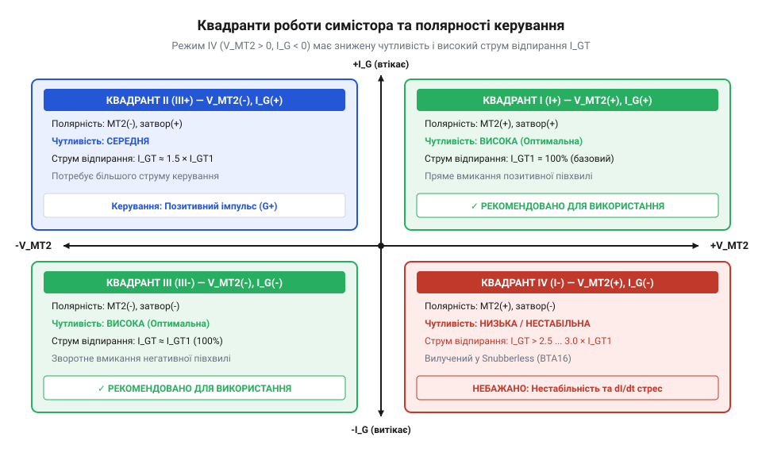
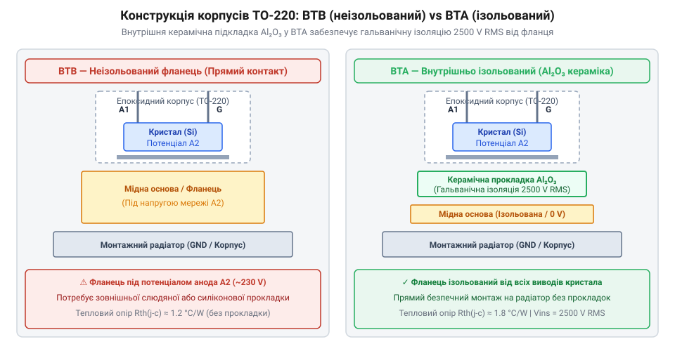

# Еволюція силових напівпровідникових ключів змінного струму

<preknowlist>
- [MOC3063 — оптосимістор з детектором нуля](root:cat-hw-drivers/moc3063-optotriac) — Принцип гальванічної розв'язки та принципи керування симістором за допомогою оптопари з детектором нуля.
</preknowlist>

## Громіздкі схеми зустрічних тиристорів

Комутація потужного навантаження в мережах змінного струму вимагає здатності ключа проводити струм в обох напрямках. У 1957 році інженери компанії General Electric під керівництвом Гордона Голла створили перший @@en|односпрямований тиристор@@ (англ. @@en|Silicon Controlled Rectifier@@, @@en|SCR@@, від латинського *silicium* — кремній та грецького *thyra* — двері). Цей чотиришаровий p-n-p-n напівпровідниковий прилад вирішив проблему керування постійним струмом високої напруги, проте для змінного струму виявився принципово обмеженим.

Оскільки @@en|SCR@@ є односпрямованим ключем, він проводитиме струм лише в одному напрямку — від виводу @@en|анод@@ до виводу @@en|катод@@ — після подачі короткого імпульсу керування на @@en|затвор@@. У мережі змінного струму напруга змінює полярність сто разів на секунду. Під час від'ємної півхвилі один @@en|тиристор@@ залишається повністю закритим, працюючи як звичайний силовий діод у зворотному включенні.

Щоб контролювати обидві півхвилі змінного струму, інженери мусили будувати зустрічно-паралельну схему з двох тиристорів: @@en|анод@@ першого з'єднували з @@en|катодом@@ другого, і навпаки. Така топологія вирішувала завдання комутації, але створювала серйозні системні проблеми. Головна складність полягала в управлінні затворами. Оскільки @@en|катод@@ кожної структури перебував під власним потенціалом (один підключений до фазної лінії, інший — до навантаження), затвори не мали спільної точки відліку напруги.

Для безпечного відпирання обох ключів доводилося будувати дві незалежні, гальванічно розв'язані лінії керування з чіткою @@en|фазовою синхронізацією@@ імпульсів відносно мережі. Схема керування мала точно визначати момент, коли зміна полярності напруги супроводжується @@en|переходом струму через нуль@@, і подавати імпульс відпирання на потрібний @@en|затвор@@. Ситуація ускладнювалася фізикою напівпровідника: під час проходження струму внутрішня p-n-p-n структура @@en|тиристора@@ насичується надлишковими носіями заряду. Коли струм падає нижче @@en|струму утримання@@ і змінює напрямок, прилад не закривається миттєво — потрібен час на рекомбінацію носіїв і @@en|відновлення запірних властивостей@@ кристала. Якщо сигнал керування на протилежний ключ подати передчасно, до завершення рекомбінації, виникає наскрізне коротке замикання. Щоб забезпечити таку точність і розв'язку, конструктори застосовували важкі імпульсні трансформатори або [спеціальні оптопари](root:cat-hw-drivers/moc3063-optotriac), що суттєво підвищувало вартість, розміри та складність друкованої плати. Подвоєна кількість силових компонентів та складність схеми змусили розробників шукати рішення, яке дозволило б комутувати обидві півхвилі всередині одного напівпровідникового кристала.

## Народження чотириквадрантного симістора

У 1964 році інженери General Electric знайшли спосіб об'єднати дві тиристорні структури на одному кремнієвому кристалі. Створений прилад отримав назву @@en|симістор@@ (англ. @@en|triac@@, від *triode for alternating current* — триод для змінного струму). Завдяки зустрічно-паралельній інтеграції п'яти напівпровідникових шарів новий ключ отримав два головні силові виводи — @@en|Main Terminal 1@@ (@@en|MT1@@) та @@en|Main Terminal 2@@ (@@en|MT2@@) — і один спільний @@en|затвор@@.

@@en|Симістор@@ здатний відкриватися незалежно від полярності напруги між виводами @@en|MT2@@ та @@en|MT1@@, а також від напрямку струму керування затвора. Ці комбінації описують чотири @@en|квадранти роботи@@ (від латинського *quadrans* — четвертина), що визначаються відносно виводу @@en|MT1@@.

*Розподіл квадрантів роботи симістора залежно від полярності напруги між виводами MT2-MT1 та керуючим струмом затвора.*

У квадрантах I(+), II(-) та III(-) @@en|симістор@@ демонструє високу чутливість затвора: внутрішні носії заряду інжектуються безпосередньо у відповідну p-n-p-n структуру, викликаючи швидке відпирання ключа малим струмом затвора. Проте у @@en|IV квадрант@@ (коли напруга на @@en|MT2@@ від'ємна, а струм затвора позитивний) фізика процесу змінюється.

Відпирання у @@en|IV квадрант@@ відбувається за допомогою так званої непрямої або поперечної інжекції носіїв. Для запуску проводимості потрібен у 2-3 рази вищий струм керування. Більше того, поперечне перенесення заряду локалізує струм у вузькій зоні кристала, що робить @@en|симістор@@ критично вразливим до швидкості наростання напруги `dV/dt`. Найменший сплеск напруги в цей момент викликає хибне відкривання приладу, обмеження робочої температури та загрозу теплового пробою.

Конструктивно кристал @@en|симістора@@ містить п'ятишарову @@en|n-p-n-p-n структуру@@ з додатковими легованими ділянками біля керуючого електрода. Через таку конфігурацію носії заряду під час поперечної інжекції рухаються уздовж вузького базового шару кремнію. В результаті струм відпирання не розподіляється по всій площі кристала, а стискається у тонкий шнур біля межі @@en|затвора@@. Висока локальна густина струму спричиняє стрімкий точковий перегрів — утворення @@en|гарячої плями@@ (англ. @@en|hot spot@@, від *hot* — гарячий та *spot* — точка). Ця @@en|гаряча пляма@@ різко знижує опір кремнію в цій зоні, провокує лавиноподібний @@en|тепловий пробій@@ і руйнує прилад до того, як проводимість розшириться на весь об'єм.

## Перехід до триквадрантних Snubberless-пристроїв

Під час роботи з індуктивним або динамічним навантаженням (електродвигуни, трансформатори, котушки реле) струм у колі відстає від напруги за фазою. Коли синусоїдальний струм проходить через нуль, @@en|симістор@@ закривається. Однак напруга в мережі в цей момент вже досягає значного значення, створюючи стрімкий стрибок напруги між виводами @@en|MT2@@ та @@en|MT1@@.

Швидкість цього стрибка називають комутаційною швидкістю наростання напруги `(dV/dt)c`. У класичних чотириквадрантних симісторах носії заряду, що залишилися в кристалі після проходження струму через нуль, під дією високої `(dV/dt)c` викликали самовільне вмикання ключа на наступній півхвилі. Для придушення таких сплесків паралельно ключу доводилося впаювати зовнішню RC-мережу — @@en|демпфер@@ (англ. @@en|snubber@@, від *snub* — глушити). Детальніше про розрахунок компонентів та фізику процесів у цих захисних колах читайте у матеріалі про [RC-демпфуючі ланцюги силових ключів](root:hw-power/snubbers-dvdt).

Еволюційним розв'язком цієї проблеми наприкінці 1980-х років стала розробка триквадрантних ключів, відомих як @@en|бездемпферний симістор@@ (англ. @@en|Snubberless triac@@). Інженери змінили архітектуру легування кристала та свідомо усунули можливість роботи в проблемному @@en|IV квадрант@@. Відмова від четвертого квадранта дозволила повністю розділити шляхи проходження носіїв заряду для позитивної та від'ємної півхвиль. Це підвищило критичну стійкість `(dV/dt)c` у 5-10 разів, зробивши зовнішній @@en|демпфер@@ непотрібним при роботі з більшістю індуктивних навантажень.

*Порівняння внутрішньої структури корпусів BTB із прямою розваркою на металевий фланець та BTA з керамічною ізолюючою підкладкою.*

Паралельно з удосконаленням кристала еволюціонували й силові корпуси. У стандартному виконанні @@en|корпус BTB@@ металевий тепловідвідний фланець корпусу TO-220 мав прямий електричний контакт із внутрішньою підкладкою @@en|MT2@@, де присутня висока мережева напруга. Для монтування кількох ключів на один радіатор вимагалися зовнішні слюдяні або силіконові прокладки. Впровадження технології @@en|корпус BTA@@ вирішило цю проблему завдяки вбудованій підкладці з кераміки оксиду алюмінію AL₂O₃. Керамічний шар всередині корпусу забезпечує електричну ізоляцію фланця до 2500 V RMS при мінімальному тепловому опорі, що дозволяє монтувати силові елементи безпосередньо на спільний радіатор або метал [твердотільних реле](root:cat-hw-drivers/ssr-g3mb-202p).

## Керамічна ізоляція у корпусах BTA

Металевий фланець класичного силового корпуса TO-220 не просто відводить тепло від напівпровідникового кристала, а є його фізичним продовженням. У симісторах серії @@en|BTB@@ кристалічна пластина впаяна безпосередньо на мідну підкладку, яка виведена на силовий вивід `MT2`. Під час роботи у мережі змінної напруги 230 В відкритий металевий фланець знаходиться під повним фазовим потенціалом. Спроба закріпити кілька таких ключів на спільний металевий радіатор призводить до миттєвого короткого замикання між силовими колами.

Тривалий час цю проблему вирішували зовнішніми ізолювальними комплектами — слюдяними прокладками та пластиковими втулками під гвинт. Однак найменший перекіс при затягуванні, мікротріщина у слюді або висихання теплопровідної пасти спричиняли електричний пробій на корпус пристрою. Технологічним проривом стала поява корпусів @@en|BTA@@ з внутрішньою ізоляцією. Усередині корпуса між кристалом та зовнішнім мідним фланцем вбудували тонку пластину з @@en|alumina|оксиду алюмінію@@. Цей керамічний матеріал поєднує високу діелектричну міцність (ізоляція до 2500 В RMS) із високою теплопровідністю.

Впровадження внутрішньої керамічної підкладки зробило зовнішній фланець корпуса @@en|BTA@@ повністю гальванічно ізольованим від усіх трьох електродів (`MT1`, `MT2`, `Gate`). Це дозволило монтувати довільну кількість силових симісторів на єдиний алюмінієвий радіатор без зовнішніх прокладок, спростивши збирання та гарантувавши високий рівень електробезпеки.

## Розвінчання міфів та вибір топології

Навколо тиристорної техніки роками зберігаються два ключові міфи. Перша омана полягає в уявленні про повну симетричність симістора в усіх чотирьох квадрантах керування. Фізична структура кристала робить IV квадрант (додатна напруга на `MT2` відносно `MT1` при від'ємному струмі затвора) найменш чутливим. Для його відмикання потрібен суттєво більший струм керування, а під час комутації в цьому режимі різко зростає ризик самочинного відкривання приладу. Саме тому сучасні 3-квадрантні ключі серії @@en|Snubberless@@ свідомо позбавлені режиму роботи в IV квадранті задля кардинального підвищення стійкості до швидкості наростання напруги (`dV/dt`).

Другий поширений міф — плутанина між типом корпуса та топологією кристала. Маркування @@en|BTA@@ та @@en|BTB@@ вказує виключно на наявність або відсутність керамічної ізоляції металевого фланця і не визначає внутрішню структуру напівпровідника. Водночас позначення @@en|Snubberless@@ описує модифікацію кремнієвого кристала зі зменшеним часом розсмоктування носіїв. Симістор у ізольованому корпусі @@en|BTA@@ може бути як класичним 4-квадрантним, так і 3-квадрантним бездемпферним.

Вибір конкретної топології та корпуса визначається характером навантаження та вимогами електробезпеки. Для чисто резистивного навантаження (ТЕНи, лампи розжарювання) достатньо звичайного 4-квадрантного симістора. При керуванні індуктивним навантаженням (електродвигуни, трансформатори, соленоїди) критично обирати 3-квадрантний @@en|Snubberless@@-симістор, який не потребує громіздких зовнішніх RC-демпферів для захисту від сплесків напруги. У схемах, де плата керування зв'язана з мікроконтролером, для безпеки використовують [оптопару з детектором](root:cat-hw-drivers/moc3063-optotriac) нуля. Коли ж потрібна готова компактна конструкція для монтажу на друковану плату, обирають [готове твердотільне реле](root:cat-hw-drivers/ssr-g3mb-202p) для комутації струмів.
