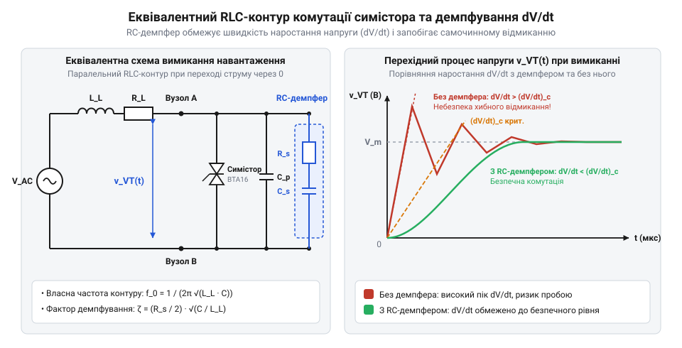

# Розрахунок демпферного RC-ланцюга та обмеження dV/dt

<preknowlist>
- [MOC3063 — оптосимістор з детектором нуля](root:cat-hw-drivers/moc3063-optotriac) — принцип оптосимісторного керування силовим ключем та особливості фазового зсуву струму й напруги при комутації індуктивності
</preknowlist>

## Хибне вмикання симістора індуктивним навантаженням

Коли симістор `@@en|triac@@` (від англ. @@en|triode for alternating current@@ — триод для змінного струму) комутує активне навантаження, струм і напруга переходять через нуль одночасно. У цьому разі ключ вимикається м'яко й безболісно. Проте під час роботи на індуктивне навантаження (обмотки електродвигунів, трансформаторів чи соленоїдів) струм відстає від напруги за фазою майже на 90 градусів. Коли струм навантаження знижується нижче струму утримання кристала і `@@en|triac@@` закривається, напруга мережі перебуває поблизу свого амплітудного значення.

У момент розмикання ключа ця амплітудна напруга миттєво прикладається до силових анодів. Виникає висока швидкість наростання напруги `dV/dt` (англ. @@en|rate of rise of voltage@@). Напівпровідникова структура симістора у закритому стані має внутрішню бар'єрну ємність p-n переходів `C_j` (англ. @@en|junction capacitance@@). Швидка зміна напруги викликає зарядний струм через цю ємність:

i_j = C_j × (dV/dt)

Цей ємнісний струм протікає через внутрішні бази p-n-p-n структури симістора і діє аналогічно струму керування. Якщо швидкість наростання `dV/dt` перевищує критичне значення `(dV/dt)_crit`, вказане у специфікації напівпровідникового приладу, ємнісний струм досягає порогу відмикання. Відбувається самовільне хибне відкривання симістора без подачі сигналу на керувальний електрод. У результаті ключ втрачає керованість, виникають неконтрольовані сплески струму та перегрів напівпровідникового кристала.

Для захисту силового ключа паралельно його виводам підключають демпферний `RC`-ланцюг — `@@en|snubber@@` (від англ. @@en|snub@@ — приборкувати, обривати). Демпфер перенаправляє комутаційний струм у конденсатор, обмежуючи крутизну наростання напруги до безпечного рівня. Навіть коли в системі встановлено [оптосимістор з детектором нуля](root:cat-hw-drivers/moc3063-optotriac) або використовується готове [твердотільне реле G3MB-202P](root:cat-hw-drivers/ssr-g3mb-202p), правильний розрахунок зовнішнього демпфера є обов'язковим для запобігання аварійним комутаційним збоям.

*Еквівалентний RLC-контур та вплив RC-демпфера на крутизну наростання напруги dV/dt під час вимикання симістора.*

Еквівалентна схема вимикання описує заміщення силового кола послідовним `RLC`-контуром, де індуктивність навантаження `L` взаємодіє з ємністю демпфера `C_s` та опором `R_s`. Без демпферного ланцюга енергія магнітного поля індуктивності миттєво перезаряджає малу ємність переходів ключа, створюючи крутий фронт напруги. Додавання демпфера `@@en|snubber@@` поглинає цю енергію, але занадто мала ємність `C_s` не зможе обмежити швидкість `dV/dt` нижче критичного порогу `(dV/dt)_crit`. Водночас неправильно обраний опір `R_s` спричинить високочастотні коливання з небезпечними сплесками амплітуди на силових виводах `@@en|triac@@`. Тому математична задача зводиться до вибору таких значень `C_s` і `R_s`, які одночасно утримують крутизну `dV/dt` у безпечних межах і гасять перехідний процес у `RLC`-контурі.

## Математична модель RLC-контуру вимикання

Після закривання симістора `@@en|triac@@` індуктивне навантаження з індуктивністю `L_L` та активним опором `R_L`, мережа живлення з амплітудною напругою `U_m` та паралельний демпферний ланцюг `@@en|snubber@@` з опором `R_s` і ємністю `C_s` утворюють послідовний `RLC`-контур. Перехідний процес наростання напруги на конденсаторі (і відповідно на кристалі симістора) описується диференціальним рівнянням другого порядку для струму контуру `i(t)`:

L_L × (d²i/dt²) + (R_L + R_s) × (di/dt) + (1 / C_s) × i = 0

Характеристичне рівняння цього контуру визначає власну резонансну частоту `ω₀` та коефіцієнт згасання `ζ` (від нім. @@de|Dämpfung@@ — згасання):

ω₀ = 1 / √(L_L × C_s)

ζ = (R_L + R_s) / (2 × √(L_L / C_s))      [коефіцієнт згасання]

У найгіршому випадку, коли вимикання відбувається при максимальному значенні напруги мережі `U_m`, а опір `R_s` малий, перехідний процес має коливальний характер (`ζ < 1`). Максимальна швидкість наростання напруги `(dV/dt)_max` спостерігається на початку перехідного процесу і визначається як добуток амплітудної напруги на власну частоту контуру:

(dV/dt)_max
= U_m × ω₀                [амплітудне значення крутизни]
= U_m / √(L_L × C_s)      [підстановка власної частоти]

З цього виразу видно, що збільшення ємності демпферного конденсатора `C_s` знижує резонансну частоту контуру і пропорційно зменшує максимальну крутизну наростання напруги `dV/dt`. Однак без належного активного опору `R_s` контур викличе високочастотні коливання з перенапругою, що досягає `2 × U_m`. Тому завдання математичного розрахунку полягає у виборі такої пари `C_s` та `R_s`, яка гарантує обмеження `dV/dt` нижче допустимого порогу та забезпечує згасання, близьке до критичного (`ζ ≈ 1`).

## Розрахунок ємності та опору демпфера

Для розрахунку мінімально необхідної ємності демпферного конденсатора `C_s` вихідними даними є амплітудна напруга мережі `U_m`, індуктивність навантаження `L_L` та критична швидкість наростання напруги симістора `(dV/dt)_crit`, отримана з документації виробника.

Прирівнюючи максимальну крутизну перехідного процесу до критичного значення `(dV/dt)_crit`, отримуємо математичний вираз для ємності:

(dV/dt)_crit = U_m / √(L_L × C_s)
(dV/dt)_crit² = U_m² / (L_L × C_s)      [піднесення до квадрата]
C_s = U_m² / (L_L × (dV/dt)_crit²)      [вираження ємності]

Після обчислення ємності визначають опір демпферного резистора `R_s`. Для запобігання перенапругам та забезпечення критичного згасання `@@en|critical damping@@` (при `ζ = 1`) активний опір контуру має дорівнювати подвійному хвильовому опору. Нехтуючи малим власним опором навантаження `R_L`, отримуємо:

R_s = 2 × √(L_L / C_s)      [умова критичного згасання]

На практиці для забезпечення стійкості без перевищення струмових обмежень опір `R_s` обирають у межах від `0.5 × √(L_L / C_s)` до `2 × √(L_L / C_s)`.

**Обчислення на прикладі**:
**Умова**: Однофазна мережа `230 V` (`50 Hz`), амплітуда напруги `U_m = 230 × √2 ≈ 325 V`. Індуктивність навантаження `L_L = 100 mH` (`0.1 H`). Допустима крутизна напруги симістора `(dV/dt)_crit = 10 V/μs` (`10⁷ V/s`).

C_s
= (325)² / (0.1 × (10⁷)²)
= 105625 / (0.1 × 10¹⁴)      [обчислення знаменника]
= 1.056 × 10⁻⁸ F             [ділення]
≈ 10 nF                      [округлення до стандартного номіналу]

R_s
= 2 × √(0.1 / (10 × 10⁻⁹))
= 2 × √(10⁷)                  [обчислення підкореневого вираз]
= 2 × 3162.27                [вилучення квадратного кореня]
≈ 6.32 kΩ                    [теоретичне значення критичного опору]

Знайдене значення `C_s = 10 nF` забезпечує необхідне обмеження `dV/dt`. Проте опір `R_s` потребує додаткової перевірки на обмеження струму розряду під час вмикання симістора `@@en|triac@@`.

## Обмеження пікового струму розряду конденсатора

Під час подачі керуючого імпульсу симістор `@@en|triac@@` відкривається і переходить у стан високої провідності за лічені мікросекунди. У цей момент демпферний конденсатор `C_s`, заряджений до напруги мережі (до `U_m`), починає миттєво розряджатися через резистор `R_s` і відкритий кристал симістора.

Якщо опір `R_s` вибрати занадто малим, струм розряду створить велику швидкість наростання струму `dI/dt` (англ. @@en|rate of rise of current@@). Оскільки в перші моменти після відкривання провідна область напівпровідникового кристала зосереджена біля керуючого електрода, висока крутизна струму `dI/dt` викликає локальний перегрів кристала і його теплову деградацію.

Піковий струм розряду конденсатора `I_peak` обчислюється за законом Ома:

I_peak = U_m / R_s

Максимальна швидкість наростання струму розряду `(dI/dt)_max` обмежена критичним значенням симістора `(dI/dt)_crit`:

(dI/dt)_max = I_peak / (R_s × C_s) = U_m / (R_s² × C_s) ≤ (dI/dt)_crit

Звідси випливає умова нижньої межі для опору `R_s`:

R_s ≥ √(U_m / (C_s × (dI/dt)_crit))

Окрім струмових обмежень, резистор `R_s` постійно розсіює теплову потужність внаслідок циклів перезаряджання ємності `C_s` з частотою мережі `f` (для мережі 50 Гц процес відбувається двічі за період):

P_Rs = C_s × U_m² × f      [потужність розсіювання резистора]

**Обчислення на прикладі**:
**Умова**: Розрахована ємність `C_s = 10 nF`, амплітуда напруги `U_m = 325 V`, частота мережі `f = 50 Hz`. Обираємо компромісний опір `R_s = 100 Ω` (типове практичне значення для демпферів `@@en|snubber@@` симісторів).

I_peak
= 325 / 100
= 3.25 A                     [піковий струм розряду]

P_Rs
= 10 × 10⁻⁹ × (325)² × 50
= 10 × 10⁻⁹ × 105625 × 50     [піднесення до квадрата]
= 0.0528 W                   [множення]
≈ 0.05 W                     [розсіювана потужність]

Значення пікового струму `3.25 A` та швидкості наростання струму лежать у безпечно допустимих межах силових симісторів, а розсіювана потужність `0.05 W` дозволяє використовувати резистор потужністю `0.5 W` чи `1 W` з великим запасом за надійністю та високовольтною міцністю.
