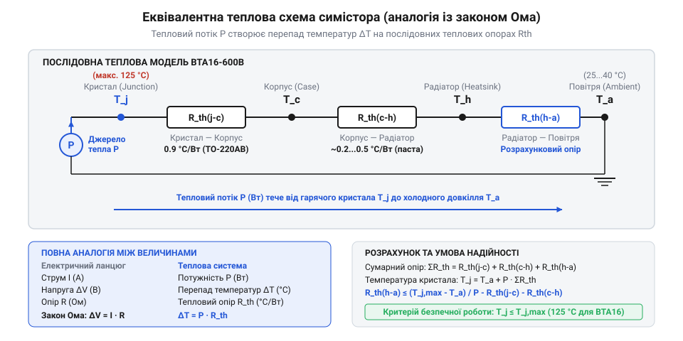

# Розрахунок теплового режиму та вибір радіатора охолодження

<preknowlist>
- [MOC3063 — оптосимістор з детектором нуля](root:cat-hw-drivers/moc3063-optotriac) — принцип відмикання симістора у момент переходу напруги через нуль для мінімізації динамічних втрат
</preknowlist>

## Перегрів та аварійне руйнування симістора

Під час проектування схем комутації змінного струму розробники часто обирають силовий @@en|симістор@@ (від @@en|triac@@, що утворено від @@en|triode for alternating current@@ — триод для змінного струму) серії @@en|BTA16-600B@@ в @@en|корпусі TO-220AB@@, розрахований на номінальний струм 16 А. Однак при спробі комутувати навантаження зі струмом навіть 10 А пристрій без охолодження катастрофічно перегрівається та виходить з ладу впродовж кількох секунд.

У низьковольтній логіці ключ у відкритому стані вважають ідеальним провідником із нульовим опором. Проте напівпровідниковий @@en|p-n перехід@@ силового ключа не є ідеальним: при проходженні струму на ньому виникає неминучий спад напруги величиною 1.2–1.5 В. Помноживши цей спад на наявний струм навантаження, ми отримуємо постійну генерацію теплової потужності безпосередньо у кремнієвому кристалі (@@en|die@@ чи @@en|junction@@).

Напівпровідниковий @@en|кристал@@ має жорстке технологічне обмеження — максимальна робоча температура не повинна перевищувати 125 °C за специфікацією (@@en|datasheet@@). Без зовнішнього тепловідводу @@en|корпус TO-220AB@@ передає тепло повітрю виключно через власну незначну поверхню. Для такого корпусу власні втрати призводять до розігріву кристала більш ніж на 60 °C на кожен ват виділеної потужності.

Навіть малопотужні [твердотільні реле G3MB-202P](root:cat-hw-drivers/ssr-g3mb-202p) обмежені струмом 2 А саме через відсутність масивного охолоджувача. Для симістора BTA16 розсіювання потужності при робочих струмах вимагає обов'язкового застосування зовнішнього @@en|радіатора@@ (від лат. @@la|radiator@@ — той, що випромінює). Без попередньої математичної оцінки виділюваного тепла й обчислення параметрів охолодження кристал гарантовано зазнає незворотного теплового пробою. Захист пристрою від короткочасних пікових перевантажень аналізує [імпульсний тепловий опір](root:hw-components/triac-transient-thermal-impedance).

Теплова потужність виділяється безпосередньо у кремнієвому кристалі в зоні @@en|p-n переходу@@. Шляхом @@en|теплопровідності@@ через внутрішній шар припою це тепло передається на мідну основу корпусу — @@en|фланець@@ (від нім. @@de|Flansch@@ — край, виступ). З незначної поверхні фланця та пластикової оболонки тепло розсіюється у повітря за рахунок природної @@en|конвекції@@ (від лат. @@la|convectio@@ — перенесення) й випромінювання. Сумарний опір цього фізичного шляху визначає власний @@en|тепловий опір@@ «кристал — навколишнє середовище», який у специфікаціях позначають як `R_th(j-a)` (від англ. @@en|junction-to-ambient thermal resistance@@). Для @@en|корпусу TO-220AB@@ симістора @@en|BTA16-600B@@ параметр `R_th(j-a)` має високе значення 60 °C/Вт. Виділення навіть 2 Вт потужності розігріває кристал на 120 °C понад температуру довкілля, що швидко виводить його за безпечну межу 125 °C.

## Математична модель виділення теплової потужності

Для визначення розмірів охолоджувача необхідно точно розрахувати середню теплову потужність, яка виділяється силовим ключем під час проходження синусоїдального струму.

Вольт-амперна характеристика відкритого p-n переходу симістора є нелінійною. Проте в робочому діапазоні струмів спад напруги на ключі точно апроксимується лінійною залежністю за допомогою двох параметрів з @@en|datasheet@@:
1. Порогова напруга `V_T₀` (спад напруги відмикання p-n переходу, для BTA16-600B зазвичай `V_T₀ = 0.85 В`).
2. Динамічний опір `R_d` (внутрішній диференціальний опір кристала, для BTA16-600B становить `R_d = 0.025 Ом`).

Миттєве значення спаду напруги `V_T(t)` залежить від миттєвого струму навантаження `i(t)` за виразом:

V_T(t) = V_T₀ + R_d · i(t)

Миттєва розсіювана потужність дорівнює добутку миттєвої напруги на струм: `p(t) = V_T₀ · i(t) + R_d · i²(t)`. Проінтегрувавши цей вираз за період мережевої частоти 50 Гц, отримуємо середню розсіювану теплову потужність `P`, де `I_AV` — середній випрямлений струм за напівперіод, а `I_RMS` — @@en|діючий струм@@ (від @@en|RMS current@@, що означає @@en|root mean square@@ — середньоквадратичне значення).

Виразимо середній струм для чистої синусоїди через діючий як `I_AV = (2 · √2 / π) · I_RMS ≈ 0.90 · I_RMS`.

Підставивши значення параметрів BTA16-600B у рівняння середньої потужності, отримуємо підсумкову формулу розрахунку виділюваної теплової потужності:

P = V_T₀ · I_AV + R_d · I_RMS²              [загальна формула середніх теплових втрат]
  = V_T₀ · (0.90 · I_RMS) + R_d · I_RMS²    [перехід від середнього струму до діючого]
  = 0.85 · (0.90 · I_RMS) + 0.010 · I_RMS²  [підстановка параметрів BTA16-600B]
  = 0.765 · I_RMS + 0.010 · I_RMS²          [робоча модель розрахунку потужності]

Перший доданок формули описує втрати на пороговому спаді напруги, які зростають лінійно зі збільшенням струму. Другий доданок визначає джоулеві втрати на динамічному опорі кристала, які залежать квадратично від струму навантаження.

**Обчислення теплової потужності BTA16-600B для діючого струму 10 А**

P = 0.765 · 10 + 0.010 · 10²                [підстановка I_RMS = 10 А]
  = 7.65 + 1.00                            [обчислення складових потужності]
  = 8.65 Вт                                [підсумкова розсіювана теплова потужність]

Розрахунок показує, що при діючому струмі 10 А симістор виділяє 8.65 Вт тепла. Зауважимо, що на частоті 50 Гц динамічні втрати перемикання є нехтовно малими порівняно зі статичними, особливо при використанні [оптопари MOC3063 з детектором нуля](root:cat-hw-drivers/moc3063-optotriac). Детально [динамічні втрати перемикання](root:hw-components/triac-dynamic-losses) аналізуються при високих частотах комутації.

## Еквівалентна схема теплового опору ланцюга

Отримане значення теплової потужності `P` визначає тепловий потік, який має безперервно відводитися від кристала в навколишнє середовище.

Для розрахунку передачі тепла використовують @@en|теплово-електричну аналогію@@. У цій моделі виділювана теплова потужність `P` (Вт) відповідає електричному струму, різниця температур `ΔT` (°C) — різниці потенціалів (напрузі), а @@en|тепловий опір@@ `R_th` (°C/Вт) — електричному опору. Перепад температур між двома точками дорівнює добутку теплового потоку на тепловий опір між ними: `ΔT = P · R_th`.

Шлях поширення тепла складається з трьох послідовних ділянок, кожна з яких чинить опір тепловому потоку:
1. Тепловий опір «кристал — корпус» `R_th(j-c)` (від @@en|junction-to-case@@): внутрішній опір від кремнієвої пластини до металевого фланця корпусу. Для ізольованого корпусу BTA16-600B згідно з @@en|datasheet@@ він становить `R_th(j-c) = 2.1 °C/Вт`.
2. Тепловий опір «корпус — радіатор» `R_th(c-h)` (від @@en|case-to-heatsink@@): опір поверхні контакту фланця та охолоджувача. Залежить від якості шліфування та наявності кремнієвої теплопровідної пасти (типово `R_th(c-h) ≈ 0.5 °C/Вт`).
3. Тепловий опір «радіатор — середовище» `R_th(h-a)` (від @@en|heatsink-to-ambient@@): опір віддачі тепла від поверхні алюмінієвого радіатора в навколишнє повітря.

*Еквівалентна замінна схема стаціонарного теплового ланцюга силового ключа на радіаторі.*

Загальний тепловий опір послідовного ланцюга дорівнює сумі окремих опорів:

R_th(total) = R_th(j-c) + R_th(c-h) + R_th(h-a)

Температура кристала `T_j` визначається виразом:

T_j = T_a + P · (R_th(j-c) + R_th(c-h) + R_th(h-a))

де `T_a` — температура навколишнього повітря усередині корпусу пристрою.

## Обчислення граничного опору та вибір радіатора

Щоб запобігти аварійному руйнуванню симістора, температура кристала `T_j` за найнесприятливіших умов не повинна перевищувати граничне значення `T_j(max) = 125 °C`.

Максимально допустимий загальний тепловий опір ланцюга `R_th(total_max)` обчислюють як відношення граничного перепаду температур до розрахованої теплової потужності: `R_th(total_max) = (T_j(max) - T_a) ÷ P`. Віднімаючи від цього значення відомі опори переходів «кристал — корпус» та «корпус — радіатор», знаходять граничний опір радіатора `R_th(h-a)`:

R_th(h-a) = ((T_j(max) - T_a) ÷ P) - R_th(j-c) - R_th(c-h)

**Обчислення необхідного радіатора для BTA16-600B при струмі 10 А та температурі повітря 40 °C**

Умови: `I_RMS = 10 А`, `P = 8.65 Вт`, `T_j(max) = 125 °C`, `T_a = 40 °C`, `R_th(j-c) = 2.1 °C/Вт`, `R_th(c-h) = 0.5 °C/Вт`.

R_th(total_max) = (125 - 40) ÷ 8.65        [граничний загальний тепловий опір]
                = 85 ÷ 8.65
                = 9.83 °C/Вт               [максимально допустимий опір ланцюга]

R_th(h-a) = 9.83 - 2.1 - 0.5              [обчислення граничного опору радіатора]
          = 7.23 °C/Вт                     [максимально припустимий опір охолоджувача]

Для надійної роботи пристрою обраний алюмінієвий @@en|радіатор@@ повинен мати паспортний тепловий опір `R_th(h-a) ≤ 7.2 °C/Вт`.

Якщо виробник ребристого алюмінієвого профілю вказує лише геометрію, ефективну площу поверхні `S` (см²) для природної конвекції можна оцінити за наближеною формулою: `S ≈ 500 ÷ R_th(h-a)`. Для нашого розрахунку необхідна площа становить: `S ≈ 500 ÷ 7.2 ≈ 70 см²`.

Таким чином, використання алюмінієвого радіатора з площею охолодження не менше 70 см² гарантує утримання температури кристала BTA16-600B в безпечних межах. Якщо габарити обмежені, застосовують [примусове повітряне охолодження](root:hw-components/forced-air-cooling-heatsinks), яке суттєво зменшує необхідні розміри радіатора.
