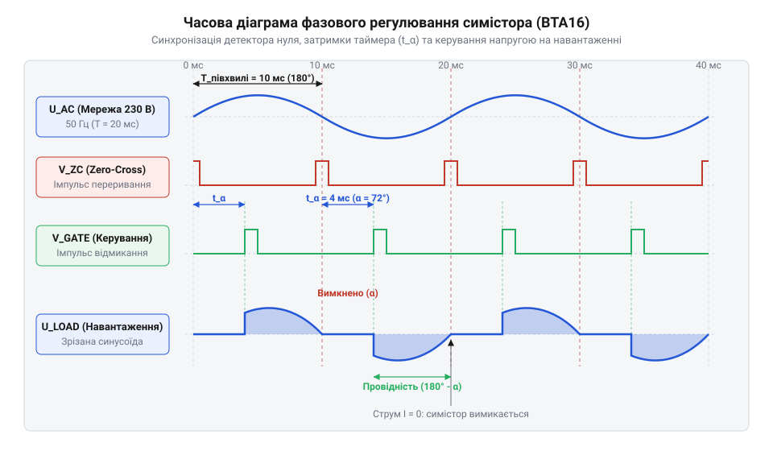
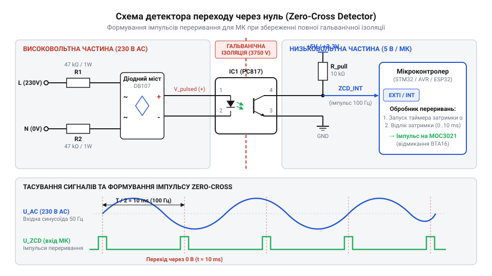

# Керований мікроконтролером фазовий регулятор потужності

<preknowlist>
- [MOC3063 — оптосимістор з детектором нуля](root:cat-hw-drivers/moc3063-optotriac) — принцип роботи оптичної розв'язки силового ключа та механізм схемного блокування відмикання симістора поза точкою переходу через нуль.
- [Твердотільне реле G3MB-202P (2 А / 240 В)](root:cat-hw-drivers/ssr-g3mb-202p) — базова концепція твердотільної комутації навантаження змінного струму та обмеження дискретного керування без фазового регулювання.
</preknowlist>

## Проблема плавного керування мережевою напругою

Спроба регулювати потужність нагрівача чи яскравість лампи розжарювання в мережі @@en|змінного струму@@ напругою `230 V` за допомогою звичайного ключа або @@en|широтно-імпульсної модуляції@@ (англ. @@en|pulse-width modulation@@, скорочено @@en|ШІМ@@) низької частоти створює серйозні проблеми. Якщо вмикати й вимикати навантаження з частотою у кілька герців, лампа сильно мерехтить, а швидке перемикання силового кола в довільні моменти часу викликає потужні струмові кидки та радіозавади. Використати для плавного керування [звичні твердотільні реле](root:cat-hw-drivers/ssr-g3mb-202p) теж не вдасться: вони комутують струм лише під час повного проходження синусоїди й не вміють дозовано відрізати частину електричної енергії всередині кожного півперіоду.

Щоб плавно змінювати потужність без мерехтіння й клацання, застосовують @@en|фазове регулювання@@ (англ. @@en|phase control@@). Ідея полягає в тому, щоб відкривати силовий ключ не на початку півхвилі, а із затримкою відносно моменту, коли напруга мережі проходить через нуль. Оскільки при частоті `50 Hz` один @@en|півперіод@@ синусоїди триває точно `10 ms`, змінюючи затримку відмикання ключа від `0` до `10 ms`, можна відрізати будь-яку частину півхвилі й тим самим регулювати середню потужність на навантаженні. Залежно від моменту перемикання ключа відсікання синусоїди виконують двома способами: як @@en|регулювання по передньому фронту@@ (англ. @@en|leading-edge phase control@@), коли ключ відкривається із затримкою всередині півхвилі й залишається відкритим до її завершення, або як @@en|регулювання по задньому фронту@@ (англ. @@en|trailing-edge phase control@@), коли ключ відкривається точно на початку півхвилі й примусово запирається всередині неї. Однак силові @@en|симістори@@ (англ. @@en|triac@@, скорочено від @@en|triode for alternating current@@ — триод для змінного струму) здатні працювати лише по передньому фронту. Після подачі керуючого імпульсу на затвор симістор відмикається й залишається у провідному стані доти, доки струм навантаження не знизиться нижче порогового значення, яке називають @@en|струмом утримання@@ (англ. @@en|holding current@@). Оскільки зняття сигналу з затвора не здатне перервати вже виниклий струм, примусово закрити відкритий симістор всередині півхвилі неможливо — він самочинно запирається тільки тоді, коли струм мережі природним чином проходить через нуль наприкінці півперіоду.


*Узгодження в часі імпульсу детектора нуля, затримки таймера та відсікання частини півхвилі напруги.*

Такий підхід вимагає від мікроконтролера жорсткої часової @@en|синхронізації@@ (грец. @@en|synchronos@@ — одночасний) з частотою мережі. Якщо мікроконтролер не знатиме точного моменту початку півхвилі, таймер затримки відраховуватиме час хаотично. У результаті фаза відмикання ключа буде постійно зсуватися, спричиняючи нестабільність потужності та блимання світла.

## Схемотехніка вузла детекції нуля мережі

Для апаратного визначення початку кожної півхвилі використовують @@en|детектор переходу через нуль@@ (англ. @@en|zero-cross detector@@). Безпосередньо підключати високовольтну мережу `230 V` до цифрових виводів мікроконтролера смертельно небезпечно для обладнання й людини, тому вузол обов'язково будують із використанням @@en|гальванічної розв'язки@@ (від імені науковця Луїджі Гальвані) на базі @@en|оптопари@@ (грец. @@en|optos@@ — видимий).

Мережева напруга подається через @@en|випрямний міст@@ і пару потужних обмежувальних резисторів на вхідний світлодіод @@en|оптопари@@. Оскільки напруга синусоїди більшу частину часу перевищує поріг увімкнення світлодіода, фототранзистор на виході відкритий і притягує цифровий вивід мікроконтролера до землі. Проте у момент, коли синусоїда опускається ближче до `0 V`, струму через світлодіод стає недостатньо, фототранзистор закривається, і @@en|підтягувальний резистор@@ (англ. @@en|pull-up resistor@@) короткочасно піднімає напругу на виході до `5 V` або `3.3 V`.


*Схема детектора переходу через нуль на світлодіодній оптопарі із захисними обмежувальними резисторами.*

Розрахунок обмежувальних резисторів первинного кола виконують за амплітудною напругою мережі. Для амплітуди `U_peak ≈ 325 V` і бажаного струму світлодіода `I_LED ≈ 5 mA` загальний опір резисторів становитиме:

```
R_total = U_peak / I_LED
        = 325 V / 0.005 A
        = 65 kΩ                 [закон Ома для вхідного кола]
```

Опір ділять на два резистори по `33 kΩ`, з'єднані послідовно у фазному та нульовому провідниках, що підвищує безпеку й розсіювальну потужність. Сумарну теплову потужність `P_total`, яка розсіюється на цих резисторах під дією діючої напруги мережі `U_rms = 230 V` при їхньому загальному опорі `R_total = 66 kΩ`, обчислюють за законом Джоуля — Ленца:

```
P_total = U_rms² / R_total
        = (230 V)² / 66 000 Ω
        = 52 900 V² / 66 000 Ω
        ≈ 0.8 W                 [сумарна потужність розсіювання]
```

Оскільки опір рознесено на два однакові компоненти, на кожен резистор припадає половина теплового навантаження: `P_R = P_total / 2 ≈ 0.4 W`. Для стабільної тривалої роботи без небезпечного перегріву та деградації друкованої плати обирають елементи із щонайменше двократним запасом за потужністю (`P_rated ≥ 0.8 W`), тобто стандартні вивідні резистори потужністю `1 W` або поверхнево-монтовані @@en|SMD-резистори@@ (англ. @@en|surface-mount device@@) типорозміру `2512`. У результаті на виході @@en|оптопари@@ формуються чіткі імпульси тривалістю близько `200...400 μs`, які виникають кожні `10 ms` і подаються на вивід @@en|зовнішнього переривання@@ (англ. @@en|external interrupt@@) мікроконтролера.

## Силовий ключ і фазовий оптодрайвер

Отримавши безпечний сигнал синхронізації, можна комутувати силову частину на базі @@en|симістора@@ (англ. @@en|triac@@, від @@en|triode for alternating current@@ — триод для змінного струму) BTA16. Для гальванічного керування @@en|симістором@@ використовують спеціальний @@en|фазовий оптосимістор@@ (англ. @@en|optotriac@@) MOC3021. Принципово важливо не переплутати його з пристроями на кшталт [оптосимісторів серії MOC3063](root:cat-hw-drivers/moc3063-optotriac): чипи із вбудованим @@en|детектором нуля@@ дозволяють вмикання лише в момент `0 V`, тому блокують подачу імпульсу в середині півхвилі й абсолютно непридатні для фазового димування. Натомість MOC3021 є «випадковим» (random-phase) драйвером, який відкривається негайно при подачі струму на вхідний світлодіод.

Коли мікроконтролер подає короткий відкривальний імпульс на MOC3021, внутрішній фотосимістор замикає коло @@en|керуючого електрода@@ (англ. @@en|gate@@) силового @@en|симістора@@ BTA16 через обмежувальний резистор. @@en|Симістор@@ BTA16 миттєво відкривається і залишається у провідному стані доти, доки струм навантаження природно не впаде майже до нуля наприкінці півхвилі. Для обмеження імпульсного струму @@en|керуючого електрода@@ послідовно з виходом MOC3021 ставлять резистор `R_g ≈ 220...360 Ω`.

При роботі з @@en|індуктивним навантаженням@@ (мотори, трансформатори) струм відстає від напруги за фазою. З цієї причини в момент закриття @@en|симістора@@ виникає стрімкий стрибок напруги `dU/dt`, який може мимовільно знову відкрити @@en|симістор@@. Для захисту паралельно силовим виводам BTA16 підключають @@en|снабер@@ (англ. @@en|snubber@@, від @@en|to snub@@ — гасити) — послідовне RC-коло з резистора `39...100 Ω` та високовольтного конденсатора `10...100 nF` (класу X2 на напругу не менше `400 V`), яке поглинає високочастотні сплески. індуктивним навантаженням@@ | Докладніше про розрахунок та вибір компонентів захисного демпфера дивіться у матеріалі про [снаберні RC-кола в колах змінного струму](root:cat-hw-drivers/moc3063-optotriac/math-triac-snubber-calculation.md).

## Алгоритм таймерів та обробка переривань

Для регулювання потужності в мережі змінного струму недостатньо просто увімкнути ключ. Оскільки мережа 50 Гц змінює напрямок струму 100 разів на секунду, кожен півперіод триває точно 10000 мкс (мікросекунд). Якщо [застосовують оптосимістор з детектором](root:cat-hw-drivers/moc3063-optotriac) нуля, симістор відкриється тільки на початку півхвилі, що унеможливлює зріз фази. Для довільного фазового регулювання потрібен фазовий оптодрайвер @@en|MOC3021@@ та керований мікроконтролерний @@en|timer@@ (англ. *time* — час).

Алгоритм керування спирається на дві апаратні події мікроконтролера: зовнішнє переривання та збіг таймера. Сигнал від @@en|Zero-Cross Detector@@ (англ. *zero* — нуль, *cross* — перетин, *detector* — виявник) надходить на вхід @@en|GPIO@@ і викликає обробник переривання @@en|ISR@@ (англ. *Interrupt Service Routine* — процедура обслуговування переривань). У момент виявлення нуля обробник обнуляє лічильник апаратного таймера й задає йому поріг порівняння, який відповідає часовій затримці `t_delay` у діапазоні від 0 до 10000 мкс. Коли @@en|timer@@ відраховує задану затримку, генерується переривання таймера, яке подає коротке відкриваюче значення HIGH тривалістю 20–50 мкс на світлодіод @@en|MOC3021@@. Твердотільний симістор @@en|BTA16@@ відмикається й залишається у провідному стані до кінця півхвилі без подальшого утримання сигналу керування.

Нижче наведено концептуальну реалізацію обробки переривань та таймера для мікроконтролерних платформ.

:::tabs
@tab C (ESP-IDF)
:::code proj-phase-control-dimmer/c/esp-idf/zero-cross-isr.c
@tab C++ (Arduino)
:::code proj-phase-control-dimmer/cpp/arduino/onzerocross.cpp
:::

Час затримки `t_delay` прямо визначає кут відмикання симістора `α`. Введемо кут відмикання `α` у радіанах від `0` до `π`, де `α = π × (t_delay / 10000 мкс)`. Відносна вихідна діюча потужність `P_rel` обчислюється інтегруванням квадратів миттєвої напруги синусоїди на інтервалі від `α` до `π`:

```
P_rel = (1 / π) × ∫[α..π] sin²(θ) dθ
      = (1 / π) × ∫[α..π] (1 - cos(2θ)) / 2 dθ    [тригонометрична тотожність]
      = 1 - α / π + sin(2 × α) / (2 × π)         [первісна та підстановка меж]
```

У цій формулі `P_rel` дорівнює відношенню вихідної потужності до її максимального значення, а `α` — куту затримки відмикання симістора. З отриманого виразу видно, що залежність є нелінійною: біля меж півхвилі (`α ≈ 0` або `α ≈ π`) зміна затримки майже не змінює потужність, а в центрі півперіоду (`α = π / 2`) чутливість регулювання є максимальною. Щоб забезпечити лінійну зміну потужності від 0 до 100%, програма повинна використовувати попередньо обчислену таблицю перекодування @@en|look-up table@@ (англ. *look-up* — пошук, *table* — таблиця), яка перераховує бажаний відсоток потужності у відповідні мікросекунди затримки `t_delay`.

Такий підхід є критичним для роботи мікроконтролера у реальному часі, оскільки пряме розв'язання нелінійного рівняння `P_rel = 1 - α / π + sin(2 × α) / (2 × π)` відносно кута `α` вимагає ітераційних чисельних методів та обчислень із плаваючою комою @@en|floating-point@@ (англ. *float* — плавати, *point* — крапка). Виконання обчислень такої складності всередині швидкодіючої процедури @@en|ISR@@ при кожному переході через нуль забирає десятки мікросекунд процесорного часу та створює часовий джиттер @@en|jitter@@ (англ. *jitter* — тремтіння) імпульсу керування. Попередньо сформований масив із 101 значення затримки, збережений у флеш-пам'яті @@en|flash memory@@ (англ. *flash* — спалах, *memory* — пам'ять), дозволяє зчитувати значення `t_delay` за бажаним відсотком потужності як за індексом за константний час `O(1)`, забезпечуючи точну синхронізацію та плавне регулювання навантаження.

## Складання, налагодження та електробезпека проєкту

Складений регулятор працює безпосередньо з мережевою напругою 230 В, тому помилки в монтажі або програмі можуть призвести до короткого замикання та пошкодження мікроконтролера. На відміну від випадків, де [просте твердотільне реле](root:cat-hw-drivers/ssr-g3mb-202p) повністю захищає низьковольтну частину за рахунок готового заводського модуля, саморобна схема вимагає суворого дотримання послідовності першого запуску та ізоляції.

Перше тестове ввімкнення регулятора виконують обов'язково через послідовно підключену лампу розжарювання потужністю 60–100 Вт замість реального потужного навантаження. Якщо в схемі є пробій симістора @@en|BTA16@@ або помилка в @@en|GPIO@@, лампа просто засвітиться на повну яскравість, обмеживши струм і відвернувши вибух силових елементів. Під час першого запуску осцилографом із розв'язувальним трансформатором перевіряють чіткість фронтів імпульсів від @@en|Zero-Cross Detector@@ та відсутність @@en|jitter@@ (англ. *jitter* — тремтіння) у часі спрацьовування @@en|ISR@@.

Під час робочих випробувань розрізняють активне та індуктивне навантаження. Для нагрівачів і ламп розжарювання напруга й струм збігаються за фазою, тому симістор вимикається рівно в точці переходу напруги через нуль. Якщо ж регулятор підключають до індуктивного навантаження (трансформатори, електродвигуни), струм відстає від напруги. Симістор @@en|TRIAC@@ (англ. *triode for alternating current* — триод для змінного струму) вимикається лише тоді, коли через нього припиняє протікати струм. Через це виникнення високого значення `dU/dt` у момент розмикання може самовільно знову відкрити симістор. Для запобігання фазовим зсувам та хаотичному відкриванню паралельно симістору встановлюють @@en|snubber@@ (англ. *snub* — гасити) (RC-ланцюг 39 Ом та 10 нФ) і захисний варистор @@en|varistor@@ (англ. *variable resistor* — варистор) для поглинання мережевих імпульсних завад. У програмі також реалізують програмний @@en|debouncing@@ (англ. *de-bounce* — усунення брязкоту) переривань, блокуючи повторні спрацьовування @@en|Zero-Cross Detector@@ на 2–3 мс після першого фронту.

Конструктивна електробезпека пристрою визначається фізичним розмежуванням високовольтної та низьковольтної зон на друкованій платі. Повітряний зазор @@en|clearance@@ (англ. *clearance* — зазор у повітрі) та шлях витоку струму по поверхні @@en|creepage@@ (англ. *creepage* — шляхи витоку) між лініями 230 В і колами мікроконтролера повинні становити не менше 6–8 мм. Під оптопарою та оптодрайвером @@en|MOC3021@@ роблять наскрізний фрезерований паз у платі для виключення пробою по нагару. Хоча корпус симістора @@en|BTA16@@ має внутрішню гальванічну ізоляцію кристала від металевого фланця, алюмінієвий радіатор охолодження підлягає обов'язковому підключенню до захисного заземлення PE. На вході мережі 230 В обов'язково встановлюють швидкий плавкий запобіжник, розрахований на номінальний струм навантаження.
