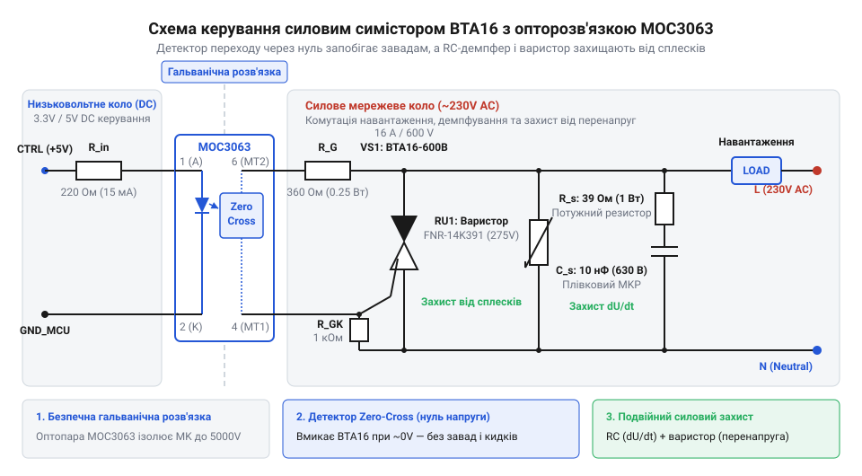
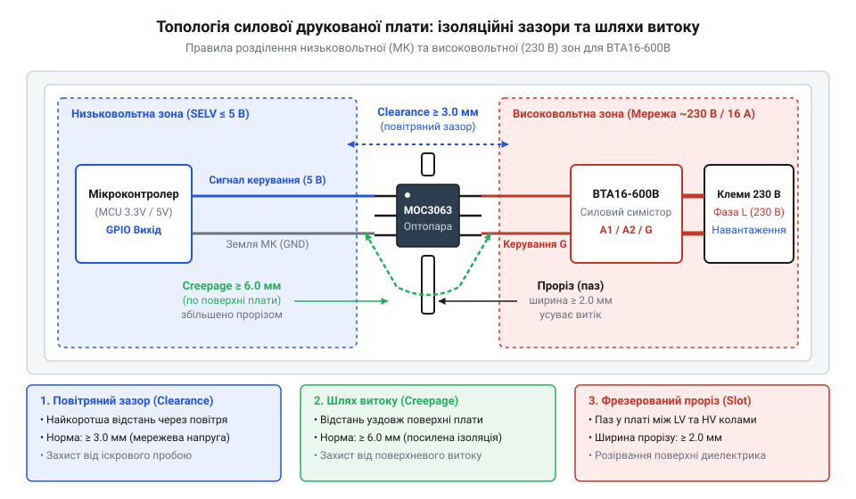

# Модуль твердотільного реле 230 В з детекцією переходу через нуль

<preknowlist>
- [MOC3063 — оптосимістор з детектором нуля](root:cat-hw-drivers/moc3063-optotriac) — Принцип роботи вхідного світлодіода, оптичного фотосимістора та вбудованої схеми виявлення переходу напруги через нуль.
- [Твердотільне реле G3MB-202P (2 А / 240 В)](root:cat-hw-drivers/ssr-g3mb-202p) — Обмеження інтегрованих малопотужних твердотільних реле за струмом та причини переходу до дискретного ключа BTA16 для важких навантажень.
</preknowlist>

## Небезпека комутації мережевого навантаження напряму

Подача силової мережевої напруги 230 В безпосередньо з виходу @@en|мікроконтролер@@ створює пряму загрозу миттєвого руйнування низьковольтної електроніки. Цифрові порти керування працюють за напруг 3.3 В або 5 В, тоді як амплітудне значення мережевої напруги сягає 325 В. Найменший пробій силового напівпровідника чи коротке замикання в колі комутації пробиває високу напругу в низьковольтну шину живлення, що спалює кристали МК та створює смертельний ризик ураження струмом для користувача.

Окрім прямого електричного пробою, комутація в довільний момент фази змінної напруги генерує потужні радіозавади та струмові сплески. Якщо ключовий елемент замикається на піку синусоїди, коли миттєва напруга максимальна, стрибок напруги викликає кидок струму за законами індуктивності й ємності. Ці імпульсні завади наводяться на лінії зв'язку, спричиняють хибні перезавантаження МК та збої сенсорів.

Для слабких навантажень струмом до 2 А розробники іноді використовують [модулі твердотільних реле](root:cat-hw-drivers/ssr-g3mb-202p), проте силові прилади на 16 А вимагають дискретної побудови силового вузла. Безаварійна робота високовольтної частини можлива лише за двох умов: фізичного відокремлення кіл через @@en|гальванічна розв'язка@@ (від @@it|Galvani@@ — пов'язаний з ім'ям вченого Гальвані) та ввімкнення струму суворо в момент @@en|Zero-Cross@@ (переходу синусоїди через нуль).

## Принцип гальванічної розв'язки й детекції нуля

Передавати сигнал керування у високовольтний силовий блок без фізичного контакту дозволяє світловий промінь. Для цього застосовують [оптосимістор з детектором нуля](root:cat-hw-drivers/moc3063-optotriac) MOC3063. Всередині його корпусу розміщено інфрачервоний світлодіод та фотосимісторний кристалик, розділені прозорим діелектриком із міцністю ізоляції понад 5000 В.

Особливість компонента MOC3063 полягає у вбудованому селекторі напруги @@en|Zero-Cross@@. Коли на світлодіод подається струм, він випромінює світло, проте внутрішній ключ не відкривається негайно, якщо миттєва напруга мережі перевищує поріг близько 20 В. Схема чекає, поки синусоїда мережі зменшиться і перетне нуль. Лише у вузькому вікні поблизу 0 В відкривається внутрішній @@en|оптосимістор@@ (від @@en|opto-@@ — оптичний та @@en|TRIAC@@ — триод змінного струму). Це гарантує ввімкнення навантаження за найменшої напруги, виключаючи сплески струму.

Для стабільного світіння світлодіода без перевантаження порту @@en|GPIO@@ мікроконтролера розраховують струмообмежувальний резистор. Напруга живлення керуючого кола позначена як `V_CC`, пряме падіння напруги на вхідному світлодіоді — `V_F`, номінальний струм відкривання світлодіода — `I_F`, а необхідний опір обмежувального резистора — `R_LED`.

**Розрахунок струмообмежувального резистора вхідного світлодіода при живленні 5 В:**
```
R_LED = (V_CC - V_F) / I_F
      = (5.0 - 1.3) / 0.010    [підстановка напруги 5 В, падіння 1.3 В та струму 10 мА]
      = 3.7 / 0.010            [обчислення різниці потенціалів на резисторі]
      = 370                    [розрахований опір у омах]
```
Зі стандартного ряду E24 обирають номінал 360 Ом або 390 Ом, що забезпечує надійне відмикання світлодіода.

## Силова комутація симістором BTA16-600B

Внутрішній фотосимістор оптопари MOC3063 витримує лише невеликий імпульсний струм, тому він не може безпосередньо живити навантаження 16 А. Для комутації високої потужності вихід оптодрайвера керує затвором силового ключа — @@en|BTA16-600B@@. @@en|симістор@@ є напівпровідниковим приладом з двонаправленою провідністю, який відкривається від короткого імпульсу струму керуючого електрода та залишається у провідному стані до кінця півхвилі змінного струму.

Коли @@en|оптосимістор@@ відкривається у момент @@en|Zero-Cross@@, він пропускає відмикаючий струм мережі на керуючий електрод BTA16-600B. Силовий симістор переходить у стан насичення та комутує струм до 16 А в обох півперіодах синусоїди. Після проходження струму через нуль симістор автоматично закривається, і для подальшої роботи вимагає повторної подачі керуючого імпульсу від оптопари на початку наступного півперіоду.


*Принципова електрична схема силового модуля з оптичною розв'язкою, відмиканням у нулі напруги, захисним RC-демпфером та варистором.*

Для обмеження пікового струму затвора силового симістора у момент спрацьовування детектора нуля розраховують обмежувальний резистор `R_G`. Напруга відсічки детектора нуля позначена як `V_IH`, необхідний струм відкривання затвора силового симістора — `I_GT`, а опір обмежувального резистора затвора — `R_G`.

**Розрахунок струмозадаючого резистора керуючого електрода симістора BTA16-600B:**
```
R_G = V_IH / I_GT
    = 20 / 0.050              [підстановка порогу детектора нуля 20 В та струму затвора 50 мА]
    = 400                     [розрахований опір у омах]
```
Зі стандартного ряду обирають резистор номіналом 360 Ом потужністю 0.25 Вт. Для запобігання хибному відмиканню силового симістора від завад між затвором та тиристорним виводом MT1 додають шунтувальний резистор `R_GK` номіналом 1 кОм.

Процедурний та об'єктно-орієнтований драйвери забезпечують безпечну ініціалізацію керуючого пина, встановлюючи вимкнений стан у регістрі даних до переведення пина в режим виходу:

:::code proj-zero-cross-solid-state-switch/c/bta16.c 41-70
:::code proj-zero-cross-solid-state-switch/cpp/TriacDriver.cpp 12-23

## Захист силового ключа від завад

Комутація мережевого навантаження 230 В супроводжується швидкими перехідними процесами, які можуть вивести з ладу силовий @@en|симістор@@ або спричинити його самовільне відкривання. Головною загрозою для напівпровідникового кристала є висока швидкість наростання напруги `dV/dt` між основними виводами MT1 та MT2, а також високовольтні комутаційні імпульси в мережі.

Коли напруга на виводах закритого ключа зростає занадто швидко, внутрішня ємність `p-n`-переходу створює струм зсуву. Цей струм потрапляє в область затвора і відкриває ключ без подачі керуючого імпульсу від оптодрайвера. Для придушення швидкості наростання напруги паралельно силовим виводам симістора підключають @@de|демпферне коло@@ (нім. *dämpfen* — пригнічувати), що складається з послідовно з'єднаних резистора `R_s` та конденсатора `C_s`. Такий @@de|RC-демпфер@@ шунтує високочастотні сплески. Конденсатор поглинає енергію швидкого стрибка напруги, а резистор обмежує амплітуду струму розряду конденсатора через кристал симістора в момент його планового ввімкнення.

Для розрахунку граничного струму розряду демпферного конденсатора `C_s` скористаємося величиною амплітудної мережевої напруги `V_peak` та опором демпферного резистора `R_s`:

```
I_peak
= V_peak ÷ R_s
= 325 ÷ 39
= 8.33 A                 [амплітуда струму розряду демпфера]
```

Отриманий піковий струм `8.33 A` є повністю безпечним для симістора BTA16-600B, ударний струм якого сягає `160 A`. При виборі компонентів обирають демпферний конденсатор ємністю від `10 nF` до `47 nF` із робочою напругою не менше 400 VAC (клас X2), а резистор — опором `39 Ohm`–`100 Ohm` потужністю `1 W`–`2 W`. Детальний математичний розрахунок реактивного опору висвітлюють [демпферні кола силових ключів](root:hw-power/snubbers-dvdt).

Другим фактором ризику є імпульсні перенапруги, викликані блискавками або вимкненням потужних індуктивних навантажень поблизу. Якщо напруга в мережі перевищить критичну межу пробою симістора `V_DRM = 600 B`, ключ зазнає теплового руйнування. Для захисту паралельно мережевим виводам встановлюють @@en|варистор@@ (англ. *variable resistor* — змінний резистор). При нормальній напрузі 230 VAC @@en|варистор@@ має опір у кілька мегаом і не впливає на роботу кола. Коли імпульс перенапруги перевищує поріг спрацьовування (наприклад, 275 VAC для елемента MOV-14D431K), його опір лавиноподібно падає до часток ома, шунтуючи високовольтний викид на себе. Специфіку підбору класифікаційної напруги та поглинаної енергії описує [варисторний захист від перенапруг](root:hw-components/varistor).


*Схема захисту силового симістора BTA16-600B від високої швидкості наростання напруги dV/dt та високовольтних мережевих сплесків.*

Коли команда від [оптосимістора з детектором нуля](root:cat-hw-drivers/moc3063-optotriac) зникає, силовий @@en|симістор@@ BTA16 не закривається миттєво, а чекає природного спаду струму нижче рівня утримання. У колах із реактивним навантаженням струм відстає від напруги за фазою, тому в момент згасання струму напруга мережі вже перебуває поблизу амплітудного значення. Через це на закритих виводах ключа виникає крутий фронт напруги — @@la|комутаційна@@ (лат. *commutatio* — зміна) швидкість наростання `(dV/dt)_c`. Без @@de|RC-демпфера@@ цей стрибок створює внутрішній струм зсуву, який знову відмикає @@en|симістор@@ на початку кожного наступного півперіоду, позбавляючи схему можливості вимкнутися. Обмежуючи швидкість наростання напруги під час розмикання, @@de|демпферне коло@@ забезпечує надійне закриття ключа, а @@en|варистор@@ захищає кристал від руйнівних високовольтних викидів мережі.

## Проектування та безпечне трасування плати

Надійність твердотільного модуля залежить не лише від розрахунку схемотехніки, а й від дотримання норм електробезпеки при фізичному розведенні друкованої плати. Високовольтна силова частина 230 В та низьковольтне коло керування мікроконтролера мають бути фізично розділені для запобігання електричному пробою та ураженню користувача струмом.

Головними параметрами безпечної топології є @@en|повітряний зазор@@ (англ. *clearance* — вільний простір) та @@en|шлях витоку@@ (англ. *creepage* від *creep* — повзти). @@en|Повітряний зазор@@ визначає найкоротшу відстань між провідниками через повітря, а @@en|шлях витоку@@ — найкоротшу відстань уздовж поверхні текстоліту. Згідно зі стандартом IEC 60664-1, для посиленої гальванічної ізоляції між мережевими ланцюгами 230 VAC та низьковольтним мікроконтролером @@en|повітряний зазор@@ має становити не менше `6.0 mm`, а @@en|шлях витоку@@ — не менше `8.0 mm`. Нормативні таблиці залежності зазорів від ступеня забруднення плати наводять [повітряні зазори та шляхи витоку](root:hw-pcb/creepage-clearance).

Коли габарити плати не дозволяють витримати відстань `8.0 mm` між виводами оптопари, у @@de|склотекстоліт@@ фрезерують @@en|ізоляційний проріз@@ шириною `1.5 mm`–`2.0 mm` безпосередньо під корпусом елемента. Повітря замінює поверхню плати, унеможливлюючи утворення струмопровідного містка через пил або вологу.


*Розподіл зон високої та низької напруги на друкованій платі силового модуля із застосуванням ізоляційного прорізу та нормованих зазорів.*

Другий аспект трасування — розрахунок ширини силових доріжок. При проходженні діючого струму `I_rms = 16 A` через стандартний мідний шар завтовшки `35 um` (1 oz) вузька доріжка починає інтенсивно грітися. Щоб перегрів провідника не перевищував `10 °C`, ширина доріжки на зовнішньому шарі плати має становити не менше `8.0 mm`. За обмеженого простору ширину доріжки зменшують до `4.0 mm`, але залишають її відкритою від паяльної маски та під час монтажу посилюють товстим шаром припою або впаяною мідною жилою перетином `1.5 mm²`.

Окрему увагу приділяють охолодженню симістора BTA16. Під час роботи на кристалі виникає падіння напруги `V_TM ≈ 1.3 B`. Визначимо розсіювану теплову потужність `P_loss` при прямому струмі `I_rms = 16 A`:

```
P_loss
= I_rms × V_TM
= 16 × 1.3
= 20.8 W                 [розсіювана теплова потужність ключа]
```

Без зовнішнього охолодження симістор миттєво перегріється та вийде з ладу. Виходячи з максимальної температури кристала `T_j_max = 125 °C` та температури навколишнього середовища `T_a = 40 °C`, обчислимо граничний сумарний @@la|тепловий опір@@ `R_th_total`:

```
R_th_total
= (T_j_max - T_a) ÷ P_loss
= (125 - 40) ÷ 20.8
= 4.08 K/W               [максимально припустимий сумарний тепловий опір]
```

Віднявши внутрішній опір перехода-корпус `1.2 K/W` та опір термопасти `0.5 K/W`, отримуємо необхідний опір @@la|радіатор@@-середовище `R_th_sa ≤ 2.38 K/W`. Це вимагає використання ребристого алюмінієвого профілю з площею поверхні близько `150`–`200 cm²`. Методику детального вибору профілів охолодження описує [тепловий розрахунок радіаторів](root:hw-components/heatsink).

## Програмне керування та випробування модуля

Фізично зібраний силовий модуль вимагає грамотного програмного керування з боку мікроконтролера. Помилки при ініціалізації виводів @@en|мікроконтролер@@а можуть призвести до короткочасного подавання логічного рівня на вхід оптопари в момент подачі живлення, що викликає хибний клацаючий запуск навантаження 230 В.

При скиданні мікроконтролера виводи GPIO перебувають у @@en|стан високого опору@@ (High-Z). Якщо налаштувати режим роботи виводу як вихід (`OUTPUT`) до встановлення потрібного логічного стану у вихідному регістрі даних (`ODR`), на пині на коротку мить з'явиться невизначений потенціал. Безаварійний алгоритм ініціалізації вимагає спочатку записати у вихідний регістр вимкнений стан (логічний 0 для active-HIGH або логічну 1 для active-LOW), і лише після цього переводити напрямок виводу в режим виходу. Після цього витримують безпечну паузу тривалістю `50 ms` для завершення перехідних процесів у джерелі живлення МК.

Нижче наведено практичні драйвери керування силовим ключем BTA16 мовами C та C++ з підтримкою безпечного старт-апу та неблокуючого таймерного вимкнення. На відміну від малопотужних інтегрованих рішень, якими є [твердотільне реле G3MB-202P](root:cat-hw-drivers/ssr-g3mb-202p), дискретне реле на BTA16 керується тривалим утриманням струму світлодіода оптодрайвера протягом усього інтервалу увімкненого стану.

:::tabs
@tab C
:::code proj-zero-cross-solid-state-switch/c/bta16.h
:::code proj-zero-cross-solid-state-switch/c/bta16.c
:::code proj-zero-cross-solid-state-switch/c/main.c

@tab C++ (Arduino)
:::code proj-zero-cross-solid-state-switch/cpp/TriacDriver.h
:::code proj-zero-cross-solid-state-switch/cpp/TriacDriver.cpp
:::code proj-zero-cross-solid-state-switch/cpp/main.cpp
:::

Перший запуск та випробування зібраного модуля виконують у три етапи з дотриманням правил електробезпеки:

1. **Холодна перевірка без мережі 230 В.** Модуль підключають лише до низьковольтної частини МК. Мультиметром або осцилографом у режимі прозвонки перевіряють появу керуючого струму на світлодіоді оптопари при виклику функцій увімкнення та вимкнення.
2. **Випробування під малопотужним навантаженням.** Силові клеми модуля підключають до мережі 230 В через послідовно з'єднану лампу розжарювання потужністю `60 W`. Переконуються, що під час передачі сигналу керування лампа світиться без мерехтіння, а при знятті сигналу повністю гасне без гудіння та хибних спалахів.
3. **Випробування під номінальним навантаженням 16 А.** Модуль підключають до потужного активного навантаження (наприклад, електрообігрівача на `3.5 kW`). Протягом 30 хвилин безперервної роботи пірометром контролюють температуру радіатора симістора (повинна стабілізуватися не вище `75 °C`) та перевіряють відсутність високочастотних завад у мережі.
