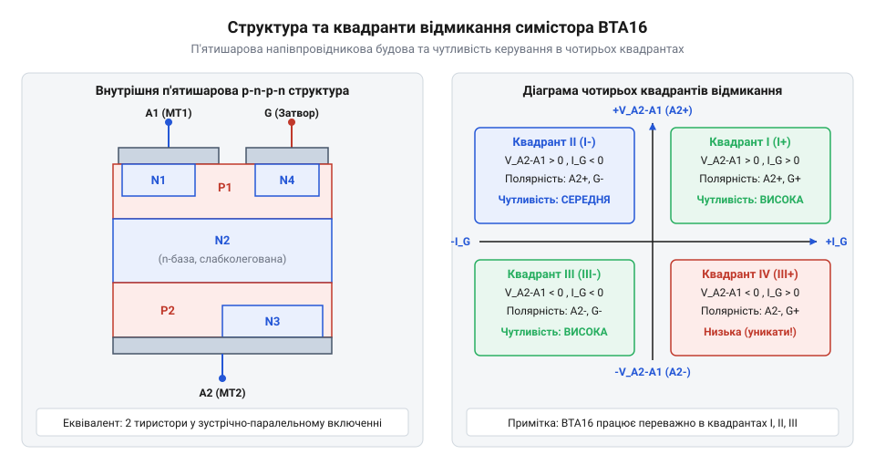
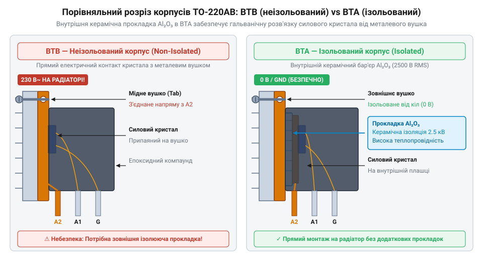
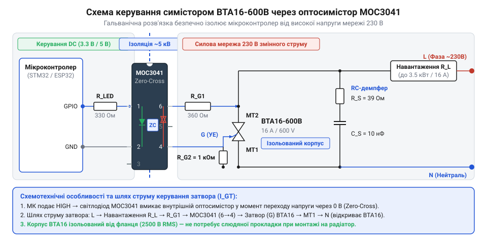
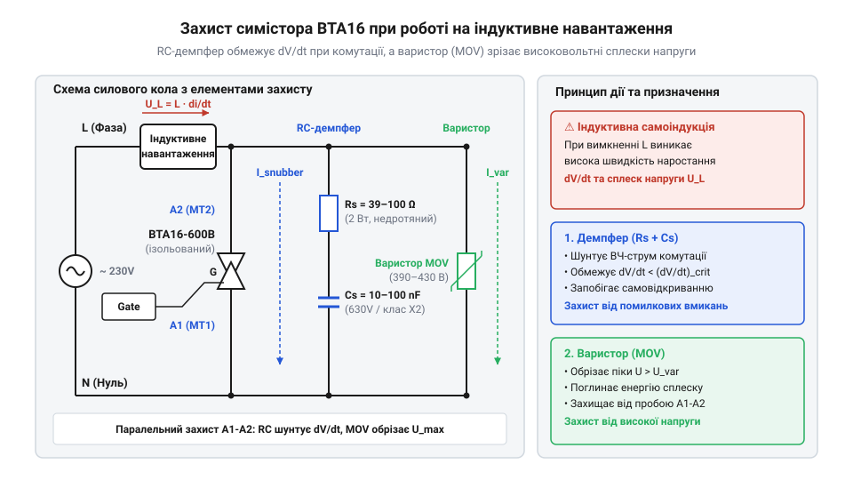

# Симістор BTA16-600B

<preknowlist>
- [Твердотільне реле G3MB-202P (2 А / 240 В)](root:cat-hw-drivers/ssr-g3mb-202p) — концепція безконтактної твердотільної комутації навантаження змінного струму
- [MOC3063 — оптосимістор з детектором нуля](root:cat-hw-drivers/moc3063-optotriac) — принцип дії оптичної розв'язки та функції детектора переходу напруги через нуль
</preknowlist>

## Проблема комутації потужного змінного струму

Керування мережевим навантаженням змінного струму з напругою 230 В та частотою 50 Гц ставить перед електронною схемою завдання швидко, безіскрово та з мінімальними втратами вмикати й вимикати електричне коло. При керуванні потужними нагрівачами, електродвигунами або освітлювальними приладами звичайне механічне реле швидко виходить з ладу. Визначна проблема механічних контактів — утворення електричної дуги під час розмикання кола під навантаженням. Електрична дуга викликає ерозію металу, зварювання контактних груп та створює потужні радіозавади. Крім того, механічний привід реле не здатний здійснювати фазове регулювання потужності чи комутацію з частотою у десятки герц через інерційність та обмежений ресурс спрацьовувань.

Спроба застосувати для комутації змінного струму класичні напівпровідникові ключі постійного струму — польові транзистори @@en|MOSFET@@ (від англ. @@en|metal-oxide-semiconductor field-effect transistor@@ — польовий транзистор зі структурою метал-оксид-напівпровідник) або біполярні транзистори — наштовхується на фундаментальне фізичне обмеження. Синусоїдальна напруга мережі змінює полярність 100 разів на секунду. У структурі звичайного N-канального польового транзистора технологічна p-область підкладки кристала з'єднана з електродом @@en|витоку@@ (від англ. @@en|source@@ — джерело носіїв) для запобігання паразитному вмиканню внутрішнього біполярного транзистора. Цей необхідний технологічний короткозамкнений контакт створює між p-підкладкою @@en|витоку@@ та n-областю @@en|стоку@@ (від англ. @@en|drain@@ — сток носіїв) внутрішній @@en|паразитний діод@@ (від англ. @@en|parasitic diode@@ — паразитний діод). @@en|body diode@@ — діод підкладки кристала) на основі кремнієвого @@en|p-n переходу@@ (від англ. @@en|p-n junction@@ — межа розділу напівпровідників p-типу та n-типу). Під час позитивної півхвилі змінного струму потенціал @@en|стоку@@ вищий за потенціал @@en|витоку@@, тому @@en|p-n перехід@@ перебуває у зворотно-зміщеному запертому стані та не заважає @@en|затвору@@ (від англ. @@en|gate@@ — затвор). @@en|gate@@ — ворота для носіїв) керувати струмом. Коли синусоїда напруги змінює полярність на протилежну, @@en|витік@@ стає позитивним відносно @@en|стоку@@, і фізична схема проходження струму кардинально змінюється. Зовнішня напруга мережі зміщує @@en|p-n перехід@@ @@en|паразитного діода@@ в прямому напрямку, викликаючи зниження потенціального бар'єра на межі напівпровідників. Основні носії заряду — дірки з p-області @@en|витоку@@ та електрони з n-області @@en|стоку@@ — починають масово зустрічно рухатися через прямозміщений @@en|p-n перехід@@. Струм негативної півхвилі протікає безпосередньо через об'єм напівпровідникового кристала в обхід ізольованого поверхневого каналу. Управляюче електричне поле на @@en|затворі@@ втрачає будь-який вплив на цей об'ємний потік носіїв. Транзистор повністю втрачає керованість і пропускає негативну півхвилю струму безперешкодно, що спричиняє миттєвий перегрів елемента та коротке замикання силової мережі.

Для керування обома півхвилями змінного струму потрібен напівпровідниковий пристрій із симетричною двоспрямованою провідністю. Щоб прослідкувати [історичний шлях розвитку силових](root:cat-hw-drivers/triac-bta16/hist-triac-evolution.md) напівпровідників, варто звернути увагу на перехід від односпрямованих ключових елементів до симетричних структур. Складені схеми на двох зустрічно-паралельних тиристорах або транзисторних мостах вимагають складних розв'язаних кіл керування для кожного затвора.

Суцільнотільний вимикач змінного струму має поєднувати двоспрямовану провідність кристала, низьке падіння напруги у відкритому стані, відсутність механічного зносу та можливість керування обома півхвилями струму за допомогою одного управляючого електрода. На відміну від малопотужних пристроїв, таких як [командне твердотільне реле](root:cat-hw-drivers/ssr-g3mb-202p) для струмів до 2 А, силовий ключ змінного струму має витримувати високі пускові навантаження. Цим вимогам відповідає @@en|симістор@@ (від англ. @@en|triac@@, скорочення від @@en|triode for alternating current@@ — триод для змінного струму) — симетричний кремнієвий @@en|тиристор@@ (від грец. @@grc|thyra@@ — двері, заслонка та англ. @@en|transistor@@ — транзистор).

За своєю внутрішньою дією @@en|симістор@@ еквівалентний двом тиристорам, увімкненим зустрічно-паралельно та об'єднаним на одному кремнієвому кристалі зі спільним управляючим електродом. Короткий імпульс струму керування відкриває напівпровідникову структуру для проходження струму в будь-якому напрямку залежно від полярності мережі. Після зняття керуючого імпульсу @@en|симістор@@ утримує відкритий стан самостійно. Він вимикається лише тоді, коли силовий струм навантаження спадає до нуля під час переходу синусоїди через нуль. Такий механізм самоутримання позбавляє управляючу схему потреби постійно витрачати енергію протягом усієї півхвилі напруги. Завдяки цьому @@en|симістор@@ стає ефективною основою для комутації потужних мережевих приладів — від побутових нагрівачів до промислових електродвигунів.

## Внутрішня структура та квадранти відмикання

Силовий @@en|симістор@@ @@en|BTA16-600B@@ являє собою монолітний напівпровідниковий кристал із п'ятишаровою p-n-p-n-n структурою, яка еквівалентна двом тиристорам, увімкненим зустрічно-паралельно зі спільним управляючим електродом. Силові виводи пристрою позначаються як основний вивід 1 (`A1`, або `MT1`) та основний вивід 2 (`A2`, або `MT2`), а керування здійснюється через електрод затвора (`G`, від англ. @@en|gate@@).


*Внутрішня будова кристала симістора та полярності напруги й струму затвора у чотирьох квадрантах відмикання.*

Перехід @@en|симістор@@а у відкритий провідний стан відбувається при подачі короткого імпульсу струму керування `I_GT` на електрод `G`. Подача струму керування викликає інжекцію носіїв заряду в базову ділянку кристала, що запускає внутрішній лавиноподібний процес позитивного зворотного зв'язку між транзисторними аналогами p-n-p та n-p-n структур. Кристал миттєво відмикається, а опір між виводами `A1` та `A2` падає до часток ома.

Залежно від полярності напруги між силовими виводами `A2` та `A1`, а також від напрямку струму керування через електрод `G`, роботу пристрою поділяють на чотири @@en|квадрант відмикання@@ (від лат. *quadrans* — четверта частина). @@la|quadrans@@ — четверта частина):

1. **Квадрант I (I+)**: потенціал виводу `A2` позитивний відносно `A1` (`V_A2-A1` > 0), струм керування втікає в затвор `G` (`I_G` > 0). Це найбільш чутливий режим відмикання, який вимагає мінімального струму керування.
2. **Квадрант II (I-)**: потенціал виводу `A2` позитивний відносно `A1` (`V_A2-A1` > 0), струм керування витікає з затвора `G` (`I_G` < 0). Відмикання відбувається стабільно з високою чутливістю.
3. **Квадрант III (III-)**: потенціал виводу `A2` негативний відносно `A1` (`V_A2-A1` < 0), струм керування витікає з затвора `G` (`I_G` < 0). Режим відповідає негативній півхвилі напруги мережі при негативному імпульсі керування.
4. **Квадрант IV (III+)**: потенціал виводу `A2` негативний відносно `A1` (`V_A2-A1` < 0), струм керування втікає в затвор `G` (`I_G` > 0). Фізика інжекції носіїв у цьому режимі є найменш ефективною. При від'ємній напрузі на `A2` основним провідним шляхом стає структура `P2-N1-P1-N3`. Втікаючий струм затвора `I_G` змушує допоміжну ділянку `N2` біля виводу `A1` інжектувати електрони в шар `P2`. Проте через позитивний потенціал затвора `G` у шарі `P2` виникає протилежний електричний градієнт, який заважає електронам рухатися напряму до `P2-N1` переходу. Носії змушені здійснювати @@en|дистанційна інжекція носіїв@@ (від лат. *injectio* — уприскування). @@la|distantia@@ — відстань та @@la|injectio@@ — впорскування), дифундуючи вбік уздовж шару `P2`. Під час цієї довгої дифузії значна частина електронів втрачається через @@en|рекомбінація носіїв@@ (від лат. *re-* та *combinatio* — повторне з'єднання). @@la|re-@@ — знову та @@la|combinare@@ — з'єднувати) з дірками. Щоб компенсувати ці втрати та зібрати в базі `N1` пусковий заряд, потрібен у 2–3 рази більший @@en|струм керування@@ `I_GT`. Крім того, таке бокове відмикання створює локальне скупчення струму на краю кристала, що уповільнює розростання провідної зони та різко знижує стійкість ключа до швидкості наростання напруги `dV/dt`.

1. **Квадрант I (I+)**: потенціал виводу `A2` позитивний відносно `A1` (`V_A2-A1` > 0), струм керування втікає в затвор `G` (`I_G` > 0). Це найбільш чутливий режим відмикання, який вимагає мінімального струму керування.
2. **Квадрант II (I-)**: потенціал виводу `A2` позитивний відносно `A1` (`V_A2-A1` > 0), струм керування витікає з затвора `G` (`I_G` < 0). Відмикання відбувається стабільно з високою чутливістю.
3. **Квадрант III (III-)**: потенціал виводу `A2` негативний відносно `A1` (`V_A2-A1` < 0), струм керування витікає з затвора `G` (`I_G` < 0). Режим відповідає негативній півхвилі напруги мережі при негативному імпульсі керування.
4. **Квадрант IV (III+)**: потенціал виводу `A2` негативний відносно `A1` (`V_A2-A1` < 0), струм керування втікає в затвор `G` (`I_G` > 0). Фізика інжекції носіїв у цьому режимі є найменш ефективною, тому для відмикання потрібен суттєво більший струм `I_GT`, а кристал має знижену стійкість до швидкості наростання напруги `dV/dt`.

Сучасна [триквадрантна технологія керування](root:hw-components/snubberless-triac-technology-principles) оптимізує кристал, повністю виключаючи IV квадрант для підвищення комутаційної стійкості.

Після закінчення імпульсу керування @@en|симістор@@ залишається у відкритому стані самостійно. Для того щоб ключ утримував провідність, струм навантаження має перевищити критичний поріг — @@en|струм фіксації@@ (англ. *latching current*). @@en|latching current@@, позначення `I_L`). Якщо під час подачі імпульсу керування струм кола ще не досяг значення `I_L` (наприклад, через індуктивний опір навантаження), ключ знову закриється одразу після зняття сигналу з затвора.

Коли @@en|симістор@@ уже повністю відкритий, керуючий електрод `G` втрачає контроль над кристалом. Вимкнути пристрій можна лише зниженням силового струму навантаження нижче другого критичного порогу — @@en|струм утримання@@ (англ. *holding current*). @@en|holding current@@, позначення `I_H`). У колах змінного струму 50 Гц струм навантаження природним чином зменшується до нуля двічі за період синусоїди. Коли миттєве значення струму падає нижче `I_H`, позитивний зворотний зв'язак у кристалі переривається, і @@en|симістор@@ відновлює свої замикаючі властивості до прибуття наступного імпульсу керування.

## Конструктивна ізоляція та корпусування BTA

Під час роботи силового ключа @@en|BTA16-600B@@ у колах із діючим струмом до 16 А на внутрішньому кристалі відбувається падіння напруги у відкритому стані `V_TM` близько 1.3 В. Внаслідок цього на кристалі розсіюється теплова потужність від 15 до 20 Вт, що вимагає обов'язкового монтування пристрою на зовнішній тепловий радіатор.

Компоненти серії виконуються у стандартному метало-пластиковому корпусі @@en|TO-220AB@@. Проте виробник фірми @@en|STMicroelectronics@@ випускає дві принципово різні конструктивні модифікації: ізольовану серію @@en|BTA@@ та неізольовану серію @@en|BTB@@.


*Конструкція ізольованого підкладкою Al2O3 корпусу BTA порівняно з неізольованим BTB.*

У неізольованому корпусі серії @@en|BTB@@ кремнієвий кристал безпосередньо припаяний до мідного фланця (тепловідвідного вушка) корпусу. Внаслідок цього металевий фланець корпусу @@en|BTB@@ має прямий електричний контакт із силовим виводом `A2`. Оскільки вивід `A2` підключений безпосередньо до високовольтної мережі 230 В, прикручування пристрою @@en|BTB@@ на спільний алюмінієвий радіатор створює високий ризик ураження електричним струмом або короткого замикання через корпус приладу. Монтаж неізольованих корпусів вимагає застосування зовнішніх слюдяних чи силіконових прокладок та ізолюючих втулок, які збільшують тепловий опір монтажу та ускладнюють збірку.

У корпусі серії @@en|BTA@@ (зокрема @@en|BTA16-600B@@) між кремнієвим кристалом та зовнішнім мідним фланцем вбудовано внутрішній керамічний шар із оксиду алюмінію (@@en|Al2O3@@). Ця керамічна підкладка має високу теплопровідність, але є відмінним діелектриком. Конструкція забезпечує електричну ізоляцію металевого фланця корпусу від усіх трьох електричних виводів (`A1`, `A2`, `G`) з пробійною напругою ізоляції не менше 2500 В (діюче значення @@en|RMS@@ за стандартом UL 1557).

Детальний [огляд родини силових симісторів](root:cat-hw-drivers/stmicro-bta-btb-triac-family-overview) фірми STMicroelectronics описує повну лінійку пристроїв у різних виконаннях. Вичерпні [електричні параметри та цокольовку](root:cat-hw-drivers/triac-bta16/api-bta16-hardware-interface.md) пристрою зведено в окремому довідникові.

Завдяки конструктивній ізоляції корпус @@en|BTA16-600B@@ можна монтувати безпосередньо на заземлене металеве шасі або спільний алюмінієвий радіатор без додаткових прокладок. Це значно спрощує теплове проектування пристрою та гарантує безпеку експлуатації. Точний [розрахунок необхідного радіатора](root:cat-hw-drivers/triac-bta16/math-triac-thermal-calculation.md) базується на падінні напруги у відкритому стані та робочому струмі навантаження.

Плата за вбудовану електричну ізоляцію в корпусах @@en|BTA@@ виражається у підвищеному внутрішньому тепловому опорі між кремнієвим кристалом і металевим фланцем `R_th(j-c)`. Через додаткову керамічну прокладку параметр `R_th(j-c)` для @@en|BTA16-600B@@ становить близько 2.1 °C/Вт, тоді як у неізольованого @@en|BTB16@@ цей показник складає лише 1.2 °C/Вт. На перший погляд, пристрій серії @@en|BTB@@ краще відводить тепло від кристала, проте для його безпечного монтажу на спільний радіатор необхідна зовнішня діелектрична слюдяна або силіконова прокладка. Така прокладка додає власний контактний тепловий опір `R_th(c-h)` порядку 1.0–1.5 °C/Вт, через що сумарний тепловий опір від кристала до радіатора `R_th(j-h)` у неізольованої серії досягає 2.2–2.7 °C/Вт. У результаті прямий монтаж @@en|BTA16-600B@@ із теплопровідною пастою дає майже такий самий або навіть нижчий підсумковий опір (близько 2.3 °C/Вт), усуваючи потребу в додаткових елементах та ризик механічного пошкодження чи пробою зовнішнього діелектрика.

## Безпечне керування через гальванічну розв'язку

Пряме підключення низьковольтного цифрового виходу мікроконтролера до симістора, який комутує мережеву напругу 230 В, створює смертельну небезпеку для електроніки та людини. Загальний дріт живлення мікроконтролера опиняється під високим потенціалом мережі. Будь-який пробій або імпульсна завада миттєво виводить з ладу цифрову частину. Для усунення електричного зв'язку між силовим колом та мікроконтролером застосовують @@en|гальванічна розв'язка@@ (від італ. *Galvani* — на честь Луїджі Гальвані, опис розділення кіл без прямого електричного контакту).

Найкращим компонентом для цього є @@en|оптосимістор@@ (від грец. *optikos* — зоровий). Усередині світлонепроникного корпусу розташовано два ізольованих елементи: світлодіод на боку низьковольтного керування та світлочутливий напівпровідниковий кристал на боку високої напруги. Передача сигналу відбувається виключно за допомогою світлового потоку в інфрачервоному діапазоні. Проміжний діелектричний шар забезпечує електричну міцність ізоляції до 2500 В.

За принципом роботи вихідного кристала оптосимістори поділяють на два класи: пристрої з внутрішньою схематикою @@en|детекція переходу через нуль@@ (англ. *zero-crossing detection*). *zero-cross detection*) та пристрої з довільним відмиканням.

Компоненти з детекцією нуля, такі як MOC3041 або [оптосимістори серії MOC3063](root:cat-hw-drivers/moc3063-optotriac), містять внутрішній вузол контролю напруги. Світлочутливий кристал відмикається лише тоді, коли синусоїдальна напруга мережі проходить поблизу нульового значення (зазвичай у межах ±20 В). Якщо керуючий струм на світлодіод подано в середині напівперіоду, оптосимістор чекає наступного переходу через нуль. Це позбавляє коло від колосальних кидків струму `dI/dt`, знижує рівень високочастотних завад і захищає силову мережу. На базі таких компонентів будують [прості комутаційні реле](root:cat-hw-drivers/triac-bta16/proj-zero-cross-solid-state-switch.md), а також готові [промислові твердотільні модулі](root:cat-hw-drivers/ssr-g3mb-202p) для комутації активного навантаження.

Пристрої без детекції нуля (наприклад, MOC3021) відмикаються миттєво після подачі струму на світлодіод, незалежно від поточної фази мережевої напруги. Це необхідно для реалізації алгоритмів, де застосовують @@en|фазове регулювання@@ (нім. *Phasenanschnittsteuerung*). *Phase* — фаза). Змінюючи затримку відмикання симістора відносно початку напівперіоду, регулюють діюче значення напруги на навантаженні. Повний опис схеми та алгоритму мікроконтролера містить [проєкт фазового регулятора](root:cat-hw-drivers/triac-bta16/proj-phase-control-dimmer.md).


*Принципова схема гальванічної розв'язки на базі оптосимістора MOC3041, що захищає мікроконтролер від високовольтного потенціалу мережі 230 В.*

Розрахунок вхідного резистора `R_in` обмежує струм через внутрішній світлодіод оптосимістора на рівні струму відмикання `I_FT`. Для надійного спрацьовування беруть струм із запасом 20-30%. При напрузі живлення мікроконтролера `V_CC = 5.0` В, прямому падінні напруги на світлодіоді `V_F = 1.2` В та необхідному струмі `I_FT = 15` мА розрахунок має вигляд:

```
R_in = (V_CC - V_F) ÷ I_FT
     = (5.0 - 1.2) ÷ 0.015     [підстановка параметрів живлення та світлодіода]
     = 3.8 ÷ 0.015             [різниця потенціалів на резисторі]
     = 253.33                  [розрахований опір в омах]
```

Отримане значення заокруглюють до стандартного номіналу 270 Ом. На вихідному боці резистор `R_g` обмежить піковий струм через вихідний фотосимістор у момент відмикання основного симістора, а додатковий резистор `R_GK` між управляючим електродом та силовим виводом запобігатиме хибному спрацьовуванню від наводок. Детальні граничні електричні величини та призначення виводів містить [технічна специфікація TO-220AB](root:cat-hw-drivers/triac-bta16/api-bta16-hardware-interface.md).

Для керування оптосимістором з мікроконтролера формують короткий цифровий імпульс або утримують активний рівень на виході GPIO:

Під час виконання наведеного коду високий логічний рівень на виводі мікроконтролера викликає струм через світлодіод опторозв'язки, що відмикає фотосимістор. Якщо застосовано [оптосимістори з детектором нуля](root:cat-hw-drivers/moc3063-optotriac), внутрішній фотосимістор очікує переходу напруги мережі через нульовий рівень і спрямовує струм відмикання затвора `I_GT` на @@en|управляючий електрод@@ (англ. *gate* — затвор) симістора BTA16-600B, відкриваючи його за час `t_gt ≈ 2` мкс. Для утримання ключа у відкритому стані після зняття керуючого сигналу анодний струм має досягти @@en|струму фіксації@@ `I_L` (для BTA16-600B значення `I_L = 40` мА). Поблизу переходу через нуль швидкість наростання силового струму `di/dt` визначається добутком пікового струму на кутову частоту мережі, а необхідний час `t_pulse` розраховують діленням струму фіксації на швидкість його наростання:

**Обчислення мінімальної тривалості імпульсу `t_pulse` для навантаження 230 Вт (діюче значення струму `I_RMS = 1.0` А, амплітуда струму `I_peak = 1.414` А, кутова частота `ω = 314.16` рад/с, струм фіксації `I_L = 0.04` А):**

```
di/dt = I_peak × ω
      = 1.414 × 314.16           [добуток амплітуди струму та кутової частоти мережі]
      = 444.22                   [швидкість наростання струму в амперах за секунду]

t_pulse = I_L ÷ (di/dt)
        = 0.04 ÷ 444.22           [ділення струму фіксації на швидкість наростання]
        = 0.00009005              [найменша тривалість у секундах]
        = 90.05                   [переведення тривалості в мікросекунди]
```

Отриманий результат `t_pulse ≈ 90` мкс визначає мінімальну тривалість сигнального імпульсу, за якої силовий струм устигає зрости до рівня фіксації провідності. Якщо мікроконтролер зніме керуючий рівень раніше ніж за 90 мкс, внутрішній зворотний зв'язок симістора не сформується, і після вимкнення світлодіода пристрій знову закриється. З огляду на технологічний розкид параметрів та можливі наводки тривалість імпульсу на виході GPIO обирають із запасом у межах 150–200 мкс, що гарантує надійне відмикання симістора BTA16-600B та мінімізує енергоспоживання керованого кола.

:::tabs
@tab C++ (Arduino)
:::code triac-bta16-d/cpp/arduino/setup.cpp
@tab C (ESP-IDF)
:::code triac-bta16-d/c/esp-idf/app-main.c
:::

## Захист від сплесків та dV/dt

Під час комутації реальних мережевих кіл симістор BTA16-600B стикається з явищами, які здатні відкрити його без сигналу керування або повністю зруйнувати напівпровідниковий кристал. Головною причиною хибного відмикання є висока швидкість наростання напруги `dV/dt` між основними силовими виводами.

Внутрішня структура симістора містить p-n переходи, які володіють власною бар'єрною ємністю `C_j`. Коли напруга на виводах швидко змінюється в часі, через цю ємність протікає @@en|паразитний струм@@ зміщення:

```
i_parasitic = C_j × (dV ÷ dt)
```

Якщо швидкість зміни напруги перевищує критичне значення `dV/dt`, паразитний струм стає достатнім для інжекції носіїв у базу p-n-p-n структури. У результаті симістор самочинно відкривається.

Розрізняють два види швидкості наростання напруги: статичну та комутаційну. Статична швидкість виникає при появі високовольтних імпульсних завад у мережі, коли симістор закритий. Комутаційна швидкість `(dV/dt)_c` виникає у момент закривання ключа, коли силову мережу навантажує @@en|індуктивне навантаження@@ (від лат. *inductio* — наведення, спонукання). Через зсув фаз між струмом та напругою в індуктивності, у момент обнулення струму напруга на симісторі стрибкоподібно зростає до пікового значення мережі, що створює екстремальний перепад `dV/dt`.

Для придушення високої швидкості наростання напруги паралельно силовим виводам симістора підключають @@en|демпферний RC-ланцюг@@ (від нім. *Dämpfer* — гасник). *Dämpfer* — глушник, пристрій гасіння коливань). Під час комутації @@en|індуктивного навантаження@@ індуктивність `L` перешкоджає миттєвій зміні струму, тому в момент обнулення струму енергія магнітного поля перезаряджає паразитичні ємності схеми, викликаючи стрімкий стрибок напруги. Конденсатор `C_s` шунтує цей імпульс струму `I_peak`, обмежуючи швидкість наростання напруги `dV/dt` до безпечного для симістора значення `(dV/dt)_crit`. Обчислимо мінімально необхідну ємність демпферного конденсатора `C_s` з пікового струму навантаження `I_peak` та допустимої швидкості наростання напруги `(dV/dt)_crit`:

```
C_s = I_peak ÷ (dV/dt)_crit
```

У цьому виразі ємність `C_s` вимірюється у фарадах, піковий струм `I_peak` — у амперах, а критична швидкість `(dV/dt)_crit` — у вольтах на секунду. Зі співвідношення видно, що зі зростанням робочого струму навантаження потрібна більша ємність для утримання швидкості зміни напруги в безпечних межах. Однак сам конденсатор `C_s` разом із індуктивністю навантаження `L` утворює послідовне коливальне коло. Без додаткового опору в колі виникає високочастотний резонанс із @@en|хвильовим опором@@ `ρ = √(L ÷ C_s)`, амплітуда якого здатна подвоїти мережеву напругу на силовому ключі. Щоб повністю згасити ці коливання та забезпечити @@en|критичне демпфування@@, опір резистора `R_s` обирають рівним хвильовому опору контуру. Визначимо величину демпферного резистора `R_s` з індуктивності навантаження `L` та розрахованої ємності `C_s`:

```
R_s = √(L ÷ C_s)
```

Тут опір `R_s` вимірюється в омах, індуктивність `L` — у генрі, а ємність `C_s` — у фарадах. Значення `R_s` не лише розсіює енергію резонансних коливань, а й обмежує струм розряду конденсатора `C_s` через кристал симістора під час його наступного відмикання при піковій напрузі мережі `V_peak`, запобігаючи руйнуванню напівпровідника від високої швидкості наростання струму `dI/dt`.

**Обчислення демпфера для навантаження зі струмом 10 А та індуктивністю 20 мГн при граничній швидкості симістора 50 В/мкс:**

```
I_peak = 10 × 1.414              [амплітудне значення струму навантаження]
       = 14.14 А                 [піковий струм у колі]

(dV/dt)_crit = 50 × 10⁶ В/с      [переведення з В/мкс у В/с]

C_s = 14.14 ÷ (50 × 10⁶)         [обчислення ємності C_s = I_peak ÷ (dV/dt)_crit]
    = 0.283 × 10⁻⁶ Ф             [розрахована ємність у фарадах]
    = 0.283 мкФ                  [переведення у мікрофаради]

R_s = √(0.02 ÷ (0.283 × 10⁻⁶))   [обчислення опору R_s = √(L ÷ C_s)]
    = √70671                     [підкореневий вираз]
    ≈ 266 Ом                     [розрахований опір демпфера]
```

Отже, для надійного придушення завад підходить демпферний конденсатор ємністю 0.27 мкФ або 0.33 мкФ на напругу не менше 400 В змінного струму та послідовний резистор номіналом 270 Ом потужністю 2 Вт.


*Паралельне підключення RC-демпфера та метал-оксидного варистора для придушення індуктивних сплесків напруги й запобігання хибному відмиканню симістора BTA16-600B.*

Конденсатор `C_s` у складі RC-ланцюга шунтує високочастотний перепад напруги, поглинаючи енергію завади та обмежуючи швидкість `dV/dt`. Резистор `R_s` необхідний для обмеження струму розряду конденсатора через кристал симістора в момент його планового відмикання. Без резистора `R_s` швидкий розряд ємності створив би небезпечне локальне перегревання напівпровідника через високу швидкість наростання струму `dI/dt`. Точний порядок вибору номіналів описує [методика розрахунку демпфера](root:cat-hw-drivers/triac-bta16/math-triac-snubber-calculation.md). Альтернативним шляхом є використання сучасних триквадрантних симісторів, де виключено потребу в демпферних колах завдяки [високій комутаційній стійкості](root:hw-components/snubberless-triac-technology-principles).

Для захисту від високоенергетичних сплесків напруги, спричинених грозовими розрядами або вимкненням потужних трансформаторів, застосовують @@en|варистор@@ (від англ. *variable resistor* — змінний резистор). Його підключають паралельно симістору або лінії живлення. При перевищенні порогової напруги опір варистора нелінійно падає з мегаом до часток ома, шунтуючи перенапругу та розсіюючи імпульс струму. Детальні варіанти побудови високовольтного захисту наведено у [вказівках щодо вибору варисторів](root:hw-components/ac-overvoltage-protection-varistors-tvs).

## Тепловий розрахунок і охолодження симістора

Кожен ампер струму навантаження, що проходить через відкритий @@en|симістор@@ (від @@en|triode for alternating current@@), виділяє тепло на внутрішньому опорі напівпровідникових структур. Під час проходження синусоїдального струму мережі на головних виводах ключа виникає @@en|падіння напруги у відкритому стані@@ значенням 1.1–1.5 В. При роботі із силовим навантаженням до 16 А ця напруга перетворюється на постійний потік теплової потужності 15–20 Вт у компактній зоні @@en|p-n переходу@@. Якщо це тепло не відводити в довкілля, температура кристала миттєво перевищить граничний поріг 125 °C, що спричинить необоротний @@en|тепловий пробій@@ напівпровідника.

Безперервний відвід тепла описують за допомогою еквівалентної схеми, де тепловий потік долає послідовні ділянки @@en|теплового опору@@ (від @@la|therme@@ — тепло та @@la|resistere@@ — чинити опір). Загальний опір складається з трьох послідовних бар'єрів: переходу кристал-корпус, межі корпус-радіатор та поверхні @@en|радіатора@@ (від @@la|radiare@@ — випромінювати) до довкілля. Для силового ключа у [ізольованому корпусі](root:cat-hw-drivers/triac-bta16/api-bta16-hardware-interface.md) типу @@en|TO-220AB@@ внутрішній опір кристал-корпус становить близько 2.1 °C/Вт через наявність керамічного прошарку. Теплопровідна паста на стику корпус-радіатор додає ще 0.3–0.5 °C/Вт, тому підбір зовнішнього охолоджувача визначає межу безпечного струму пристрою.


*Еквівалентна теплова схема заміщення силового ключа, що ілюструє послідовне долання тепловим потоком опорів кристал-корпус, корпус-радіатор та радіатор-довкілля: сумарний тепловий опір визначає підсумковий температурний режим кристала та вимоги до ефективності охолоджувача.*

Розсіювану теплову потужність визначають через діюче значення струму навантаження та базову напругу відкривання кристала.

```
P_D = V_TO × I_AV + R_d × I_RMS²
    = 1.1 × I_RMS            [апроксимація падіння напруги для симістора]
```

У цій формулі `P_D` позначає теплову потужність розсіювання у @@en|ватах@@, `V_TO` — порогову напругу відкритого ключа у @@en|вольтах@@, а `I_RMS` — діюче значення струму навантаження в @@en|амперах@@. Множення прямого падіння напруги на струм дає середню потужність втрат, яку радіатор повинен повністю розсіяти в навколишнє повітря.

Щоб кристал не перегрівся вище граничної температури, розраховують гранично допустимий опір радіатора відносно довкілля, а на його основі визначають геометричні розміри та необхідну фізичну площу поверхні металевого охолоджувача. Значення теплового опору радіатора `R_th(h-a)` задає інтенсивність тепловіддачі у навколишнє повітря за рахунок @@en|природної конвекції@@ та теплового випромінювання. Щоб перевести цей опір у конкретні геометричні параметри — ефективну площу поверхні алюмінієвих ребер `S` у квадратних сантиметрах, використовують емпіричний коефіцієнт тепловіддачі алюмінієвого профілю в умовах вільної конвекції. Для вертикально орієнтованих ребристих алюмінієвих радіаторів у застійному повітрі питомий опір одиниці площі становить приблизно 500–600 см²·°C/Вт. Формула визначення мінімально необхідної фізичної площі поверхні радіатора `S` має вигляд:

```
S = 500 ÷ R_th(h-a)           [емпіричний розрахунок площі алюмінієвого радіатора]
```

У цій формулі `S` позначає необхідну ефективну площу поверхні алюмінієвого радіатора в квадратних сантиметрах (`см²`), чисельник `500` — емпіричну константу тепловіддачі алюмінієвого ребристого профілю при природному охолодженні (вимірюється в `см²·°C/Вт`), а `R_th(h-a)` — граничний тепловий опір радіатор-довкілля у `°C/Вт`. Зі збільшенням теплового опору потрібна площа зменшується, і навпаки — чим менший тепловий опір вимагається для потужного струму, тим більшим має бути металевий охолоджувач.

**Обчислення граничного теплового опору та необхідної площі поверхні радіатора для струму 10 А**

```
P_D = 1.1 × 10               [підстановка струму навантаження 10 А]
    = 11 W                   [значення теплової потужності]

R_th(j-a) = (T_jmax - T_amax) ÷ P_D
          = (125 - 40) ÷ 11  [різниця граничної та кімнатної температур]
          = 7.73 °C/W        [максимальний повний опір системи]

R_th(h-a) = R_th(j-a) - R_th(j-c) - R_th(c-h)
          = 7.73 - 1.2 - 0.5 [віднімання опору кристала та контакту]
          = 6.03 °C/W        [необхідний граничний опір радіатора]

S = 500 ÷ R_th(h-a)
  = 500 ÷ 6.03               [ділення константи тепловіддачі на опір радіатора]
  = 82.92 cm²                [розрахована необхідна площа поверхні]
```

Тут `T_jmax` є максимально допустимою температурою кристала, `T_amax` — температурою повітря всередині корпусу приладу, `R_th(j-a)` — повним тепловим опором, `R_th(j-c)` — опором кристал-корпус, `R_th(c-h)` — опором контактного шару, `R_th(h-a)` — шуканим опором радіатора, а `S` — необхідною фізичною площею поверхні охолоджувача в квадратних сантиметрах. Отриманий результат `R_th(h-a) = 6.03 °C/Вт` показує верхню межу теплового опору, що відповідає мінімальній площі алюмінієвих ребер близько `83 см²`. Чим більший струм протікає через ключ, тим меншим має бути тепловий опір і тим більшу площу ребер повинен мати металевий профіль. За отриманими геометричними параметрами обирають стандартний ребристий алюмінієвий профіль із запасом 15–20% (площею близько `100 см²`) або застосовують [детальний розрахунок теплового режиму](root:cat-hw-drivers/triac-bta16/math-triac-thermal-calculation.md) для систем із примусовим обдувом.

**Обчислення граничного теплового опору радіатора для струму 10 А**

```
P_D = 1.1 × 10               [підстановка струму навантаження 10 А]
    = 11 W                   [значення теплової потужності]

R_th(j-a) = (T_jmax - T_amax) ÷ P_D
          = (125 - 40) ÷ 11  [різниця граничної та кімнатної температур]
          = 7.73 °C/W        [максимальний повний опір системи]

R_th(h-a) = R_th(j-a) - R_th(j-c) - R_th(c-h)
          = 7.73 - 1.2 - 0.5 [віднімання опору кристала та контакту]
          = 6.03 °C/W        [необхідний опір радіатора]
```

Тут `T_jmax` є максимально допустимою температурою кристала, `T_amax` — температурою повітря всередині корпусу приладу, `R_th(j-a)` — повним тепловим опором, `R_th(j-c)` — опором кристал-корпус, `R_th(c-h)` — опором контактного шару, а `R_th(h-a)` — шуканим опором радіатора. Отриманий результат 6.03 °C/Вт показує верхню межу опору: чим менше це значення, тим більшу площу ребер повинен мати металевий профіль. За отриманими параметрами вибирають ребристий алюмінієвий профіль або застосовують [детальний розрахунок теплового режиму](root:cat-hw-drivers/triac-bta16/math-triac-thermal-calculation.md) для систем із примусовим обдувом.

Практичний монтаж обраного алюмінієвого профілю вимагає дотримання орієнтації ребер у просторі та врахування умов усередині герметичного корпусу. При вертикальному розташуванні ребер підігріте повітря вільно піднімається вгору, забезпечуючи розрахункову швидкість @@en|природної конвекції@@. Якщо ж ребра розмістити горизонтально або перекрити вентиляційні отвори приладу, ефективна тепловіддача падає на 20–30%, що підвищує температуру навколишнього середовища `T_amax` і зміщує підсумковий @@en|тепловий опір@@ у небезпечну зону. Для максимального струму навантаження 16 А розсіювана потужність зростає до 17.6 Вт, тому в обмеженому об'ємі закритого щита без примусового обдуву площі ребристого @@en|радіатора@@ може виявитися недостатньо, що загрожує перегрівом кристала та неконтрольованим @@en|тепловим пробоєм@@ ключа.
