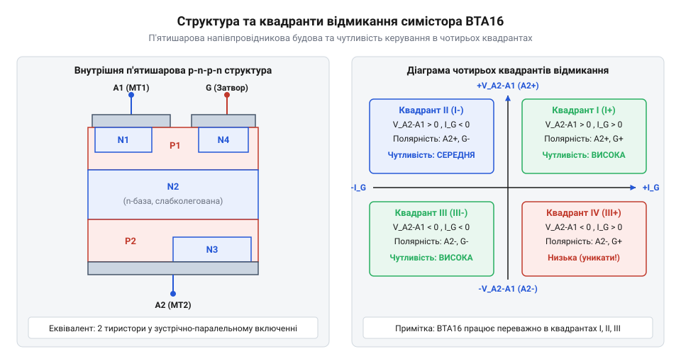
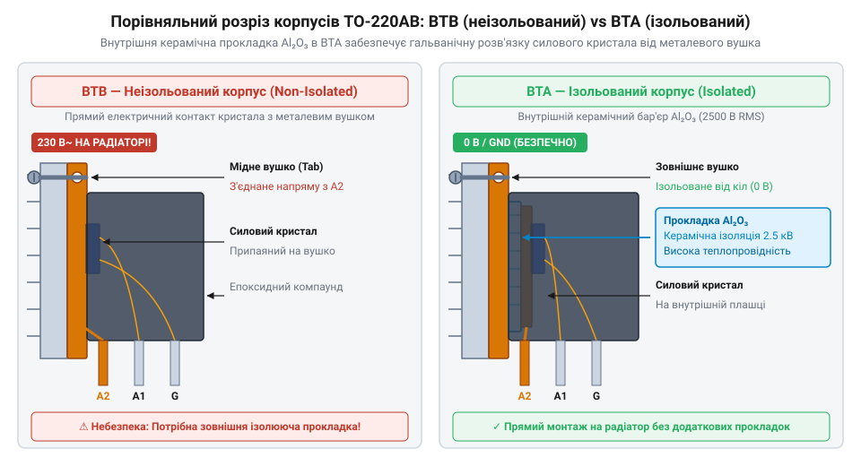
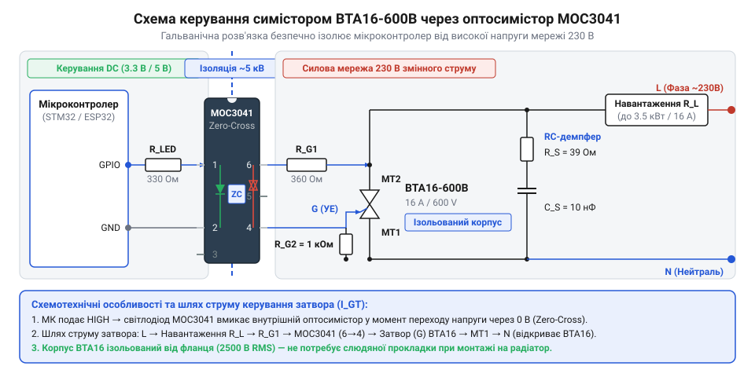
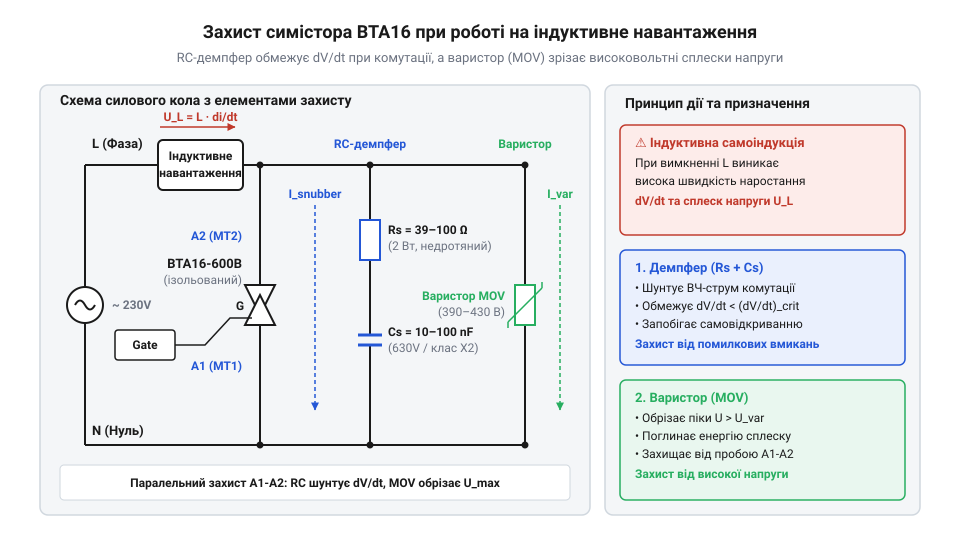
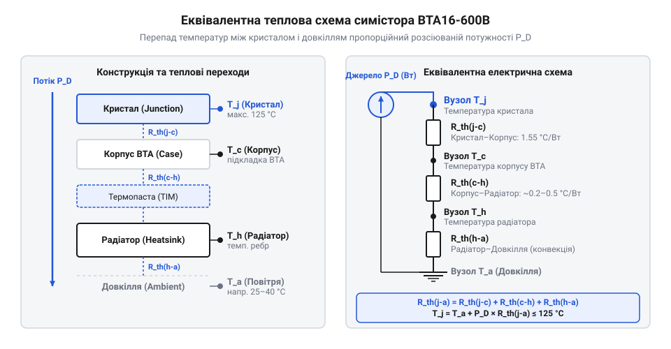

# Симістор BTA16-600B

<preknowlist>
- [Твердотільне реле G3MB-202P (2 А / 240 В)](root:cat-hw-drivers/ssr-g3mb-202p) — концепція безконтактної твердотільної комутації навантаження змінного струму
- [MOC3063 — оптосимістор з детектором нуля](root:cat-hw-drivers/moc3063-optotriac) — принцип дії оптичної розв'язки та функції детектора переходу напруги через нуль
</preknowlist>

## Проблема комутації потужного змінного струму

Комутація високовольтного змінного струму високої потужності створює виклики для класичних ключів. Механічні @@en|реле@@ (франц. *relais* — зміна) зношуються від електричної дуги на контактах, а поодинокий n-канальний @@en|MOSFET@@ (англ. *Metal-Oxide-Semiconductor Field-Effect Transistor*) пропускає негативну півхвилю через свій @@en|паразитний діод@@ підкладки. Для керування обома півхвилями змінної напруги потрібен симетричний напівпровідниковий пристрій, здатний проводити струм в обох напрямках. Цю задачу вирішує @@en|симістор@@ (англ. *triode for alternating current*, `TRIAC`), який об'єднує два протилежно увімкнені тиристори. Для малих навантажень застосовують [компактні твердотільні реле](root:cat-hw-drivers/ssr-g3mb-202p), але потужні мережеві кола вимагають дискретних симісторів.

## Структура симістора та квадранти відмикання

Силовий @@en|симістор@@ BTA16-600B має п'ятишарову структуру p-n-p-n-p. Після подачі струму на @@en|затвор@@ пристрій лавиноподібно відкривається й утримує провідність, поки струм не впаде нижче @@en|струму утримання@@ `I_H` при переході через нуль.


*П'ятишарова структура симістора та поляризація виводів у чотирьох квадрантах відмикання.*

Відмикання відбувається у чотирьох @@en|квадрантах@@ (лат. *quadrans* — четверта частина) залежно від полярності напруги на виводі A2 та затворі G. У четвертому квадранті `(A2-, G+)` чутливість затвора найнижча. Для впевненого відкриття початковий струм повинен перевищувати @@en|струм фіксації@@ `I_L`.

## Особливості ізольованого корпусу BTA

При виборі симістора BTA16-600B критичне маркування корпусу: BTA відрізняється від BTB наявністю внутрішньої ізоляції. У серії BTB металевий фланець з'єднаний із силовим виводом A2, що загрожує коротким замиканням при монтажі на спільний радіатор.


*Керамічна підкладка корпусу BTA ізолює кристалоутримувач від металевого фланця.*

У корпус BTA вбудовано керамічну підкладку з оксиду алюмінію `Al2O3` (англ. *aluminum oxide*), яка забезпечує гальванічну ізоляцію фланця до 2500 V RMS. Це дозволяє кріпити симістор безпосередньо на алюмінієвий @@en|радіатор@@ без зовнішніх діелектричних прокладок.

## Гальванічна опторозв'язка та керування симістором

Пряме підключення затвора симістора до мікроконтролера небезпечне через високу мережеву напругу. Для захисту низьковольтних кіл застосовують @@en|оптосимістор@@, який передає сигнал через оптичний канал.


*Мікроконтролер керує світлодіодом оптопари, яка відмикає затвор симістора в силовому колі.*

Для простого увімкнення навантаження обирають [оптосимістор MOC3063 з детектором нуля](root:cat-hw-drivers/moc3063-optotriac), що відкриває ключ на початку півхвилі. Для фазового регулювання беруть оптопари без детекції нуля. Струм затвора обмежують резистором, а керуючий імпульс утримують до досягнення струму `I_L`.

## Захист симістора від dV/dt та сплесків

Під час роботи з індуктивним навантаженням швидке наростання напруги `dV/dt` на силових виводах перезаряджає бар'єрну ємність p-n переходів, викликаючи самочинне відмикання симістора.


*Паралельний RC-демпфер обмежує швидкість наростання напруги dV/dt, а варистор зрізає перенапруги.*

Для обмеження `dV/dt` паралельно симістору вмикають @@en|демпфер@@ (нім. *Dämpfer* — глушник) — послідовне RC-коло, яке гасить резонансні коливання. Захист від високовольтних сплесків мережі забезпечує @@en|варистор@@ (англ. *variable resistor*), опір якого нелінійно падає при імпульсній перенапрузі.

## Тепловий розрахунок та вибір радіатора

Падіння напруги на відкритому симісторі `V_T ≈ 1.55 V` викликає теплові втрати `P ≈ 1.1 × I_T(RMS)`. Для розрахунку охолодження використовують еквівалентну теплову схему з послідовними опорами.


*Загальний тепловий опір складається з опорів кристала, корпусу, термопасти та радіатора.*

Сумарний опір `R_th(j-a) = R_th(j-c) + R_th(c-h) + R_th(h-a)` визначає температуру кристала:

```
T_j = T_a + P × R_th(j-a)
```

Щоб температура `T_j` не перевищила критичні 125 °C, обирають алюмінієвий @@en|радіатор@@ із належною площею поверхні та необхідним опором `R_th(h-a)`.
