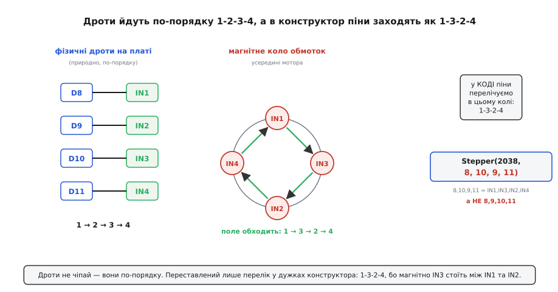

# ⚙️ Крутимо 28BYJ-48 через ULN2003 у коді: від голого масиву до бібліотек

Плата ULN2003 не має власного розуму — уся логіка обертання живе у твоїй прошивці. Це означає дещо приємне: **немає ніякого таємничого «протоколу»**, який треба вивчати. Керувати мотором — це буквально вмикати й вимикати чотири цифрові виводи в правильному порядку і з правильним темпом. Якщо ти вмієш виставити цифровий вивід у одиницю чи нуль (`digitalWrite()` на Arduino, `gpio_set_level()` в ESP-IDF, `HAL_GPIO_WritePin()` на STM32), ти вже вмієш крутити кроковий мотор — лишилося зрозуміти, *який* порядок правильний і *звідки* він береться.

Ця вставка проходить весь шлях знизу вгору. Спершу зробимо мотор власними руками — заб'ємо ту саму вісімку станів half-step у масив і будемо перебирати рядки самі, вмикаючи по чотири ноги. Ти побачиш кожен біт і зрозумієш, що всередині бібліотек немає магії. Потім піднімемося на рівень стандартної бібліотеки `Stepper`, розберемося з дивним порядком пінів `1-3-2-4` (і чому саме він, а не `1-2-3-4`), а на завершення візьмемо `AccelStepper` — бібліотеку з розгоном і гальмуванням, яка вміє те, чого стандартна не вміє. Наскрізно розберемо задання швидкості, напряму й кроків на оберт, знеструмлення обмоток проти нагріву та чотири пастки, на яких спотикаються всі.

Мова тут одна — C/C++. Це домен заліза: ми смикаємо ноги мікроконтролера, рахуємо такти, дбаємо про струм; тут не місце Python чи JavaScript — вони не керують GPIO в реальному часі. А от **платформа** — вибір твій, і код це відображає. Мотору байдуже, хто саме смикає його чотири входи: потрібні лише чотири звичайні цифрові виводи-виходи (ні ШІМ, ні переривань, ні альтернативної функції) і якесь джерело часу з роздільністю в мілісекунди. Тому кожен приклад нижче дано трьома вкладками: Arduino (найкоротший запис, з нього й починаємо), ESP-IDF (драйвер GPIO і задача FreeRTOS) та STM32 HAL. Одне застереження для 3.3-вольтових платформ (ESP32, більшість STM32): входи ULN2003 — це бази дарлінгтонів через резистор, порахований під 5 В, тож від 3.3 В ключі відкриваються, але з меншим запасом за струмом бази. На практиці працює; якщо мотор слабкий чи нестабільний — це перше, куди дивитися (лікується буфером рівня 3.3 → 5 В). Код увесь робочий: скопіюй, заший, крутиться.

## Крок нульовий: як плата виглядає з боку коду

Перш ніж писати рядок, домовмося про підключення, бо весь код на нього спирається. Плата хоче чотири будь-які цифрові виводи-виходи — жодних особливих вимог до них нема. Для конкретики візьмемо найпоширенішу розкладку з підручників — чотири входи плати на виводи **D8, D9, D10, D11** Arduino; у вкладках ESP-IDF і STM32 це будуть просто чотири GPIO, які ти обереш сам:

```
вивід Arduino   вхід плати   обмотка
    D8      →      IN1     →    A
    D9      →      IN2     →    B
    D10     →      IN3     →    C
    D11     →      IN4     →    D
```

Це просте, «природне» відображення: D8 керує IN1, D9 керує IN2 і так далі, по порядку. Запам'ятай його — воно фізичне, воно на дротах, і воно **не зміниться** до кінця вставки. А от у якому порядку ці входи перелічувати *в коді*, коли ми дійдемо до бібліотек, — питання окреме й підступне, і саме воно плутає найбільше. Поки що просто тримай у голові: чотири дроти йдуть з D8…D11 на IN1…IN4 по-порядку.

Плюс мотора приходить окремо — у клему `+ −` плати, з окремого джерела на п'ять вольт (чому окремого — розберемо в пастках). Земля плати-контролера й мінус того джерела **з'єднані**. Усе, більше про залізо в цій вставці нічого — далі самий код.

## Рівень 1: голими руками — вісім станів у масиві

Почнімо з фундаменту, де видно кожен біт. Мета — самому проганяти ту саму послідовність half-step, що керує обмотками. Нагадаю її числами: одиниця означає «цю обмотку під струмом», нуль — «знеструмлена». Вісім рядків, чотири стовпці:

```
крок   IN1 IN2 IN3 IN4
 1      1   0   0   0
 2      1   1   0   0
 3      0   1   0   0
 4      0   1   1   0
 5      0   0   1   0
 6      0   0   1   1
 7      0   0   0   1
 8      1   0   0   1
```

Придивись до візерунка, бо в ньому вся суть. Одиниця «пливе» вниз по стовпцях зліва направо, а між чистими станами (світиться одна обмотка) вклинюються перехідні (світяться дві сусідні). Ідея проста: якщо вмикати обмотки строго по колу, магнітне поле всередині мотора теж піде по колу, а ротор — слідом за полем. Перехідні пари між чистими станами й дають «половину кроку»: поле зупиняється на півдорозі між двома обмотками, притягнуте одразу до обох.

Тепер перекладемо цю таблицю в C++ дослівно. Кожен рядок — це чотири біти, тож заведемо двовимірний масив `8 × 4`:

:::tabs
:::code api-uln2003/c/arduino/riven-1-holymy-rukamy.ino
:::code api-uln2003/c/esp-idf/riven-1-holymy-rukamy.c
:::code api-uln2003/c/stm32/riven-1-holymy-rukamy.c
:::

Тепер — серце всього. Функція, що виставляє на чотири виводи один рядок таблиці за його номером:

:::tabs
```arduino
// Виставити на IN1..IN4 стан рядка step (0..7).
void applyStep(int step) {
  digitalWrite(IN1, seq[step][0]);
  digitalWrite(IN2, seq[step][1]);
  digitalWrite(IN3, seq[step][2]);
  digitalWrite(IN4, seq[step][3]);
}
```
```esp-idf
// Виставити на IN1..IN4 стан рядка step (0..7).
static void apply_step(int step) {
  gpio_set_level(IN1, seq[step][0]);
  gpio_set_level(IN2, seq[step][1]);
  gpio_set_level(IN3, seq[step][2]);
  gpio_set_level(IN4, seq[step][3]);
}
```
```stm32
// Виставити на IN1..IN4 стан рядка step (0..7).
static void apply_step(uint8_t step) {
  for (uint8_t i = 0; i < 4; i++)
    HAL_GPIO_WritePin(PORTS[i], PINS[i],
                      seq[step][i] ? GPIO_PIN_SET : GPIO_PIN_RESET);
}
```
:::

Оце і є вся «наука». Далі треба лише **крутити цей індекс по колу** й витримувати паузу між тактами, щоб ротор устигав дійти до нового положення поля. Зробимо безкінечне повільне обертання вперед:

:::tabs
```arduino
int idx = 0;   // поточний рядок таблиці

void loop() {
  applyStep(idx);        // виставити обмотки
  idx = (idx + 1) % 8;   // наступний рядок; по колу через % 8
  delay(2);              // пауза, щоб ротор устиг (мс на півкрок)
}
```
:::code api-uln2003/c/esp-idf/riven-1-holymy-rukamy-2.c
```stm32
int idx = 0;   // поточний рядок таблиці

// у main(), після MX_GPIO_Init():
while (1) {
  apply_step(idx);       // виставити обмотки
  idx = (idx + 1) % 8;   // наступний рядок; по колу через % 8
  HAL_Delay(2);          // пауза, щоб ротор устиг (мс на півкрок)
}
```
:::

Заший — і вал повільно поповзе. Дивись на чотири світлодіоди плати: вони по черзі перебігають по колу, і це видима картина того, що робить `idx`. Хочеш назад — крути індекс у протилежний бік. Ось акуратний спосіб, що не боїться від'ємних чисел (у C залишок від ділення від'ємного може бути від'ємним, тож додаємо `+ 8`):

```cpp
// Вперед:   idx = (idx + 1) % 8;
// Назад:
idx = (idx + 7) % 8;   // те саме, що (idx - 1 + 8) % 8
```

Чому `+ 7`, а не `- 1`? Бо `+ 7 (mod 8)` тотожно `− 1 (mod 8)`, але завжди лишається додатним — і жоден компілятор чи платформа не здивує тебе від'ємним індексом у масив. Дрібниця, а рятує від рідкісного, але злого бага.

### Скільки кроків — на скільки градусів

Тепер зробимо щось корисніше за безкінечне кручення — **точний поворот на задану кількість кроків**. Для цього треба одне число: скільки півкроків припадає на повний оберт вихідного вала. І тут ховається славнозвісна риса 28BYJ-48.

Сам мотор робить 32 повні кроки на оберт **свого** ротора. Але всередині корпусу сидить редуктор із пластикових шестерень, що сповільнює обертання. Передавальний коефіцієнт редуктора — **не рівно 64**, як часто пишуть на позір, а **63.684**; це число вирахували ентузіасти, розібравши мотор і полічивши зуби:

```
передатне число = (31·32·26·22) / (11·10·9·9) = 63.68395…
```

Це усталений, підтверджений розрахунком факт. Звідси кроки на повний оберт вихідного вала:

```
повні кроки  = 32 · 63.684 ≈ 2038
півкроки     = 64 · 63.684 ≈ 4076
```

Отже, у half-step-режимі на один оберт вала припадає близько **4076** наших тактів. Загорни це в код і зроби функцію «зроби N кроків у заданому напрямі»:

:::tabs
:::code api-uln2003/c/arduino/skilky-krokiv-na-skilky.ino
:::code api-uln2003/c/esp-idf/skilky-krokiv-na-skilky.c
:::code api-uln2003/c/stm32/skilky-krokiv-na-skilky.c
:::

Хочеш «повернути на 90 градусів»? Це чверть оберту: `HALFSTEPS_PER_REV / 4 ≈ 1019` півкроків. Зверни увагу — число **некругле**, і рівно на 90.000° ти не станеш: `4076 / 4 = 1019`, а це 89.98°. Для стрілки чи заслінки байдуже; для верстата — вже ні (про це у пастках).

> 🔧 **Навіщо це.** Ручний масив — не просто навчальна вправа «щоб зрозуміти». Він дає тобі **повний контроль**, якого бібліотеки не дають. Хочеш власний профіль швидкості? Несиметричне гальмування? Пропускати перехідні пари, щоб перейти на повний крок і виграти момент? Химерну послідовність під незвичну обмотку? Усе це — просто інша таблиця й інший цикл. Коли бібліотека «майже підходить, але не зовсім», уміння зійти на цей рівень і написати перебір самому — те, що відрізняє «скопіював приклад» від «керую мотором».

### Прибираємо блокувальний delay

У прикладах вище пауза **заморожує всю програму** на кожному такті. Поки мотор крутиться, мікроконтролер не може ні кнопку опитати, ні датчик прочитати — він тупо чекає. Для іграшки згодиться, для справжнього пристрою — ні. Позбудьмося блокування, замінивши сон на порівняння часу за вільним лічильником: `micros()` на Arduino, `esp_timer_get_time()` в ESP-IDF, `HAL_GetTick()` на STM32. Ідея скрізь та сама: не спати, а на кожному проході головного циклу питати «чи минуло вже досить часу від попереднього кроку?» — і крокувати лише тоді.

:::tabs
:::code api-uln2003/c/arduino/prybyraiemo-blokuvalnyi.ino
:::code api-uln2003/c/esp-idf/prybyraiemo-blokuvalnyi.c
:::code api-uln2003/c/stm32/prybyraiemo-blokuvalnyi.c
:::

Тепер швидкість — це просто величина інтервалу: менша пауза → частіші такти → швидше крутиться. Напрям — знак `dir`. І весь цей час мікроконтролер лишається живим між кроками. Перехід від сну до порівняння часу — універсальний прийом усього кооперативного коду; для мотора він особливо доречний, бо крок — подія рідка (мілісекунди), а між ними купа вільного часу.

> 🔧 **Навіщо це.** Порівняння `now - lastStepUs` написане саме так — різниця, а не `now >= lastStepUs + interval` — навмисне. Будь-який лічильник часу скінченної ширини рано чи пізно **переповнюється** й скидається в нуль: `micros()` на Arduino — приблизно кожні 70 хвилин, 32-бітний `HAL_GetTick()` на STM32 — кожні 49 діб (64-бітний `esp_timer_get_time()` в ESP-IDF пристрій не переживе). Форма з відніманням переживає це переповнення без збою (беззнакова арифметика «обертається» правильно), а форма з додаванням — ні: біля межі вона дасть хибне спрацювання або зависання на 70 хвилин. Це та деталь, яку не видно на столі за п'ять хвилин тесту, але яка кладе пристрій, що працює добу.

## Рівень 2: стандартна бібліотека Stepper

Ручний перебір ясний, але громіздкий: таблиця, індекс, час — усе на тобі. Arduino має вбудовану бібліотеку `Stepper`, яка ховає це за трьома методами: задав швидкість, скажи «крокни стільки-то» — вона сама проганяє послідовність. Підключати нічого не треба, вона є в кожній інсталяції Arduino IDE. Ні в ESP-IDF, ні в STM32 HAL готової бібліотеки крокового мотора нема — там цю роль виконує тонка власна обгортка над рівнем 1, і у вкладках видно, що вона вміщається в десяток рядків.

Але саме тут чигає **найковарніша пастка всієї теми** — порядок, у якому перелічувати виводи: в аргументах конструктора чи, у власній обгортці, в масиві пінів — суть одна. Розберемо його повільно, бо на ньому спотикаються всі без винятку.

### Чому порядок пінів — не 1-2-3-4, а 1-3-2-4

Здавалося б, логічно: обмотки в таблиці йдуть A, B, C, D по стовпцях IN1, IN2, IN3, IN4 — значить, і в конструктор пиши їх по порядку, `IN1, IN2, IN3, IN4`. **І це не працює.** Мотор або смикається на місці, гуде й гріється, або крутиться ривками — але по колу не йде.

Причина — в **розводці обмоток усередині 28BYJ-48**, і вона не збігається з нумерацією входів. Бібліотека `Stepper` усередині ганяє поле в порядку *своїх* чотирьох аргументів: перший, другий, третій, четвертий — і чекає, що цей порядок відповідає **фізично сусіднім** обмоткам, які треба вмикати одну за одною по колу. А в 28BYJ-48 обмотки, підключені до `IN1, IN2, IN3, IN4`, розташовані **не** в порядку `1→2→3→4` навколо ротора. Магнітно-сусідній ланцюжок у цього мотора такий:

```
магнітний порядок обмоток:  IN1 → IN3 → IN2 → IN4 → (знову IN1)
```

Обмотка на `IN3` магнітно стоїть *між* `IN1` і `IN2`, а не після `IN2`. Тому щоб поле йшло рівним колом, бібліотеці треба згодувати входи в порядку `1, 3, 2, 4` — тоді її внутрішня послідовність збіжиться з фізичним колом обмоток, і вал поїде рівно.


*Фізичні дроти (ліворуч) прості: D8→IN1, D9→IN2, D10→IN3, D11→IN4, по-порядку. Але магнітно (праворуч) обмотки розташовані по колу як IN1-IN3-IN2-IN4, і саме в цьому порядку номери пінів заходять у конструктор. Плутанина рівно в тому, що дроти йдуть 1-2-3-4, а перелік у коді — 1-3-2-4.*

Ось як це виглядає в коді. Дроти на платі — незмінні (`D8→IN1`… `D11→IN4`), а в коді перелічуємо **виводи в магнітному порядку**:

:::tabs
:::code api-uln2003/c/arduino/chomu-poriadok-piniv-ne-1.ino
:::code api-uln2003/c/esp-idf/chomu-poriadok-piniv-ne-1.c
:::code api-uln2003/c/stm32/chomu-poriadok-piniv-ne-1.c
:::

Розглянь конструктор пильно: `Stepper motor(2038, 8, 10, 9, 11)`. Числа `8, 10, 9, 11` — це `D8, D10, D9, D11`, тобто піни `IN1, IN3, IN2, IN4`. Дроти на платі ти **не чіпав** — вони так і йдуть 1-2-3-4. Переставлений лише **перелік у коді**. Ось ця розбіжність — «дроти по-порядку, а в дужках навхрест» — і є джерело всіх мук. Запиши собі правило одним рядком: **для 28BYJ-48 виводи перелічуються в порядку IN1, IN3, IN2, IN4 — байдуже, у конструктор `Stepper` (`8, 10, 9, 11`) чи у власний масив пінів.**

> 🔧 **Навіщо це.** Не намагайся «виправити» дроти, переткнувши їх на платі так, щоб у конструктор писати гарне `8, 9, 10, 11`. Це погана ідея з двох причин. По-перше, роз'єм мотора має одну орієнтацію — ти не переставиш обмотки, не розбираючи колодку. По-друге, наступна людина (чи ти за півроку) очікує «природну» розводку `D8→IN1…D11→IN4` — і зламає голову, чому в тебе інакше. Правильний шлях — лишити дроти простими й прямими, а дивний порядок тримати там, де йому місце: в одному рядку конструктора з коментарем. Розбіжність нікуди не дінеться (вона в залізі мотора), але хай вона живе в коді, а не в павутинні дротів.

### Швидкість, напрям, кроки

У `Stepper` три керма, і всі три вже видно у прикладі:

**Швидкість** — метод `setSpeed(rpm)`, в **обертах за хвилину**. Не в кроках за секунду, не в паузах — саме в обертах вала за хвилину, що зручно й наочно. `setSpeed(10)` — десять обертів за хвилину, майже межа плавного ходу 28BYJ-48. Хочеш повільніше — став менше; більше десь за 15 об/хв мотор почне зриватися (див. пастки).

**Кроки й напрям** — метод `step(n)`. Додатне `n` — вперед, від'ємне — назад. `step(2038)` — рівно оберт уперед, `step(-1019)` — чверть оберту назад. Число завжди в **повних** кроках, тому й `STEPS_PER_REV = 2038`.

**Важлива й неприємна риса** `Stepper.step()` — він **блокувальний**. Виклик `motor.step(2038)` не поверне керування, доки не докрутить усі 2038 кроків; на швидкості 10 об/хв це цілих шість секунд, протягом яких програма мертва. Це головне обмеження стандартної бібліотеки: вона проста, але «жадібна» до процесора. Якщо тобі треба крутити мотор *і* одночасно робити щось інше — стандартна `Stepper` не годиться, і ось тут на сцену виходить `AccelStepper`.

## Рівень 3: AccelStepper — розгін, гальмування, неблокувальність

`AccelStepper` — стороння бібліотека (постав через Library Manager: *Sketch → Include Library → Manage Libraries → «AccelStepper»*). В ESP-IDF і STM32 HAL її нема, але й потреби в чужому коді тут менше: усе, що вона робить, — це дві формули й таймер, і у вкладках видно, як їх пишуть на цих платформах. Вона робить те, чого дві попередні не вміють, і чого справжній рух вимагає:

- **розганяє й гальмує** мотор плавно (трапецієподібний профіль швидкості), а не жбурляє його одразу на повну — це дозволяє їхати швидше без зривів;
- **неблокувальна**: ти в циклі кличеш `run()`, вона робить рівно один крок, якщо настав час, і **одразу повертає керування** — програма між кроками вільна;
- уміє half-step з коробки й рахує позицію в кроках.

Порядок пінів — **той самий 1-3-2-4**, з тієї ж причини (магнітна розводка мотора нікуди не поділася). А режим half-step задають константою — у бібліотеці вона зветься `AccelStepper::HALF4WIRE` (числове значення `8`; часто в прикладах пишуть як `#define HALFSTEP 8`). «HALF» — половинний крок, «4WIRE» — чотири керовані ноги.

:::tabs
:::code api-uln2003/c/arduino/riven-3-accelstepper.ino
:::code api-uln2003/c/esp-idf/riven-3-accelstepper.c
:::code api-uln2003/c/stm32/riven-3-accelstepper.c
:::

Тут кілька нових керм, і кожне варте слова.

**`setMaxSpeed(кроків/с)`** — стеля швидкості в **кроках за секунду** (тут — півкроках). Уже не оберти за хвилину, як у `Stepper`, а кроки за секунду, бо AccelStepper мислить кроками. `700` півкроків/с при 4076 на оберт — це `700 / 4076 ≈ 0.17` оберту за секунду, тобто близько 10 об/хв — знову ж таки біля розумної межі для цього мотора. Мотор ніколи не перевищить цю швидкість, хоч би як розганявся.

**`setAcceleration(кроків/с²)`** — те, заради чого все й затівалося. Це **прискорення**: наскільки різко мотор набирає й скидає швидкість. Замість жбурнути ротор одразу на 700 кроків/с (де він зірветься), бібліотека плавно розганяє його від нуля, тримає на стелі, а перед ціллю так само плавно гальмує. Ця трапеція швидкості дозволяє врешті **їхати швидше**, ніж дозволив би різкий старт: різкий старт зриває ротор ще на низькій швидкості, а плавний дає йому час «зачепитися» за поле. Постав `setAcceleration(400)` — м'яко; постав `2000` — дуже різко, ближче до зриву.

**`moveTo(позиція)` проти `move(кроки)`** — тонка, але важлива різниця. `moveTo(1000)` — це **абсолютна** ціль: «їдь у точку 1000 від початку відліку». `move(1000)` — **відносна**: «проїдь 1000 кроків від того, де ти зараз». У прикладі вгорі `moveTo` зручний, бо ми ганяємо між двома фіксованими точками — нулем і одним обертом. Напрям при цьому AccelStepper обирає **сам**: якщо ціль попереду — крутить уперед, якщо позаду — назад. Тобі не треба ним керувати вручну, лише сказати «куди».

**`run()` — і чому його треба кликати часто.** Це неблокувальне серце бібліотеки. Кожен виклик `run()` дивиться на годинник і на профіль розгону; якщо настав час чергового кроку — робить рівно один і повертає керування, якщо ні — просто повертає керування, нічого не роблячи. Тому `run()` треба кликати **якомога частіше** — щонайменше раз за кожен прохід `loop()`, і не смій ставити `delay()` у цикл: поки ти спиш у `delay`, `run()` не викликається, кроки не робляться, і плавний профіль розсипається на ривки. Правило залізне: **у циклі з AccelStepper — жодних `delay`; замість них хай крутиться `run()`.**

> 🔧 **Навіщо це.** `blocking` проти `non-blocking` — не академічна дрібниця, а вибір архітектури всієї програми. `Stepper.step()` каже «віддай мені процесор на шість секунд». `AccelStepper.run()` каже «дай мені мікросекунду, я візьму рівно скільки треба й поверну». Перше годиться, коли мотор — єдине, що робить пристрій. Друге — коли треба крутити мотор *і* стежити за кнопкою, *і* блимати світлодіодом, *і* слухати UART одночасно. Майже будь-який реальний пристрій — другий випадок, тому AccelStepper і став стандартом де-факто для 28BYJ-48. Ціна одна: `run()` мусиш кликати сам і часто, бо ніхто за тебе цього не зробить.

### Швидкість без розгону — коли треба крутити нонстоп

Іноді ціль — не «доїхати до точки», а «просто крутися рівно з такою швидкістю», без розгінних трапецій: вентилятор, коліщатко, безкінечна подача. Для цього AccelStepper має інший режим — `setSpeed()` + `runSpeed()`, що ігнорує прискорення й жене мотор рівним темпом; руками виходить ще простіше — сталий інтервал і жодних формул:

:::tabs
```arduino
void setup() {
  motor.setMaxSpeed(600.0);
  motor.setSpeed(300.0);   // стала швидкість, кроків/с; знак = напрям
}

void loop() {
  motor.runSpeed();   // рівний крок за розкладом, БЕЗ розгону/гальмування
}
```
:::code api-uln2003/c/esp-idf/shvydkist-bez-rozhonu-koly.c
```stm32
// Той самий таймер, лише ARR більше не міняється.
// У callback вище перед розрахунком трапеції ставимо один рядок:
//   if (remaining < 0) return;   // режим сталої швидкості — ARR не чіпаємо
void spinAtSpeed(float stepsPerSec, int8_t direction) {
  dir = direction;                    // +1 вперед, -1 назад
  remaining = -1;                     // -1 = «крутися без кінця», нуля не досягне
  __HAL_TIM_SET_AUTORELOAD(&htim2, (uint32_t)(1000000.0f / stepsPerSec) - 1);
  HAL_TIM_Base_Start_IT(&htim2);
}
```
:::

Тут `setSpeed(300)` — уперед на 300 півкроків/с, `setSpeed(-300)` — назад. Ніякого розгону: щойно ввімкнув — поїхав на повній (тому величину бери з запасом до зриву). `runSpeed()`, як і `run()`, неблокувальний — клич його часто. Це найпростіший спосіб отримати «крутися й не зупиняйся».

## Знеструмлення обмоток: проти нагріву й марної витрати струму

Одну важливу річ жодна з бібліотек **не робить сама**, а робити варто. Коли мотор дійшов до цілі й стоїть, остання обмотка (чи пара) **лишається під струмом** — і `Stepper`, і AccelStepper тримають останній стан на виводах. Крізь обмотку весь час тече струм у сотні міліампер, і мотор із платою відчутно **гріються**, хоч вал не рухається й нічого корисного не діється.

Розберемо, коли це проблема, а коли ні. Струм у стоячій обмотці створює **утримувальний момент** — мотор активно опирається зовнішньому провертанню вала. Якщо тобі треба *утримувати позицію* під навантаженням (заслінка, яку тисне пружина; стрілка, яку не можна зрушити), — це якраз потрібно, лишай як є. Але якщо після руху вал може спокійно стояти сам (нічого його не крутить), тримати обмотку під струмом — марно палити енергію й гріти залізо. Тоді обмотки треба **знеструмити**: усі чотири входи в нуль.

У ручному коді це один рядок:

:::tabs
```arduino
// Знеструмити всі обмотки: усі входи LOW. Момент зникає, нагрів припиняється.
void releaseCoils() {
  digitalWrite(IN1, LOW);
  digitalWrite(IN2, LOW);
  digitalWrite(IN3, LOW);
  digitalWrite(IN4, LOW);
}
```
```esp-idf
// Знеструмити всі обмотки: усі входи в 0. Момент зникає, нагрів припиняється.
static void release_coils(void) {
  gpio_set_level(IN1, 0);
  gpio_set_level(IN2, 0);
  gpio_set_level(IN3, 0);
  gpio_set_level(IN4, 0);
}
```
```stm32
// Знеструмити всі обмотки: усі входи в 0. Момент зникає, нагрів припиняється.
static void release_coils(void) {
  for (uint8_t i = 0; i < 4; i++)
    HAL_GPIO_WritePin(PORTS[i], PINS[i], GPIO_PIN_RESET);
}
```
:::

Кличеш його після завершення руху — і мотор «відпускається»: холодний, тихий, струму майже не бере. У AccelStepper для того самого є вбудований метод — `disableOutputs()` (а `enableOutputs()` вмикає назад перед наступним рухом); у власній обгортці ти й так кличеш свій `release_coils()` там, де рух закінчився:

:::tabs
```arduino
void loop() {
  motor.run();
  if (motor.distanceToGo() == 0) {
    motor.disableOutputs();   // доїхали — знеструмити обмотки
    // ...перед наступним moveTo() кликни motor.enableOutputs();
  }
}
```
```esp-idf
static void motor_task(void *arg) {
  for (;;) {
    move_to(HALFSTEPS_PER_REV);   // блокує лише цю задачу
    release_coils();              // доїхали — знеструмити обмотки
    vTaskDelay(pdMS_TO_TICKS(1000));
    move_to(0);
    release_coils();
  }
}
```
:::code api-uln2003/c/stm32/znestrumlennia-obmotok.c
:::

> 🔧 **Навіщо це.** Тут є справжній інженерний компроміс, а не «завжди роби так». Знеструмиш — виграєш нагрів і струм, але **втратиш утримувальний момент**: вал стане вільним і зовнішня сила його проверне, а мотор цього навіть «не помітить» (лічильник кроків думатиме, що позиція та сама, — з'явиться неврахований дрейф). Не знеструмиш — тримаєш позицію залізно, але гріється і жере струм постійно. Тому рішення просте за логікою: **тримати обмотку під струмом рівно тоді й лише тоді, коли реально треба утримувати позицію проти зовнішньої сили.** Стрілка годинника між секундами може стояти знеструмлена — її ніщо не крутить; заслінку під пружиною — ні, знеструмиш і вона відскочить. У сумніві — знеструмлюй: холодніше, ощадливіше, а більшість застосувань утримувального моменту й не потребує.

## Складність і пастки: чотири речі, на яких спотикаються всі

Код вище робочий, але між «скомпілювалось» і «крутиться, як задумано» лежать чотири граблі. Кожні з них коштували комусь вечора, і всі чотири передбачувані.

### Пастка 1: живлення мотора не з піна плати, і USB не тягне пуск

Найчастіша й найпідступніша. Спокуса очевидна: у будь-якої плати-контролера є вивід живлення (`5V` в Arduino, `5V`/`VBUS` на платах ESP32 і STM32) — то чому б не взяти живлення мотора звідти, одним дротиком, без окремого блока? **Тому що не тягне.** 28BYJ-48 бере в русі сотні міліампер, а в момент старту («пусковий струм») — ще більше, короткими сплесками. Коли плата живиться від USB, порт часто дає до пів ампера на всю плату разом, і пусковий кидок мотора просаджує напругу нижче межі — мікроконтролер **перезавантажується** прямо посеред руху. Симптом класичний і збиває з пантелику: «код правильний, дроти правильні, а плата раз у раз ребутиться або мотор смикається й гуде».

Лікування — **окреме джерело п'яти вольт** у клему `+ −` плати ULN2003, здатне дати щонайменше ампер. І критично: **земля цього джерела має з'єднатися із землею плати-контролера**. Без спільної землі сигнали `IN1…IN4` не матимуть спільної точки відліку з ключами мікросхеми, і ключі поводитимуться як завгодно. Правило одним рядком: **сигнали розділяй, землю об'єднуй** — логіка живиться від плати-контролера, сила мотора від окремого блока, а сходяться два боки лише по спільній землі.

### Пастка 2: порядок пінів у конструкторі (ще раз, бо це варте повтору)

Уже розібрали докладно, але це така часта причина «не крутиться», що варта окремого рядка в переліку пасток. Якщо `Stepper` чи `AccelStepper` замість плавного обертання дають **смикання на місці, гудіння, вібрацію без руху** — з імовірністю дев'ять із десяти в тебе піни в конструкторі стоять `8, 9, 10, 11` замість правильного `8, 10, 9, 11`. Симптом саме такий: мотор явно «живий», обмотки клацають, світлодіоди мигтять — але вал стоїть або сіпається туди-сюди, бо поле не обходить коло, а стрибає навхрест. Заміни порядок на `1-3-2-4` — і воно поїде. Це перше, що треба перевіряти, коли «все правильно, а не крутиться».

### Пастка 3: зрив на завеликій швидкості

Кроковий мотор тримається за магнітне поле лише доти, доки встигає за ним. Женеш такти надто швидко — ротор **відстає, зривається із синхронізму** і замість крутитися просто гуде й дрижить на місці, іноді провертаючись на випадковий кут. Це не поломка, а фізична межа: у момент кроку ротор має встигнути «перескочити» до нового положення поля, а на це треба час. Перевищив темп — синхронізм губиться.

Для 28BYJ-48 стеля плавного ходу — приблизно **10–15 обертів вихідного вала за хвилину**, точне число залежить від навантаження й напруги живлення. У кроках за секунду це десь `600–900` півкроків/с. Ставиш `setMaxSpeed()` чи `setSpeed()` вище — ризикуєш зривом. Ознака перевищення однозначна: мотор голосно **гуде або тріщить, але не крутиться** (або крутиться ривками й у випадковий бік).

Порятунок від зриву — рівно та причина, чому існує `setAcceleration()` у AccelStepper. **Плавний розгін зсуває межу вгору**: якщо не жбурляти ротор одразу на повну, а дати йому набрати швидкість поступово, він встигає «зачепитися» за поле й тримає синхронізм на вищій швидкості, ніж витримав би з різкого старту. Тому AccelStepper із розумним прискоренням часто вижимає з мотора помітно більше, ніж голий `Stepper`. Якщо мотор зривається — спершу **знизь `setMaxSpeed`**, а тоді, якщо треба швидше, **зменш `setAcceleration`** (м'якший старт) і пробуй підняти стелю знову.

### Пастка 4: 2038, а не 2048 — некругле число кроків

Спокуса взяти «гарне» `2048` (= 32 · 64) велика, і в купі прикладів в інтернеті стоїть саме воно. Для грубих завдань — «крутнись приблизно на оберт» — різниця мала й непомітна. Але вона **накопичується**: справжнє число ближче до `2038` (= 32 · 63.684), і кожен оберт із `2048` дає похибку близько піввідсотка. За один оберт — дрібниця; за сотню обертів туди-сюди — вже помітний **дрейф позиції**, бо помилка складається щоразу.

Причина — той самий некруглий передавальний коефіцієнт редуктора `63.684`, а не рівно `64`. Тому для будь-чого, де важлива позиція, бери **2038** повних кроків (або **4076** півкроків) на оберт. І пам'ятай глибший наслідок: навіть із точним `2038` число некругле, тож на *довільний* кут ти ніколи не станеш ідеально, і за багато обертів дрейф однаково накопиться (просто повільніше). Тому 28BYJ-48 **не годиться для точного абсолютного позиціювання без зворотного зв'язку**. Треба точну позицію надовго — звіряй її **кінцевим вимикачем чи датчиком** на початку руху («приведи вал у відоме нульове положення»), а не покладайся на лічильник кроків. Для стрілки, заслінки, повільного повороту камери це байдуже; для верстата чи руки робота — критично.

## Підсумок: три рівні, одна фізика

Ти пройшов усі три поверхи керування 28BYJ-48 через ULN2003, і головне — побачив, що **під усіма ними одна й та сама фізика**: чотири виводи, вісім станів half-step, поле, що обходить мотор по колу.

**Голий масив** дає повний контроль і повне розуміння — бери його, коли бібліотека «майже підходить» чи коли треба щось незвичне. **`Stepper`** ховає перебір за трьома методами, коштом блокувальності — бери, коли мотор єдиний у пристрої й простота важливіша за все. **`AccelStepper`** додає розгін, гальмування й неблокувальність — бери, коли треба крутити мотор *і* робити щось інше водночас, або їхати швидше без зривів; на практиці це найчастіший вибір.

А чотири пастки — окреме живлення зі спільною землею, порядок пінів `1-3-2-4`, межа швидкості й число `2038` — не залежать від рівня коду взагалі. Це властивості **заліза**: блока живлення, розводки обмоток, механіки ротора й редуктора. Тому їх треба знати раз і тримати в голові завжди, на якому б рівні ти не писав. Розберешся в них один раз на цьому копійчаному моторі — і той самий спосіб мислення (порахуй струм, дай спільну землю, знай межу, не вір круглим числам) перенесеться на будь-який серйозніший привід, який ти візьмеш далі.
