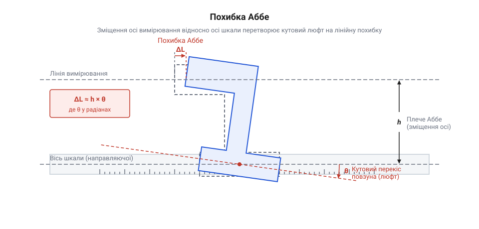
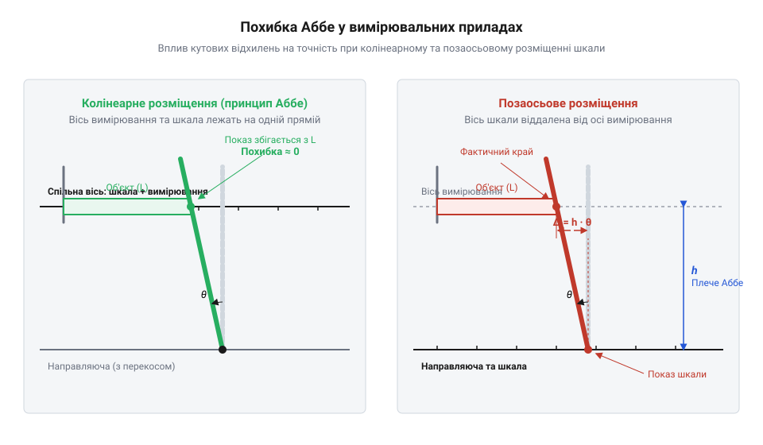
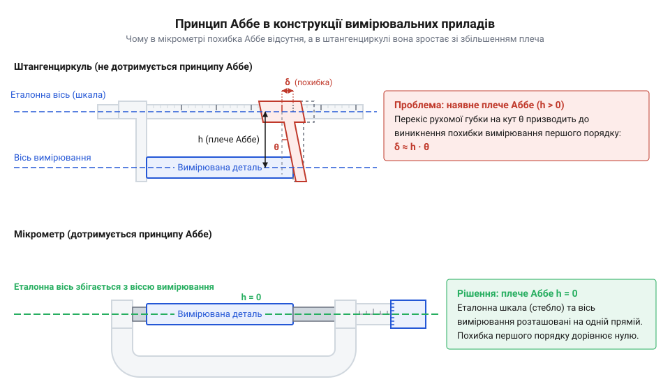
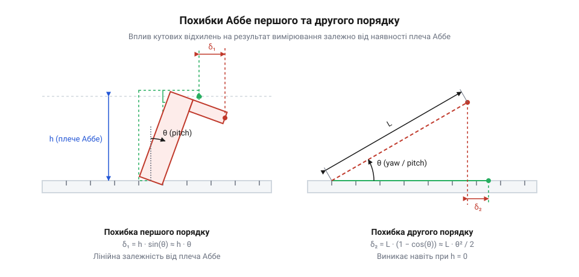
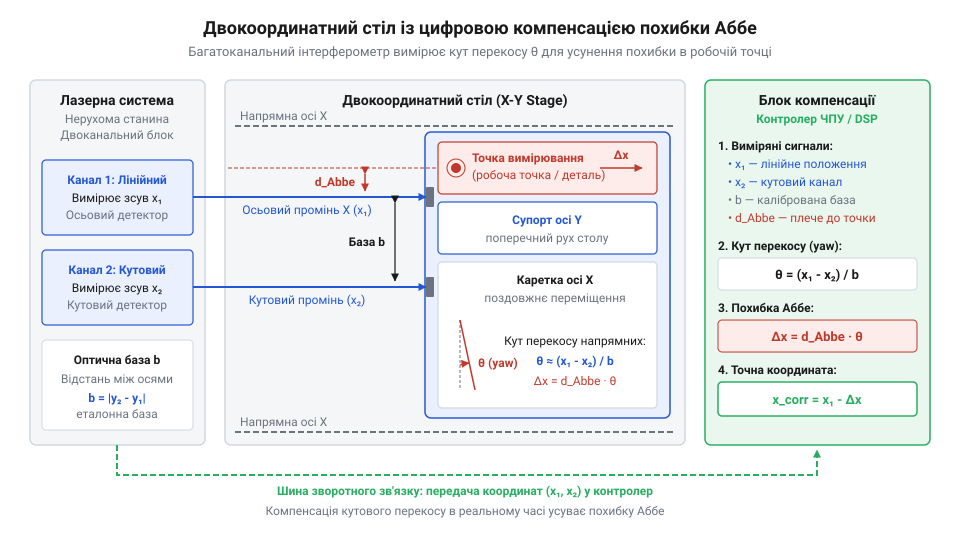

# Похибка Аббе у вимірювальних приладах

<preknowlist>
- [Штангенциркуль](root:cat-hw-instruments/vernier-caliper) — будова винесених вимірювальних губок та принципи роботи ноніусного механізму
- [Мікрометр](root:cat-hw-instruments/micrometer) — гвинтовий механізм та колінеарне розташування вимірювальних поверхонь
- [Індикатор годинникового типу](root:cat-hw-instruments/dial-indicator) — конструкція вимірювального стержня та осьова передача переміщення
</preknowlist>

## Непомітний перекос і хибні вимірювання

У прецизійному машинобудуванні та метрології нерідко виникає парадоксальна ситуація: вимірювальна система оснащена високоточною оптичною або електронною шкалою з роздільною здатністю в частки мікрометра, проте реальна вимірювальна невизначеність виявляється в десятки разів більшою за паспортну дискретність датчика. Оператор спостерігає на дисплеї значення 10.000 мм, хоча фактичний розмір оброблюваної деталі становить 10.015 мм. Джерелом цього систематичного відхилення є не збій лінійного кодера і не знос вимірювальних поверхонь, а геометричне просторове розведення осі, уздовж якої зчитуються показання шкали, та осі, на якій відбувається безпосередній контакт із вимірюваною деталлю.

Будь-яка механічна @@en|guideway@@ (направляюча), якою переміщується вимірювальна каретка або щуп, має скінченну жорсткість і виробничі допуски. Навіть у високопрецизійних вузлах присутній мікроскопічний кутовий люфт, зазор у підшипниках ковзання чи кочення, а також локальна непрямолінійність рейок. Крім того, під час вимірювання оператор або привід прикладе вимірювальне зусилля, яке викликає пружні деформації елементів конструкції. Коли каретка рухається уздовж направляючої, ці чинники призводять до того, що каретка не просто здійснює чистий поступальний рух, а додатково повертається на мікроскопічний кут перекосу `θ`. Поняття @@en|angular deviation@@ (кутове відхилення) описує саме цей непрогнозований поворот вузла в просторі.

Якщо вимірювальний контакт розташований не на самій лінійці, а винесений убік на певну відстань, цей відрізок створює важіль. Фізико-геометрична величина цієї просторової віддаленості називається @@en|Abbe offset@@ (плече Аббе) або @@en|Abbe arm@@ і позначається як `L_A`. У разі кутового повороту каретки на кут `θ` винесена вимірювальна точка описує дугу в просторі. Оскільки кут перекосу є малим, ця дуга проектується на вимірювальну вісь як поздовжнє лінійне зміщення `ΔL`.


*Позаосьове вимірювання на механічній направляючій: кутовий перекос каретки перетворюється на поздовжню похибку вимірювання через наявність плеча Аббе.*

Щоб оцінити масштаб цієї проблеми, розглянемо геометричну залежність. Нехай `L_A` позначає плече Аббе (відстань між лінією шкали та лінією вимірювання), `θ` — кут перекосу каретки в радіанах, а `ΔL` — поздовжнє зміщення вимірювального контакту, яке й формує @@en|Abbe error@@ (похибка Аббе). З прямокутного трикутника зміщення виражається через тригонометричну функцію тангенса:

ΔL = L_A · tan(θ)
= L_A · θ                      [малі кути: tan(θ) ≈ θ у радіанах]
= 50 mm × 0.00017453 rad       [підстановка значення плеча L_A = 50 мм та кута θ = 0.01°]
= 0.008727 mm ≈ 8.73 μm        [переведення в мікрометри]

Для отримання цієї похибки у 8.73 мкм достатньо, щоб кут перекосу каретки становив лише `0.01°` (тобто менше за `36` кутових секунд) при плечі `L_A = 50 mm`. У допусках точного машинобудування, де обробка деталей проводиться з точністю до `1–2 мкм`, таке непомітне відхилення повністю руйнує точність вимірювання.

Вимірювальне зусилля, що прикладається до деталі, істотно підсилює цей ефект через пружні деформації механізму. Коли вимірювальні губки контактують із деталлю на кінцях винесених консолей, зусилля затискання `F` на плечі `L_A` створює механічний згинальний момент `M = F · L_A`. Цей момент діє протилежно опорові механічної системи, де вирішальну роль відіграє @@en|angular stiffness@@ (кутова жорсткість, від англ. *angular* — кутовий та *stiffness* — жорсткість, опір деформації) каретки та направляючої `K_θ`. Приріст кута перекосу `Δθ` прямо пропорційний прикладеному моменту й обернено пропорційний кутовій жорсткості вузла: `Δθ = M ÷ K_θ = (F · L_A) ÷ K_θ`. Додаючись до початкового геометричного люфту `θ`, цей приріст формує додаткову пружну складову похибки Аббе `ΔL_elast = L_A · Δθ = (F · L_A²) ÷ K_θ`. Оскільки пружне відхилення залежить від квадрата плеча `L_A²`, навіть незначне збільшення вимірювального зусилля `F` при малій кутовій жорсткості `K_θ` спричиняє стрімке зростання вимірювальної невизначеності. Коли ми використовуємо [ручний штангенциркуль для вимірювання](root:cat-hw-instruments/vernier-caliper), відхилення губок виникає миттєво при найменшому зміщенні точки прикладання сили через неконтрольоване коливання зусилля оператора. Для перевірки та калібрування таких систем метрологи застосовують [еталонні концеві міри](root:cat-hw-instruments/gauge-blocks), які дозволяють зафіксувати зростання похибки при зміщенні деталі вздовж губок.

В історії вимірювальної техніки це явище тривалий час залишалося головним бар'єром на шляху підвищення точності компараторів. Термін @@en|comparator@@ (від латинського *comparare* — зіставляти, порівнювати) позначає прилад для порівняння вимірюваного розміру з еталоном. Детальний аналіз того, як ця проблема призвела до переосмислення конструкції вимірювальних систем, висвітлено у матеріалі про [історію відкриття оптичного компаратора](root:cat-hw-instruments/abbe-error/hist-ernst-abbe-comparator-principle.md) та виникнення наукового приладобудування.

Для мінімізації негативного впливу перекосів інженери змушені зменшувати [кутові відхилення та кінематичні люфти в направляючих](root:hw-motion/kinematic-guideway-angular-errors), однак механічне усунення зазорів має свої фізичні межі. Це ставить перед нами фундаментальне геометричне завдання: змінити саму взаємну компоновку шкали та вимірювальної осі так, щоб важіль `L_A` взагалі зник із розрахункових рівнянь.

## Геометрична природа принципу Ернста Аббе

У 1890 році німецький фізик і оптико-механік Ернст Аббе, працюючи над підвищенням точності вимірювальних приладів на підприємстві Carl Zeiss у Єні, сформулював фундаментальне правило побудови розмірних вимірювальних систем. Воно увійшло в метрологію як @@en|Abbe principle@@ (принцип Аббе): *вимірювальний прилад повинен бути сконструйований так, щоб вимірюваний відрізок (лінія вимірювання) і еталонна шкала (лінія зчитування) лежали на одній прямій лінії, тобто були колінеарними.*

Геометричний зміст цього принципу полягає у свідомому зведенні плеча `L_A` до нульового значення (`L_A = 0`). Коли лінія шкали та вимірювальна вісь збігаються, будь-який кутовий перекос каретки `θ` відбувається безпосередньо навколо осі вимірювання. Оскільки відстань між осі шкали та осі контакту дорівнює нулю, добуток `L_A · θ` перетворюється на нуль. У результаті @@en|angular deviation@@ (кутове відхилення) каретки більше не створює поздовжньої похибки першого порядку.


*Порівняння схем з нульовим та непольовим плечем Аббе: співвісне розміщення усуває лінійне плече ричага і захищає від кутових відхилень.*

Наочним прикладом застосування цієї геометричної вимоги є порівняльний аналіз двох класичних металообробних та метрологічних інструментів — мікрометра та штангенциркуля.

У конструкціях, де працює [класичний мікрометричний гвинт](root:cat-hw-instruments/micrometer) (від грецького *mikros* — малий та *metron* — міра), вимірювальний стебловий механізм, прецизійна різьба та вимірювальна вісь об'єкта перебувають на одній прямій лінії. Фізичний контакт із деталлю відбувається безпосередньо між п'ятою та торцем мікрометричного щупа, у той час як шкала нанесена уздовж цього ж стебла. Завдяки цьому плече `L_A = 0`. Якщо в різьбовому парі або направляючих щупа виникає кутовий люфт або перекос, він викликає лише незначний поворот контактної площини, але не призводить до первинного лінійного зсуву показань вздовж вимірювальної осі. Мікрометр конструктивно захищений від похибки Аббе.

Натомість [типовий вимірювальний штангенциркуль](root:cat-hw-instruments/vernier-caliper) (від німецького *Stangenzirkel* — розмірний циркуль на штанзі) за своєю природою грубо порушує принцип Аббе. Основна лінійна шкала розміщена на штанзі, а вимірювання виконується губками, які винесені вбік на відстань `L_A = 40…80 mm`. Коли ноніусна або цифрова каретка рухається вздовж штанги, будь-який зазор між кареткою та штангою спричиняє перекос каретки. Якщо деталь затискається на кінчиках губок, плече `L_A` досягає максимального значення, що викликає значне викривлення виміряного розміру.


*Вимірювальні осі штангенциркуля та мікрометра: у штангенциркулі вимірювальна лінія зміщена від шкали, тоді як у мікрометрі вони повністю збігаються.*

Детальний [покроковий аналіз вимірювальних схем](root:cat-hw-instruments/abbe-error/proj-caliper-vs-micrometer-abbe-analysis.md) для штангенциркулів і мікрометрів наочно показує, що при ідентичній якості виготовлення направляючих невизначеність штангенциркуля виявляється в десятки разів вищою саме через порушення принципу Аббе.

Принцип Аббе застосовується не лише в ручному інструменті, а й у прецизійному лабораторному обладнанні. Наприклад, [індикатор годинникового типу](root:cat-hw-instruments/dial-indicator) будується так, щоб вимірювальний стержень рухався суворо вздовж осі передавальної зубчастої рейки, запобігаючи бічним перекосам. У складніших системах, як-от [оптичні компаратори та вимірювальні мікроскопи](root:cat-hw-instruments/optical-comparators-measuring-microscopes), вірна геометрія досягається шляхом спостереження об'єкта крізь оптичну вісь, колінеарну з еталонними штриховими мірами.

Таким чином, дотримання принципу Аббе є першою лінією конструктивного захисту: замість намагання виготовити «ідеально пряму» механічну направляючу без найменших зазорів, інженер змінює геометрію приладу так, щоб неминучі механічні кутові перекоси перестали впливати на результати вимірювань у першому наближенні.

## Виникнення похибок першого й другого порядків

Щоб детально розібратися у впливі кутових відхилень на точність вимірювання, необхідно перейти від спрощеної плоскої моделі до тривимірного кінематичного аналізу каретки, яка рухається уздовж осі `X`. Кутові деформації та люфти механічних направляючих розкладаються на три ортогональні компоненти повороту навколо відповідних осей координат:

1. @@en|pitch@@ (тангаж або поздовжній перекос) — кутовий поворот каретки навколо горизонтальної осі `Y`, що перпендикулярна до напрямку руху. 2. @@en|yaw@@ (рискання або боковий перекос) — кутовий поворот каретки навколо вертикальної осі `Z`. 3. @@en|roll@@ (крен або поперечний перекос) — кутовий поворот каретки навколо власної осі руху `X`.

Розглянемо просторове розташування вимірювального контакту відносно зчитувальної шкали. Нехай шкала розміщена вздовж осі `X`, а точка контакту винесена в просторі на плече Аббе з координатами зміщення `y_A` вздовж осі `Y` та `z_A` вздовж осі `Z`.


*Вплив трьох кутових компонент відхилення направляючої на поздовжнє зміщення: плече Аббе формує похибку першого порядку, а довжина вимірювання — похибка другого порядку.*

Коли каретка здійснює повороти на малі кути `θ_pitch` та `θ_yaw`, ці кути викликають зсув точки контакту вздовж осі вимірювання `X`. Поворот `θ_pitch` діє через вертикальне плече `z_A`, створюючи зсув `z_A · sin(θ_pitch)`. Поворот `θ_yaw` діє через горизонтальне плече `y_A`, створюючи зсув `y_A · sin(θ_yaw)`. Для малих кутів `sin(θ) ≈ θ`, тому сумарне поздовжнє зміщення дорівнює:

ΔX₁ = z_A · θ_pitch + y_A · θ_yaw

Ця складова називається @@en|first-order error@@ (похибка першого порядку). Її головна особливість полягає в *лінійній* залежності від кута перекосу `θ` та величини плеча Аббе (`z_A` або `y_A`). Якщо плече Аббе є суттєвим (наприклад, декілька сантиметрів), навіть крихітні кути перекосу в секунди дуги призводять до вимірювальних похибок мікронного рівня. Поворот `θ_roll` навколо осі `X` не створює поздовжнього зсуву першого порядку вздовж `X`, але зміщує точку вимірювання у перпендикулярній площині `YZ`.

Що відбувається, коли прилад спроєктовано суворо за принципом Аббе, тобто `y_A = 0` та `z_A = 0`? У цьому випадку лінійні доданки `z_A · θ_pitch` та `y_A · θ_yaw` обраховуються як нуль, і похибка першого порядку повністю зникає (`ΔX₁ = 0`).

Проте кутовий поворот каретки на кут `θ` створює ще один геометричний ефект — проєкційне скорочення довжини вимірюваного відрізка `L`. Якщо каретка або траверса повернута на кут `θ`, вимірюваний вектор довжиною `L` проєктується на лінійну шкалу як `L · cos(θ)`. Відхилення виміряного значення від істинного утворює @@en|second-order error@@ (похибка другого порядку):

ΔX₂ = L - L · cos(θ) = L · (1 - cos(θ))

Для математичного розрахунку застосуємо розклад функції косинуса в ряд Тейлора для малих кутів: `cos(θ) ≈ 1 - θ² / 2`. Тоді формула похибки другого порядку набуває вигляду:

ΔX₂ = L · (1 - (1 - θ² / 2))
= L · (θ² / 2)                 [спрощення алгебраїчного виразу]
= L · θ² / 2                   [остаточний вираз похибки другого порядку]

Для порівняння масштабу впливу похибок першого та другого порядків виконаємо розрахунок на конкретному прикладі. Нехай вимірюється деталь довжиною `L = 100 mm`, кут перекосу направляючої становить `θ = 0.01°` (`1.7453 × 10⁻⁴ rad`), а позаосьове плече Аббе дорівнює `z_A = 50 mm`.

Обчислимо похибку першого порядку `ΔX₁`:

ΔX₁ = z_A · θ_pitch
= 50 mm × 0.00017453 rad       [підстановка плеча z_A = 50 мм та кута θ = 0.01°]
= 0.008727 mm = 8.727 μm = 8727 nm [лінійна похибка першого порядку]

Обчислимо похибку другого порядку `ΔX₂` для тієї ж системи:

ΔX₂ = L · (θ² / 2)
= 100 mm × (0.00017453 rad)² / 2 [підстановка довжини L = 100 мм та кута θ]
= 100 mm × (3.0461 × 10⁻⁸) / 2  [обчислення квадрата кута]
= 1.523 × 10⁻⁶ mm = 1.523 nm   [квадратична похибка другого порядку]

Порівняння результатів вражає: похибка першого порядку становить `8727 нм`, тоді як похибка другого порядку для того ж кута дорівнює лише `1.523 нм`! Похибка першого порядку виявляється більшою у `5730` разів.

Саме цей математичний факт пояснює колосальну метрологічну цінність принципу Аббе. Дотримання колінеарності осей не усуває кутові відхилення направляючих повністю, але воно переводить похибку вимірювання з лінійної залежності першого порядку в квадратичну залежність другого порядку. В результаті вплив кутового перекосу зменшується на три-чотири порядки — від мікрометрів до часток нанометра.

Тривимірний розрахунок кінематичних матриць з урахуванням усіх трьох компонент кута розглянуто у спеціалізованому матеріалі про [кінематику та розкладання кутів](root:cat-hw-instruments/abbe-error/math-abbe-error-kinematics-geometry.md) в механічних системах.

У тих випадках, коли через конструктивні обмеження приладу (наприклад, у двокоординатних позиціонуючих столах ЧПУ або координатно-вимірювальних машинах) винести шкалу на лінію вимірювання фізично неможливо, застосовують [прецизійні лазерні інтерферометри](root:cat-hw-instruments/laser-interferometers-linear-positioning) (від латинського *inter* — між, *ferens* — той, що несе, та грецького *metron* — вимірювати) з кількома оптичними каналами. Вони дозволяють одночасно зчитувати зміщення та кути `θ_pitch`, `θ_yaw`, після чудо вимірювальна система реалізує [таблиці компенсації похибок](root:hw-motion/cnc-geometric-error-compensation-tables) у реальному часі, цифровим способом віднімаючи значення `ΔX₁` з показань приладу.

## Конструкції приладів і плече Аббе

Уявіть практичну метрологічну ситуацію: лаборант вимірює високоточні [концеві міри довжини](root:cat-hw-instruments/gauge-blocks) за допомогою двох поширених механічних інструментів. При вимірюванні плитками КМД за допомогою [штангенциркуля](root:cat-hw-instruments/vernier-caliper) (від німецького *Stangenzirkel* — розмірний циркуль на штанзі) результат суттєво змінюється залежно від того, чи затиснуто деталь біля основи вимірювальних губок, чи на їхніх кінчиках. Різниця в показах може досягати 0.04–0.06 мм, що в кілька разів перевищує ціну поділки шкал. Натомість, застосовуючи гладкий [мікрометр](root:cat-hw-instruments/micrometer) (від грецького *mikros* — малий та *metron* — міра), метролог отримує ідентичний результат із точністю до одиниць мікрометрів незалежно від зусилля затискання. Ця відмінність пояснюється принциповою відмінністю геометрії вимірювальних кіл приладів та наявністю або відсутністю плеча Аббе.

Конструкція штангенциркуля містить поздовжню штангу, всередині якої розміщено вимірювальну шкалу, та рухому рамку з винесеними губками. Лінія, уздовж якої відбувається контакт губок із деталлю, відсунута від лінійної шкали на відстань, що називається @@en|Abbe offset@@ (від англ. *Abbe offset* — плече Аббе, перпендикулярна відстань від вимірювальної осі до шкал). Наявність плеча `L` створює механічний важіль. У процесі переміщення рухомої рамки вздовж @@en|guideway@@ (від англ. *guideway* — направляюча ковзання чи кочення) неминуче виникають кутові відхилення через технологічні зазори (люфти) та пружне вигинання штанги. Кутовий перекіс рамки у площині вимірювання являє собою @@en|pitch@@ (від англ. *pitch* — тангаж, кутовий перекіс навколо поперечної осі) або @@en|yaw@@ (від англ. *yaw* — рискання, кутовий поворот у горизонтальній площині).

Оскільки вимірювальна лінія винесена на відстань `L`, будь-який кутовий поворот рамки на кут `θ` спричиняє лінійний зсув точок контакту відносно справжнього значення шкали. Це явище породжує похибку першого порядку. Для розрахунку величини лінійного зсуву `Δx₁` за відомим плечем Аббе `L = 50 мм` та кутом перекосу рамки `θ = 0.05°` (що відповідає кутовому люфту близько 0.0008727 радіана) застосовують тригонометричну залежність:

```
Δx₁ = L × sin(θ)
    = 50 × sin(0.05°)        [підстановка довжини плеча L = 50 мм та кута 0.05°]
    ≈ 50 × 0.0008727         [наближення для малого кута в радіанах]
    ≈ 0.0436 мм              [обчислення лінійного зсуву]
    = 43.6 мкм               [переведення у мікрометри]
```

Отримане значення 43.6 мкм показує, що навіть мікроскопічний кутовий люфт рамки у 0.05° за наявності плеча Аббе 50 мм викликає похибку, яка перевищує допустиму похибку вимірювального приладу. Якщо оператор додатково прикладає надмірне зусилля до рухомої рамки, пружна деформація губок додатково збільшує кут `θ`, погіршуючи результат. Детальні експериментальні дослідження та числові розрахунки цих деформацій наведено в матеріалі про [аналіз похибки Аббе у штангенциркулях](root:cat-hw-instruments/abbe-error/proj-caliper-vs-micrometer-abbe-analysis.md).

Зовсім інша геометрія реалізована в конструкції мікрометра. У ньому вимірювальний шпиндель, ковадло (п'ята) та вимірювальна шкала (мікрометричний гвинт зі стеблом) розташовані суворо на одній лінії. Таке розміщення гарантує @@en|collinearity@@ (від лат. *collinearis* — розташування на одній прямій лінії, співвісність) вимірювальної осі та лінії зчитування показів. У мікрометрі плече Аббе дорівнює нулю (`L = 0`). Оскільки `L = 0`, добуток `L × sin(θ)` тотожно перетворюється на нуль, а похибка першого порядку повністю зникає.

За відсутності плеча Аббе єдиним джерелом вимірювальної невизначеності від кутового перекосу шпинделя залишається похибка другого порядку, яка виникає через геометричне скорочення проекції вимірюваного відрізка `d` при його нахилі на кут `θ`. За залежністю `Δx₂ = d × (1 - cos(θ))` розрахуємо величину цієї похибки для деталі розміром `d = 25 мм` при тому самому куті перекосу `θ = 0.05°`:

```
Δx₂ = d × (1 - cos(θ))
    = 25 × (1 - cos(0.05°))    [підстановка вимірюваного розміру d = 25 мм та кута 0.05°]
    ≈ 25 × (1 - 0.99999962)    [розрахунок значення косинуса малого кута]
    ≈ 0.0000095 мм             [значення лінійного зсуву другого порядку]
    = 0.0095 мкм               [переведення у мікрометри]
```

Порівняння двох результатів виявляє фундаментальну перевагу: похибка мікрометра (0.0095 мкм) виявляється більш ніж у 4500 разів меншою за похибку штангенциркуля (43.6 мкм) за однакового кутового відхилення направляючих. Саме завдяки цьому @@de|Abbe-Prinzip@@ (від нім. *Abbe-Prinzip* — принцип колінеарності шкал та вимірювальних осей, сформульований Ернстом Аббе) став основою для проєктування прецизійного метрологічного обладнання.

Аналогічний аналіз плеча Аббе можна застосувати й до інших вимірювальних приладів. Наприклад, класичний [індикатор годинникового типу](root:cat-hw-instruments/dial-indicator) (від латинського *indicator*, від *indicare* — вказувати, показувати) має рухомий вимірювальний стрижень, що рухається всередині прецизійних направляючих втулок. Якщо вимірювання здійснюється безпосередньо наконечником стрижня, вимірювальна вісь збігається з віссю переміщення (`L = 0`). Проте якщо метролог встановлює на стрижень виносний боковий щуп або кутовий важіль, виникає плече Аббе `L`, яке перетворює будь-який радіальний люфт втулки на вагому лінійну похибку першого порядку.

У більш складних багатокоординатних системах, таких як [оптичні компаратори та вимірювальні мікроскопи](root:cat-hw-instruments/optical-comparators-measuring-microscopes), вимірювальні оптичні шкали (енкодери) часто змонтовані збоку від координатного стола, тоді як оптична вісь об'єктива знаходиться в центрі робочої зони. У результаті створюється об'ємний вектор плеча Аббе `L = (Lx, Ly, Lz)`. Під час руху стола уздовж направляючих виникають кінематичні пертурбації: тангаж @@en|pitch@@, рискання @@en|yaw@@ та крен (@@en|roll@@, від англ. *roll* — кутовий поворот навколо поздовжньої осі руху). Взаємодія цього вектора з кутовими відхиленнями генерує просторові похибки позиціонування. Детальний математичний аналіз тривимірної кінематики кутових поворотів викладено в [моделюванні кінематики похибок Аббе](root:cat-hw-instruments/abbe-error/math-abbe-error-kinematics-geometry.md), а аналіз механічного зносу направляючих наведено в матеріалі про [кутові відхилення та кінематичні люфти](root:hw-motion/kinematic-guideway-angular-errors).

Фундаментальне значення принципу співвісності вперше усвідомив німецький фізик Ернст Аббе у 1890 році під час розробки високоточних компараторів для фабрики Carl Zeiss у Єні. Докладний історичний контекст та передумови цього відкриття описані у матеріалі про [історію принципу Аббе](root:cat-hw-instruments/abbe-error/hist-ernst-abbe-comparator-principle.md).

## Способи мінімізації та компенсації похибки

Усунення похибки Аббе у високоточних вимірювальних та позиціонуючих системах вимагає поєднання конструктивних рішень на етапі проєктування механіки та цифрових методів компенсації під час експлуатації. Найбільш радикальним та надійним підходом є абсолютне дотримання принципу Аббе шляхом побудови співвісних вимірювальних схем, у яких плече `L` фізично дорівнює нулю (`L = 0`). Прикладом такого підходу є поздовжні компаратори та інтерферометричні вимірювальні системи, де лазерний промінь спрямовується суворо вздовж лінії переміщення робочого органа або об'єкта вимірювання.

Проте у багатьох реальних конструкціях (наприклад, у двокоординатних літографічних столах чи фрезерних верстатах із ЧПУ) розташувати вимірювальну шкалу безпосередньо на лінії обробки або контакту неможливо через фізичні перешкоди, наявність шпинделя чи зони різання. У таких випадках застосовують схему симетричного подвійного зчитування. З обох боків від робочої осі на однакових відстанях `+L` та `-L` встановлюють дві ідентичні лінійні шкали (енкодери, @@en|encoder@@ від англ. *encoder* — датчик лінійного або кутового переміщення). Під час виникнення кутового перекосу каретки на кут `θ` одна шкала фіксує збільшення довжини на `+L × sin(θ)`, а друга — зменшення на `-L × sin(θ)`. Розрахунок середнього арифметичного значення показів двох шкал `x_avg` виглядає наступним чином:

```
x₁ = x_real + L × sin(θ)
x₂ = x_real - L × sin(θ)
x_avg = (x₁ + x₂) ÷ 2
      = (x_real + L × sin(θ) + x_real - L × sin(θ)) ÷ 2    [сумування показів двох симетричних шкал]
      = (2 × x_real) ÷ 2                                  [скорочення протилежних доданків]
      = x_real                                            [повне скасування похибки першого порядку]
```

Цей розрахунок доводить, що двостороннє симетричне розташування шкал повністю компенсує похибку першого порядку, перетворюючи систему з позаосьовим плечем на еквівалент приладу з нулевим плечем Аббе.

Якщо конструкція не дозволяє розмістити подвійні шкали, інженерним завданням стає максимальне зменшення кута перекосу `θ`. Для цього замість стандартних механічних направляючих ковзання застосовують аеростатичні (повітряні) або гідростатичні опори, а також монокристалічні пружні шарніри (@@en|flexure@@, від лат. *flexura* — пружний шарнір або згин). Вони забезпечують високу кутову жорсткість і зменшують кутові відхилення @@en|pitch@@ та @@en|yaw@@ до часток кутової секунди (`1'' ≈ 4.85 × 10⁻⁶ рад`). Окрім того, важливо враховувати температурні деформації: зміна температури навколишнього середовища на `ΔT` викликає розширення плеча `ΔL = L × α × ΔT` (де `α` — коефіцієнт лінійного теплового розширення матеріалу). Це призводить до нестабільності плеча Аббе, що вимагає термостабілізації робочої зони або використання інварних та ситалових конструктивних елементів.

У нанометровій метрології основним інструментом вимірювання переміщень виступають [лазерні інтерферометри у лінійних вимірюваннях](root:cat-hw-instruments/laser-interferometers-linear-positioning) (@@en|laser interferometer@@ від англ. *laser interferometer* — оптичний прилад для вимірювання довжини на основі інтерференції світла). Для усунення похибки Аббе відбивач (кутовий ретрорефлектор) лазерного інтерферометра монтують безпосередньо на інструментальному супорті або в точці контакту з деталлю. Якщо ж ретрорефлектор зсунутий відносно точної точки вимірювання, застосовують багатоканальні лазерні системи з додатковими кутовими каналами, які в реальному часі відстежують кути кутових поворотів каретки.


*Схема двокоординатного позиціонувального столу з лазерним інтерферометром та додатковими кутовими датчиками для цифрової компенсації похибки Аббе.*

Як показано на схемі, вимірювальна система складається з основного лазерного інтерферометра, що вимірює лінійне переміщення шпинделя, та допоміжних опорних променів або автоколіматорів (@@en|autocollimator@@, від грец. *autos* та лат. *collimare* — оптико-електронний прилад для контролю кутових відхилень). Допоміжні оптичні канали безперервно зчитують поточний тангаж `θ_pitch` та рискання `θ_yaw` позиціонуючого столу.

Отримані кутові значення передаються в цифровий контролер керування рухом, де реалізовано алгоритм компенсації в реальному часі. Знаючи точні координати вектора плеча Аббе `L = (Lx, Ly, Lz)` від оптичної осі до робочої точки, обчислювальний блок вносить математичну поправку в покази лінійного енкодера:

```
x_corr = x_enc - (Ly × θ_yaw + Lz × θ_pitch)
```

Завдяки такій цифровій корекції керуюча система маскує наявне плече Аббе і компенсує лінійний зсув ще до моменту виконання позиціонування або обробки. Подібні алгоритмічні таблиці корекції геометричних похибок широко застосовуються в сучасних верстатах з ЧПУ, що описано в матеріалі про [алгоритмічну компенсацію геометричних похибок у системах ЧПУ](root:hw-motion/cnc-geometric-error-compensation-tables). Покроковий алгоритм практичного налаштування та калібрування лазерного інтерферометра з цифровою компенсацією кутів висвітлено у матеріалі про [налаштування компенсації похибки Аббе лазерним інтерферометром](root:cat-hw-instruments/abbe-error/proj-abbe-error-laser-interferometer-compensation.md).