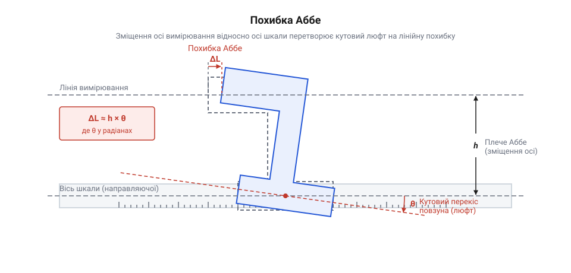
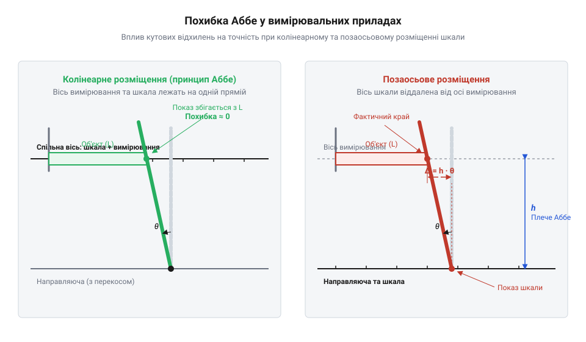
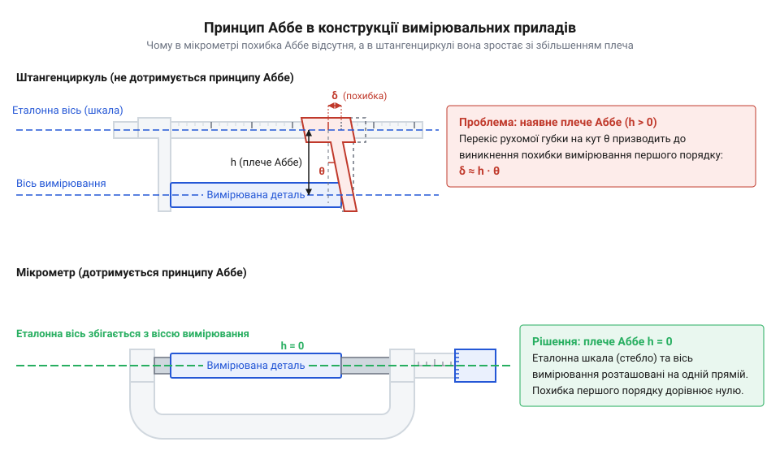

# Похибка Аббе у вимірювальних приладах

<preknowlist>
- [Штангенциркуль](root:cat-hw-instruments/vernier-caliper) — будова винесених вимірювальних губок та принципи роботи ноніусного механізму
- [Мікрометр](root:cat-hw-instruments/micrometer) — гвинтовий механізм та колінеарне розташування вимірювальних поверхонь
</preknowlist>

## Непомітний перекос і хибні вимірювання

Під час точних вимірювань виникає парадокс: прилад має шкалу з мікронною роздільністю, проте похибка сягає десятків мікрометрів. Причина полягає в механіці. Будь-яка механічна напрямна (англ. @@en|guideway@@, від англ. *guide* — вести, та *way* — шлях) має мікролюфти та зазори. Через них вимірювальна каретка під час руху повертається на малий кут — кутове відхилення (англ. @@en|angular deviation@@, від лат. *de-* — від-, та *via* — шлях).

Якщо контакт лежить на осі шкали, поворот майже не впливає на показ. Проте коли контакт винесено вбік, відстань між віссю шкали та лінією вимірювання утворює важіль — плече Аббе (англ. @@en|Abbe offset@@, від імені німецького фізика @@de|Ernst Abbe@@ та англ. *offset* — зміщення вбік) довжиною `h`. Перекіс каретки на кут `θ` зміщує контакт уздовж осі вимірювання, породжуючи похибку Аббе (англ. @@en|Abbe error@@, від лат. *error* — хиба).

Знайдемо поздовжнє зміщення контакту `ΔL` через плече Аббе `h` та кут перекосу `θ`:

```
ΔL = h · tan(θ)
   ≈ h · θ          [для малих кутів у радіанах: tan(θ) ≈ θ]
```

Отриманий вираз визначає лінійну похибку першого порядку, прямо пропорційну величині плеча `h`.


*Кутове відхилення каретки на кут θ зміщує винесену точку контакту на величину ΔL через плече h.*

**Розрахунок похибки при перекосі каретки**

Нехай контакт винесено на плече `h = 50 mm`, а кутовий перекіс становить `0.01°` (`θ ≈ 0.000175 rad`):

```
ΔL = 50 mm × 0.000175 rad
   = 0.00875 mm     [добуток плеча на кут]
   ≈ 8.8 μm         [переведення в мікрометри]
```

Непомітний перекіс у соту частку градуса спричиняє похибку майже `9 μm`. До того ж вимірювальне зусилля створює згинальний момент на плечі `h`, деформуючи губки. Для контролю таких похибок метрологи застосовують калібровані [кінцеві міри довжини](root:cat-hw-instruments/gauge-blocks).

## Геометрична суть принципу Аббе

Усунути похибку @@en|Abbe error@@ лише вдосконаленням напрямних неможливо: рухоме з'єднання потребує зазору для ковзання, а затягування викликає тертя і знос.

Геометричний розв'язок запропонував @@de|Ernst Abbe@@: ліквідувати сам важіль похибки. Сформульований ним принцип Аббе (англ. @@en|Abbe principle@@, від лат. *principium* — початок, основа) вимагає: еталонна шкала приладу та лінія вимірювання повинні лежати на одній прямій, тобто бути колінеарними (англ. @@en|collinear@@, від лат. *col-* — разом, та *linea* — лінія).


*Колінеарне розміщення зводить плече Аббе до нуля й виключає зміщення першого порядку, тоді як позаосьова схема породжує похибку.*

Коли лінія зчитування збігається з віссю вимірювання, плече Аббе стає нульовим: `h = 0`. У формулі `ΔL ≈ h · θ` добуток перетворюється на нуль незалежно від кута `θ`. Каретка обертається навколо самої осі вимірювання, тому контакт не має зміщення вздовж вимірюваного розміру.

Залишковий ефект визначає похибка другого порядку `ΔL₂ ≈ L · θ² / 2` від косинусного скорочення проекції деталі `L`. Для кута `θ = 0.01°` на довжині `100 mm` вона становить лише `1.5 nm`. Зміна геометрії усуває похибку в її фізичній першопричині.

## Порівняння мікрометра та штангенциркуля

Конструкція ручних інструментів наочно ілюструє геометричний захист.

У [типовому штангенциркулі](root:cat-hw-instruments/vernier-caliper) принцип Аббе порушено конструктивно. Шкала лежить на штанзі, а вимірюють винесеними губками з плечем `h = 30…80 mm`. Будь-який люфт рамки спричиняє перекіс. Через це точність залежить від місця затискання: контакт на кінчиках губок дає максимальне плече `h` і найбільшу похибку `δ ≈ h · θ`. Зсув деталі до штанги зменшує важіль `h` та похибку. До того ж зусилля пальця згинає губки, додаючи деформацію.


*У штангенциркулі винесені губки формують плече Аббе h, а в мікрометрі вимірювальний шпиндель і шкала лежать на одній осі вимірювання.*

Натомість у [класичному мікрометрі](root:cat-hw-instruments/micrometer) втілено колінеарність. Шпиндель, мікрометричний гвинт і шкала лежать на спільній осі вимірювання (`h = 0`). Мікролюфт у різьбі викликає лише поворот торця шпинделя, не створюючи лінійного зміщення показань. Вимірювальне зусилля діє суворо вздовж осі без згинального моменту.

Штангенциркуль має похибку `0.02–0.05 mm`, тоді як мікрометр гарантує `0.001–0.002 mm`. Подібне співвісне розташування мають [індикатори годинникового типу](root:cat-hw-instruments/dial-indicator), де щуп рухається вздовж лінії вимірювання.