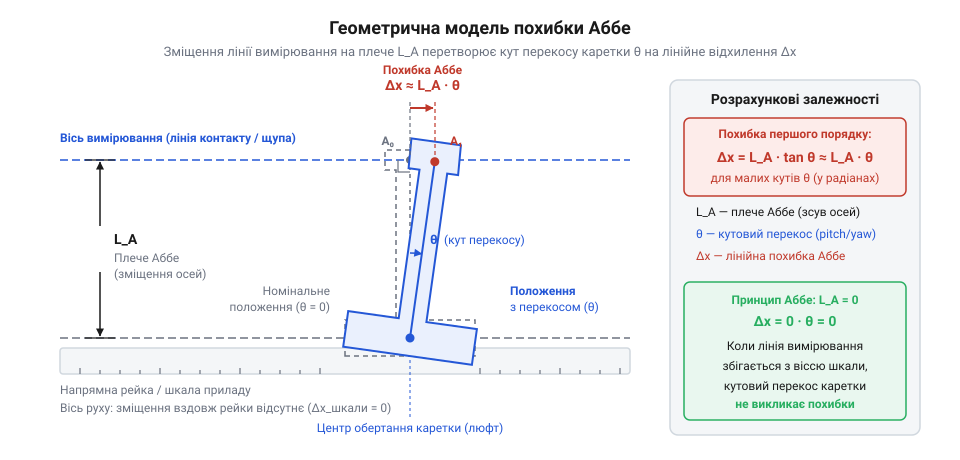
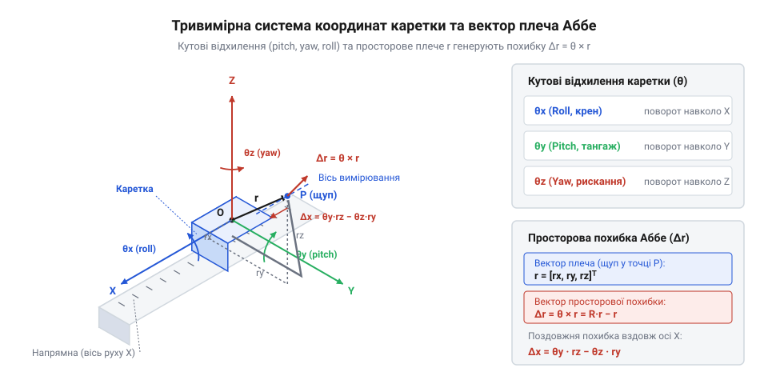

# Математичне та геометричне моделювання похибки Аббе

<preknowlist>
- [Штангенциркуль](root:cat-hw-instruments/vernier-caliper) — як класичний приклад конструкції, де порушується принцип Аббе через винесені вимірювальні губки.
- [Мікрометр](root:cat-hw-instruments/micrometer) — як базовий приклад інструменту, де принцип Аббе дотримується, оскільки вісь шкали збігається з віссю вимірювання.
</preknowlist>

## Природа виникнення похибки Аббе

У вимірювальних приладах часто виникає ситуація, коли шкала або механізм зчитування не лежить на одній прямій із деталлю, яку ми вимірюємо. Це просторове рознесення осі вимірювання та осі руху напрямної створює геометричне плече, яке називають плечем Аббе. На перший погляд, якщо напрямна абсолютно рівна і каретка рухається ідеально прямо, зміщення осі не має значення: обидві лінії паралельні і проходять однаковий шлях. Проблема з'являється тоді, коли в русі виникають навіть найменші кутові відхилення — нахили або перекоси. Жодна механічна напрямна не буває геометрично досконалою: навіть прецизійне шліфування залишає мікронерівності та хвилястість профілю. Опори каретки ковзають по окремих виступах мікрорельєфу різної висоти, що змушує рухомий вузол безперервно перекошуватися на частки мікрометра. З часом до цього додається нерівномірне механічне зношення поверхонь: на ділянках найчастішого ходу метал стирається сильніше, профіль напрямної просідає, а збільшені робочі зазори дають каретці додаткову свободу для перекосу.

Коли каретка нахиляється під час руху, вісь вимірювання описує дугу відносно осі руху. Через наявність плеча Аббе цей мікроскопічний нахил перетворюється на відчутне лінійне зміщення на кінці плеча. Відстань, яку реально проходить вимірювальний щуп, стає більшою або меншою за ту, яку фіксує шкала на осі напрямної. Це явище, коли кутова похибка напрямної множиться на відстань між осями, утворюючи лінійну помилку вимірювання, називають @@de|Abbescher Fehler@@ (похибкою Аббе).

*Вісь вимірювання рознесена з віссю руху на величину плеча Аббе, через що кутовий нахил каретки призводить до лінійної похибки на вимірювальному щупі.*

Найгірше те, що цю помилку неможливо виявити за показаннями самої шкали, оскільки датчик на осі руху фіксує ідеальне переміщення. Чим більше плече Аббе, тим більшу похибку генерує той самий кут нахилу напрямної. Якщо механізм не може забезпечити ідеальну прямолінійність без нахилів, єдиний спосіб уникнути цієї похибки — звести плече Аббе до нуля, тобто сумістити вісь вимірювання з віссю шкали.

## Математичний апарат першого порядку

Щоб кількісно оцінити похибку Аббе для плоских систем, розглянемо двовимірну модель, де рух відбувається вздовж осі `x`, а вісь вимірювання зміщена вздовж осі `y` на відстань `h` (плече Аббе). Якщо каретка під час руху нахиляється на малий кут `θ` навколо осі `z` (це так званий кут рискання, або @@en|yaw@@), точка вимірювання зміщується від свого ідеального положення.

Знайдемо це лінійне зміщення вздовж осі вимірювання `x`. Геометрично точка на кінці плеча `h` описує дугу радіуса `h` при повороті на кут `θ`. Похибка вимірювання `Δx` є різницею між реальною координатою та ідеальною.

        Δx
        = h · tan(θ)             [з прямокутного трикутника, утвореного нахилом каретки]
        ≈ h · θ                  [для малих кутів тангенс кута в радіанах наближено дорівнює самому куту]

Ця формула показує базову похибку Аббе першого порядку: помилка прямо пропорційна довжині плеча `h` і куту нахилу `θ`. Лінійна залежність означає, що похибка зростає симетрично як при додатних, так і при від'ємних кутах перекосу, і є головним джерелом вимірювальної невизначеності в інструментах із рознесеними осями, наприклад, у [штангенциркулі](root:cat-hw-instruments/vernier-caliper).

Для повноцінного аналізу тривимірних систем вимірювання цього недостатньо. Каретка може нахилятися в просторі за трьома кутами: рискання (yaw) `θ_z`, тангаж (@@en|pitch@@) `θ_y` та хитання (@@en|roll@@) `θ_x`. Плече Аббе також стає просторовим вектором `r = (h_x, h_y, h_z)`.

*Три кутові ступені свободи каретки утворюють просторові повороти, кожен з яких по-різному впливає на зміщення точки вимірювання залежно від напрямку вектора плеча Аббе.*

Щоб знайти вектор похибки `Δr = (Δx, Δy, Δz)`, застосуємо векторний підхід. Проте у тривимірному просторі скінченні повороти не є векторами: результат обертання тіла навколо кількох осей залежить від послідовності цих дій. Якщо повернути об'єкт спочатку навколо осі `x`, а потім навколо `y`, він набуде іншої орієнтації, ніж за зворотної послідовності поворотів. Оскільки додавання векторів не залежить від порядку доданків, операції з непереставним результатом не можна об'єднати у вектор. Ситуація змінюється, коли кутові перекоси каретки мікроскопічні — частки кутової мінути або мілірадіани. Для таких кутів перехресні добутки мають другий порядок малості, тому ними можна знехтувати. У результаті черговість нахилів більше не впливає на кінцеву орієнтацію каретки. Завдяки цьому малі повороти стають комутативними (від лат. @@la|commutare@@ — міняти місцями, змінювати) і поводяться як звичайні вектори. Для великих кутів ця властивість руйнується і векторний опис ламається, проте в межах жорстких вимірювальних напрямних лінійне наближення діє бездоганно. Це дозволяє описати сумарний нахил каретки єдиним вектором малих поворотів `θ = (θ_x, θ_y, θ_z)`. Лінійне зміщення точки, віддаленої на вектор `r` від центру обертання, дорівнює їхньому векторному добутку.

        Δr
        = θ × r                  [векторний добуток вектора поворотів на вектор плеча]
        = (θ_y · h_z - θ_z · h_y, θ_z · h_x - θ_x · h_z, θ_x · h_y - θ_y · h_x)  [розкриття визначника векторного добутку]

У цьому результаті видно, що похибка вздовж будь-якої осі залежить від перехресних складових. Наприклад, зміщення `Δx` генерується нахилами `θ_y` та `θ_z`, якщо існують відповідні плечі `h_z` та `h_y`. Кут хитання `θ_x` не впливає на похибку `Δx`, оскільки він обертає систему навколо осі руху, не зміщуючи її вздовж цієї ж осі.

## Просторова матриця трансформації
У реальних вимірювальних машинах і верстатах каретка рідко нахиляється лише в одній площині. Рухаючись уздовж напрямної, вона одночасно зазнає відхилень навколо всіх трьох осей: кут тангажу (@@en|pitch@@), кут рискання (@@en|yaw@@) та кут крену (@@en|roll@@). Щоб знайти повний вектор похибки Аббе в просторі, плоского наближення `Δx ≈ h · θ` вже недостатньо. Нам потрібен інструмент, який об'єднає всі три кутові похибки з усіма трьома складовими плеча Аббе (вильоту інструмента) в єдиний розрахунок. Таким інструментом є просторова матриця трансформації.

Матриця трансформації переводить координати точки з локальної системи відліку каретки в глобальну систему координат верстата. Якщо каретка ідеальна, ця матриця містить лише лінійне переміщення. Але через кутові похибки напрямних локальна система координат злегка повертається відносно глобальної. Цей поворот описується матрицею обертання, яка складається з трьох послідовних поворотів навколо осей X, Y та Z.

Оскільки кутові відхилення напрямних зазвичай дуже малі (одиниці або десятки кутових секунд), ми можемо використати наближення малих кутів: синус малого кута дорівнює самому куту в радіанах (`sin(θ) ≈ θ`), а косинус дорівнює одиниці (`cos(θ) ≈ 1`). Добуток двох малих кутів дає настільки мізерну величину, що нею можна знехтувати. Це дозволяє нам суттєво спростити матрицю обертання `R`. 

Замість складної матриці з тригонометричними функціями ми отримуємо лінійну матрицю:

        R
        = [1, -θz, θy; θz, 1, -θx; -θy, θx, 1]      [матриця повороту для малих кутів]

Тут `θx` — кут крену (навколо осі руху X), `θy` — кут тангажу, а `θz` — кут рискання. 

Плече Аббе — це вектор `r`, який вказує від центру обертання (точки опори на напрямну) до точки вимірювання (наприклад, кінчика щупа). Нехай він має координати `[rx, ry, rz]`. Щоб знайти зміщення цієї точки через нахил, ми множимо матрицю `R` на вектор `r` і віднімаємо початкове положення вектора `r`. 

        Δr
        = R · r - r                                 [зміщення як різниця нового і старого положень]
        = [1, -θz, θy; θz, 1, -θx; -θy, θx, 1] · [rx, ry, rz]^T - [rx, ry, rz]^T
        = [rx - θz·ry + θy·rz, θz·rx + ry - θx·rz, -θy·rx + θx·ry + rz]^T - [rx, ry, rz]^T
        = [-θz·ry + θy·rz, θz·rx - θx·rz, -θy·rx + θx·ry]^T

Результат — це і є вектор тривимірної похибки Аббе. Його можна записати ще коротше через векторний добуток, як ви вже бачили раніше: `Δr = θ × r`, де вектор кутів `θ = [θx, θy, θz]`. 

З цієї матриці добре видно, як саме кути і плечі взаємодіють. Похибка по осі X (поздовжня) залежить від кута рискання `θz` та плеча `ry`, а також від кута тангажу `θy` та плеча `rz`. Кут крену `θx` взагалі не впливає на поздовжню похибку Аббе, оскільки обертання відбувається навколо самої осі X. Цей факт має ключове значення для проєктування: якщо вимірювальна система чутлива лише до похибок уздовж осі руху, ви можете ігнорувати крен, але мусите жорстко контролювати тангаж і рискання.

З іншого боку, якщо ви будуєте тривимірну вимірювальну машину, що зчитує координати за всіма трьома осями, поперечні зміщення стають такими ж критичними. Наприклад, зміщення по осі Y залежить від рискання `θz` та плеча `rx`, а також від крену `θx` та плеча `rz`. Тут принцип Аббе вимагає мінімізації плечей у всіх трьох вимірах, що на практиці виконати неможливо — щуп завжди винесений у простір. Саме тому в сучасних координатних машинах похибки вимірюють лазерними інтерферометрами, записують у карту корекції та на льоту компенсують їх, множачи координати на описану матрицю в програмному забезпеченні.

## Похибки другого порядку та деформації
Лінійна залежність `Δx = h · θ` описує головну, найбільшу частину похибки. Вона належить до похибок першого порядку, оскільки залежить від кута в першому степені. Але що станеться, якщо ми ідеально виконаємо принцип Аббе? Тобто якщо точка вимірювання лежатиме точно на осі напрямної, і плече `h` дорівнюватиме нулю? Чи зникне похибка повністю?

Геометрія показує, що похибка не зникає, а переходить у другий порядок. Уявіть вісь вимірювання і шкалу. Вони лежать на одній прямій. Тепер через дефект напрямної рухома каретка зі шкалою нахиляється на кут `θ`. При цьому шкала більше не паралельна осі вимірювання. Відстань, яку проходить каретка, відкладається вздовж нахиленої шкали. Реальне ж зміщення вздовж осі вимірювання є проєкцією цього шляху.

Похибка виникає через те, що косинус кута не дорівнює точно одиниці. 

        Δx_косинусна
        = L - L · cos(θ)                            [різниця між пройденим шляхом і його проєкцією]
        = L · (1 - cos(θ))                          [групування]

Оскільки для малих кутів розклад у ряд Тейлора дає `cos(θ) ≈ 1 - θ²/2`, ми можемо оцінити величину цієї похибки:

        Δx_косинусна
        ≈ L · (1 - (1 - θ²/2))                      [підстановка наближення косинуса]
        = L · θ² / 2                                [кінцева формула косинусної похибки]

Це і є косинусна похибка. Вона залежить від квадрата кута. Оскільки кут `θ` сам по собі дуже малий (наприклад, `0.0001` радіана), його квадрат (`0.00000001`) робить косинусну похибку на порядки меншою за похибку Аббе. Якщо похибка першого порядку становить мікрометри, похибка другого порядку — це нанометри. Саме тому дотримання принципу Аббе вважається таким ефективним: воно знищує величезну лінійну похибку, залишаючи лише непомітну квадратичну.

Але кути перекосу виникають не лише через кривизну самих напрямних. Механічна система має люфти в підшипниках та пружність матеріалу. Коли каретка рухається, зусилля приводу рідко прикладається точно в центрі мас і центрі тертя. Виникає перекидальний момент, який вибирає люфти і згинає конструкцію.

Уявіть, що каретку штовхає гвинт, розташований збоку від напрямної. Сила тертя діє на напрямній, а сила тяги — на гвинті. Утворюється пара сил, яка намагається розвернути каретку навколо вертикальної осі (викликає рискання). Величина цього розвороту обмежується лише зазорами в підшипниках та жорсткістю самої каретки. Щойно напрямок руху змінюється, сила тертя розвертається у зворотний бік, і каретка перекошується в іншому напрямку. 

Пружні деформації працюють подібно. Якщо плече Аббе велике, а вимірювальне зусилля на кінці щупа зростає, конструкція працює як важіль. Сама деталь або стійка мікрометра згинається. Математично це моделюється додаванням ще одного компонента до вектора похибки, де кут нахилу `θ` стає не константою для даної точки напрямної, а функцією від прикладеного зусилля. 

Загальна вимірювальна невизначеність машини вимагає підсумовування всіх цих ефектів. Для цього використовують середньоквадратичне додавання незалежних складових. Але похибка Аббе через кривизну і похибка через пружний перекіс від тертя часто є корельованими або мають постійний напрямок. Тому їх доводиться додавати алгебрично (з урахуванням знака), що може як компенсувати, так і збільшити сумарну похибку. Розуміння цих складових дозволяє конструкторам розносити підшипники ширше, щоб зменшити люфтовий кут, розташовувати привод ближче до осі тертя та збільшувати жорсткість консольних елементів там, де плече Аббе неминуче.